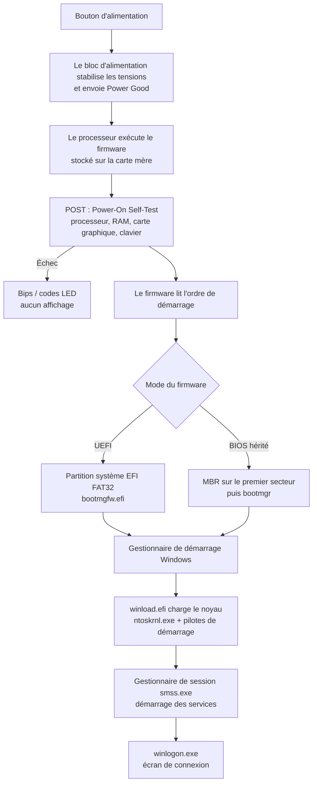

# Démarrage du PC et configuration du BIOS / UEFI

[](README.fr.md)
[](README.md)


| Élément | Contenu |
|---|---|
| **Référent** | Comment un PC démarre, du bouton d'alimentation jusqu'à l'écran de connexion de Windows, et comment modifier les réglages du firmware (BIOS/UEFI) en sécurité. |
| **Émetteur** | **bazeeza** |
| **Message** | Comprendre chaque étape du démarrage pour localiser rapidement une panne au démarrage, puis entrer dans le firmware, changer l'ordre de démarrage et vérifier Secure Boot. |
| **Récepteur** | Techniciens de soutien et techniciens terrain, étudiants en TI. |
| **Canal** | Dépôt GitHub `Bazeeza/Technical-Runbooks` |
| **Code** | Français, rédaction technique (traduction de l'original anglais) |
| **Référence** | [Microsoft: Boot and UEFI](https://learn.microsoft.com/en-us/windows-hardware/drivers/bringup/boot-and-uefi) · [Microsoft: Secure Boot](https://learn.microsoft.com/en-us/windows-hardware/design/device-experiences/oem-secure-boot) · [Suspend-BitLocker](https://learn.microsoft.com/en-us/powershell/module/bitlocker/suspend-bitlocker) · Manuels des fabricants (Dell, HP, Lenovo) |

---

## Objectif

Un technicien qui connaît la séquence de démarrage peut dire **où** un PC s'arrête (« pas de POST », « aucun périphérique de démarrage », « Windows plante pendant le chargement ») au lieu de deviner. Ce runbook explique la séquence, puis montre comment entrer dans le firmware, régler l'ordre de démarrage pour démarrer sur une clé USB, et confirmer que le mode UEFI et Secure Boot sont activés (les deux sont exigés par Windows 11).

## Prérequis

- [ ] Un accès physique au PC et à son alimentation
- [ ] Le mot de passe du firmware (BIOS), si l'organisation en définit un
- [ ] L'autorisation de modifier les réglages : dans un parc géré, les changements de firmware peuvent être contrôlés de façon centrale
- [ ] Si le disque est chiffré avec BitLocker : protection **suspendue** avant tout changement de firmware, et clé de récupération disponible

```powershell
manage-bde -status C:                                   # "Protection On" means BitLocker is active
Suspend-BitLocker -MountPoint 'C:' -RebootCount 1       # administrator; resumes after one restart
```

Les commentaires signifient : « Protection On » veut dire que BitLocker est actif ; commande d'administrateur, la protection reprend après un redémarrage.

---

## La séquence de démarrage



| Étape | Ce qui se passe | En cas d'échec, vous voyez |
|---|---|---|
| **Alimentation** | Le bloc d'alimentation (PSU) stabilise les tensions et prévient la carte mère. | Rien du tout : aucun ventilateur, aucune LED |
| **POST** | Le firmware teste le matériel essentiel. | Des bips, un code LED clignotant, les ventilateurs tournent mais l'écran reste noir |
| **Périphérique de démarrage** | Le firmware cherche un disque amorçable selon l'ordre de démarrage. | `No bootable device`, `Boot device not found` |
| **Gestionnaire de démarrage** | Windows Boot Manager lit la configuration de démarrage (BCD). | `BOOTMGR is missing`, `0xc000000f`, boucle de réparation automatique |
| **Noyau et pilotes** | Windows charge son noyau et ses pilotes. | Écran bleu (BSOD) avec un code d'arrêt, points qui tournent sans fin |
| **Connexion** | Les services démarrent, puis l'écran de connexion apparaît. | Écran noir avec curseur, erreurs de profil |

> [!TIP]
> Notez la **dernière chose qui a fonctionné**. « Le logo Dell apparaît, puis `No bootable device` » veut dire que le POST est passé et que le problème vient du disque ou de l'ordre de démarrage, pas de la RAM.

### UEFI ou BIOS hérité

| | UEFI (moderne) | BIOS hérité (ancien) |
|---|---|---|
| Table de partitions | **GPT** | MBR |
| Taille maximale du disque de démarrage | Aucune limite pratique | 2 To |
| Secure Boot | Oui | Non |
| Windows 11 | **Obligatoire** | Non pris en charge |

---

## Étape 1 — Entrer dans la configuration du firmware

### Option A — Depuis Windows (la plus fiable)

Le démarrage rapide saute souvent la fenêtre de détection du clavier : appuyer sur une touche à l'allumage peut donc ne pas fonctionner. Depuis Windows :

1. **Paramètres → Système → Récupération → Démarrage avancé → Redémarrer maintenant**
2. **Dépannage → Options avancées → Changer les paramètres du microprogramme UEFI → Redémarrer**

Ou, dans un terminal **administrateur** :

```powershell
shutdown /r /fw /t 0   # restart directly into the firmware setup
```

Le commentaire signifie : redémarrer directement dans la configuration du firmware.

### Option B — Touche à l'allumage

Allumez le PC et appuyez plusieurs fois sur la touche dès que le logo apparaît.

| Fabricant | Configuration du firmware | Menu de démarrage ponctuel |
|---|---|---|
| Dell | `F2` | `F12` |
| HP | `Esc` puis `F10` | `Esc` puis `F9` |
| Lenovo ThinkPad / ThinkCentre | `F1` (`Enter` d'abord sur certains portables) | `F12` |
| Lenovo IdeaPad | `F2` ou le bouton Novo | `F12` |
| ASUS | `Del` ou `F2` | `F8` (bureau) / `Esc` (portable) |
| Acer | `F2` | `F12` (à activer dans la configuration) |
| MSI | `Del` | `F11` |
| Gigabyte | `Del` | `F12` |

---

## Étape 2 — Démarrer une seule fois sur une clé USB (recommandé)

Utilisez le **menu de démarrage ponctuel** (tableau ci-dessus) et choisissez la clé USB. On évite ainsi de changer l'ordre de démarrage permanent : le PC revient à la normale au redémarrage suivant.

**Résultat attendu :** l'installateur ou l'outil de la clé USB démarre.

## Étape 3 — Changer l'ordre de démarrage permanent (si nécessaire)

1. Entrez dans la configuration du firmware.
2. Trouvez **Boot**, **Boot Sequence** ou **Boot Priority**.
3. Placez le périphérique voulu en haut. Gardez **Windows Boot Manager** juste après.
4. **Enregistrez et quittez** (souvent `F10`).

> [!WARNING]
> Une fois le travail terminé, remettez **Windows Boot Manager** en première place. Une clé USB oubliée en haut de la liste peut bloquer le démarrage suivant ou lancer une installation non voulue.

## Étape 4 — Vérifier le mode UEFI et Secure Boot

Dans Windows, lancez `msinfo32` et lisez le **Résumé système** :

| Champ | Valeur attendue |
|---|---|
| Mode BIOS (BIOS Mode) | `UEFI` |
| État du démarrage sécurisé (Secure Boot State) | `On` (Activé) |

En PowerShell (administrateur) :

```powershell
Confirm-SecureBootUEFI        # True = Secure Boot active, an error = legacy BIOS mode
Get-Tpm | Select-Object TpmPresent, TpmReady   # TPM 2.0 is also required by Windows 11
```

Les commentaires signifient : `True` = Secure Boot actif, une erreur = mode BIOS hérité ; le TPM 2.0 est aussi exigé par Windows 11.

Si Secure Boot est `Off`, activez-le dans le firmware sous **Security** ou **Boot → Secure Boot**.

> [!CAUTION]
> Ne passez jamais une installation fonctionnelle du mode Legacy au mode UEFI dans le firmware sans avoir d'abord converti le disque (`mbr2gpt /validate` puis `mbr2gpt /convert`, depuis Windows). Sinon Windows ne démarrera plus. Suspendez BitLocker avant tout changement de firmware, sinon le PC demandera la clé de récupération.

---

## Vérification

- [ ] Le PC démarre Windows normalement après les changements
- [ ] `msinfo32` affiche `UEFI` et Secure Boot `On`
- [ ] Windows Boot Manager est en premier dans l'ordre de démarrage
- [ ] La protection BitLocker a repris (`manage-bde -status`)

## Dépannage

| Symptôme | Cause probable | Correction |
|---|---|---|
| La touche de configuration ne fait rien, Windows démarre normalement | Le démarrage rapide saute la fenêtre du clavier | Utiliser l'option A (`shutdown /r /fw /t 0`) |
| La clé USB n'apparaît pas dans le menu de démarrage | Clé créée seulement pour le BIOS hérité, ou démarrage USB désactivé | Recréer la clé en mode GPT/UEFI ; activer le démarrage USB dans le firmware |
| Le PC demande la clé de récupération BitLocker après le changement | Réglage du firmware modifié alors que BitLocker était actif | Saisir la clé de 48 chiffres, puis suspendre BitLocker avant le prochain changement |
| `Confirm-SecureBootUEFI` renvoie `False` | Mode UEFI, mais Secure Boot désactivé | Activer Secure Boot dans le firmware (étape 4) |
| `Confirm-SecureBootUEFI` renvoie une erreur | Mode BIOS hérité, ou PC sans UEFI | Convertir le disque avec `mbr2gpt` avant de passer en UEFI (voir la mise en garde de l'étape 4) |
| Le PC ne démarre pas du tout | Panne d'alimentation, de POST, de disque ou de Windows | Suivre le [guide de dépannage « le PC ne démarre pas »](TROUBLESHOOTING.md) |

## Retour arrière

- **Ordre de démarrage :** remettre **Windows Boot Manager** en première place et enregistrer (`F10`).
- **Tout autre réglage du firmware :** la plupart des configurations proposent **Load Optimized Defaults** ou **Restore Defaults** ; notez d'abord les valeurs d'origine, car les valeurs par défaut peuvent désactiver des réglages exigés par l'organisation (TPM, Secure Boot, virtualisation).
- **BitLocker :** s'il a été suspendu sans nombre de redémarrages, le réactiver avec `Resume-BitLocker -MountPoint 'C:'`.

---

<sub>Écrit par bazeeza · Vous avez trouvé une erreur ? <a href="https://github.com/Bazeeza/Technical-Runbooks/issues/new?template=runbook-error.yml">Signalez-la ici</a>.</sub>
