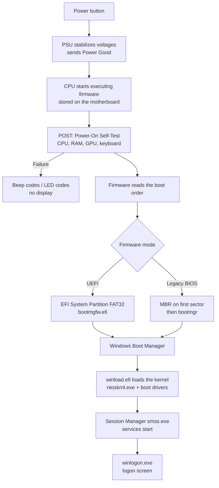

# PC Boot Process and BIOS / UEFI Configuration


| Element | Content |
|---|---|
| **Referent** | How a PC starts, from the power button to the Windows logon screen, and how to change firmware (BIOS/UEFI) settings safely. |
| **Sender** | **Bariu Azeez** |
| **Message** | Understand each stage of the boot so a startup failure can be located quickly, then enter the firmware, change the boot order and check Secure Boot. |
| **Receiver** | Help desk and field technicians, IT students. |
| **Channel** | GitHub repository `Bazeeza/Technical-Runbooks` |
| **Code** | English, technical writing |
| **Reference** | [Microsoft: Boot and UEFI](https://learn.microsoft.com/en-us/windows-hardware/drivers/bringup/boot-and-uefi) · [Microsoft: Secure Boot](https://learn.microsoft.com/en-us/windows-hardware/design/device-experiences/oem-secure-boot) · Manufacturer manuals (Dell, HP, Lenovo) |

---

## Objective

A technician who knows the boot sequence can say **where** a PC stops ("no POST", "no boot device", "Windows crashes while loading") instead of guessing. This runbook explains the sequence, then shows how to enter the firmware, set the boot order to start from a USB key, and confirm that UEFI mode and Secure Boot are enabled (both required by Windows 11).

## Prerequisites

- [ ] Physical access to the PC and its power supply
- [ ] The firmware (BIOS) password, if the organization sets one
- [ ] Permission to change settings: on a managed fleet, firmware changes may be controlled centrally

---

## 1. The boot sequence



| Stage | What happens | If it fails, you see |
|---|---|---|
| **Power** | The power supply (PSU) stabilizes voltages and signals the motherboard. | Nothing at all: no fans, no LEDs |
| **POST** | The firmware tests the essential hardware. | Beeps, blinking LED code, fans spin but black screen |
| **Boot device** | The firmware looks for a bootable disk following the boot order. | `No bootable device`, `Boot device not found` |
| **Boot manager** | Windows Boot Manager reads the boot configuration (BCD). | `BOOTMGR is missing`, `0xc000000f`, automatic repair loop |
| **Kernel and drivers** | Windows loads its kernel and drivers. | Blue screen (BSOD) with a stop code, spinning dots forever |
| **Logon** | Services start, then the logon screen appears. | Black screen with cursor, profile errors |

> [!TIP]
> Note the **last thing that worked**. "The Dell logo appears, then `No bootable device`" means POST passed and the problem is the disk or the boot order, not the RAM.

### UEFI vs legacy BIOS

| | UEFI (modern) | Legacy BIOS (old) |
|---|---|---|
| Partition table | **GPT** | MBR |
| Max boot disk size | No practical limit | 2 TB |
| Secure Boot | Yes | No |
| Windows 11 | **Required** | Not supported |

---

## 2. Enter the firmware setup

### Method A: from Windows (most reliable)

Fast Startup often skips the keyboard detection window, so pressing a key at power-on may not work. From Windows:

1. **Settings → System → Recovery → Advanced startup → Restart now**
2. **Troubleshoot → Advanced options → UEFI Firmware Settings → Restart**

Or, in an **administrator** terminal:

```powershell
shutdown /r /fw /t 0   # restart directly into the firmware setup
```

### Method B: key at power-on

Turn the PC on and tap the key repeatedly as soon as the logo appears.

| Manufacturer | Firmware setup | One-time boot menu |
|---|---|---|
| Dell | `F2` | `F12` |
| HP | `Esc` then `F10` | `Esc` then `F9` |
| Lenovo ThinkPad / ThinkCentre | `F1` (`Enter` first on some laptops) | `F12` |
| Lenovo IdeaPad | `F2` or the Novo button | `F12` |
| ASUS | `Del` or `F2` | `F8` (desktop) / `Esc` (laptop) |
| Acer | `F2` | `F12` (must be enabled in setup) |
| MSI | `Del` | `F11` |
| Gigabyte | `Del` | `F12` |

---

## 3. Boot once from a USB key (preferred)

Use the **one-time boot menu** (table above) and pick the USB key. This avoids changing the permanent boot order, so the PC returns to normal on the next restart.

**Expected result:** the installer or tool on the USB key starts.

## 4. Change the permanent boot order (if needed)

1. Enter the firmware setup.
2. Find **Boot**, **Boot Sequence** or **Boot Priority**.
3. Move the wanted device to the top. Keep **Windows Boot Manager** right after it.
4. **Save and exit** (often `F10`).

> [!WARNING]
> Once the job is done, put **Windows Boot Manager** back in first place. A forgotten USB key at the top of the list can block the next startup or start an unwanted installation.

## 5. Check UEFI mode and Secure Boot

In Windows, run `msinfo32` and read the **System Summary**:

| Field | Expected value |
|---|---|
| BIOS Mode | `UEFI` |
| Secure Boot State | `On` |

In PowerShell (administrator):

```powershell
Confirm-SecureBootUEFI        # True = Secure Boot active, an error = legacy BIOS mode
Get-Tpm | Select-Object TpmPresent, TpmReady   # TPM 2.0 is also required by Windows 11
```

If Secure Boot is `Off`, enable it in the firmware under **Security** or **Boot → Secure Boot**.

> [!CAUTION]
> Never switch a working installation from Legacy to UEFI in the firmware without converting the disk first (`mbr2gpt /validate` then `mbr2gpt /convert`, from Windows). Otherwise Windows will not start. Suspend BitLocker before any firmware change, or the PC will ask for the recovery key.

---

## Verification

- [ ] The PC starts Windows normally after the changes
- [ ] `msinfo32` shows `UEFI` and Secure Boot `On`
- [ ] Windows Boot Manager is first in the boot order
- [ ] BitLocker protection is resumed (`manage-bde -status`)

## Next step

When the PC does not start at all, follow [TROUBLESHOOTING.md](TROUBLESHOOTING.md).

---

<sub>Written by Bariu Azeez · Found an error? Open an issue.</sub>
