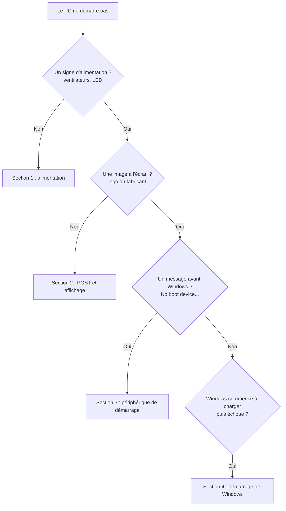

# Dépannage : le PC ne démarre pas

[](TROUBLESHOOTING.fr.md)
[](TROUBLESHOOTING.md)


| Élément | Contenu |
|---|---|
| **Référent** | Diagnostic d'un PC qui n'atteint pas l'écran de connexion de Windows. |
| **Émetteur** | **bazeeza** |
| **Message** | Localiser d'abord l'étape du démarrage qui échoue, puis appliquer la correction correspondante, de la moins invasive à la plus invasive. |
| **Récepteur** | Techniciens de soutien et techniciens terrain. |
| **Canal** | Dépôt GitHub `Bazeeza/Technical-Runbooks` |
| **Code** | Français, rédaction technique (traduction de l'original anglais) |
| **Référence** | [Microsoft: Advanced troubleshooting for Windows boot problems](https://learn.microsoft.com/en-us/troubleshoot/windows-client/performance/windows-boot-issues-troubleshooting) · [Windows Recovery Environment](https://learn.microsoft.com/en-us/windows-hardware/manufacture/desktop/windows-recovery-environment--windows-re--technical-reference) |

---

## Objectif

Rendre au PC un démarrage fonctionnel **sans perdre les données de l'utilisateur**, en identifiant l'étape exacte où le démarrage s'arrête (voir la [séquence de démarrage](README.fr.md#la-séquence-de-démarrage)) et en escaladant avec des informations précises quand une réparation matérielle est nécessaire.

## Règles d'or

1. **Demander avant de toucher :** qu'est-ce qui a changé récemment ? (mise à jour, nouvel appareil, panne de courant, chute, liquide)
2. **Le moins invasif d'abord :** vérifier les câbles avant d'ouvrir le boîtier, réparer avant de réinstaller.
3. **Protéger les données :** ne jamais formater ni réinitialiser un disque avant d'avoir confirmé que les fichiers de l'utilisateur sont sauvegardés.
4. **Noter** chaque symptôme et chaque action, pour le billet et pour l'escalade.

---

## Arbre de décision



---

## 1. Aucune alimentation

| Vérification | Comment |
|---|---|
| Prise électrique | Brancher un appareil qui fonctionne sur la même prise. Éviter les multiprises pendant le test. |
| Câble d'alimentation | Remplacer par un câble en bon état. Sur un poste fixe, vérifier l'interrupteur arrière du bloc d'alimentation (`I` = allumé). |
| Chargeur de portable | La LED du chargeur est-elle allumée ? Essayer un autre chargeur compatible. Débrancher les périphériques externes. |
| Charge résiduelle | Tout débrancher (et la batterie si elle est amovible), maintenir le bouton d'alimentation **30 secondes**, rebrancher, réessayer. |
| Façade | Sur un poste fixe, le bouton du boîtier peut être déconnecté de la carte mère. |

**Escalader** si rien ne change : panne probable du bloc d'alimentation, du chargeur ou de la carte mère.

## 2. Alimentation mais aucune image (POST)

1. **Comptez les bips** ou les **clignotements de LED** et cherchez le code dans la documentation du fabricant (Dell et HP publient des tableaux de codes LED de diagnostic). Le code indique souvent la pièce en panne (RAM, processeur, carte graphique).
2. **Vérifiez le chemin d'affichage :** écran allumé et réglé sur la bonne entrée, câble bien branché. Sur un poste fixe avec une carte graphique, branchez l'écran **sur la carte**, pas sur la carte mère.
3. **Retirez** tout ce qui n'est pas nécessaire : périphériques USB, stations d'accueil, disques supplémentaires.
4. **Réinsérez la RAM** (appareil éteint et débranché, précautions antistatiques) : retirez et remettez chaque barrette ; testez avec une seule barrette à la fois.
5. Portable : essayez un **écran externe** pour écarter l'écran interne.

> [!WARNING]
> Ouvrir un appareil sous garantie ou un appareil loué peut être interdit. Vérifiez la politique de l'organisation avant de retirer une pièce.

## 3. « No bootable device » / « Boot device not found »

Le POST est passé : le firmware ne trouve aucun disque sur lequel démarrer.

1. Retirez les clés USB et les disques externes, puis redémarrez.
2. Dans la configuration du firmware, vérifiez que le **disque interne est détecté**.
   - Non détecté → panne probable du disque ou de sa connexion. Lancez les diagnostics matériels intégrés du fabricant (Dell : `F12` → Diagnostics ; HP : `F2` ; Lenovo : `F10` sur de nombreux modèles). **Escaladez.**
   - Détecté → placez **Windows Boot Manager** en premier dans l'ordre de démarrage ([README, étape 3](README.fr.md#étape-3--changer-lordre-de-démarrage-permanent-si-nécessaire)).
3. Vérifiez que le mode du firmware n'a pas changé (UEFI ou Legacy) et que le mode SATA n'a pas été modifié (par exemple de RAID/RST à AHCI) : ce changement rend le disque illisible pour Windows.

## 4. Windows commence à charger, puis échoue

Utilisez l'**environnement de récupération Windows (WinRE)**. Il s'ouvre automatiquement après 2 démarrages ratés, ou depuis une clé USB d'installation de Windows (**Réparer l'ordinateur**).

Essayez dans cet ordre :

| # | Option (Dépannage → Options avancées) | Quand |
|---|---|---|
| 1 | **Outil de redémarrage système** (Startup Repair) | Premier essai dans tous les cas |
| 2 | **Désinstaller des mises à jour** | Le problème a commencé après une mise à jour |
| 3 | **Restauration du système** | Un point de restauration existe d'avant le problème |
| 4 | **Paramètres → Mode sans échec** | Pour retirer un pilote ou un logiciel défectueux |
| 5 | **Invite de commandes** (commandes ci-dessous) | Fichiers de démarrage ou système de fichiers endommagés |
| 6 | **Réinitialiser ce PC → Conserver mes fichiers** | Dernier recours, après avoir sauvegardé les données |

### Commandes de réparation (invite de commandes dans WinRE)

> [!IMPORTANT]
> Dans WinRE, la partition Windows n'est souvent **pas** `C:`. Trouvez-la d'abord avec `diskpart` → `list volume` → `exit`. Les commandes ci-dessous utilisent `C:` comme exemple.

```cmd
:: Check and repair the file system
chkdsk C: /f

:: Repair Windows system files (offline mode)
sfc /scannow /offbootdir=C:\ /offwindir=C:\Windows

:: Recreate the boot files on the EFI partition from the Windows installation
bcdboot C:\Windows
```

Les commentaires signifient, dans l'ordre : vérifier et réparer le système de fichiers ; réparer les fichiers système de Windows (mode hors ligne) ; recréer les fichiers de démarrage sur la partition EFI à partir de l'installation de Windows.

Si BitLocker est activé, WinRE demande la **clé de récupération** (48 chiffres). Elle est généralement stockée dans l'Active Directory ou l'Entra ID de l'organisation, ou dans le compte Microsoft de l'utilisateur (aka.ms/myrecoverykey).

### Écran bleu (BSOD)

Notez le **code d'arrêt** (par exemple `INACCESSIBLE_BOOT_DEVICE`, `CRITICAL_PROCESS_DIED`) et le nom du fichier s'il est affiché. Cherchez le code dans la [référence des codes de vérification de bogue](https://learn.microsoft.com/en-us/windows-hardware/drivers/debugger/bug-check-code-reference2) de Microsoft. Des BSOD répétés après une mise à jour de pilote → mode sans échec, puis restaurer la version précédente du pilote dans le Gestionnaire de périphériques.

### Vérification automatique : Get-DiskHealth

Un disque défaillant cause plusieurs symptômes de cette page : *No bootable device*, des erreurs de système de fichiers que `chkdsk` retrouve sans cesse, des blocages au démarrage. Une fois Windows redémarré, la commande `Get-DiskHealth` du module PowerShell [Helpdesk Toolkit](https://github.com/Bazeeza/helpdesk-toolkit) vérifie le disque et l'espace libre en une seule commande (Windows PowerShell 5.1 ou PowerShell 7, lecture seule) :

```powershell
Import-Module .\HelpdeskToolkit\HelpdeskToolkit.psd1
Get-DiskHealth                                              # overall status: OK, Unknown, Warning or Critical
Get-DiskHealth | Select-Object -ExpandProperty Issues       # one line per problem, for the ticket
Get-DiskHealth | Select-Object -ExpandProperty PhysicalDisks | Format-List *
```

Les commentaires signifient : état global (OK, Unknown, Warning ou Critical) ; une ligne par problème, pour le billet.

Un disque physique en `Warning` ou `Critical` est signalé par le disque lui-même (`HealthStatus`) : sauvegardez d'abord les données de l'utilisateur et prévoyez le remplacement avant toute autre réparation. Lancez PowerShell **en tant qu'administrateur** pour voir aussi la température, l'usure et les erreurs de lecture et d'écriture non corrigées. Détails : [référence de Get-DiskHealth](https://github.com/Bazeeza/helpdesk-toolkit/blob/main/docs/commands/Get-DiskHealth.md).

---

## Vérification

- [ ] Le PC atteint l'écran de connexion **deux fois de suite** (un seul bon démarrage peut cacher une panne intermittente)
- [ ] L'utilisateur ouvre ses fichiers et le réseau fonctionne
- [ ] La protection BitLocker est de nouveau active : `manage-bde -status C:` affiche `Protection On`
- [ ] Le disque ne signale aucun problème d'état : `Get-DiskHealth` n'affiche aucun disque physique en `Warning` ou `Critical`
- [ ] Aucune nouvelle erreur critique après la réparation : **Observateur d'événements → Journaux Windows → Système**, niveau *Critique* (événement 41 = arrêt inattendu)

## Informations à donner lors d'une escalade

```text
Appareil / numéro de série  :
Utilisateur et lieu         :
Symptôme (exact)            : ex. « Le logo apparaît, puis 'No bootable device' »
Étape atteinte              : Alimentation / POST / Périphérique de démarrage / Windows
Code de bips ou de LED      :
Changements récents         :
Actions déjà faites         : ex. décharge résiduelle, réinsertion de la RAM, Startup Repair (échec)
Données sauvegardées ?      : Oui / Non / Inconnu
```

Une escalade précise évite de refaire les mêmes tests et fait réparer l'appareil plus vite.

---

<sub>Écrit par bazeeza · Vous avez trouvé une erreur ? <a href="https://github.com/Bazeeza/Technical-Runbooks/issues/new?template=runbook-error.yml">Signalez-la ici</a>.</sub>
