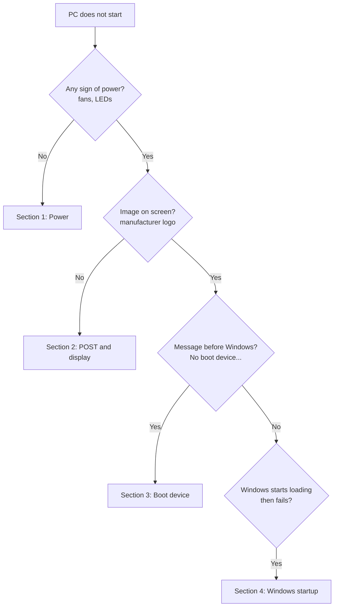

# Troubleshooting: the PC Does Not Start


| Element | Content |
|---|---|
| **Referent** | Diagnosis of a PC that does not reach the Windows logon screen. |
| **Sender** | **Bariu Azeez** |
| **Message** | Locate the failing boot stage first, then apply the matching fix, from the least to the most invasive. |
| **Receiver** | Help desk and field technicians. |
| **Channel** | GitHub repository `Bazeeza/Technical-Runbooks` |
| **Code** | English, technical writing |
| **Reference** | [Microsoft: Advanced troubleshooting for Windows boot problems](https://learn.microsoft.com/en-us/troubleshoot/windows-client/performance/windows-boot-issues-troubleshooting) · [Windows Recovery Environment](https://learn.microsoft.com/en-us/windows-hardware/manufacture/desktop/windows-recovery-environment--windows-re--technical-reference) |

---

## Objective

Bring the PC back to a working startup **without losing user data**, by identifying the exact stage where the boot stops (see the [boot sequence](README.md#1-the-boot-sequence)) and escalating with precise information when a hardware repair is needed.

## Golden rules

1. **Ask before touching:** what changed recently? (update, new device, power outage, drop, liquid)
2. **Least invasive first:** check cables before opening the case, repair before reinstalling.
3. **Protect the data:** never format or reset a disk before confirming that the user's files are backed up.
4. **Write down** every symptom and every action, for the ticket and for escalation.

---

## Decision tree



---

## 1. No power at all

| Check | How |
|---|---|
| Outlet | Plug a known working device into the same outlet. Avoid power strips during the test. |
| Power cable | Swap with a known good cable. On a desktop, check the PSU rear switch (`I` = on). |
| Laptop charger | Charger LED on? Try another compatible charger. Remove external devices. |
| Residual charge | Unplug everything (and the battery if removable), hold the power button **30 seconds**, reconnect, try again. |
| Front panel | On a desktop, the case button may be disconnected from the motherboard. |

**Escalate** if nothing changes: likely PSU, charger, or motherboard failure.

## 2. Power but no image (POST)

1. **Count the beeps** or the **LED blinks** and look up the code in the manufacturer's documentation (Dell and HP publish diagnostic LED tables). The code often names the faulty part (RAM, CPU, GPU).
2. **Check the display path:** monitor on and set to the right input, cable firmly connected. On a desktop with a graphics card, connect the monitor **to the card**, not to the motherboard.
3. **Remove** everything not needed: USB devices, docks, extra drives.
4. **Reseat the RAM** (power off and unplugged, anti-static precautions): remove and reinsert each module; test with one module at a time.
5. Laptop: try an **external monitor** to rule out the internal screen.

> [!WARNING]
> Opening a device under warranty or a leased fleet device may be forbidden. Check the organization's policy before removing any part.

## 3. "No bootable device" / "Boot device not found"

POST passed: the firmware cannot find a disk to start from.

1. Remove USB keys and external disks, then restart.
2. In the firmware setup, check that the **internal disk is detected**.
   - Not detected → likely disk or connection failure. Run the manufacturer's built-in hardware diagnostics (Dell: `F12` → Diagnostics; HP: `F2`; Lenovo: `F10` on many models). **Escalate.**
   - Detected → put **Windows Boot Manager** first in the boot order ([README, step 4](README.md#4-change-the-permanent-boot-order-if-needed)).
3. Check that the firmware mode has not changed (UEFI vs Legacy) and that the SATA mode has not been switched (e.g. from RAID/RST to AHCI): changing it makes the disk unreadable for Windows.

## 4. Windows starts loading, then fails

Use the **Windows Recovery Environment (WinRE)**. It opens automatically after 2 failed startups, or from a Windows installation USB key (**Repair your computer**).

Try in this order:

| # | Option (Troubleshoot → Advanced options) | When |
|---|---|---|
| 1 | **Startup Repair** | First attempt in all cases |
| 2 | **Uninstall Updates** | The problem started after an update |
| 3 | **System Restore** | A restore point exists from before the problem |
| 4 | **Startup Settings → Safe Mode** | To remove a faulty driver or software |
| 5 | **Command Prompt** (commands below) | Damaged boot files or file system |
| 6 | **Reset this PC → Keep my files** | Last resort, after backing up data |

### Repair commands (Command Prompt in WinRE)

> [!IMPORTANT]
> In WinRE, the Windows partition is often **not** `C:`. Find it first with `diskpart` → `list volume` → `exit`. The commands below use `C:` as an example.

```cmd
:: Check and repair the file system
chkdsk C: /f

:: Repair Windows system files (offline mode)
sfc /scannow /offbootdir=C:\ /offwindir=C:\Windows

:: Recreate the boot files on the EFI partition from the Windows installation
bcdboot C:\Windows
```

If BitLocker is enabled, WinRE asks for the **recovery key** (48 digits). It is usually stored in the organization's Active Directory or Entra ID, or in the user's Microsoft account (aka.ms/myrecoverykey).

### Blue screen (BSOD)

Note the **stop code** (for example `INACCESSIBLE_BOOT_DEVICE`, `CRITICAL_PROCESS_DIED`) and the file name if one is shown. Search the code in Microsoft's [bug check reference](https://learn.microsoft.com/en-us/windows-hardware/drivers/debugger/bug-check-code-reference2). Recurring BSODs after a driver update → Safe Mode, then roll back the driver in Device Manager.

---

## Information to give when escalating

```text
Device / serial number :
User and location      :
Symptom (exact)        : e.g. "Logo appears, then 'No bootable device'"
Stage reached          : Power / POST / Boot device / Windows
Beep or LED code       :
Recent changes         :
Actions already done   : e.g. power drain, RAM reseat, Startup Repair (failed)
Data backed up?        : Yes / No / Unknown
```

A precise escalation avoids repeating the same tests and gets the device repaired faster.

---

<sub>Written by Bariu Azeez · Found an error? Open an issue.</sub>
