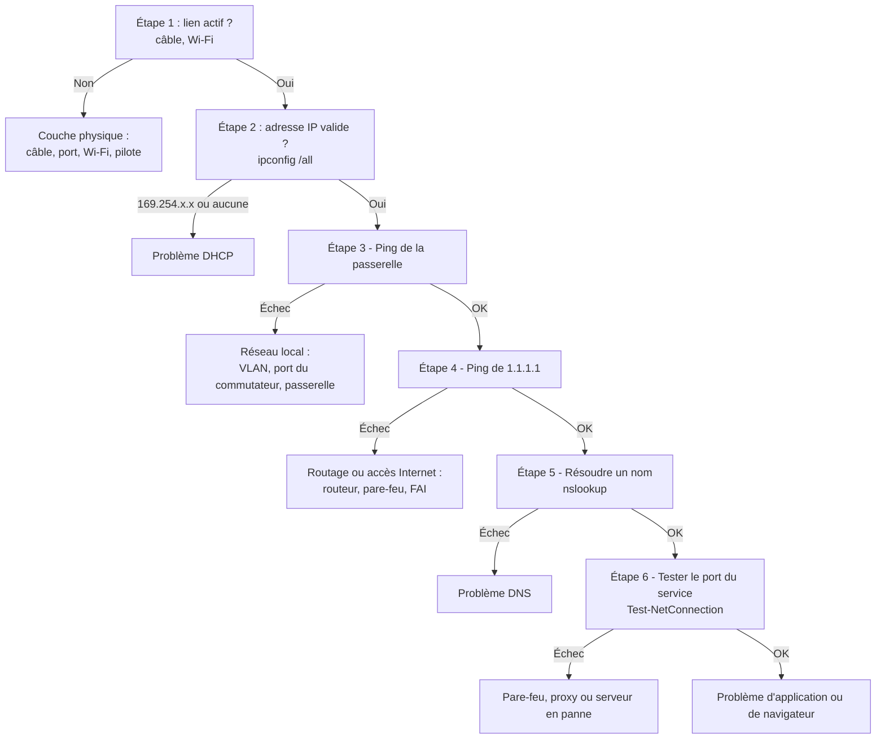

# Dépannage réseau : « Je n'ai pas Internet »

[](README.fr.md)
[](README.md)


| Élément | Contenu |
|---|---|
| **Référent** | Diagnostic structuré d'un poste de travail qui ne joint pas le réseau, Internet ou un service précis. |
| **Émetteur** | **bazeeza** |
| **Message** | Tester le réseau couche par couche, du câble jusqu'à l'application, pour localiser la panne avec des preuves plutôt qu'avec des suppositions. |
| **Récepteur** | Techniciens de soutien, techniciens réseau, étudiants en TI. |
| **Canal** | Dépôt GitHub `Bazeeza/Technical-Runbooks` |
| **Code** | Français, rédaction technique (traduction de l'original anglais) · commandes Windows, équivalents Linux dans l'[aide-mémoire](COMMAND-CHEATSHEET.fr.md) |
| **Référence** | [Microsoft: TCP/IP troubleshooting](https://learn.microsoft.com/en-us/troubleshoot/windows-client/networking/tcpip-troubleshooting) · [Test-NetConnection](https://learn.microsoft.com/en-us/powershell/module/nettcpip/test-netconnection) · méthodologie de dépannage Cisco CCNA |

---

## Objectif

« Pas d'Internet » peut vouloir dire un câble, un échec DHCP, une passerelle, le DNS, un pare-feu ou une panne de serveur. La **méthode ascendante** (*bottom-up*) teste chaque couche du modèle OSI dans l'ordre : une couche ne peut fonctionner que si les couches en dessous fonctionnent. En quelques minutes, le technicien sait **quelle couche est en panne** et la corrige, ou fait une escalade avec des preuves.

## Prérequis

- [ ] Un accès au poste de travail (sur place ou par prise de contrôle à distance)
- [ ] Un terminal : PowerShell ou l'invite de commandes (en administrateur pour les commandes de réparation)
- [ ] Les valeurs réseau attendues, si elles sont connues : sous-réseau, passerelle, serveurs DNS

---

## Étape 0 — Définir la portée

Poser ces questions avant de tester :

| Question | Pourquoi |
|---|---|
| Un utilisateur ou plusieurs ? | Plusieurs utilisateurs → problème de réseau ou de serveur, pas de ce PC |
| Tout, ou un seul site/une seule application ? | Un seul service → DNS, pare-feu ou ce serveur |
| Filaire, Wi-Fi ou RPV (VPN) ? | Chemins différents, causes différentes |
| Depuis quand, après quel changement ? | Mises à jour, déménagement, nouvel équipement |

## Arbre de décision



---

## Étape 1 — Couche physique : y a-t-il un lien ?

- **Filaire :** les voyants de lien de la carte réseau et du port du commutateur sont-ils allumés ? Le câble est-il bien enclenché ? Essayer un autre câble et une autre prise murale.
- **Wi-Fi :** connecté au bon réseau (SSID) ? Mode avion désactivé ? Force du signal correcte ?

```powershell
Get-NetAdapter | Select-Object Name, Status, LinkSpeed, MacAddress
```

**Résultat attendu :** la carte utilisée affiche `Up`. `Disconnected` indique un problème de câble, de port ou de Wi-Fi. `Disabled` veut dire qu'elle a été désactivée : `Enable-NetAdapter -Name "Ethernet"`.

Vérifiez aussi **LinkSpeed** : une carte gigabit liée à `100 Mbps` signale le plus souvent une paire endommagée dans le câble, car le gigabit a besoin des quatre paires. Pour aller plus loin, voir [08 Câblage réseau et terminaison](../08-Network-Cabling-and-Termination/README.fr.md) pour un lien filaire, ou [09 Dépannage Wi-Fi](../09-WiFi-Troubleshooting/README.fr.md) pour un lien sans fil.

## Étape 2 — Configuration IP : le PC a-t-il reçu une adresse ?

```cmd
ipconfig /all
```

Lire la carte active :

| Champ | Normal | Problème |
|---|---|---|
| IPv4 Address | Dans le sous-réseau attendu, par ex. `192.168.10.25` | **`169.254.x.x`** = APIPA : aucun serveur DHCP n'a répondu |
| Subnet Mask | par ex. `255.255.255.0` | Mauvais masque (erreur de configuration statique) |
| Default Gateway | par ex. `192.168.10.1` | Vide → aucune route hors du sous-réseau |
| DNS Servers | Les DNS de l'organisation | Vides ou adresses inconnues |

**Adresse APIPA (`169.254.x.x`)** : demander un nouveau bail.

```cmd
ipconfig /release
ipconfig /renew
```

Toujours `169.254` ? La requête DHCP n'atteint pas le serveur : port du commutateur dans le mauvais VLAN, étendue DHCP pleine, relais DHCP manquant (`ip helper-address` sur le routeur) ou serveur DHCP en panne. **Faire une escalade à l'équipe réseau** avec ces informations.

## Étape 3 — Réseau local : le PC joint-il sa passerelle ?

```cmd
ping 192.168.10.1
```

Remplacez par la passerelle trouvée à l'étape 2. Des réponses (`Reply from ...`) prouvent que le réseau local fonctionne. Des délais dépassés indiquent un problème de VLAN, de commutateur ou de passerelle. (Certaines passerelles bloquent le ping : confirmer avec un deuxième PC sur le même réseau.)

## Étape 4 — Au-delà du réseau : Internet est-il joignable par adresse IP ?

```cmd
ping 1.1.1.1
tracert 1.1.1.1
```

Un `ping` vers une adresse IP publique, **sans** utiliser de nom, sépare le routage du DNS. S'il échoue, `tracert` montre le dernier saut qui répond : la panne se trouve juste après (routeur, pare-feu, fournisseur Internet).

## Étape 5 — DNS : les noms sont-ils résolus ?

```cmd
nslookup www.microsoft.com
```

**Résultat attendu :** une ou plusieurs adresses sous `Addresses`. Si l'étape 4 a fonctionné mais que celle-ci échoue, le problème est le **DNS** :

```cmd
ipconfig /flushdns
nslookup www.microsoft.com 1.1.1.1
```

La deuxième commande interroge directement un serveur DNS public. Si elle fonctionne, c'est le serveur DNS configuré qui pose problème : faire une escalade. Sur un réseau d'entreprise, les noms internes (par ex. `intranet.corp.example.com`) ne se résolvent qu'avec les serveurs DNS internes.

## Étape 6 — Service : le port est-il ouvert ?

```powershell
Test-NetConnection www.microsoft.com -Port 443
```

`TcpTestSucceeded : True` signifie que le chemin réseau et le port sont ouverts : le problème restant vient de l'application (navigateur, réglage du proxy, certificat, compte). `False` signifie qu'un pare-feu bloque le port ou que le service est en panne.

Ports courants : `80` HTTP · `443` HTTPS · `53` DNS · `22` SSH · `3389` RDP · `445` SMB (partages de fichiers) · `5060` SIP (VoIP) · `9100` et `631` impression (raw et IPP).

Pour une imprimante qui ne répond pas, continuez avec [06 Dépannage d'imprimantes](../06-Printer-Troubleshooting/README.fr.md#étape-4--imprimante-réseau--est-elle-joignable-sur-son-port-). Pour RDP, voir [07 Bureau à distance avec NLA](../07-Remote-Support/RDP.fr.md). Pour un téléphone IP qui sonne mais sans son, SIP sur 5060 ne suffit pas : la voix utilise une plage distincte de ports UDP, voir [10 Dépannage des téléphones VoIP / SIP](../10-VoIP-SIP-Phone-Troubleshooting/README.fr.md#étape-5--pas-de-son-ou-son-dans-un-seul-sens).

---

## Vérification automatique : Test-NetworkHealth

Les étapes 1 à 6 sont automatisées par la commande `Test-NetworkHealth` du module PowerShell [Helpdesk Toolkit](https://github.com/Bazeeza/helpdesk-toolkit) (Windows PowerShell 5.1 ou PowerShell 7, lecture seule, sans droits d'administrateur) :

```powershell
Import-Module .\HelpdeskToolkit\HelpdeskToolkit.psd1
Test-NetworkHealth | Select-Object -ExpandProperty Checks      # Pass, Warning, Fail or Skipped per step
Test-NetworkHealth -TargetHost 'print01.corp.example.com' -Port 9100
```

Le commentaire signifie : Pass, Warning, Fail ou Skipped pour chaque étape.

Le résultat donne la première étape en échec (`FailedStep`) et sa cause probable (`Diagnosis`), prêtes pour le billet. Une passerelle qui ignore le ping est affichée comme `Warning` quand Internet répond quand même, ce qui correspond à la remarque de l'étape 3. La commande ne fait que diagnostiquer : les réparations ci-dessous restent manuelles. Détails : [référence de Test-NetworkHealth](https://github.com/Bazeeza/helpdesk-toolkit/blob/main/docs/commands/Test-NetworkHealth.md).

---

## Réparation rapide (après le diagnostic)

N'utilisez ces commandes qu'après avoir identifié le problème : elles réinitialisent la pile réseau et exigent un redémarrage.

> [!WARNING]
> Une réinitialisation du réseau réécrit les réglages TCP/IP : une adresse, une passerelle ou un DNS **statique** peut être perdu, et **Network reset** (*Réinitialisation du réseau*) dans les Paramètres retire aussi les clients RPV (VPN) et les commutateurs virtuels. Enregistrez d'abord la configuration actuelle :
>
> ```cmd
> ipconfig /all > "%USERPROFILE%\Desktop\ipconfig-before-reset.txt"
> ```

```cmd
netsh winsock reset
netsh int ip reset
```

Ou **Paramètres → Réseau et Internet → Paramètres réseau avancés → Réinitialisation du réseau** (*Settings → Network & internet → Advanced network settings → Network reset*).

---

## Vérification

Refaites les mêmes tests que pour le diagnostic, dans le même ordre : la correction n'est prouvée que lorsque chaque étape réussit.

```powershell
Get-NetAdapter | Where-Object Status -eq 'Up' | Select-Object Name, LinkSpeed
Test-NetConnection 1.1.1.1                          # PingSucceeded : True
Resolve-DnsName www.microsoft.com                   # one or more addresses
Test-NetConnection www.microsoft.com -Port 443      # TcpTestSucceeded : True
```

Les commentaires indiquent le résultat attendu ; `one or more addresses` signifie : une ou plusieurs adresses.

- [ ] La carte est `Up` à la vitesse attendue
- [ ] La passerelle, une adresse IP publique et un nom répondent tous
- [ ] L'utilisateur confirme que l'application qui ne fonctionnait pas fonctionne maintenant
- [ ] Le billet indique la couche en panne, la cause et la correction

## Dépannage

| Symptôme | Cause probable | Correction |
|---|---|---|
| Adresse `169.254.x.x` après `/renew` | La requête DHCP n'atteint aucun serveur | Escalade avec le port du commutateur et le VLAN (étape 2) |
| La passerelle répond, `1.1.1.1` ne répond pas | Routage, pare-feu ou fournisseur Internet | `tracert 1.1.1.1`, escalade avec le dernier saut qui répond |
| `1.1.1.1` répond, les noms ne se résolvent pas | Serveur DNS injoignable ou erroné | Comparer avec `nslookup <name> 1.1.1.1`, escalade pour le serveur DNS |
| Les noms internes échouent, les noms publics fonctionnent | RPV (VPN) coupé ou mauvais suffixe DNS | Reconnecter le RPV, vérifier `ipconfig /all` → *DNS Suffix Search List* |
| Tout fonctionne par adresse IP, un seul site échoue | Réglage du proxy, certificat ou site en panne | Tester depuis un deuxième PC, vérifier **Paramètres → Réseau et Internet → Proxy** |
| Fonctionne en Wi-Fi, pas par câble (ou l'inverse) | Seulement le chemin en panne | [08 Câblage](../08-Network-Cabling-and-Termination/README.fr.md) ou [09 Wi-Fi](../09-WiFi-Troubleshooting/README.fr.md) |

## Retour arrière

- **Configuration statique perdue après une réinitialisation :** ressaisir l'adresse, le masque, la passerelle et le DNS à partir du fichier enregistré avant la réinitialisation (**Paramètres → Réseau et Internet → Ethernet → Attribution d'adresse IP → Modifier**).
- **Carte désactivée par erreur :** `Enable-NetAdapter -Name "Ethernet"`.
- **Client RPV (VPN) retiré par la réinitialisation du réseau :** le réinstaller depuis la source de logiciels de l'organisation ([runbook 03](../03-Software-Deployment/README.fr.md)).

## Informations à fournir lors d'une escalade

```text
User / PC / location       :
Wired, Wi-Fi or VPN         :
Link speed / Wi-Fi Rssi     : e.g. "1 Gbps" or "-72 dBm on 5 GHz"
Scope                       : this PC only / several users / whole site
Last successful step        : e.g. "Ping gateway OK, ping 1.1.1.1 fails"
ipconfig /all output        : (attached)
tracert output              : (attached)
Actions already done        :
```

Les champs signifient, dans l'ordre : utilisateur / PC / emplacement ; filaire, Wi-Fi ou RPV ; vitesse du lien / signal Wi-Fi ; portée (ce PC seulement / plusieurs utilisateurs / tout le site) ; dernière étape réussie ; sortie de `ipconfig /all` (en pièce jointe) ; sortie de `tracert` (en pièce jointe) ; actions déjà faites.

Plutôt que des captures d'écran, la commande `Export-HelpdeskReport` du [Helpdesk Toolkit](https://github.com/Bazeeza/helpdesk-toolkit) écrit les six étapes, le diagnostic et la configuration de la carte dans un seul fichier HTML à joindre au billet (vérifications en lecture seule, aucun script dans le fichier) :

```powershell
Export-HelpdeskReport -Section Network -TicketNumber 'INC-0042' -Path "$env:USERPROFILE\Desktop"
```

Le fichier contient les adresses MAC et IP du PC : ne le joindre qu'au billet. Détails : [référence d'Export-HelpdeskReport](https://github.com/Bazeeza/helpdesk-toolkit/blob/main/docs/commands/Export-HelpdeskReport.md).

---

<sub>Écrit par bazeeza · Vous avez trouvé une erreur ? <a href="https://github.com/Bazeeza/Technical-Runbooks/issues/new?template=runbook-error.yml">Signalez-la ici</a>.</sub>
