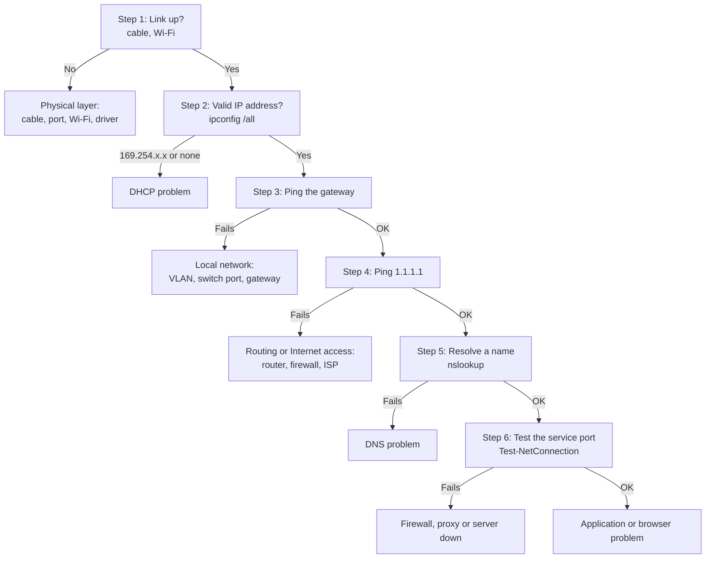

# Network Troubleshooting: "I Have No Internet"


| Element | Content |
|---|---|
| **Referent** | Structured diagnosis of a workstation that cannot reach the network, the Internet or a specific service. |
| **Sender** | **bazeeza** |
| **Message** | Test the network layer by layer, from the cable to the application, so the fault is located with proof instead of guesses. |
| **Receiver** | Help desk technicians, network technicians, IT students. |
| **Channel** | GitHub repository `Bazeeza/Technical-Runbooks` |
| **Code** | English, technical writing · Windows commands, Linux equivalents in the [cheat sheet](COMMAND-CHEATSHEET.md) |
| **Reference** | [Microsoft: TCP/IP troubleshooting](https://learn.microsoft.com/en-us/troubleshoot/windows-client/networking/tcpip-troubleshooting) · [Test-NetConnection](https://learn.microsoft.com/en-us/powershell/module/nettcpip/test-netconnection) · Cisco CCNA troubleshooting methodology |

---

## Objective

"No Internet" can mean a cable, a DHCP failure, a gateway, DNS, a firewall or a server outage. The **bottom-up method** tests each layer of the OSI model in order: a layer can only work if the layers below it work. In a few minutes, the technician knows **which layer fails** and either fixes it or escalates with evidence.

## Prerequisites

- [ ] Access to the workstation (on site or by remote control)
- [ ] A terminal: PowerShell or Command Prompt (administrator for the repair commands)
- [ ] The expected network values, if known: subnet, gateway, DNS servers

---

## Step 0 — Define the scope

Ask before testing:

| Question | Why |
|---|---|
| One user or many? | Many users → network or server issue, not this PC |
| Everything or one site/application? | One service only → DNS, firewall or that server |
| Wired, Wi-Fi or VPN? | Different paths, different causes |
| Since when, after what change? | Updates, move, new equipment |

## Decision flow



---

## Step 1 — Physical layer: is there a link?

- **Wired:** link LEDs on the network card and the switch port? Cable firmly clipped? Try another cable and another wall port.
- **Wi-Fi:** connected to the right network (SSID)? Airplane mode off? Signal strength correct?

```powershell
Get-NetAdapter | Select-Object Name, Status, LinkSpeed, MacAddress
```

**Expected result:** the adapter in use shows `Up`. `Disconnected` means a cable, port or Wi-Fi problem. `Disabled` means it was turned off: `Enable-NetAdapter -Name "Ethernet"`.

Check **LinkSpeed** too: a gigabit card linked at `100 Mbps` usually means a damaged pair in the cable, because gigabit needs all four pairs. Go deeper with [08 Network Cabling and Termination](../08-Network-Cabling-and-Termination/README.md) for a wired link, or [09 Wi-Fi Troubleshooting](../09-WiFi-Troubleshooting/README.md) for a wireless one.

## Step 2 — IP configuration: did the PC get an address?

```cmd
ipconfig /all
```

Read the active adapter:

| Field | Healthy | Problem |
|---|---|---|
| IPv4 Address | In the expected subnet, e.g. `192.168.10.25` | **`169.254.x.x`** = APIPA: no DHCP server answered |
| Subnet Mask | e.g. `255.255.255.0` | Wrong mask (static configuration error) |
| Default Gateway | e.g. `192.168.10.1` | Empty → no route outside the subnet |
| DNS Servers | The organization's DNS | Empty or unknown addresses |

**APIPA address (`169.254.x.x`)**: request a new lease.

```cmd
ipconfig /release
ipconfig /renew
```

Still `169.254`? The DHCP request does not reach the server: switch port in the wrong VLAN, DHCP scope full, missing DHCP relay (`ip helper-address` on the router), or DHCP server down. **Escalate to the network team** with this information.

## Step 3 — Local network: can the PC reach its gateway?

```cmd
ping 192.168.10.1
```

Replace with the gateway from step 2. Replies (`Reply from ...`) prove that the local network works. Timeouts mean a VLAN, switch or gateway problem. (Some gateways block ping: confirm with a second PC on the same network.)

## Step 4 — Beyond the network: is the Internet reachable by IP?

```cmd
ping 1.1.1.1
tracert 1.1.1.1
```

`ping` to a public IP **without** using a name separates routing from DNS. If it fails, `tracert` shows the last hop that answers: the fault is just after it (router, firewall, Internet provider).

## Step 5 — DNS: are names resolved?

```cmd
nslookup www.microsoft.com
```

**Expected result:** one or more addresses under `Addresses`. If step 4 worked but this fails, the problem is **DNS**:

```cmd
ipconfig /flushdns
nslookup www.microsoft.com 1.1.1.1
```

The second command asks a public DNS server directly. If it works, the configured DNS server is the problem: escalate. On a corporate network, internal names (e.g. `intranet.corp.example.com`) only resolve with the internal DNS servers.

## Step 6 — Service: is the port open?

```powershell
Test-NetConnection www.microsoft.com -Port 443
```

`TcpTestSucceeded : True` means the network path and the port are open: the remaining problem is the application (browser, proxy setting, certificate, account). `False` means a firewall blocks the port or the service is down.

Common ports: `80` HTTP · `443` HTTPS · `53` DNS · `22` SSH · `3389` RDP · `445` SMB (file shares) · `5060` SIP (VoIP) · `9100` and `631` printing (raw and IPP).

For a printer that does not answer, continue with [06 Printer Troubleshooting](../06-Printer-Troubleshooting/README.md#step-4--network-printer-is-it-reachable-on-its-port). For RDP, see [07 Remote Desktop with NLA](../07-Remote-Support/RDP.md). For an IP phone that rings but has no audio, SIP on 5060 is not enough: the voice uses a separate range of UDP ports, see [10 VoIP / SIP Phone Troubleshooting](../10-VoIP-SIP-Phone-Troubleshooting/README.md#step-5--no-audio-or-one-way-audio).

---

## Automated check: Test-NetworkHealth

Steps 1 to 6 are automated by the `Test-NetworkHealth` command of the [Helpdesk Toolkit](https://github.com/Bazeeza/helpdesk-toolkit) PowerShell module (Windows PowerShell 5.1 or PowerShell 7, read-only, no administrator rights):

```powershell
Import-Module .\HelpdeskToolkit\HelpdeskToolkit.psd1
Test-NetworkHealth | Select-Object -ExpandProperty Checks      # Pass, Warning, Fail or Skipped per step
Test-NetworkHealth -TargetHost 'print01.corp.example.com' -Port 9100
```

The result gives the first step that failed (`FailedStep`) and its likely cause (`Diagnosis`), ready for the ticket. A gateway that ignores ping is shown as a `Warning` when the Internet still answers, which matches the note of step 3. The command only diagnoses: the repairs below stay manual. Details: [Test-NetworkHealth reference](https://github.com/Bazeeza/helpdesk-toolkit/blob/main/docs/commands/Test-NetworkHealth.md).

---

## Quick repair (after diagnosis)

Use these only after identifying the problem; they reset the network stack and require a restart.

> [!WARNING]
> A network reset rewrites the TCP/IP settings: a **static** address, gateway or DNS can be lost, and **Network reset** in Settings also removes VPN clients and virtual switches. Save the current configuration first:
>
> ```cmd
> ipconfig /all > "%USERPROFILE%\Desktop\ipconfig-before-reset.txt"
> ```

```cmd
netsh winsock reset
netsh int ip reset
```

Or **Settings → Network & internet → Advanced network settings → Network reset**.

---

## Verification

Run the same tests as the diagnosis, in the same order: the fix is proven only when every step passes.

```powershell
Get-NetAdapter | Where-Object Status -eq 'Up' | Select-Object Name, LinkSpeed
Test-NetConnection 1.1.1.1                          # PingSucceeded : True
Resolve-DnsName www.microsoft.com                   # one or more addresses
Test-NetConnection www.microsoft.com -Port 443      # TcpTestSucceeded : True
```

- [ ] The adapter is `Up` at the expected speed
- [ ] The gateway, a public IP and a name all answer
- [ ] The user confirms that the application that failed now works
- [ ] The ticket records the failing layer, the cause and the fix

## Troubleshooting

| Symptom | Likely cause | Fix |
|---|---|---|
| Address `169.254.x.x` after `/renew` | DHCP request does not reach a server | Escalate with the switch port and VLAN (step 2) |
| Gateway answers, `1.1.1.1` does not | Routing, firewall or Internet provider | `tracert 1.1.1.1`, escalate with the last hop that answers |
| `1.1.1.1` answers, names do not resolve | DNS server unreachable or wrong | Compare with `nslookup <name> 1.1.1.1`, escalate the DNS server |
| Internal names fail, public names work | VPN down or wrong DNS suffix | Reconnect the VPN, check `ipconfig /all` → *DNS Suffix Search List* |
| Everything works by IP, one site fails | Proxy setting, certificate or site down | Test from a second PC, check **Settings → Network & internet → Proxy** |
| Works on Wi-Fi, not on cable (or the opposite) | The failing path only | [08 Cabling](../08-Network-Cabling-and-Termination/README.md) or [09 Wi-Fi](../09-WiFi-Troubleshooting/README.md) |

## Rollback

- **Static configuration lost after a reset:** re-enter the address, mask, gateway and DNS from the file saved before the reset (**Settings → Network & internet → Ethernet → IP assignment → Edit**).
- **Adapter disabled by mistake:** `Enable-NetAdapter -Name "Ethernet"`.
- **VPN client removed by Network reset:** reinstall it from the organization's software source ([runbook 03](../03-Software-Deployment/README.md)).

## Information to give when escalating

```text
User / PC / location       :
Wired, Wi-Fi or VPN         :
Link speed / Wi-Fi Rssi     : e.g. "1 Gbps" or "-72 dBm on 5 GHz"
Scope                       : this PC only / several users / whole site
Last successful step        : e.g. "Ping gateway OK, ping 1.1.1.1 fails"
ipconfig /all output        : (attached)
tracert output              : (attached)
Actions already done        :
```

---

<sub>Written by bazeeza · Found an error? <a href="https://github.com/Bazeeza/Technical-Runbooks/issues/new?template=runbook-error.yml">Report it here</a>.</sub>
