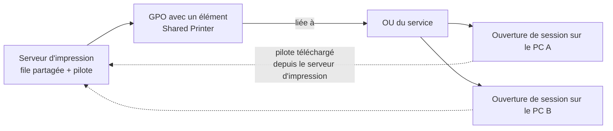

# Déployer des imprimantes par stratégie de groupe

[](GPO-DEPLOYMENT.fr.md)
[](GPO-DEPLOYMENT.md)


| Élément | Contenu |
|---|---|
| **Référent** | Connecter automatiquement une imprimante partagée à tous les utilisateurs d'un service, avec un élément de préférences de stratégie de groupe. |
| **Émetteur** | **bazeeza** |
| **Message** | Remplacer l'installation manuelle de l'imprimante sur chaque PC par un seul réglage central, réversible, appliqué à l'ouverture de session. |
| **Récepteur** | Techniciens de soutien et d'administration système qui ont le droit de modifier les stratégies de groupe. |
| **Canal** | Dépôt GitHub `Bazeeza/Technical-Runbooks` |
| **Code** | Français, rédaction technique (traduction de l'original anglais) · Console de gestion des stratégies de groupe (GPMC) |
| **Référence** | [Group Policy Preferences: Printers extension](https://learn.microsoft.com/en-us/previous-versions/windows/it-pro/windows-server-2012-r2-and-2012/dn581925(v=ws.11)) · [Group Policy preferences in Windows](https://learn.microsoft.com/en-us/windows-server/identity/ad-ds/manage/group-policy/group-policy-preferences) · [KB5005010: printer driver installation restricted to administrators](https://support.microsoft.com/en-us/topic/kb5005010-restricting-installation-of-new-printer-drivers-after-applying-the-july-6-2021-updates-31b91c02-05bc-4ada-a7ea-183b129578a7) |

Retour à [06 Dépannage d'imprimante](README.fr.md).

---

## Objectif

Installer une imprimante à la main sur 40 postes prend du temps et produit 40 configurations légèrement différentes. Un élément d'imprimante des **préférences de stratégie de groupe** (*Group Policy Preferences*, GPP) connecte la file partagée `\\printserver\queue` pour chaque utilisateur ciblé à l'ouverture de session, la définit comme imprimante par défaut si on le souhaite, et peut la retirer de façon tout aussi centralisée quand l'imprimante est remplacée.

## Fonctionnement



## Prérequis

- [ ] Un domaine Active Directory : les éléments de préférences n'existent que dans les GPO de domaine
- [ ] L'imprimante **partagée sur un serveur d'impression**, avec son pilote installé sur ce serveur, et une impression de test qui fonctionne depuis le serveur
- [ ] Le chemin UNC de la file, par exemple `\\printserver\Office-2F`
- [ ] Les droits de créer et de lier des GPO sur l'unité d'organisation (OU) cible
- [ ] Un groupe de sécurité pour les utilisateurs qui doivent recevoir l'imprimante (facultatif, pour le ciblage)

---

## Procédure

### Étape 1 — Créer la GPO

Ouvrez **Group Policy Management** (*Gestion des stratégies de groupe*, `gpmc.msc`), faites un clic droit sur l'OU qui contient les **comptes d'utilisateurs** du service, et choisissez **Create a GPO in this domain, and Link it here** (*Créer un objet GPO dans ce domaine, et le lier ici*). Donnez-lui un nom clair, par exemple `U-Printers-Office-2F` (le préfixe `U-` indique qu'elle contient des paramètres d'utilisateur).

**Pourquoi sur l'OU des utilisateurs :** un élément d'imprimante partagée s'exécute dans le contexte de l'**utilisateur**. Il crée la connexion pour la personne qui ouvre la session, peu importe le poste où elle l'ouvre.

### Étape 2 — Ajouter un élément Shared Printer

Modifiez la GPO, puis allez à :

```text
User Configuration > Preferences > Control Panel Settings > Printers
```

Faites un clic droit sur **Printers → New → Shared Printer** (*Imprimantes → Nouveau → Imprimante partagée*) et remplissez :

| Champ | Valeur | Pourquoi |
|---|---|---|
| **Action** | `Update` | Crée la connexion si elle manque, la corrige si elle existe, conserve les autres réglages de l'utilisateur. `Replace` la supprime et la recrée à chaque actualisation. |
| **Share path** | `\\printserver\Office-2F` | La file sur le serveur d'impression, aussi la source du pilote |
| **Set this printer as the default printer** | Seulement s'il s'agit de l'imprimante principale du service | Évite un appel fréquent au soutien (« ça imprime sur la mauvaise imprimante ») |

### Étape 3 — Cibler les bons utilisateurs (facultatif)

Dans l'élément, ouvrez **Common → Item-level targeting → Targeting... → New Item → Security Group** (*Commun → Ciblage au niveau de l'élément → Ciblage... → Nouvel élément → Groupe de sécurité*) et choisissez le groupe du service. L'imprimante n'est alors ajoutée que pour les membres de ce groupe, même si la GPO est liée plus haut dans l'arborescence.

### Étape 4 — S'assurer que les utilisateurs standard peuvent obtenir le pilote

Depuis les mises à jour de sécurité d'août 2021, **seuls les administrateurs peuvent installer des pilotes d'imprimante** par défaut (KB5005010). La connexion à l'imprimante partagée fonctionne pour les utilisateurs standard quand le pilote est déjà présent sur le PC ou qu'il s'agit d'un pilote **package-aware** provenant d'un serveur autorisé par la stratégie. Deux options propres :

1. Préinstaller le pilote sur les postes (image, outil de déploiement de logiciels), puis déployer la connexion par GPO.
2. Configurer **Computer Configuration > Administrative Templates > Printers > Point and Print Restrictions** pour n'autoriser que vos serveurs d'impression, et suivre KB5005010 pour l'effet de `RestrictDriverInstallationToAdministrators`.

> [!WARNING]
> Ne réglez pas `RestrictDriverInstallationToAdministrators` à `0` pour « faire disparaître la demande » : cela rouvre la famille de vulnérabilités PrintNightmare sur chaque poste qui reçoit la stratégie.

### Étape 5 — Appliquer et tester sur un poste

Sur un PC de test, ouvrez une session avec un utilisateur du groupe ciblé :

```cmd
gpupdate /force
gpresult /r /scope user
```

**Résultat attendu :** `gpresult` affiche `U-Printers-Office-2F` sous **Applied Group Policy Objects** (*objets de stratégie de groupe appliqués*), et l'imprimante apparaît dans **Paramètres → Bluetooth et appareils → Imprimantes et scanners**.

---

## Vérification

- [ ] `gpresult /r /scope user` montre la GPO comme appliquée
- [ ] `Get-Printer | Where-Object Type -eq 'Connection'` liste `\\printserver\Office-2F`
- [ ] Une page de test s'imprime depuis la session de l'utilisateur de test
- [ ] Un utilisateur **hors** du groupe ciblé ne reçoit pas l'imprimante (si le ciblage est utilisé)

## Dépannage

| Symptôme | Cause probable | Correction |
|---|---|---|
| GPO affichée sous **Denied** (*refusée*) ou absente de `gpresult` | Liée à l'OU des ordinateurs au lieu de celle des utilisateurs, ou le filtrage de sécurité exclut l'utilisateur | La lier à l'OU des utilisateurs, vérifier **Security Filtering** (*filtrage de sécurité*) |
| GPO appliquée mais aucune imprimante | Le ciblage au niveau de l'élément exclut l'utilisateur, ou le chemin du partage est erroné | Vérifier l'appartenance aux groupes (`whoami /groups`) et ouvrir le chemin UNC à la main |
| L'utilisateur reçoit une demande d'administrateur pour le pilote | Pilote absent et installation restreinte (KB5005010) | Préinstaller le pilote (étape 4) |
| L'imprimante apparaît deux fois | Une ancienne connexion manuelle avec un autre nom existe encore | Retirer l'ancienne ; utiliser un élément `Delete` pour l'ancien chemin pendant la migration |
| Le changement n'est pas encore visible | La stratégie de groupe s'actualise environ toutes les 90 minutes, et à l'ouverture de session | `gpupdate /force`, puis fermer et rouvrir la session |

## Retour arrière

- Pour retirer proprement l'imprimante à tout le monde : changez l'**Action** de l'élément pour `Delete` et laissez la GPO en place pendant un cycle d'actualisation, puis retirez la GPO. Supprimer simplement la GPO laisse la connexion sur les PC, sauf si l'élément utilise l'action `Replace` avec **Common → Remove this item when it is no longer applied** (*Commun → Supprimer cet élément lorsqu'il n'est plus appliqué*) coché.
- `Delete` retire seulement la connexion ; il ne retire pas le pilote des postes.

---

<sub>Écrit par bazeeza · Vous avez trouvé une erreur ? <a href="https://github.com/Bazeeza/Technical-Runbooks/issues/new?template=runbook-error.yml">Signalez-la ici</a>.</sub>
