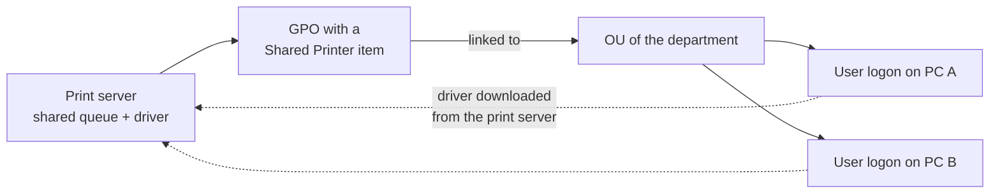

# Deploying Printers with Group Policy


| Element | Content |
|---|---|
| **Referent** | Connecting a shared printer to every user of a department automatically, with a Group Policy Preferences item. |
| **Sender** | **Bariu Azeez** |
| **Message** | Replace manual printer installation on each PC with one central, reversible setting that applies at logon. |
| **Receiver** | Help desk and system administration technicians with rights to edit Group Policy. |
| **Channel** | GitHub repository `Bazeeza/Technical-Runbooks` |
| **Code** | English, technical writing · Group Policy Management Console (GPMC) |
| **Reference** | [Group Policy Preferences: Printers extension](https://learn.microsoft.com/en-us/previous-versions/windows/it-pro/windows-server-2012-r2-and-2012/dn581925(v=ws.11)) · [Group Policy preferences in Windows](https://learn.microsoft.com/en-us/windows-server/identity/ad-ds/manage/group-policy/group-policy-preferences) · [KB5005010: printer driver installation restricted to administrators](https://support.microsoft.com/en-us/topic/kb5005010-restricting-installation-of-new-printer-drivers-after-applying-the-july-6-2021-updates-31b91c02-05bc-4ada-a7ea-183b129578a7) |

Back to [06 Printer Troubleshooting](README.md).

---

## Objective

Installing a printer by hand on 40 workstations takes time and produces 40 slightly different configurations. A **Group Policy Preferences** (GPP) printer item connects the shared queue `\\printserver\queue` for every targeted user at logon, sets it as default if wanted, and can remove it just as centrally when the printer is replaced.

## How it works



## Prerequisites

- [ ] An Active Directory domain: preference items exist only in domain-based GPOs
- [ ] The printer **shared on a print server**, with its driver installed there, and a test print that works from the server
- [ ] The UNC path of the queue, for example `\\printserver\Office-2F`
- [ ] Rights to create and link GPOs on the target organizational unit (OU)
- [ ] A security group for the users who should get the printer (optional, for targeting)

---

## Procedure

### Step 1 — Create the GPO

Open **Group Policy Management** (`gpmc.msc`), right-click the OU that contains the **user accounts** of the department, and select **Create a GPO in this domain, and Link it here**. Give it a clear name, for example `U-Printers-Office-2F` (the `U-` prefix says it holds user settings).

**Why on the users' OU:** a shared printer item runs in the **user** context. It maps the connection for the person who logs on, wherever they log on.

### Step 2 — Add a Shared Printer item

Edit the GPO, then go to:

```text
User Configuration > Preferences > Control Panel Settings > Printers
```

Right-click **Printers → New → Shared Printer** and fill in:

| Field | Value | Why |
|---|---|---|
| **Action** | `Update` | Creates the connection if missing, corrects it if it exists, keeps other user settings. `Replace` deletes and re-creates it at every refresh. |
| **Share path** | `\\printserver\Office-2F` | The queue on the print server, also the source of the driver |
| **Set this printer as the default printer** | Only if this is the main printer of the department | Saves a common help desk call ("it prints on the wrong printer") |

### Step 3 — Target the right users (optional)

In the item, open **Common → Item-level targeting → Targeting... → New Item → Security Group** and choose the department group. The printer is then added only for members of that group, even if the GPO is linked higher in the tree.

### Step 4 — Make sure standard users can get the driver

Since the August 2021 security updates, **only administrators can install printer drivers** by default (KB5005010). The shared printer connection works for standard users when the driver is already present on the PC or is a **package-aware** driver from a server that policy allows. Two clean options:

1. Pre-install the driver on the workstations (image, software deployment tool), then deploy the connection by GPO.
2. Configure **Computer Configuration > Administrative Templates > Printers > Point and Print Restrictions** to allow only your print servers, and follow KB5005010 for the effect of `RestrictDriverInstallationToAdministrators`.

> [!WARNING]
> Do not set `RestrictDriverInstallationToAdministrators` to `0` to "make the prompt go away": it re-opens the PrintNightmare class of vulnerabilities on every workstation that receives the policy.

### Step 5 — Apply and test on one workstation

On a test PC, log on with a user of the target group:

```cmd
gpupdate /force
gpresult /r /scope user
```

**Expected result:** `gpresult` lists `U-Printers-Office-2F` under **Applied Group Policy Objects**, and the printer appears in **Settings → Bluetooth & devices → Printers & scanners**.

---

## Verification

- [ ] `gpresult /r /scope user` shows the GPO as applied
- [ ] `Get-Printer | Where-Object Type -eq 'Connection'` lists `\\printserver\Office-2F`
- [ ] A test page prints from the test user's session
- [ ] A user **outside** the target group does not get the printer (if targeting is used)

## Troubleshooting

| Symptom | Likely cause | Fix |
|---|---|---|
| GPO listed under **Denied** or missing in `gpresult` | Linked to the computers' OU instead of the users' OU, or security filtering excludes the user | Link it to the users' OU, check **Security Filtering** |
| GPO applied but no printer | Item-level targeting excludes the user, or the share path is wrong | Check the group membership (`whoami /groups`) and open the UNC path manually |
| User gets an administrator prompt for the driver | Driver not present and installation restricted (KB5005010) | Pre-install the driver (step 4) |
| Printer appears twice | An old manual connection with another name still exists | Remove the old one; use a `Delete` item for the old path during the migration |
| Change not visible yet | Group Policy refreshes about every 90 minutes, and at logon | `gpupdate /force`, then log off and on |

## Rollback

- To remove the printer from everyone cleanly: change the item **Action** to `Delete` and leave the GPO in place for one refresh cycle, then remove the GPO. Simply deleting the GPO leaves the connection on the PCs, unless the item uses the `Replace` action with **Common → Remove this item when it is no longer applied** checked.
- `Delete` removes the connection only; it does not remove the driver from the workstations.

---

<sub>Written by Bariu Azeez · Found an error? <a href="https://github.com/Bazeeza/Technical-Runbooks/issues/new?template=runbook-error.yml">Report it here</a>.</sub>
