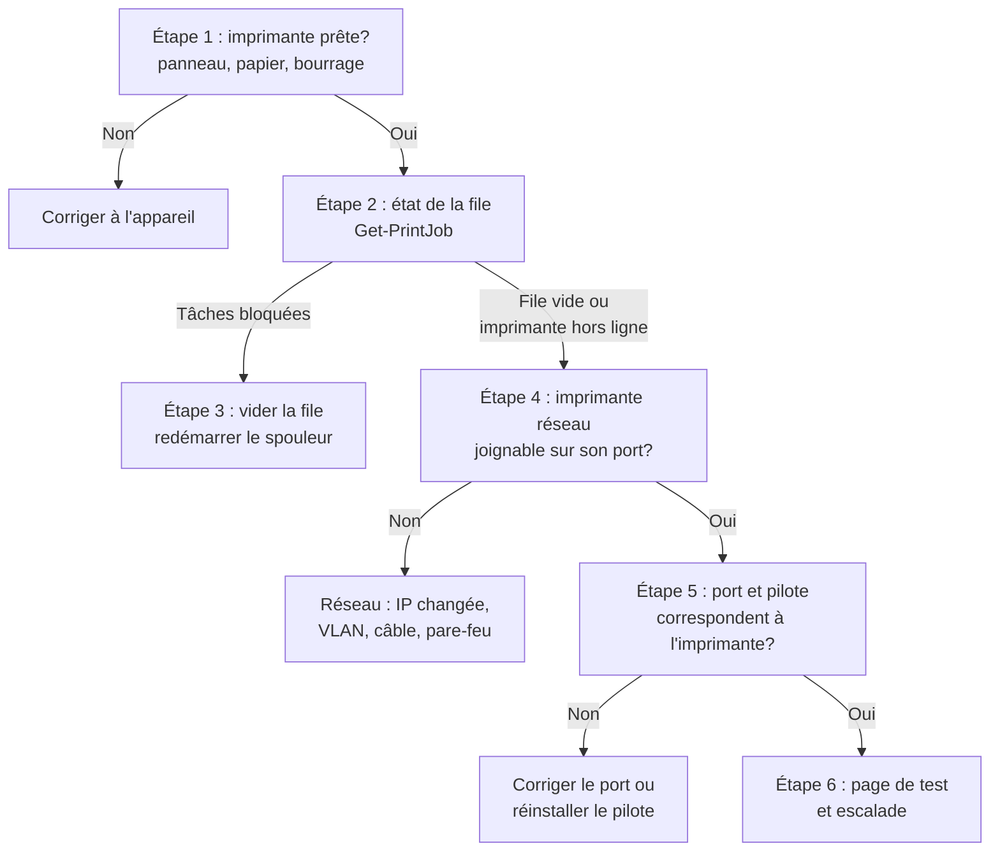

# Dépannage d'imprimante : « Mon document ne s'imprime pas »

[](README.fr.md)
[](README.md)


| Élément | Contenu |
|---|---|
| **Référent** | Diagnostic et réparation d'un poste Windows qui ne peut pas imprimer sur une imprimante locale ou réseau. |
| **Émetteur** | **bazeeza** |
| **Message** | Trouver le maillon défaillant (imprimante, réseau, port, pilote, file d'attente ou spouleur) et le réparer sans tout réinstaller par réflexe. |
| **Récepteur** | Techniciens de soutien, techniciens terrain, étudiants en TI. |
| **Canal** | Dépôt GitHub `Bazeeza/Technical-Runbooks` |
| **Code** | Français, rédaction technique (traduction de l'original anglais) · module PowerShell `PrintManagement`, Paramètres de Windows 11 |
| **Référence** | [Microsoft Support: fix print jobs stuck in the queue](https://support.microsoft.com/en-us/windows/hardware/printer/fix-print-job-stuck-in-queue-errors-in-windows) · [PrintManagement cmdlets](https://learn.microsoft.com/en-us/powershell/module/printmanagement/) · [KB5005010: printer driver installation restricted to administrators](https://support.microsoft.com/en-us/topic/kb5005010-restricting-installation-of-new-printer-drivers-after-applying-the-july-6-2021-updates-31b91c02-05bc-4ada-a7ea-183b129578a7) · [RFC 8011: Internet Printing Protocol](https://www.rfc-editor.org/rfc/rfc8011) |

---

## Objectif

Une tâche d'impression traverse plusieurs maillons : **application → file d'attente → service Spouleur d'impression (Print Spooler) → pilote → port → réseau → imprimante**. N'importe quel maillon peut la bloquer. Ce runbook les teste dans l'ordre, de la vérification la moins coûteuse à la réparation la plus invasive, pour que le technicien corrige la vraie cause et puisse l'expliquer dans le billet.

Fichiers complémentaires :

- [`Reset-PrintQueue.ps1`](Reset-PrintQueue.ps1) : vide une file d'attente bloquée de façon sûre (arrêter le spouleur, vider le dossier de spoule, redémarrer, vérifier), avec `-WhatIf`.
- [Déployer des imprimantes par stratégie de groupe](GPO-DEPLOYMENT.fr.md) : envoyer les imprimantes à de nombreux postes au lieu de les installer une par une.

## Prérequis

- [ ] Le nom exact de l'imprimante utilisée, et son type : **locale** (USB), **réseau directe** (port TCP/IP vers l'imprimante) ou **partagée** (`\\printserver\queue`)
- [ ] Un accès au poste (sur place ou par [soutien à distance](../07-Remote-Support/README.fr.md))
- [ ] Un PowerShell élevé pour les étapes du spouleur et du pilote
- [ ] L'adresse IP attendue de l'imprimante, s'il s'agit d'une imprimante réseau

---

## Étape 0 — Définir la portée

| Question | Pourquoi |
|---|---|
| Un seul utilisateur ou tous ceux de cette imprimante ? | Tous → l'imprimante, son réseau ou le serveur d'impression. Un seul → ce PC. |
| Rien ne s'imprime, ou un seul document / une seule application ? | Un seul document → problème de fichier ou d'application, pas de l'imprimante. |
| L'imprimante affiche-t-elle une erreur sur son panneau (papier, toner, bourrage) ? | La moitié des « problèmes d'imprimante » se règlent à l'appareil. |
| Qu'est-ce qui a changé : nouveau PC, mise à jour, imprimante déplacée, nouvelle IP ? | Une nouvelle adresse IP brise tous les ports TCP/IP qui pointent vers l'ancienne. |

## Arbre de décision



---

## Étape 1 — Vérifier l'imprimante elle-même

Regardez le panneau de l'imprimante ou sa page web : **Ready / Online** (*prête / en ligne*), aucun bourrage, du papier dans le bon bac, du toner, aucune erreur en attente. Imprimez une **page de configuration** depuis le panneau : elle confirme que l'imprimante fonctionne sans aucun PC et affiche son adresse IP actuelle.

**Résultat attendu :** l'imprimante est prête et vous connaissez son adresse IP (pour une imprimante réseau).

## Étape 2 — Lire la file d'attente

```powershell
Get-Printer | Select-Object Name, PrinterStatus, PortName, DriverName, Shared
Get-PrintJob -PrinterName 'Office-Printer' | Select-Object Id, DocumentName, UserName, JobStatus, SubmittedTime
```

Remplacez `Office-Printer` par le vrai nom donné par la première commande. Dans l'interface graphique : **Paramètres → Bluetooth et appareils → Imprimantes et scanners → (imprimante) → Ouvrir la file d'attente d'impression**.

| Ce que vous voyez | Signification |
|---|---|
| Une tâche en `Error` ou `Printing` qui ne finit jamais, d'autres derrière elle | La première tâche bloque la file : passer à l'étape 3 |
| `PrinterStatus` = `Offline` | Windows ne joint pas l'imprimante : passer à l'étape 4 |
| File vide, mais l'utilisateur dit avoir imprimé | La tâche n'a jamais atteint cette file : mauvaise imprimante sélectionnée, ou l'application a échoué |

## Étape 3 — Vider une file bloquée et redémarrer le spouleur

D'abord, annulez seulement la tâche qui bloque :

```powershell
Remove-PrintJob -PrinterName 'Office-Printer' -ID 12
```

Si la tâche ne disparaît pas, redémarrez le service **Print Spooler** (*Spouleur d'impression*), qui gère toutes les files du PC :

```powershell
Restart-Service -Name Spooler
Get-Service -Name Spooler
```

**Résultat attendu :** `Status` = `Running`. Si des tâches restent bloquées, ce sont les fichiers de spoule eux-mêmes qui sont verrouillés : arrêtez le spouleur, supprimez les fichiers de `C:\Windows\System32\spool\PRINTERS` (les fichiers seulement, jamais le dossier), puis redémarrez-le. [`Reset-PrintQueue.ps1`](Reset-PrintQueue.ps1) fait exactement cela et vérifie le résultat :

```powershell
.\Reset-PrintQueue.ps1 -WhatIf   # shows what would be deleted
.\Reset-PrintQueue.ps1           # does it
```

Les commentaires signifient, dans l'ordre : affiche ce qui serait supprimé ; le fait.

> [!WARNING]
> Vider le dossier de spoule supprime **toutes** les tâches en attente de **toutes** les imprimantes de ce PC, pas seulement celle qui bloque. Sur un serveur d'impression, cela touche tous les utilisateurs : prévenez-les d'abord ou faites-le en dehors des heures de bureau.

## Étape 4 — Imprimante réseau : est-elle joignable sur son port ?

Une imprimante réseau écoute sur un ou plusieurs ports d'impression :

| Port | Protocole | Usage typique |
|---|---|---|
| **9100/TCP** | Raw (aussi appelé JetDirect ou AppSocket) | Par défaut pour un *Standard TCP/IP Port* de Windows |
| **631/TCP** | IPP / IPPS (Internet Printing Protocol) | Imprimantes modernes, impression sans pilote avec le pilote de classe IPP de Windows |
| **515/TCP** | LPR/LPD | Anciennes imprimantes et systèmes d'impression Unix |

```powershell
Test-NetConnection 192.0.2.50 -Port 9100
Test-NetConnection 192.0.2.50 -Port 631
```

Remplacez `192.0.2.50` par l'IP inscrite sur la page de configuration (étape 1).

**Résultat attendu :** `TcpTestSucceeded : True` sur le port utilisé par la file. `PingSucceeded` seul ne suffit pas : certaines imprimantes répondent au ping alors que leur service d'impression est arrêté, d'autres bloquent le ping mais impriment très bien.

Si le test échoue : l'imprimante a changé d'adresse IP (bail DHCP sans réservation), se trouve dans un VLAN que le PC ne peut pas joindre, ou un pare-feu bloque le port. Utilisez la méthode couche par couche de [04 Dépannage réseau](../04-Network-Troubleshooting/README.fr.md).

> [!TIP]
> Les imprimantes devraient avoir une **réservation DHCP** ou une adresse statique. Une imprimante dont l'adresse change brise tous les PC qui utilisent un port TCP/IP pointant vers l'ancienne adresse.

## Étape 5 — Vérifier que le port et le pilote correspondent à l'imprimante

```powershell
Get-Printer -Name 'Office-Printer' | Select-Object Name, PortName, DriverName
Get-PrinterPort | Select-Object Name, PrinterHostAddress, PortNumber
Get-PrinterDriver | Select-Object Name, Manufacturer, MajorVersion
```

- **Mauvaise adresse de port :** le port pointe encore vers l'ancienne IP. Créez un port avec la bonne adresse et assignez-le :

  ```powershell
  Add-PrinterPort -Name 'IP_192.0.2.50' -PrinterHostAddress '192.0.2.50'
  Set-Printer -Name 'Office-Printer' -PortName 'IP_192.0.2.50'
  ```

- **Pilote incorrect ou corrompu** (pages illisibles, bacs manquants, erreurs à chaque tâche) : retirez l'imprimante, retirez son pilote, puis installez le pilote actuel du fabricant, ou le **Microsoft IPP Class Driver** si l'imprimante prend en charge IPP.

  ```powershell
  Remove-Printer -Name 'Office-Printer'
  Remove-PrinterDriver -Name 'Old Vendor Driver Name'
  ```

> [!NOTE]
> Depuis les mises à jour de sécurité d'août 2021 (correctifs PrintNightmare), **seuls les administrateurs peuvent installer des pilotes d'imprimante** par défaut (`RestrictDriverInstallationToAdministrators` = 1, voir KB5005010). Un utilisateur standard qui reçoit une demande d'administrateur en se connectant à une imprimante partagée voit cette protection, pas un bogue. La solution est de préinstaller le pilote ou de déployer l'imprimante par [stratégie de groupe](GPO-DEPLOYMENT.fr.md), pas de désactiver la protection.

## Étape 6 — Imprimer une page de test

```powershell
Invoke-CimMethod -InputObject (Get-CimInstance Win32_Printer -Filter "Name='Office-Printer'") -MethodName PrintTestPage
```

Ou **Paramètres → Imprimantes et scanners → (imprimante) → Imprimer une page de test**.

**Résultat attendu :** la page sort. Si la page de test de Windows s'imprime mais pas le document de l'utilisateur, le problème vient de l'application ou du document (essayez de l'imprimer en PDF, ou depuis une autre application).

---

## Vérification

- [ ] `Get-Service Spooler` affiche `Running`
- [ ] `Get-PrintJob -PrinterName '<printer>'` ne renvoie aucune tâche bloquée
- [ ] `Test-NetConnection <printer IP> -Port <9100 or 631>` réussit (imprimante réseau)
- [ ] Une page de test et le **document de l'utilisateur lui-même** s'impriment
- [ ] Le billet indique quel maillon a échoué (appareil, réseau, port, pilote, file) et ce qui a été fait

## Dépannage

| Symptôme | Cause probable | Correction |
|---|---|---|
| La file affiche `Error`, rien ne s'imprime, les autres tâches s'accumulent | Première tâche corrompue ou bloquée | L'annuler (étape 3) ; si impossible, `Reset-PrintQueue.ps1` |
| Le spouleur s'arrête de nouveau quelques secondes après son démarrage | Un pilote ou un processeur d'impression défectueux fait planter le service | Consulter **Observateur d'événements → Journaux des applications et des services → Microsoft → Windows → PrintService**, retirer le pilote nommé dans l'erreur |
| Imprimante `Offline` sur tous les PC | L'imprimante a changé d'IP, est éteinte, ou son réseau est en panne | Page de configuration, puis `Test-NetConnection` (étape 4) |
| Imprimante `Offline` sur un seul PC | Le port de ce PC pointe vers une ancienne IP | Corriger le port (étape 5) |
| Caractères illisibles ou pages de symboles | Mauvais pilote (pilote PCL pour une imprimante PostScript, ou l'inverse) | Installer le bon pilote pour ce modèle |
| L'utilisateur doit fournir des droits d'administrateur en ajoutant une imprimante partagée | Installation des pilotes réservée aux administrateurs (KB5005010) | Préinstaller le pilote ou déployer par [GPO](GPO-DEPLOYMENT.fr.md) |
| Ça imprime, mais sur la mauvaise imprimante | Windows gère automatiquement l'imprimante par défaut | **Paramètres → Imprimantes et scanners → désactiver « Autoriser Windows à gérer mon imprimante par défaut »**, puis choisir l'imprimante par défaut |

## Retour arrière

- Recréer une imprimante retirée : `Add-Printer -Name '<name>' -DriverName '<driver>' -PortName '<port>'`, ou relancer le déploiement par stratégie de groupe avec `gpupdate /force`.
- Un dossier de spoule vidé ne peut pas être restauré : les utilisateurs doivent imprimer leurs documents de nouveau. C'est pourquoi l'étape 3 commence par annuler seulement la tâche qui bloque.

## Informations à fournir lors d'une escalade

```text
Printer name / model / location :
Connection type                 : local USB / direct TCP/IP / shared queue
Scope                           : one user / every user of this printer
Printer panel status            :
Test-NetConnection result       : port 9100 or 631, True/False
Driver name and version         :
Event Viewer PrintService error : (attached)
Actions already done            :
```

---

<sub>Écrit par bazeeza · Vous avez trouvé une erreur ? <a href="https://github.com/Bazeeza/Technical-Runbooks/issues/new?template=runbook-error.yml">Signalez-la ici</a>.</sub>
