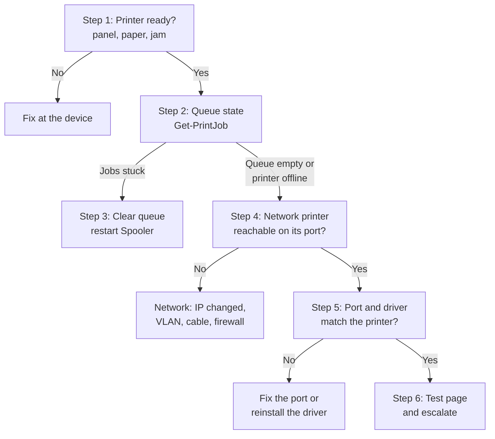

# Printer Troubleshooting: "My Document Does Not Print"


| Element | Content |
|---|---|
| **Referent** | Diagnosis and repair of a Windows workstation that cannot print to a local or network printer. |
| **Sender** | **Bariu Azeez** |
| **Message** | Locate the failing link (printer, network, port, driver, queue or spooler) and fix it without reinstalling everything by reflex. |
| **Receiver** | Help desk technicians, field technicians, IT students. |
| **Channel** | GitHub repository `Bazeeza/Technical-Runbooks` |
| **Code** | English, technical writing · PowerShell `PrintManagement` module, Windows 11 Settings |
| **Reference** | [Microsoft Support: fix print jobs stuck in the queue](https://support.microsoft.com/en-us/windows/hardware/printer/fix-print-job-stuck-in-queue-errors-in-windows) · [PrintManagement cmdlets](https://learn.microsoft.com/en-us/powershell/module/printmanagement/) · [KB5005010: printer driver installation restricted to administrators](https://support.microsoft.com/en-us/topic/kb5005010-restricting-installation-of-new-printer-drivers-after-applying-the-july-6-2021-updates-31b91c02-05bc-4ada-a7ea-183b129578a7) · [RFC 8011: Internet Printing Protocol](https://www.rfc-editor.org/rfc/rfc8011) |

---

## Objective

A print job travels through several links: **application → print queue → Print Spooler service → driver → port → network → printer**. Any link can break it. This runbook tests them in order, from the cheapest check to the most invasive repair, so the technician fixes the real cause and can explain it in the ticket.

Companion files:

- [`Reset-PrintQueue.ps1`](Reset-PrintQueue.ps1): clears a stuck queue safely (stop the spooler, empty the spool folder, restart, verify), with `-WhatIf`.
- [Deploying printers with Group Policy](GPO-DEPLOYMENT.md): push printers to many workstations instead of installing them one by one.

## Prerequisites

- [ ] The exact printer name the user prints to, and whether it is **local** (USB), **direct network** (TCP/IP port to the printer) or **shared** (`\\printserver\queue`)
- [ ] Access to the workstation (on site or by [remote support](../07-Remote-Support/README.md))
- [ ] An elevated PowerShell for the spooler and driver steps
- [ ] The printer's expected IP address, if it is a network printer

---

## Step 0 — Define the scope

| Question | Why |
|---|---|
| One user or everyone on this printer? | Everyone → the printer, its network or the print server. One user → this PC. |
| Nothing prints, or one document / one application? | One document → file or application issue, not the printer. |
| Does the printer show an error on its panel (paper, toner, jam)? | Half of "printer problems" are solved at the device. |
| What changed: new PC, update, printer moved, new IP? | A new IP address breaks every TCP/IP port that points to the old one. |

## Decision flow



---

## Step 1 — Check the printer itself

Look at the printer panel or its web page: **Ready / Online**, no paper jam, paper in the right tray, toner present, no pending error. Print a **configuration page** from the panel: it confirms the printer works without any PC and shows its current IP address.

**Expected result:** the printer is ready and you know its IP address (for a network printer).

## Step 2 — Read the queue

```powershell
Get-Printer | Select-Object Name, PrinterStatus, PortName, DriverName, Shared
Get-PrintJob -PrinterName 'Office-Printer' | Select-Object Id, DocumentName, UserName, JobStatus, SubmittedTime
```

Replace `Office-Printer` with the real name from the first command. In the graphical interface: **Settings → Bluetooth & devices → Printers & scanners → (printer) → Open print queue**.

| What you see | Meaning |
|---|---|
| One job in `Error` or `Printing` that never finishes, others behind it | The first job blocks the queue: go to step 3 |
| `PrinterStatus` = `Offline` | Windows cannot reach the printer: go to step 4 |
| Queue empty, but the user says they printed | The job never reached this queue: wrong printer selected, or the application failed |

## Step 3 — Clear a stuck queue and restart the spooler

First, cancel the blocking job only:

```powershell
Remove-PrintJob -PrinterName 'Office-Printer' -ID 12
```

If the job will not go away, restart the **Print Spooler** service (it holds every queue on the PC):

```powershell
Restart-Service -Name Spooler
Get-Service -Name Spooler
```

**Expected result:** `Status` = `Running`. If jobs are still stuck, the spool files themselves are locked: stop the spooler, delete the files in `C:\Windows\System32\spool\PRINTERS` (the files only, never the folder), then start it again. [`Reset-PrintQueue.ps1`](Reset-PrintQueue.ps1) does exactly this and checks the result:

```powershell
.\Reset-PrintQueue.ps1 -WhatIf   # shows what would be deleted
.\Reset-PrintQueue.ps1           # does it
```

> [!WARNING]
> Emptying the spool folder deletes **every** pending job of **every** printer on this PC, not only the blocked one. On a print server, this affects all users: warn them first or do it outside business hours.

## Step 4 — Network printer: is it reachable on its port?

A network printer listens on one or more printing ports:

| Port | Protocol | Typical use |
|---|---|---|
| **9100/TCP** | Raw (also called JetDirect or AppSocket) | Default for a Windows *Standard TCP/IP Port* |
| **631/TCP** | IPP / IPPS (Internet Printing Protocol) | Modern printers, driverless printing with the Windows IPP class driver |
| **515/TCP** | LPR/LPD | Older printers and Unix print systems |

```powershell
Test-NetConnection 192.0.2.50 -Port 9100
Test-NetConnection 192.0.2.50 -Port 631
```

Replace `192.0.2.50` with the IP printed on the configuration page (step 1).

**Expected result:** `TcpTestSucceeded : True` on the port the queue uses. `PingSucceeded` alone is not enough: some printers answer ping with the printing service stopped, others block ping but print fine.

If the test fails: the printer changed IP address (DHCP lease without reservation), sits in a VLAN the PC cannot reach, or a firewall blocks the port. Use the layer-by-layer method of [04 Network Troubleshooting](../04-Network-Troubleshooting/README.md).

> [!TIP]
> Printers should have a **DHCP reservation** or a static address. A printer whose address changes breaks every PC that uses a TCP/IP port pointing to the old address.

## Step 5 — Check that the port and the driver match the printer

```powershell
Get-Printer -Name 'Office-Printer' | Select-Object Name, PortName, DriverName
Get-PrinterPort | Select-Object Name, PrinterHostAddress, PortNumber
Get-PrinterDriver | Select-Object Name, Manufacturer, MajorVersion
```

- **Wrong port address:** the port still points to the old IP. Create a port with the right address and assign it:

  ```powershell
  Add-PrinterPort -Name 'IP_192.0.2.50' -PrinterHostAddress '192.0.2.50'
  Set-Printer -Name 'Office-Printer' -PortName 'IP_192.0.2.50'
  ```

- **Wrong or corrupt driver** (garbled pages, missing trays, errors at every job): remove the printer, remove its driver, then install the current driver from the manufacturer, or the **Microsoft IPP Class Driver** if the printer supports IPP.

  ```powershell
  Remove-Printer -Name 'Office-Printer'
  Remove-PrinterDriver -Name 'Old Vendor Driver Name'
  ```

> [!NOTE]
> Since the August 2021 security updates (PrintNightmare fixes), **only administrators can install printer drivers** by default (`RestrictDriverInstallationToAdministrators` = 1, see KB5005010). A standard user who gets an administrator prompt when connecting to a shared printer is seeing this protection, not a bug. The fix is to pre-install the driver or deploy the printer by [Group Policy](GPO-DEPLOYMENT.md), not to turn the protection off.

## Step 6 — Print a test page

```powershell
Invoke-CimMethod -InputObject (Get-CimInstance Win32_Printer -Filter "Name='Office-Printer'") -MethodName PrintTestPage
```

Or **Settings → Printers & scanners → (printer) → Print test page**.

**Expected result:** the page comes out. If the Windows test page prints but the user's document does not, the problem is the application or the document (try printing it as PDF, or from another application).

---

## Verification

- [ ] `Get-Service Spooler` shows `Running`
- [ ] `Get-PrintJob -PrinterName '<printer>'` returns no stuck job
- [ ] `Test-NetConnection <printer IP> -Port <9100 or 631>` succeeds (network printer)
- [ ] A test page and the **user's own document** print
- [ ] The ticket says which link failed (device, network, port, driver, queue) and what was done

## Troubleshooting

| Symptom | Likely cause | Fix |
|---|---|---|
| Queue shows `Error`, nothing prints, other jobs pile up | First job corrupted or blocked | Cancel it (step 3); if impossible, `Reset-PrintQueue.ps1` |
| Spooler stops again a few seconds after starting | Faulty driver or print processor crashes the service | Check **Event Viewer → Applications and Services Logs → Microsoft → Windows → PrintService**, remove the driver named in the error |
| Printer `Offline` on every PC | Printer changed IP, is off, or its network is down | Configuration page, then `Test-NetConnection` (step 4) |
| Printer `Offline` on one PC only | Port on this PC points to an old IP | Fix the port (step 5) |
| Garbled characters or pages of symbols | Wrong driver (PCL driver for a PostScript printer, or the reverse) | Install the right driver for this model |
| User is asked for administrator rights when adding a shared printer | Driver installation restricted to administrators (KB5005010) | Pre-install the driver or deploy by [GPO](GPO-DEPLOYMENT.md) |
| Prints, but to the wrong printer | Windows manages the default printer automatically | **Settings → Printers & scanners → turn off "Let Windows manage my default printer"**, then set the default |

## Rollback

- Re-create a printer that was removed: `Add-Printer -Name '<name>' -DriverName '<driver>' -PortName '<port>'`, or re-run the Group Policy deployment with `gpupdate /force`.
- An emptied spool folder cannot be restored: users must print their documents again. This is why step 3 starts by cancelling only the blocking job.

## Information to give when escalating

```text
Printer name / model / location :
Connection type                 : local USB / direct TCP/IP / shared queue
Scope                           : one user / every user of this printer
Printer panel status            :
Test-NetConnection result       : port 9100 or 631, True/False
Driver name and version         :
Event Viewer PrintService error : (attached)
Actions already done            :
```

---

<sub>Written by Bariu Azeez · Found an error? <a href="https://github.com/Bazeeza/Technical-Runbooks/issues/new?template=runbook-error.yml">Report it here</a>.</sub>
