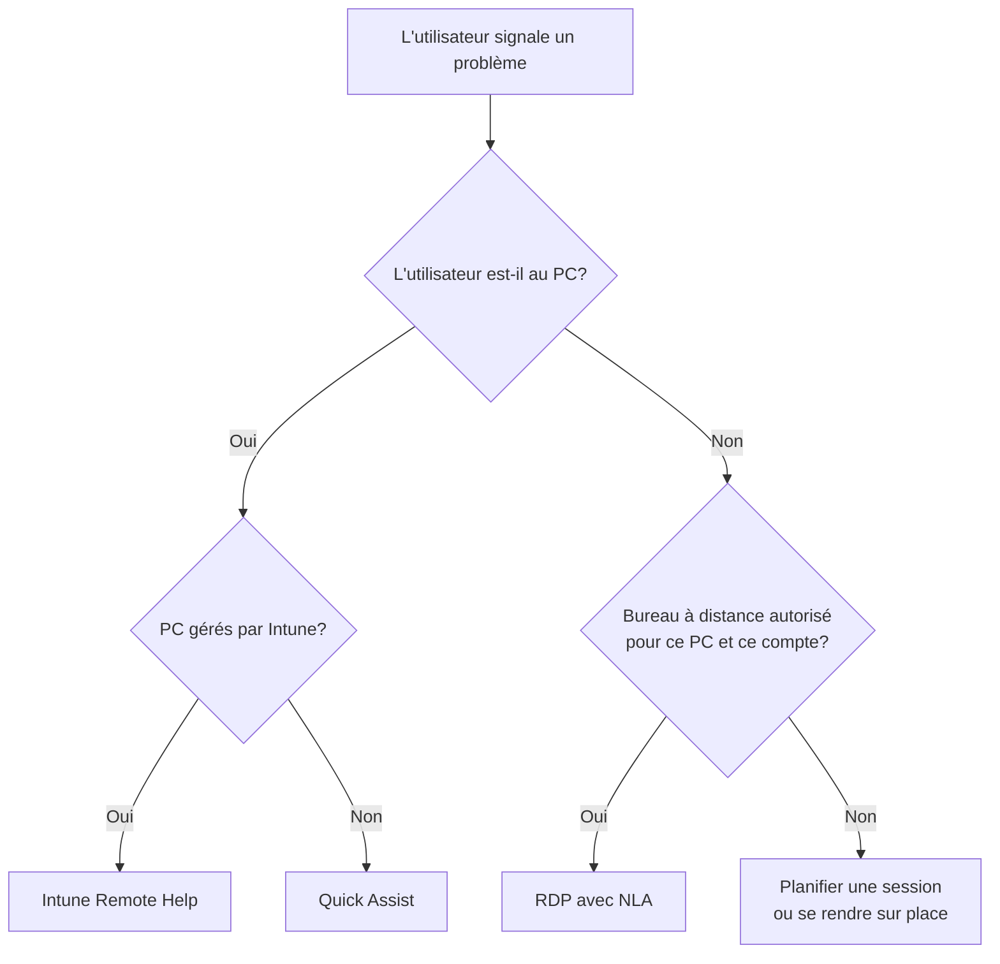

# Soutien à distance : aider un utilisateur avec Assistance rapide (Quick Assist)

| Élément | Contenu |
|---|---|
| **Référent** | Prendre le contrôle de l'écran d'un utilisateur, avec son consentement, pour diagnostiquer et régler un problème sans se déplacer. |
| **Émetteur** | **bazeeza** |
| **Message** | Choisir le bon outil à distance, se connecter avec le consentement explicite de l'utilisateur, travailler de façon sûre et fermer la session proprement. |
| **Récepteur** | Techniciens de soutien, étudiants en TI. |
| **Canal** | Dépôt GitHub `Bazeeza/Technical-Runbooks` |
| **Code** | Français, rédaction technique (traduction de l'original anglais) · Quick Assist, Connexion Bureau à distance (`mstsc`) |
| **Référence** | [Microsoft Learn: Use Quick Assist to help users](https://learn.microsoft.com/en-us/windows/client-management/client-tools/quick-assist) · [Microsoft Support: protect yourself from tech support scams](https://support.microsoft.com/help/4013405) · [Intune Remote Help](https://learn.microsoft.com/en-us/intune/intune-service/fundamentals/remote-help) |

---

## Objectif

La plupart des appels au soutien finissent par « pouvez-vous me montrer ? ». Une session à distance permet au technicien de **voir** le problème au lieu de le deviner à partir d'une description. Elle donne aussi au technicien le même pouvoir sur le PC que l'utilisateur, et c'est exactement ce dont les fraudeurs abusent. Ce runbook rend chaque session **consentie, vérifiée et traçable**.

Fichiers complémentaires :

- [Bureau à distance (RDP) avec authentification au niveau du réseau](RDP.fr.md) : ouvrir une session complète sur un poste ou un serveur, quand personne n'a besoin d'être devant l'écran.
- [Liste de contrôle de sécurité du soutien à distance](SECURITY-CHECKLIST.fr.md) : les règles à suivre avant, pendant et après chaque session.

## Choisir le bon outil

| Situation | Outil | Pourquoi |
|---|---|---|
| Un utilisateur est devant le PC et a besoin d'aide **maintenant** | **Quick Assist** | Intégré à Windows, l'utilisateur voit tout et approuve chaque niveau d'accès |
| L'organisation gère ses PC avec Intune | **Intune Remote Help** | Même principe que Quick Assist, avec accès basé sur les rôles, accès conditionnel et journaux de session (Microsoft le recommande plutôt que Quick Assist à l'intérieur d'un même locataire) |
| Personne n'est devant le PC (serveur, travail en dehors des heures) | **Bureau à distance (RDP)** | Ouvre une session complète avec le compte du technicien, voir [RDP.fr.md](RDP.fr.md) |
| Le problème empêche Windows de démarrer ou d'atteindre le réseau | **Aucun** | Les outils à distance ont besoin d'une session et d'un réseau fonctionnels : se rendre sur place ou guider l'utilisateur par téléphone |

## Prérequis

- [ ] Un **billet** qui existe avant la session : la session fait partie d'une demande, jamais une surprise
- [ ] L'identité de l'utilisateur confirmée par un canal connu (rappel au numéro de l'annuaire, billet ouvert depuis son compte)
- [ ] Pour le technicien (l'assistant) : un compte professionnel **Microsoft Entra ID** ou un compte Microsoft pour se connecter à Quick Assist
- [ ] Les deux PC peuvent joindre les points de terminaison de Microsoft Quick Assist sur **TCP 443** (HTTPS). L'utilisateur (celui qui partage) n'a pas besoin de se connecter

---

## Procédure (Quick Assist)

### Étape 1 — Expliquer ce qui va se passer et obtenir le consentement

Dites-le simplement, avant tout échange de code :

> « Je vais vous donner un court code de sécurité. Quand vous l'entrerez, vous verrez mon nom et vous pourrez choisir de me laisser voir ou contrôler votre écran. Vous pouvez mettre fin à la session à tout moment depuis la barre d'outils de Quick Assist. Je n'ouvrirai pas vos fichiers personnels ni vos courriels sans vous le demander. »

**Pourquoi :** l'utilisateur doit savoir que c'est **lui** qui garde le contrôle. Notez dans le billet que le consentement a été donné, et par qui.

### Étape 2 — Démarrer la session comme assistant

Ouvrez Quick Assist (**Ctrl + Windows + Q**, ou recherchez *Quick Assist*), choisissez **Help someone** (*Aider quelqu'un*), connectez-vous si demandé. Quick Assist affiche un **code de sécurité à durée limitée**.

Donnez le code à l'utilisateur **par téléphone ou par le billet**, jamais par un courriel auquel il ne s'attend pas.

**Résultat attendu :** un code s'affiche avec un compte à rebours.

### Étape 3 — L'utilisateur entre le code et autorise la session

L'utilisateur ouvre Quick Assist, tape le code sous **Security code from assistant** (*Code de sécurité de l'assistant*), choisit **Submit** (*Envoyer*), puis **Allow** (*Autoriser*) pour partager l'écran. L'utilisateur voit le nom de l'assistant sous la forme *prénom, initiale du nom* : demandez-lui de confirmer qu'il correspond au technicien au téléphone.

**Résultat attendu :** vous voyez l'écran de l'utilisateur en **affichage seulement**.

### Étape 4 — Demander le contrôle seulement quand vous en avez besoin

Beaucoup de problèmes se règlent en regardant et en guidant. Quand vous devez agir vous-même, choisissez **Request control** (*Demander le contrôle*) : l'utilisateur doit choisir **Allow** (*Autoriser*) ou **Deny** (*Refuser*).

Pendant que vous avez le contrôle :

- Dites ce que vous allez faire avant de le faire (« J'ouvre le Gestionnaire de périphériques »).
- Utilisez le crayon d'annotation pour montrer où cliquer quand l'utilisateur devrait apprendre l'étape.
- Mettez la session en pause si l'utilisateur doit taper un mot de passe, et détournez le regard de l'écran. Ne demandez jamais le mot de passe lui-même.
- Quand une demande d'administrateur (UAC) apparaît, c'est du côté de l'utilisateur qu'il faut y répondre : l'assistant n'a que les droits de l'utilisateur.

### Étape 5 — Fermer la session et documenter

Dites à l'utilisateur que la session est terminée, fermez-la depuis la barre d'outils de Quick Assist, et faites confirmer par l'utilisateur que Quick Assist est fermé de son côté.

Dans le billet, notez : heure de début et de fin, ce qui a été vu, ce qui a été modifié, et que l'utilisateur a confirmé la correction. Quick Assist ne crée **aucun** journal sur l'un ou l'autre PC : le billet est donc la seule trace de ce qui s'est passé.

---

## Vérification

- [ ] L'utilisateur confirme que le problème est réglé, de son côté, après la fermeture de la session
- [ ] Quick Assist est fermé sur les deux PC
- [ ] Le billet consigne le consentement, les actions et les heures

## Dépannage

| Symptôme | Cause probable | Correction |
|---|---|---|
| Le code est refusé | Code expiré (il est à durée limitée) ou mal tapé | Générer un nouveau code et le lire lentement, caractère par caractère |
| Quick Assist ne s'ouvre pas ou affiche une fenêtre vide | Application pas à jour, ou WebView2 absent sous Windows 10 | Mettre à jour Quick Assist depuis le Microsoft Store |
| La connexion reste bloquée sur « Connecting » | Un pare-feu ou un proxy bloque les points de terminaison de Quick Assist sur le port 443 | Tester depuis un autre réseau ; l'équipe réseau doit autoriser les points de terminaison listés par Microsoft |
| L'assistant voit mais ne peut pas cliquer | Le contrôle n'a pas été demandé ou l'utilisateur a choisi **Deny** | Choisir de nouveau **Request control** et expliquer pourquoi |
| L'assistant ne peut pas répondre à une demande d'administrateur (UAC) | L'assistant n'a que les droits de l'utilisateur ; l'UAC doit être traité du côté de l'utilisateur | Demander à l'utilisateur d'y répondre, ou à un administrateur de faire l'étape |
| L'outil est désactivé dans l'organisation | Une stratégie bloque Quick Assist au profit d'un autre outil | Utiliser l'outil approuvé (par exemple Remote Help) |

## Retour arrière

Une session à distance ne modifie rien par elle-même. Annulez les actions faites pendant la session en suivant leur propre runbook, et notez-le dans le billet.

---

Écrit par bazeeza · Vous avez trouvé une erreur ? <a href="https://github.com/Bazeeza/Technical-Runbooks/issues/new?template=runbook-error.yml">Signalez-la ici</a>.
