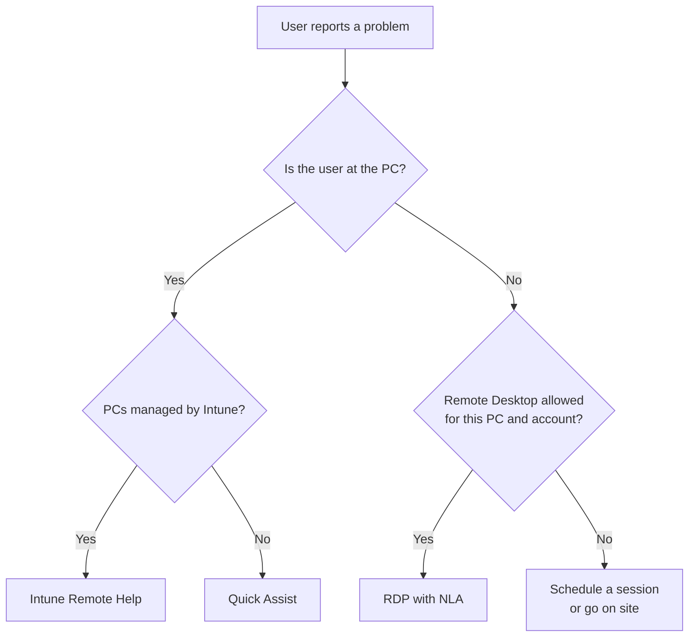

# Remote Support: Helping a User with Quick Assist

| Element | Content |
|---|---|
| **Referent** | Taking control of a user's screen, with their consent, to diagnose and fix a problem without travelling. |
| **Sender** | **Bariu Azeez** |
| **Message** | Choose the right remote tool, connect with the user's explicit consent, work safely and close the session cleanly. |
| **Receiver** | Help desk technicians, IT students. |
| **Channel** | GitHub repository `Bazeeza/Technical-Runbooks` |
| **Code** | English, technical writing · Quick Assist, Remote Desktop Connection (`mstsc`) |
| **Reference** | [Microsoft Learn: Use Quick Assist to help users](https://learn.microsoft.com/en-us/windows/client-management/client-tools/quick-assist) · [Microsoft Support: protect yourself from tech support scams](https://support.microsoft.com/help/4013405) · [Intune Remote Help](https://learn.microsoft.com/en-us/intune/intune-service/fundamentals/remote-help) |

---

## Objective

Most help desk calls end with "can you show me?". A remote session lets the technician **see** the problem instead of guessing from a description. It also gives the technician the same power over the PC as the user, which is exactly what scammers abuse. This runbook makes every session **consented, verified and traceable**.

Companion files:

- [Remote Desktop (RDP) with Network Level Authentication](RDP.md): open a full session on a workstation or server, when nobody needs to be in front of the screen.
- [Remote support security checklist](SECURITY-CHECKLIST.md): the rules to follow before, during and after every session.

## Choose the right tool

| Situation | Tool | Why |
|---|---|---|
| A user is in front of the PC and needs help **now** | **Quick Assist** | Built into Windows, the user sees everything and approves each level of access |
| The organization manages its PCs with Intune | **Intune Remote Help** | Same idea as Quick Assist, with role-based access, conditional access and session logs (Microsoft recommends it over Quick Assist inside one tenant) |
| Nobody is in front of the PC (server, after-hours work) | **Remote Desktop (RDP)** | Opens a full session with the technician's own account, see [RDP.md](RDP.md) |
| The problem prevents Windows from starting or reaching the network | **None** | Remote tools need a working session and network: go on site or guide the user by phone |

## Prerequisites

- [ ] A **ticket** that exists before the session: the session is part of a request, never a surprise
- [ ] The user's identity confirmed through a known channel (callback to the number in the directory, ticket opened from their account)
- [ ] For the technician (helper): a work **Microsoft Entra ID** or Microsoft account to sign in to Quick Assist
- [ ] Both PCs can reach the Microsoft Quick Assist endpoints on **TCP 443** (HTTPS). The user (sharer) does not need to sign in

---

## Procedure (Quick Assist)

### Step 1 — Explain what will happen and get consent

Say it plainly, before any code is exchanged:

> "I will give you a short security code. When you enter it, you will see my name and you can choose to let me see or control your screen. You can end the session at any time from the Quick Assist toolbar. I will not open your personal files or e-mail without asking."

**Why:** the user must know that **they** stay in control. Write in the ticket that consent was given, and by whom.

### Step 2 — Start the session as the helper

Open Quick Assist (**Ctrl + Windows + Q**, or search *Quick Assist*), select **Help someone**, sign in if asked. Quick Assist shows a **time-limited security code**.

Give the code to the user **by phone or through the ticket**, never by an e-mail they did not expect.

**Expected result:** a code is displayed with a countdown.

### Step 3 — The user enters the code and allows the session

The user opens Quick Assist, types the code under **Security code from assistant**, selects **Submit**, then **Allow** to share the screen. The user sees the helper's name as *first name, last initial*: ask them to confirm it matches the technician on the phone.

**Expected result:** you see the user's screen in **view only**.

### Step 4 — Request control only when you need it

Many problems are solved by watching and guiding. When you must act yourself, select **Request control**: the user is asked to **Allow** or **Deny**.

While in control:

- Say what you are about to do before doing it ("I'm opening Device Manager").
- Use the annotation pen to show where to click when the user should learn the step.
- Pause the session if the user needs to type a password, and look away from the screen. Never ask for the password itself.
- When an administrator prompt (UAC) appears, the user's side must answer it: the helper only has the user's rights.

### Step 5 — Close the session and document

Tell the user the session is over, end it from the Quick Assist toolbar, and confirm the user sees that Quick Assist is closed on their side.

In the ticket, write: start and end time, what was seen, what was changed, and that the user confirmed the fix. Quick Assist does **not** create logs on either PC, so the ticket is the only record of what happened.

---

## Verification

- [ ] The user confirms the problem is solved, on their side, after the session is closed
- [ ] Quick Assist is closed on both PCs
- [ ] The ticket records consent, actions and times

## Troubleshooting

| Symptom | Likely cause | Fix |
|---|---|---|
| The code is refused | Code expired (it is time-limited) or mistyped | Generate a new code and read it slowly, character by character |
| Quick Assist does not open or shows a blank window | App outdated, or WebView2 missing on Windows 10 | Update Quick Assist from the Microsoft Store |
| Connection hangs on "Connecting" | A firewall or proxy blocks the Quick Assist endpoints on 443 | Test from another network; the network team must allow the endpoints listed by Microsoft |
| The helper can see but not click | Control was not requested or the user selected **Deny** | **Request control** again and explain why |
| An administrator prompt (UAC) cannot be answered by the helper | The helper only has the user's rights; UAC must be answered on the user's side | Ask the user to answer it, or an administrator to do the step |
| The tool is disabled in the organization | Policy blocks Quick Assist in favour of another tool | Use the approved tool (for example Remote Help) |

## Rollback

A remote session changes nothing by itself. Undo the actions taken during the session following their own runbook, and note it in the ticket.

---

Written by Bariu Azeez · Found an error? <a href="https://github.com/Bazeeza/Technical-Runbooks/issues/new?template=runbook-error.yml">Report it here</a>.
