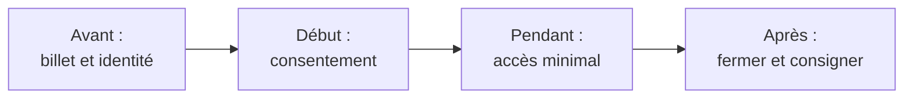

# Liste de contrôle de sécurité du soutien à distance

| Élément | Contenu |
|---|---|
| **Référent** | Les règles qu'un technicien suit avant, pendant et après chaque session de soutien à distance. |
| **Émetteur** | **bazeeza** |
| **Message** | Une session à distance donne un accès complet à l'ordinateur d'un utilisateur : elle doit être demandée, vérifiée, consentie, minimale et consignée. |
| **Récepteur** | Techniciens de soutien, et les utilisateurs qu'ils aident. |
| **Canal** | Dépôt GitHub `Bazeeza/Technical-Runbooks` |
| **Code** | Français, rédaction technique (traduction de l'original anglais) · liste de contrôle |
| **Référence** | [Microsoft Learn: Quick Assist, Report Abuse section](https://learn.microsoft.com/en-us/windows/client-management/client-tools/quick-assist#report-abuse) · [Microsoft Support: protect yourself from tech support scams](https://support.microsoft.com/help/4013405) · [Canadian Centre for Cyber Security: social engineering](https://www.cyber.gc.ca/en/guidance/social-engineering-itsap00166) |

Retour à [07 Soutien à distance](README.fr.md).

---

## Pourquoi une liste de contrôle

Les arnaques au faux soutien technique fonctionnent parce qu'un vrai outil à distance, utilisé par un faux technicien, ressemble exactement à une vraie session de soutien. La seule différence est le **processus** : qui a établi le contact, comment les identités ont été vérifiées, et ce qu'on a dit à l'utilisateur. Suivre la même courte liste à chaque fois protège l'utilisateur, l'organisation et le technicien (qui peut prouver ce qui a été fait).

## Avant la session

- [ ] Un billet existe, ouvert par l'utilisateur ou par le soutien **à la demande de l'utilisateur**
- [ ] L'identité de l'utilisateur est confirmée par un canal connu : rappel au numéro de l'annuaire de l'entreprise, ou billet ouvert depuis son propre compte
- [ ] L'outil est **approuvé** par l'organisation (Quick Assist, Remote Help, RDP par VPN, autre outil géré)
- [ ] On explique à l'utilisateur comment reconnaître le technicien (nom affiché par l'outil, numéro du billet)

> [!IMPORTANT]
> Enseignez cette règle aux utilisateurs : **les TI ne démarrent jamais une session à distance qu'ils n'ont pas demandée.** Un appel, une fenêtre surgissante ou un courriel inattendu qui demande d'installer un outil à distance ou de lire un code est une arnaque jusqu'à preuve du contraire. Microsoft affirme ne jamais faire de contact non sollicité pour demander l'accès à un appareil.

## Démarrer la session

- [ ] On dit à l'utilisateur ce qui sera vu et fait, et qu'il peut arrêter la session à tout moment
- [ ] Le consentement est explicite (l'utilisateur choisit lui-même **Allow**) et noté dans le billet
- [ ] L'utilisateur confirme que le nom affiché par l'outil correspond au technicien au téléphone
- [ ] Commencer en **affichage seulement** ; demander le contrôle seulement au besoin

## Pendant la session

- [ ] Rester sur la tâche du billet : aucune consultation des fichiers personnels, des courriels ou de l'historique du navigateur
- [ ] Annoncer chaque action avant de la faire
- [ ] **Ne jamais demander un mot de passe.** Mettre la session en pause ou détourner le regard pendant que l'utilisateur le tape
- [ ] Ne pas copier de fichiers du PC de l'utilisateur vers celui du technicien, sauf si le billet l'exige, et le dire
- [ ] Ne pas installer un autre outil d'accès à distance « pour la prochaine fois »

## Après la session

- [ ] Fermer la session depuis l'outil et vérifier avec l'utilisateur qu'elle est fermée de son côté
- [ ] Pour RDP, **se déconnecter** (*Sign out*) au lieu de fermer la fenêtre (une session déconnectée reste ouverte)
- [ ] Noter dans le billet : heure de début et de fin, consentement, actions, résultat, tout élément sensible qui était visible
- [ ] Retirer tout accès temporaire accordé pour la session (appartenance temporaire à un groupe, exception de pare-feu)

## Si une session semble suspecte

Ceci s'applique quand un utilisateur signale une session qu'il n'a pas demandée, ou quand le technicien voit des signes d'arnaque (outil à distance inconnu installé, utilisateur à qui on demande d'acheter des cartes-cadeaux, fausses fenêtres de « virus ») :

1. **Déconnecter** le réseau (débrancher le câble, désactiver le Wi-Fi) pour couper l'accès à distance.
2. Ne rien supprimer : les preuves aident l'équipe de sécurité.
3. **Escalader à l'équipe de sécurité** avec l'heure, le nom de l'outil et ce que l'utilisateur a vu ou tapé.
4. Faire changer les mots de passe de l'utilisateur **depuis un autre appareil, sain**, en commençant par le courriel et la banque si des comptes personnels ont été utilisés. Pour un compte professionnel, révoquer aussi ses sessions et vérifier les règles de sa boîte aux lettres, comme dans [le runbook 14, liste C](../14-Phishing-Report-and-First-Response/FIRST-RESPONSE-CHECKLIST.fr.md#liste-c--mot-de-passe-saisi-ou-demande-mfa-inattendue-approuvée).
5. Aider l'utilisateur à le signaler : au Canada, au [Centre antifraude du Canada](https://antifraudcentre-centreantifraude.ca/) ; pour les arnaques qui utilisent le nom de Microsoft, par le [formulaire Microsoft de signalement d'arnaque au soutien technique](https://support.microsoft.com/windows/cfa4609a-92cc-4808-95e8-392b4ffd0753).

---

Écrit par bazeeza · Vous avez trouvé une erreur ? <a href="https://github.com/Bazeeza/Technical-Runbooks/issues/new?template=runbook-error.yml">Signalez-la ici</a>.
