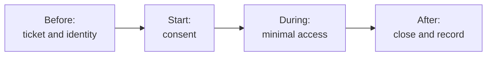

# Remote Support Security Checklist

| Element | Content |
|---|---|
| **Referent** | The rules a technician follows before, during and after every remote support session. |
| **Sender** | **Bariu Azeez** |
| **Message** | A remote session gives full access to a user's computer: it must be requested, verified, consented, minimal and recorded. |
| **Receiver** | Help desk technicians, and the users they support. |
| **Channel** | GitHub repository `Bazeeza/Technical-Runbooks` |
| **Code** | English, checklist |
| **Reference** | [Microsoft Learn: Quick Assist, Report Abuse section](https://learn.microsoft.com/en-us/windows/client-management/client-tools/quick-assist#report-abuse) · [Microsoft Support: protect yourself from tech support scams](https://support.microsoft.com/help/4013405) · [Canadian Centre for Cyber Security: social engineering](https://www.cyber.gc.ca/en/guidance/social-engineering-itsap00166) |

Back to [07 Remote Support](README.md).

---

## Why a checklist

Tech support scams work because a real remote tool, used by a fake technician, looks exactly like a real support session. The only difference is the **process**: who started the contact, how identities were checked, and what the user was told. Following the same short list every time protects the user, the organization and the technician (who can prove what was done).

## Before the session

- [ ] A ticket exists, opened by the user or by the help desk **at the user's request**
- [ ] The user's identity is confirmed through a known channel: callback to the number in the company directory, or a ticket opened from their own account
- [ ] The tool is one **approved** by the organization (Quick Assist, Remote Help, RDP through VPN, other managed tool)
- [ ] The user is told how to recognize the technician (name shown by the tool, ticket number)

> [!IMPORTANT]
> Teach users this rule: **IT never starts a remote session they did not ask for.** An unexpected call, pop-up or e-mail asking to install a remote tool or to read a code is a scam until proven otherwise. Microsoft states that it never makes unsolicited contact to request access to a device.

## Starting the session

- [ ] The user is told what will be seen and done, and that they can stop the session at any time
- [ ] Consent is explicit (the user selects **Allow** themselves) and written in the ticket
- [ ] The user confirms that the name displayed by the tool matches the technician on the phone
- [ ] Start with **view only**; request control only when needed

## During the session

- [ ] Stay on the task of the ticket: no browsing of personal files, e-mail or browser history
- [ ] Say each action before doing it
- [ ] **Never ask for a password.** Pause the session or look away while the user types it
- [ ] Do not copy files from the user's PC to the technician's PC unless the ticket requires it, and say so
- [ ] Do not install another remote access tool "for next time"

## After the session

- [ ] End the session from the tool and check with the user that it is closed on their side
- [ ] For RDP, **sign out** instead of closing the window (a disconnected session stays open)
- [ ] Write in the ticket: start and end time, consent, actions, result, anything sensitive that was visible
- [ ] Remove any temporary access granted for the session (temporary group membership, firewall exception)

## If a session looks suspicious

This applies when a user reports a session they did not request, or when the technician sees signs of a scam (unknown remote tool installed, user asked to buy gift cards, fake "virus" pop-ups):

1. **Disconnect** the network (unplug the cable, turn off Wi-Fi) to stop the remote access.
2. Do not delete anything: the evidence helps the security team.
3. **Escalate to the security team** with the time, the tool name and what the user saw or typed.
4. Have the user's passwords changed **from another, clean device**, starting with e-mail and banking if personal accounts were used.
5. Help the user report it: in Canada, to the [Canadian Anti-Fraud Centre](https://antifraudcentre-centreantifraude.ca/); for scams using Microsoft's name, through the [Microsoft tech support scam form](https://support.microsoft.com/windows/cfa4609a-92cc-4808-95e8-392b4ffd0753).

---

Written by Bariu Azeez · Found an error? <a href="https://github.com/Bazeeza/Technical-Runbooks/issues/new?template=runbook-error.yml">Report it here</a>.
