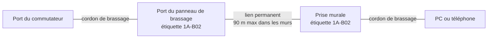

# Panneaux de brassage, prises keystone et étiquetage

| Élément | Contenu |
|---|---|
| **Référent** | Raccorder un câble par poinçonnage sur un panneau de brassage ou une prise keystone (IDC de type 110), et étiqueter les deux extrémités. |
| **Émetteur** | **bazeeza** |
| **Message** | Terminer proprement le lien permanent aux deux extrémités et l'étiqueter pour que tout technicien trouve le bon port sans suivre le câble. |
| **Récepteur** | Techniciens terrain, techniciens en câblage, techniciens de soutien TI, étudiants en informatique. |
| **Canal** | Dépôt GitHub `Bazeeza/Technical-Runbooks` |
| **Code** | Français, rédaction technique (traduction de l'original anglais) · outil à poinçonner (lame 110), panneau de brassage, prises keystone |
| **Référence** | [Black Box: copper cable installation guidelines](https://www.blackbox.com/insights/blackbox-explains/inner/detail/copper-cable/copper-cable-for-every-environment/copper-cable-installation-guidelines) · [Fluke Networks: T568A vs T568B](https://www.flukenetworks.com/knowledge-base/application-or-standards-articles-copper/differences-between-wiring-codes-t568a-vs) · [Cabling Installation & Maintenance: boiling down the 606-A labeling standard](https://www.cablinginstall.com/connectivity/article/16465694/boiling-down-the-606-a-labeling-standard) |

Fait partie de [08 Câblage réseau et terminaison](README.fr.md), étape 5.

---

## Objectif

Une installation de câblage structuré a trois parties : le **panneau de brassage** dans la baie, le **lien permanent** dans les murs et la **prise murale** au poste de travail. Des cordons de brassage relient le panneau au commutateur et la prise au PC. Quand le panneau et la prise sont terminés avec le même schéma et étiquetés avec le même identifiant, un technicien passe de « le poste 2-14 n'a pas de réseau » au bon port du commutateur en une minute.

## Prérequis

- [ ] Un **outil à poinçonner** avec une lame 110 (le côté coupant de la lame est tourné vers le bout du fil à couper)
- [ ] Un panneau de brassage ou des prises keystone de la **même catégorie** que le câble (câble Cat 6 sur des prises Cat 6)
- [ ] Le schéma de câblage du site : **T568A ou T568B**, imprimé sur le panneau ou l'étiquette de la prise
- [ ] Une étiqueteuse ou des étiquettes préimprimées, et le plan d'étiquetage du site
- [ ] Des attaches à fermeture autoagrippante (type Velcro) pour les faisceaux

## Procédure

### Étape 1 — Acheminer et ranger le câble au panneau

Amenez le câble à l'arrière de son port, avec une boucle de réserve (*service loop*) de mou dans la baie ou le plafond. Gardez un rayon de courbure d'au moins **4 fois le diamètre du câble** pour l'UTP et ne tirez pas avec plus de **110 N (environ 25 lbf)**.

**Résultat attendu :** le câble atteint le port sans tension et sans pliure prononcée.

### Étape 2 — Dénuder la gaine

Retirez environ **25 mm (1 po)** de gaine avec une pince à dénuder, sans entailler les fils. Coupez le fil de déchirement et la croix de séparation en plastique (Cat 6) à ras de la gaine.

**Résultat attendu :** quatre paires intactes, la gaine s'arrêtant juste à l'arrière de l'IDC.

### Étape 3 — Placer les paires dans l'IDC

Suivez les étiquettes de couleurs **imprimées sur le panneau ou la prise** pour le schéma choisi (A ou B). Détorsadez chaque paire seulement autant qu'il faut pour atteindre sa fente : **pas plus de 13 mm (0,5 po)** de fil détorsadé pour le Cat 5e et plus.

**Pourquoi :** ce sont les torsades qui annulent la diaphonie. Chaque millimètre détorsadé au-delà de la limite ajoute du bruit, et un long détorsadage peut à lui seul faire échouer une certification Cat 6.

### Étape 4 — Poinçonner

Placez l'outil à poinçonner bien droit sur chaque fil, côté coupant vers l'extérieur, et appuyez jusqu'au déclic. L'outil enfonce le fil dans l'IDC et coupe l'excédent en un seul geste.

**Résultat attendu :** chaque fil est enfoncé à fond dans sa fente, l'excédent est coupé proprement et aucun cuivre n'est exposé hors de l'IDC.

> [!TIP]
> Les prises keystone et les panneaux de brassage de fabricants différents placent les couleurs différemment à l'arrière. Suivez toujours l'étiquette de couleurs de la pièce elle-même, pas une photo d'un autre modèle.

### Étape 5 — Terminer l'autre extrémité avec le même schéma

Au poste de travail, terminez la prise keystone de la même façon, avec le **même schéma** que le panneau. Mélanger A à une extrémité et B à l'autre crée des **paires croisées**, détectées par le [test du câble](CABLE-TESTING.fr.md).

### Étape 6 — Étiqueter les deux extrémités

Mettez le **même identifiant** sur le port du panneau de brassage et sur la plaque murale, et sur le câble lui-même près de chaque extrémité si le site l'exige.

Un format courant, tiré de la norme d'étiquetage ANSI/TIA-606-A pour un lien horizontal, est **fs-an** :

| Partie | Signification | Exemple |
|---|---|---|
| **f** | Étage | `1` |
| **s** | Local de télécommunication à cet étage | `A` |
| **a** | Panneau de brassage dans ce local | `B` |
| **n** | Numéro du port sur le panneau | `02` |

Exemple : **`1A-B02`** désigne l'étage 1, la salle de télécommunication A, le panneau de brassage B, le port 02. La prise murale du poste porte le même `1A-B02`.

Règles d'étiquetage :

- **Étiquettes imprimées**, jamais écrites à la main : elles restent lisibles pendant des années.
- Le **même identifiant aux deux extrémités**, pour que personne n'ait besoin d'un générateur de tonalité pour un câble étiqueté.
- Le plan d'étiquetage est **écrit** et conservé avec la documentation du site, avec le port du commutateur auquel chaque port du panneau est brassé.

### Étape 7 — Ranger le faisceau

Regroupez les câbles d'un panneau avec des attaches autoagrippantes, **sans serrer** : une attache qui déforme la gaine change la géométrie des paires et peut dégrader les performances. N'utilisez jamais d'agrafes sur un câble réseau.

## Vérification

- [ ] Chaque port réussit le [test du câble](CABLE-TESTING.fr.md) entre le port du panneau et sa prise murale
- [ ] Le port du panneau et la prise murale portent le même identifiant imprimé
- [ ] Le détorsadage à chaque IDC reste sous 13 mm ; aucun cuivre visible hors de l'IDC
- [ ] Le plan d'étiquetage est mis à jour avec les nouveaux ports et leurs ports de commutateur

## Dépannage

| Symptôme | Cause probable | Correction |
|---|---|---|
| Un fil ouvert après le poinçonnage | Fil mal enfoncé, ou coupé par la lame tournée du mauvais côté | Poinçonner de nouveau le fil ; s'il a été coupé trop court, refaire la terminaison du câble |
| Paires croisées entre le panneau et la prise | Une extrémité en T568A, l'autre en T568B | Refaire une extrémité avec le schéma du site |
| Un lien Cat 6 échoue à la certification, le schéma de câblage est correct | Trop de détorsadage ou gaine dénudée trop loin | Refaire la terminaison avec moins de détorsadage |
| L'étiquette du port ne correspond pas à la documentation du commutateur | Plan non mis à jour après un déménagement | Suivre le câble avec le générateur de tonalité et la sonde ou le clignotement du port du commutateur, puis mettre le plan à jour |

## Retour arrière

Une mauvaise terminaison est coupée et refaite avec du câble neuf pris dans la boucle de réserve. Retirez l'étiquette d'un port abandonné et marquez-le comme libre dans le plan d'étiquetage.

---

Écrit par bazeeza · Vous avez trouvé une erreur ? <a href="https://github.com/Bazeeza/Technical-Runbooks/issues/new?template=runbook-error.yml">Signalez-la ici</a>.
