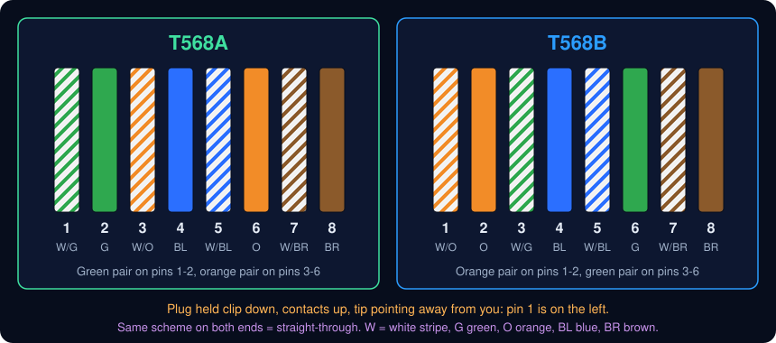

# Câblage réseau et terminaison : fabriquer un câble RJ45 qui réussit le test

| Élément | Contenu |
|---|---|
| **Référent** | Choisir, terminer, tester et étiqueter un câble Ethernet à paires torsadées (Cat 5e, Cat 6, Cat 6A) avec des connecteurs RJ45. |
| **Émetteur** | **bazeeza** |
| **Message** | Fabriquer un câble droit selon T568A ou T568B, choisir la bonne catégorie et prouver le résultat avec un testeur de câbles avant de brancher quoi que ce soit. |
| **Récepteur** | Techniciens terrain, techniciens en câblage et en télécommunication, techniciens de soutien TI, étudiants en informatique. |
| **Canal** | Dépôt GitHub `Bazeeza/Technical-Runbooks` |
| **Code** | Français, rédaction technique (traduction de l'original anglais) · pince à dénuder, pince à sertir RJ45, testeur de câbles |
| **Référence** | [Fluke Networks: T568A vs T568B wiring and colour code](https://www.flukenetworks.com/knowledge-base/application-or-standards-articles-copper/differences-between-wiring-codes-t568a-vs) · [Fluke Networks: Ethernet cable categories and speeds](https://www.flukenetworks.com/blog/cabling-chronicles/ethernet-cable-history) · [Fluke Networks: 10GBASE-T field testing requirements](https://www.flukenetworks.com/knowledge-base/applicationstandards-articles-copper/10gbase-t-field-testing-requirements) · [Black Box: copper cable installation guidelines](https://www.blackbox.com/insights/blackbox-explains/inner/detail/copper-cable/copper-cable-for-every-environment/copper-cable-installation-guidelines) |

---

## Objectif

La couche physique est la base de tout réseau : un câble mal serti cause des pertes de lien, un lien à 100 Mb/s au lieu de 1 Gb/s, ou des erreurs qui ressemblent à un « réseau lent ». Ce runbook fabrique un câble RJ45 qui respecte le code de couleurs, utilise la bonne catégorie et est **prouvé** bon par un testeur, puis étiqueté pour que le technicien suivant le retrouve.

Fichiers associés :

- [Schéma de brochage T568A et T568B](t568-pinout.svg)
- [Tester un câble en cuivre et lire les défauts du schéma de câblage (*wire map*)](CABLE-TESTING.fr.md)
- [Panneaux de brassage, prises keystone et étiquetage](PATCH-PANEL-AND-LABELING.fr.md)

## Prérequis

- [ ] Un câble de la catégorie requise, à conducteurs **pleins** (*solid*) pour les parcours dans les murs, **multibrins** (*stranded*) pour les cordons de brassage
- [ ] Des fiches RJ45 adaptées au câble : catégorie, conducteur plein ou multibrin, et calibre des conducteurs ; plus des manchons de protection (*boots*)
- [ ] Une pince à dénuder, une pince coupante à ras, une pince à sertir RJ45 pour ce type de fiche
- [ ] Un testeur de câbles avec son unité distante
- [ ] Le schéma de câblage du site (T568A ou T568B) : le demander, ou regarder un panneau de brassage existant

---

## Les codes de couleurs

| Broche | T568A | T568B | Paire (T568A / T568B) |
|---|---|---|---|
| 1 | Blanc / vert | Blanc / orange | 3 / 2 |
| 2 | Vert | Orange | 3 / 2 |
| 3 | Blanc / orange | Blanc / vert | 2 / 3 |
| 4 | Bleu | Bleu | 1 |
| 5 | Blanc / bleu | Blanc / bleu | 1 |
| 6 | Orange | Vert | 2 / 3 |
| 7 | Blanc / brun | Blanc / brun | 4 |
| 8 | Brun | Brun | 4 |

Les paires sont numérotées 1 bleue, 2 orange, 3 verte, 4 brune. Les deux schémas ne font qu'**échanger les paires orange et verte** : le bleu reste sur 4-5 et le brun sur 7-8. Une paire utilise toujours les broches **1-2, 3-6, 4-5 ou 7-8**, c'est pourquoi les broches 3 et 6 ne sont pas côte à côte.

> [!NOTE]
> T568A et T568B ont les **mêmes performances**. T568A est le schéma privilégié par la norme TIA-568 (et exigé dans certains contrats gouvernementaux) ; T568B est très courant dans les installations commerciales. Ce qui compte, c'est d'utiliser **un seul schéma partout sur un site**, aux deux extrémités de chaque câble.

## Câble droit ou croisé ?

| Câble | Extrémités | Usage |
|---|---|---|
| **Droit** (*straight-through*) | Même schéma aux deux extrémités (A-A ou B-B) | PC vers commutateur, commutateur vers routeur, cordons de brassage, tous les parcours de câblage structuré |
| **Croisé** (*crossover*) | T568A à une extrémité, T568B à l'autre | Autrefois pour relier deux appareils du même type (PC à PC, commutateur à commutateur) |

Les commutateurs et cartes réseau modernes prennent en charge l'**Auto-MDI-X** : ils détectent les paires et inversent eux-mêmes l'émission et la réception, donc un câble droit fonctionne entre deux appareils quelconques. Fabriquez **uniquement des câbles droits**, sauf si un vieil appareil sans Auto-MDI-X exige précisément un câble croisé.

## Choisir une catégorie

| Catégorie | Bande passante | Gigabit Ethernet (1000BASE-T) | 10 Gigabit Ethernet (10GBASE-T) | Usage typique |
|---|---|---|---|---|
| **Cat 5e** | 100 MHz | 100 m | Non pris en charge | Installations existantes, cordons de brassage courts |
| **Cat 6** | 250 MHz | 100 m | 37 m, jusqu'à 55 m selon la diaphonie exogène (*alien crosstalk*) | Bureaux, la plupart des nouvelles prises de poste |
| **Cat 6A** | 500 MHz | 100 m | 100 m | Nouvelles installations, points d'accès Wi-Fi 6/6E/7, PoE++ |

La limite Ethernet de 100 m vaut pour le **canal** complet : au plus **90 m** de câble permanent dans les murs plus **10 m** de cordons de brassage au total. Chaque composant (câble, prise, fiche, cordon) doit être de la même catégorie, sinon le lien ne vaut pas mieux que son maillon le plus faible.

---

## Procédure

### Étape 1 — Couper et dénuder

Coupez le câble bien d'équerre avec la pince coupante à ras. Dénudez environ **25 mm (1 po)** de gaine avec la pince à dénuder, en la faisant tourner une fois autour du câble. Vérifiez qu'aucun isolant de conducteur n'est entaillé : une entaille peut causer un court-circuit plus tard.

**Résultat attendu :** quatre paires torsadées intactes. Coupez le fil de déchirement (*rip cord*) et, sur du Cat 6, la croix de séparation en plastique (*spline*), à ras de la gaine.

### Étape 2 — Détorsader et ordonner les fils

Séparez les quatre paires, détorsadez-les juste assez et disposez les huit fils à plat, côte à côte, dans l'ordre du schéma choisi (tableau ci-dessus), broche 1 à gauche, la fiche tenue languette vers le bas, contacts vers le haut, bout pointé loin de vous.

**Pourquoi :** les torsades annulent les interférences et la diaphonie. Gardez-les le plus près possible de la fiche : pas plus de **13 mm (0,5 po)** détorsadés.

### Étape 3 — Couper les fils à la bonne longueur

Aplatissez les fils entre vos doigts et coupez-les droit pour qu'une fois insérés dans la fiche, la **gaine entre dans la fiche** au-delà du point de serrage (*strain relief*) et que les fils atteignent le bout de la fiche.

**Résultat attendu :** une rangée plate et égale de huit fils, coupés à la longueur indiquée par le fabricant de la fiche (tenez les fils contre la fiche pour vérifier).

> [!TIP]
> Les fiches **traversantes** (*pass-through*) laissent les fils ressortir à l'avant de la fiche, ce qui permet de vérifier facilement l'ordre des couleurs avant de sertir ; la pince à sertir pour fiches traversantes les coupe ensuite à ras. Les fiches standard demandent une coupe précise, mais aucun outil spécial.

### Étape 4 — Insérer dans la fiche

Glissez les fils dans la fiche, contacts vers le haut, en gardant l'ordre. Poussez jusqu'à ce que chaque fil touche l'avant de la fiche et que la gaine soit à l'intérieur du corps de la fiche.

**Vérifier avant de sertir :** regardez par le côté et par l'avant de la fiche : couleurs dans le bon ordre, chaque bout de cuivre visible à l'avant, gaine sous la languette de serrage.

### Étape 5 — Sertir

Insérez la fiche dans la pince à sertir et serrez à fond jusqu'à ce que le cliquet se libère. L'outil enfonce les huit contacts à travers l'isolant et bloque la gaine.

**Résultat attendu :** les huit contacts dorés sont enfoncés au même niveau, et tirer doucement sur le câble ne le fait pas bouger dans la fiche.

### Étape 6 — Répéter à l'autre extrémité, puis tester

Terminez l'autre extrémité avec le **même schéma**. Glissez le manchon sur le câble **avant** de sertir. Testez ensuite le câble comme décrit dans [CABLE-TESTING.fr.md](CABLE-TESTING.fr.md).

**Résultat attendu :** le testeur montre les broches 1 à 8 en droit, chaque paire réussit et la longueur correspond au câble.

### Étape 7 — Étiqueter

Étiquetez les deux extrémités avec le même identifiant. Pour les panneaux de brassage et les prises murales, suivez [PATCH-PANEL-AND-LABELING.fr.md](PATCH-PANEL-AND-LABELING.fr.md).

---

## Sécurité et bonnes pratiques

| Règle | Pourquoi |
|---|---|
| Porter des lunettes de sécurité pour couper et dénuder | Les bouts de cuivre et les morceaux de croix de séparation volent |
| Tenir le câble de données loin des câbles électriques, jamais dans le même conduit ou la même boîte que l'alimentation | Évite les interférences et, surtout, les dangers électriques |
| Utiliser un câble avec la cote de résistance au feu exigée par le code du bâtiment (espaces plénum ou colonnes montantes) | Une gaine non cotée dans un espace de circulation d'air propage le feu et des fumées toxiques |
| Respecter le rayon de courbure (4 fois le diamètre du câble) et la tension de tirage (110 N) | Les pliures et un tirage excessif déforment les paires de façon permanente |
| Utiliser une échelle stable et vérifier les avertissements d'amiante ou électriques avant d'ouvrir un plafond | La plupart des accidents de câblage sont des chutes |
| Ne jamais couper ni refaire la terminaison d'un câble qui alimente un appareil (caméra PoE, point d'accès, téléphone) sans d'abord le débrancher au commutateur | Évite d'endommager l'équipement et confirme qu'il s'agit du bon câble (niveaux de puissance PoE : [préparation du réseau pour la voix](../10-VoIP-SIP-Phone-Troubleshooting/VOICE-NETWORK-READINESS.fr.md#alimentation-par-ethernet-poe)) |

## Vérification

- [ ] Les deux extrémités suivent le même schéma (A-A ou B-B)
- [ ] Testeur de câbles : schéma de câblage réussi, chaque paire correcte, longueur plausible
- [ ] Gaine tenue par le serrage de la fiche aux deux extrémités, manchons en place
- [ ] L'appareil branché établit le lien à la vitesse attendue (`Get-NetAdapter` affiche **1 Gbps** pour un lien gigabit)
- [ ] Les deux extrémités sont étiquetées

## Dépannage

| Symptôme | Cause probable | Correction |
|---|---|---|
| Lien à **100 Mb/s** au lieu de 1 Gb/s | Une des quatre paires est ouverte ou défectueuse : le 100 Mb/s n'utilise que les paires sur 1-2 et 3-6, le gigabit utilise les quatre | Tester le câble, refaire la terminaison de l'extrémité défectueuse |
| Aucun lien | Fil ouvert, fiche non sertie, ou mauvais câble branché | Tester avec le testeur de câbles ; vérifier les deux extrémités |
| Le lien tombe quand on touche le câble | Gaine hors de la fiche, fils mal tenus dans les contacts | Couper et refaire la terminaison avec la gaine dans la fiche |
| Fonctionne avec un câble court, échoue avec un long | Canal de plus de 100 m, ou mauvaise catégorie pour la vitesse | Mesurer la longueur avec le testeur ; raccourcir ou ajouter un commutateur |
| Le testeur montre des paires croisées | T568A à une extrémité, T568B à l'autre | Refaire une extrémité avec le schéma du site |
| La fiche se fend ou les contacts ne descendent pas | Mauvais type de fiche pour le câble (conducteur plein dans une fiche pour multibrin seulement) ou mauvais outil | Utiliser des fiches prévues pour le câble et l'outil correspondant |

## Retour arrière

Une mauvaise terminaison RJ45 ne se répare pas : coupez la fiche juste derrière et refaites la terminaison. Laissez pour cela un peu de mou aux deux extrémités des câbles installés.

---

Écrit par bazeeza · Vous avez trouvé une erreur ? <a href="https://github.com/Bazeeza/Technical-Runbooks/issues/new?template=runbook-error.yml">Signalez-la ici</a>.
