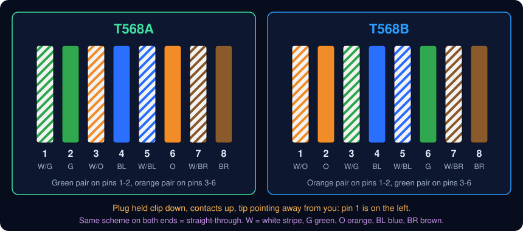

# Network Cabling and Termination: Building an RJ45 Cable That Passes the Test

| Element | Content |
|---|---|
| **Referent** | Choosing, terminating, testing and labeling twisted-pair Ethernet cable (Cat 5e, Cat 6, Cat 6A) with RJ45 connectors. |
| **Sender** | **Bariu Azeez** |
| **Message** | Build a straight-through cable to T568A or T568B, choose the right category, and prove the result with a cable tester before connecting anything. |
| **Receiver** | Field technicians, cabling and telecommunication technicians, help desk technicians, IT students. |
| **Channel** | GitHub repository `Bazeeza/Technical-Runbooks` |
| **Code** | English, technical writing · cable stripper, RJ45 crimping tool, cable tester |
| **Reference** | [Fluke Networks: T568A vs T568B wiring and colour code](https://www.flukenetworks.com/knowledge-base/application-or-standards-articles-copper/differences-between-wiring-codes-t568a-vs) · [Fluke Networks: Ethernet cable categories and speeds](https://www.flukenetworks.com/blog/cabling-chronicles/ethernet-cable-history) · [Fluke Networks: 10GBASE-T field testing requirements](https://www.flukenetworks.com/knowledge-base/applicationstandards-articles-copper/10gbase-t-field-testing-requirements) · [Black Box: copper cable installation guidelines](https://www.blackbox.com/insights/blackbox-explains/inner/detail/copper-cable/copper-cable-for-every-environment/copper-cable-installation-guidelines) |

---

## Objective

The physical layer is the base of every network: a badly crimped cable causes link drops, a 100 Mb/s link instead of 1 Gb/s, or errors that look like a "slow network". This runbook builds an RJ45 cable that follows the colour code, uses the right category, and is **proven** good by a tester, then labeled so the next technician can find it.

Companion files:

- [T568A and T568B pinout diagram](t568-pinout.svg)
- [Testing a copper cable and reading wire map faults](CABLE-TESTING.md)
- [Patch panels, keystone jacks and labeling](PATCH-PANEL-AND-LABELING.md)

## Prerequisites

- [ ] Cable of the required category, **solid** conductors for runs in walls, **stranded** for patch cords
- [ ] RJ45 plugs matching the cable: category, solid or stranded, and conductor size; plus strain-relief boots
- [ ] Cable stripper, flush cutter, RJ45 crimping tool for that plug type
- [ ] A cable tester with its remote unit
- [ ] The site wiring scheme (T568A or T568B): ask, or look at an existing patch panel

---

## The colour codes

| Pin | T568A | T568B | Pair (T568A / T568B) |
|---|---|---|---|
| 1 | White / green | White / orange | 3 / 2 |
| 2 | Green | Orange | 3 / 2 |
| 3 | White / orange | White / green | 2 / 3 |
| 4 | Blue | Blue | 1 |
| 5 | White / blue | White / blue | 1 |
| 6 | Orange | Green | 2 / 3 |
| 7 | White / brown | White / brown | 4 |
| 8 | Brown | Brown | 4 |

Pairs are numbered 1 blue, 2 orange, 3 green, 4 brown. The two schemes only **swap the orange and green pairs**: blue stays on 4-5 and brown on 7-8. A pair always uses pins **1-2, 3-6, 4-5 or 7-8**, which is why pins 3 and 6 are not side by side.

> [!NOTE]
> T568A and T568B have the **same performance**. T568A is the preferred scheme of the TIA-568 standard (and required on some government contracts); T568B is very common in commercial installations. What matters is to use **one scheme everywhere on a site**, at both ends of every cable.

## Straight-through or crossover?

| Cable | Ends | Use |
|---|---|---|
| **Straight-through** | Same scheme at both ends (A-A or B-B) | PC to switch, switch to router, patch cords, every structured cabling run |
| **Crossover** | T568A at one end, T568B at the other | Historically for like-to-like devices (PC to PC, switch to switch) |

Modern switches and network cards support **Auto-MDI-X**: they detect the pairs and swap transmit and receive themselves, so a straight-through cable works between any two devices. Build **straight-through cables only**, unless an old device without Auto-MDI-X specifically needs a crossover.

## Choosing a category

| Category | Bandwidth | Gigabit Ethernet (1000BASE-T) | 10 Gigabit Ethernet (10GBASE-T) | Typical use |
|---|---|---|---|---|
| **Cat 5e** | 100 MHz | 100 m | Not supported | Existing installations, short patch cords |
| **Cat 6** | 250 MHz | 100 m | 37 m, up to 55 m depending on alien crosstalk | Offices, most new desk drops |
| **Cat 6A** | 500 MHz | 100 m | 100 m | New installations, Wi-Fi 6/6E/7 access points, PoE++ |

The 100 m Ethernet limit is for the whole **channel**: at most **90 m** of permanent cable in the walls plus **10 m** of patch cords in total. Every component (cable, jack, plug, patch cord) must be of the same category, or the link is only as good as its weakest part.

---

## Procedure

### Step 1 — Cut and strip

Cut the cable square with the flush cutter. Strip about **25 mm (1 in.)** of jacket with the stripper, turning it once around the cable. Check that no conductor insulation is nicked: a nick can short later.

**Expected result:** four intact twisted pairs. Cut away the rip cord and, on Cat 6, the plastic spline, flush with the jacket.

### Step 2 — Untwist and order the wires

Separate the four pairs, untwist them just enough, and arrange the eight wires flat, side by side, in the order of the chosen scheme (table above), pin 1 on the left with the plug held clip down, contacts up, tip pointing away from you.

**Why:** the twists cancel interference and crosstalk. Keep them as close to the plug as possible: no more than **13 mm (0.5 in.)** untwisted.

### Step 3 — Trim the wires to length

Flatten the wires between your fingers and cut them straight across so that, inserted in the plug, the **jacket enters the plug** past the strain-relief point and the wires reach the end of the plug.

**Expected result:** a flat, even row of eight wires, cut to the length the plug manufacturer specifies (hold the wires against the plug to check).

> [!TIP]
> **Pass-through** plugs let the wires go out the front of the plug, which makes the colour order easy to check before crimping; the crimping tool for pass-through plugs then cuts them flush. Standard plugs need a precise cut, but no special tool.

### Step 4 — Insert into the plug

Slide the wires into the plug, contacts up, keeping the order. Push until every wire touches the front of the plug and the jacket is inside the plug body.

**Check before crimping:** look through the side and the front of the plug: colours in the right order, every copper end visible at the front, jacket under the strain-relief tab.

### Step 5 — Crimp

Insert the plug into the crimping tool and squeeze fully until the ratchet releases. The tool pushes the eight contacts down through the insulation and locks the jacket.

**Expected result:** all eight gold contacts are pushed down to the same level, and pulling gently on the cable does not move it in the plug.

### Step 6 — Repeat on the other end, then test

Terminate the other end with the **same scheme**. Slide the boot on the cable **before** crimping it. Then test the cable as described in [CABLE-TESTING.md](CABLE-TESTING.md).

**Expected result:** the tester shows pins 1 to 8 straight through, every pair passes, and the length matches the cable.

### Step 7 — Label

Label both ends with the same identifier. For patch panels and wall jacks, follow [PATCH-PANEL-AND-LABELING.md](PATCH-PANEL-AND-LABELING.md).

---

## Safety and good practice

| Rule | Why |
|---|---|
| Wear safety glasses when cutting and stripping | Copper ends and spline pieces fly |
| Keep data cable away from electrical cables, never in the same conduit or box as power | Avoids interference and, above all, electrical hazards |
| Use cable with the fire rating required by the building code (plenum or riser spaces) | A non-rated jacket in an air-handling space spreads fire and toxic smoke |
| Respect bend radius (4 times the cable diameter) and pulling tension (110 N) | Kinks and over-pulling deform the pairs permanently |
| Use a stable ladder and check for asbestos or electrical warnings before opening a ceiling | Most cabling accidents are falls |
| Never cut or re-terminate a cable that powers a device (PoE camera, access point, phone) without disconnecting it at the switch first | Avoids damaging the equipment and confirms you have the right cable |

## Verification

- [ ] Both ends follow the same scheme (A-A or B-B)
- [ ] Cable tester: wire map pass, every pair correct, length plausible
- [ ] Jacket held by the plug's strain relief at both ends, boots in place
- [ ] Connected device links at the expected speed (`Get-NetAdapter` shows **1 Gbps** for a gigabit link)
- [ ] Both ends labeled

## Troubleshooting

| Symptom | Likely cause | Fix |
|---|---|---|
| Link at **100 Mb/s** instead of 1 Gb/s | One of the four pairs is open or bad: 100 Mb/s only uses pairs on 1-2 and 3-6, gigabit uses all four | Test the cable, re-terminate the faulty end |
| No link at all | Open wire, plug not crimped, or wrong cable plugged | Test with the cable tester; check both ends |
| Link drops when the cable is touched | Jacket outside the plug, wires loose in the contacts | Cut off and re-terminate with the jacket inside the plug |
| Works with a short cable, fails with a long one | Over 100 m channel, or wrong category for the speed | Measure the length with the tester; shorten or add a switch |
| Tester shows crossed pairs | T568A on one end, T568B on the other | Re-terminate one end with the site scheme |
| Plug cracks or contacts do not go down | Wrong plug type for the cable (solid conductor in a stranded-only plug) or wrong tool | Use plugs rated for the cable and the matching tool |

## Rollback

A bad RJ45 termination cannot be repaired: cut the plug off just behind it and terminate again. Keep a little slack at both ends of installed cables for this.

---

Written by Bariu Azeez · Found an error? <a href="https://github.com/Bazeeza/Technical-Runbooks/issues/new?template=runbook-error.yml">Report it here</a>.
