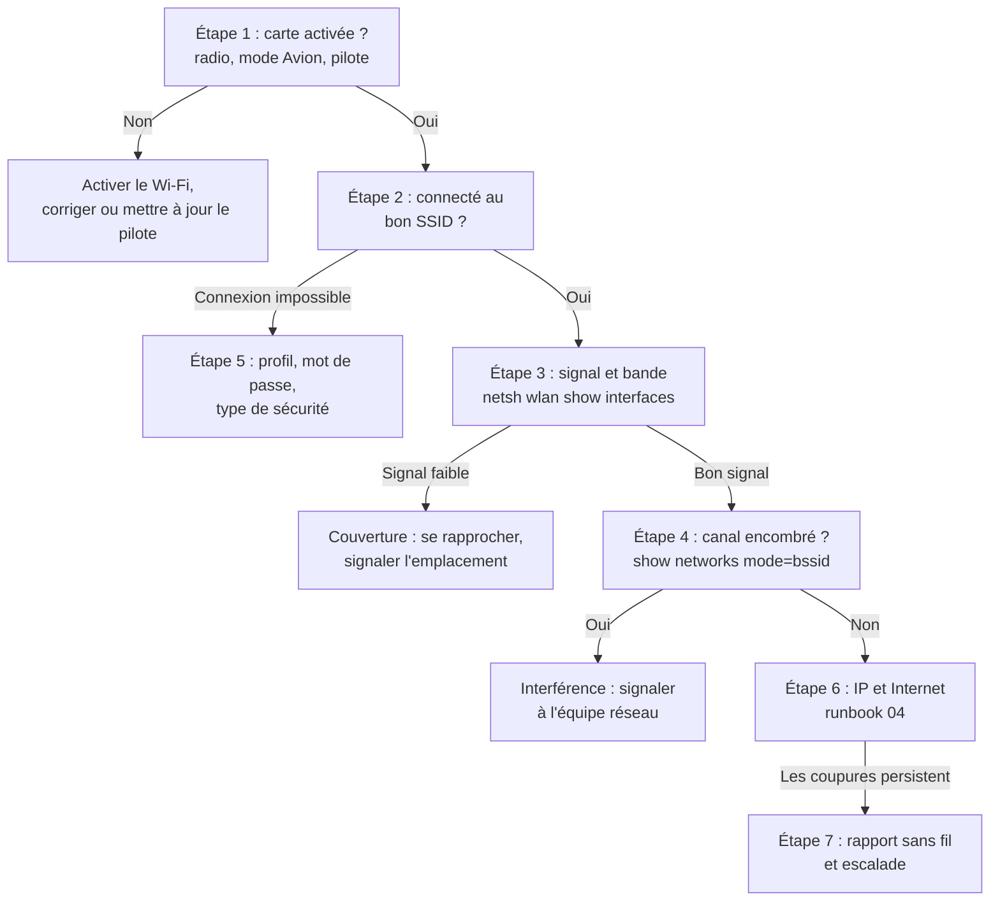

# Dépannage Wi-Fi : « Le Wi-Fi est lent ou se coupe sans arrêt »

[](README.fr.md)
[](README.md)


| Élément | Contenu |
|---|---|
| **Référent** | Diagnostic d'un poste Windows dont la connexion Wi-Fi échoue, se coupe ou est lente. |
| **Émetteur** | **bazeeza** |
| **Message** | Lire les vraies valeurs radio (bande, canal, signal, débit) avec `netsh wlan`, distinguer un problème de couverture ou d'interférence d'un problème de PC, et escalader avec un rapport de réseau sans fil. |
| **Récepteur** | Techniciens de soutien TI, techniciens terrain, étudiants en informatique. |
| **Canal** | Dépôt GitHub `Bazeeza/Technical-Runbooks` |
| **Code** | Français, rédaction technique (traduction de l'original anglais) · `netsh wlan`, module PowerShell `NetAdapter`, Paramètres de Windows 11 |
| **Référence** | [Microsoft Learn: netsh wlan](https://learn.microsoft.com/en-us/windows-server/administration/windows-commands/netsh-wlan) · [Microsoft Support: analyze the wireless network report](https://support.microsoft.com/en-us/help/4000462) · [Microsoft Learn: Wi-Fi access and location changes](https://learn.microsoft.com/en-us/windows/win32/nativewifi/wi-fi-access-location-changes) · [Wi-Fi Alliance: Wi-Fi 6E: the details you need to know](https://www.wi-fi.org/beacon/chuck-lukaszewski/wi-fi-6e-the-details-you-need-to-know) · [Cisco: what is Wi-Fi 6 vs. Wi-Fi 6E vs. Wi-Fi 7](https://www.cisco.com/site/us/en/learn/topics/networking/what-is-wifi-6-vs-wifi-6e.html) |

---

## Objectif

Une plainte Wi-Fi (« lent », « se coupe toutes les heures », « impossible de se connecter ») a trois origines possibles : **l'environnement radio** (signal faible, interférences, canal encombré), **le réseau** (point d'accès, authentification, DHCP) ou **le PC** (pilote, économie d'énergie, ancien profil). Ce runbook lit d'abord les valeurs mesurées, pour que le technicien puisse dire de laquelle il s'agit et la corriger, ou remettre à l'équipe réseau un rapport au lieu de « le Wi-Fi est mauvais ».

Fichiers associés :

- [`Export-WifiDiagnostics.ps1`](Export-WifiDiagnostics.ps1) : enregistre la sortie de chaque commande de ce runbook dans un seul dossier pour le billet, avec `-WhatIf`.
- [Lire le rapport de réseau sans fil](WLAN-REPORT.fr.md) : ce que contient `netsh wlan show wlanreport` et comment lire une déconnexion.

## Prérequis

- [ ] Un accès au poste (sur place, ou en [assistance à distance](../07-Remote-Support/README.fr.md) : une réinitialisation du Wi-Fi peut couper la session à distance)
- [ ] Le nom du réseau attendu (SSID) et son type de sécurité (WPA2/WPA3 Personnel ou Entreprise)
- [ ] Une invite de commandes ou un PowerShell en mode administrateur pour le rapport de réseau sans fil
- [ ] Si possible, un deuxième appareil sur le même Wi-Fi pour comparer

---

## Les bandes Wi-Fi en un tableau

| Bande | Canaux (Amérique du Nord) | Forces | Faiblesses |
|---|---|---|---|
| **2,4 GHz** | 1 à 11, seuls **1, 6 et 11** ne se chevauchent pas | Plus grande portée, traverse le mieux les murs | Seulement trois canaux propres, partagés avec le Bluetooth, les fours à micro-ondes et tous les voisins |
| **5 GHz** | 36 à 165, nombreux canaux sans chevauchement | Beaucoup plus de capacité, moins d'interférences | Portée plus courte, les murs absorbent davantage ; les canaux **DFS** (52 à 144) doivent être quittés quand un radar est détecté |
| **6 GHz** | Appareils Wi-Fi 6E et Wi-Fi 7 seulement | Spectre propre, canaux larges | Portée la plus courte, exige une carte 6E/7 **et** le WPA3 ; la disponibilité dépend de l'organisme de réglementation du pays |

> [!NOTE]
> Les générations Wi-Fi et leurs noms IEEE, tels qu'affichés par `netsh` dans **Radio type** (type de radio) : Wi-Fi 4 = 802.11n, Wi-Fi 5 = 802.11ac, Wi-Fi 6 et 6E = 802.11ax, Wi-Fi 7 = 802.11be. Une carte ne peut utiliser que les bandes et les générations qu'elle prend en charge.

## Étape 0 — Définir la portée du problème

| Question | Pourquoi |
|---|---|
| Un utilisateur ou tout le monde dans cette zone ? | Tout le monde → point d'accès, couverture ou interférence. Un utilisateur → ce PC. |
| Partout, ou seulement dans une pièce ? | Une pièce → trou de couverture ou source d'interférence. |
| Impossible de se connecter, connecté sans Internet, ou connecté mais lent / qui se coupe ? | Chaque symptôme mène à une étape différente ci-dessous. |
| Un câble fonctionne-t-il au même poste ? | Le câble fonctionne → le problème vient seulement de la partie sans fil. |
| Qu'est-ce qui a changé : nouveau PC, mise à jour de pilote, nouveau point d'accès, déménagement ? | La plupart des billets Wi-Fi suivent un changement. |

## Arbre de décision



---

## Étape 1 — Vérifier que la carte est activée

```powershell
Get-NetAdapter -Physical | Select-Object Name, InterfaceDescription, Status, LinkSpeed
netsh wlan show drivers
```

Dans **Settings → Network & internet** (*Paramètres → Réseau et Internet*) : le Wi-Fi est **On** (*Activé*) et **Airplane mode** (*Mode Avion*) est désactivé. Certains portables ont aussi une touche de fonction ou un interrupteur physique pour la radio.

**Résultat attendu :** la carte Wi-Fi affiche `Up` (connectée) ou `Disconnected` (activée, mais non associée). `Not Present` ou aucune carte signifie un problème de pilote : ouvrez **Device Manager → Network adapters** (*Gestionnaire de périphériques → Cartes réseau*), puis réinstallez le pilote du fabricant du PC.

Dans `netsh wlan show drivers`, la ligne **Radio types supported** (types de radio pris en charge) liste les générations que la carte peut utiliser, et la liste des authentifications montre si elle prend en charge le **WPA3**. Une vieille carte qui ne liste que `802.11n` ne verra jamais un réseau 6 GHz, et une carte sans WPA3 ne peut pas rejoindre un réseau WPA3 seulement.

## Étape 2 — Lire l'état de la connexion

```cmd
netsh wlan show interfaces
```

| Champ | Ce qu'il faut vérifier |
|---|---|
| **State** | `connected`, `disconnected`, ou `authenticating` bloqué longtemps |
| **SSID** | Le bon réseau, pas un réseau invité ou un réseau voisin au nom semblable |
| **AP BSSID** | L'adresse MAC de la radio du point d'accès utilisé : elle change quand le PC passe à un autre point d'accès (itinérance) |
| **Band** et **Channel** | 2,4, 5 ou 6 GHz, et le numéro du canal (voir le tableau ci-dessus) |
| **Radio type** | La génération négociée, par exemple `802.11ac` |
| **Authentication** et **Cipher** | Doivent correspondre au réseau, par exemple `WPA2-Personal` / `CCMP` |
| **Receive rate** / **Transmit rate** (Mbps) | Débit de liaison négocié avec le point d'accès, pas le débit réel |
| **Signal** et **Rssi** | Le signal en pourcentage, et la puissance du signal reçu en dBm |

Les noms de champs ci-dessus sont ceux qu'affiche Windows 11 en anglais ; un Windows en français affiche les mêmes informations avec des libellés traduits.

> [!NOTE]
> Depuis Windows 11 version 24H2, les commandes qui lisent le SSID ou le BSSID exigent l'**accès à la localisation**. Si `netsh wlan` répond qu'il a besoin de l'autorisation de localisation, activez **Settings → Privacy & security → Location → Location services** (*Paramètres → Confidentialité et sécurité → Localisation → Services de localisation*), puis relancez la commande.

## Étape 3 — Évaluer le signal

| Rssi (dBm) | Qualité du signal | À quoi s'attendre |
|---|---|---|
| -30 à -60 | Excellente à très bonne | Pleine vitesse |
| -60 à -67 | Bonne | Cible de conception courante pour les appels vocaux et vidéo |
| -67 à -75 | Passable | Le Web et le courriel fonctionnent, les appels et la vidéo peuvent saccader |
| -75 à -85 | Faible | Lent, retransmissions et coupures fréquentes |
| sous -85 | Inutilisable | Déconnexions |

Les valeurs en dBm sont négatives : **-55 est plus fort que -75**. Chaque écart de 3 dB divise ou double la puissance, donc quelques dB comptent.

- **Signal faible au poste :** refaites le test à côté du point d'accès. Si le signal y devient bon et que le problème disparaît, c'est la **couverture**, pas le PC. Notez l'emplacement (étage, pièce) pour l'équipe réseau.
- **Bon signal mais débit faible :** le PC est peut-être sur 2,4 GHz alors que le 5 GHz est disponible. Vérifiez **Band**. Beaucoup de réseaux utilisent le même SSID sur les deux bandes et laissent le PC choisir (orientation de bande, *band steering*).
- **Portable sur une station d'accueil :** une station métallique, un écran ou le couvercle fermé peuvent bloquer les antennes, souvent placées dans le cadre de l'écran.

## Étape 4 — Chercher un canal encombré

```cmd
netsh wlan show networks mode=bssid
```

Cette commande liste chaque point d'accès que le PC entend, avec son **Signal**, sa **Band**, son **Channel** et, quand le point d'accès la publie, sa **Channel Utilization** (utilisation du canal, charge BSS).

**Ce qu'il faut chercher :**

- Sur 2,4 GHz, beaucoup de réseaux sur le même canal ou sur des canaux **voisins** (par exemple 3, 4 et 6 se chevauchent). Seuls 1, 6 et 11 sont propres.
- Une **Channel Utilization** qui reste élevée sur le point d'accès utilisé : le canal est occupé, tout le monde attend son tour.
- Plusieurs réseaux voisins puissants sur votre canal : courant dans les immeubles d'appartements et les bureaux partagés.

Le soutien TI ne change **pas** les canaux des points d'accès : il remet cette liste à l'équipe réseau, qui planifie les canaux pour tout l'étage.

## Étape 5 — Corriger une connexion qui échoue

| Symptôme | Cause probable | Correction |
|---|---|---|
| « Can't connect to this network » (*Impossible de se connecter à ce réseau*) après un changement de mot de passe | Ancien profil enregistré avec l'ancienne clé | Oublier le réseau et se reconnecter (ci-dessous) |
| Réseau visible sur d'autres appareils, pas sur ce PC | Bande non prise en charge (6 GHz, ou 5 GHz sur une vieille carte), ou SSID masqué | Vérifier **Radio types supported** (étape 1) ; pour un SSID masqué, l'ajouter manuellement |
| Échoue sur un réseau WPA3, fonctionne en WPA2 | Carte ou pilote sans WPA3 | Mettre à jour le pilote, ou l'équipe réseau active le mode de transition WPA2/WPA3 |
| Le Wi-Fi d'entreprise (802.1X) échoue pour un utilisateur | Mot de passe, certificat ou compte expiré | Vérifier d'abord le compte ([runbook 05](../05-Active-Directory-User-Management/README.fr.md)) |
| Connecté, mais une page de connexion n'apparaît jamais (hôtel, réseau invité) | Portail captif non affiché | Ouvrir un navigateur vers un site en HTTP simple pour déclencher le portail |

**Oublier un réseau** (supprime le profil enregistré et sa clé) :

```cmd
netsh wlan show profiles
netsh wlan delete profile name="Office-WiFi"
```

Ou **Settings → Network & internet → Wi-Fi → Manage known networks → (réseau) → Forget** (*Paramètres → Réseau et Internet → Wi-Fi → Gérer les réseaux connus → (réseau) → Oublier*). Remplacez `Office-WiFi` par le nom exact du profil. L'utilisateur doit connaître le mot de passe avant que vous fassiez cela.

> [!WARNING]
> N'affichez ni n'exportez jamais une clé Wi-Fi pour « vérifier le mot de passe » (`key=clear`) : la clé s'affiche en clair à l'écran et dans l'historique. Demandez à l'utilisateur de la taper, ou obtenez-la de l'équipe réseau.

## Étape 6 — Vérifier l'IP et Internet

Une fois le PC associé avec un bon signal, le reste est identique à un réseau filaire : adresse IP valide, passerelle, DNS, port. Suivez [04 Dépannage réseau](../04-Network-Troubleshooting/README.fr.md) à partir de l'étape 2.

> [!TIP]
> Windows 11 peut utiliser une **adresse matérielle aléatoire** par réseau (**Settings → Network & internet → Wi-Fi → Random hardware addresses**, *Paramètres → Réseau et Internet → Wi-Fi → Adresses matérielles aléatoires*). Un réseau qui filtre par adresse MAC, ou une réservation DHCP, ne reconnaîtra pas le PC si cette option est activée. Vérifiez-la quand « le Wi-Fi fonctionne partout sauf ici ».

## Étape 7 — Coupures répétées, recueillir des preuves

Des déconnexions répétées demandent un historique, pas un test unique. Depuis une invite de commandes en mode administrateur :

```cmd
netsh wlan show wlanreport
```

Cette commande génère un rapport HTML des **trois derniers jours** de sessions Wi-Fi, avec chaque déconnexion et sa raison. Comment le lire : [WLAN-REPORT.fr.md](WLAN-REPORT.fr.md).

Vérifiez ensuite les deux causes côté PC des coupures régulières :

- **Économie d'énergie :** **Device Manager → Network adapters → (carte Wi-Fi) → Properties → Power Management** (*Gestionnaire de périphériques → Cartes réseau → (carte Wi-Fi) → Propriétés → Gestion de l'alimentation*), décochez **Allow the computer to turn off this device to save power** (*Autoriser l'ordinateur à éteindre ce périphérique pour économiser l'énergie*) si les coupures arrivent après des périodes d'inactivité.
- **Pilote :** comparez la date et la version du pilote (`netsh wlan show drivers`) avec la page de soutien du fabricant du PC ; installez la version du fabricant, pas seulement ce que propose Windows Update.

Pour tout enregistrer pour le billet en une seule étape :

```powershell
.\Export-WifiDiagnostics.ps1 -IncludeWlanReport
```

---

## Vérification

- [ ] `netsh wlan show interfaces` affiche `connected` au bon SSID, sur la bande attendue
- [ ] Le **Rssi** est de -67 dBm ou mieux à l'emplacement habituel de l'utilisateur
- [ ] Les applications de l'utilisateur fonctionnent, y compris un appel ou une vidéo si c'était la plainte
- [ ] Pour les coupures intermittentes : aucune nouvelle déconnexion dans le rapport sans fil après la correction (vérifier le lendemain)
- [ ] Le billet indique quelle partie était en cause (couverture, interférence, profil, pilote, réseau) et ce qui a été fait

## Dépannage

| Symptôme | Cause probable | Correction |
|---|---|---|
| Coupures en marchant d'une pièce à l'autre | Le PC garde un point d'accès faible au lieu de passer à un autre (« client collant », *sticky client*) | Noter l'**AP BSSID** avant et après ; mettre à jour le pilote ; signaler à l'équipe réseau |
| Lent seulement à certaines heures | Canal occupé ou nombreux utilisateurs sur un même point d'accès | Étape 4 à l'heure de pointe, signaler l'utilisation du canal |
| Courte déconnexion, plusieurs utilisateurs en même temps, sur 5 GHz | Changement de canal DFS après une détection de radar | Le signaler : l'équipe réseau peut éviter les canaux DFS |
| Le Wi-Fi se coupe quand un casque Bluetooth est utilisé | Les deux partagent la bande 2,4 GHz | Privilégier le 5 GHz pour la connexion Wi-Fi |
| `There is no wireless interface on the system` | Carte désactivée, retirée ou pilote manquant | Étape 1, **Device Manager** (*Gestionnaire de périphériques*) |
| `netsh wlan` demande l'autorisation de localisation | Règle de confidentialité de la localisation de Windows 11 24H2 | Activer les services de localisation (étape 2) |
| Tout échoue après de nombreuses tentatives | Pile réseau corrompue | **Settings → Network & internet → Advanced network settings → Network reset** (*Paramètres → Réseau et Internet → Paramètres réseau avancés → Réinitialisation du réseau* ; réinstalle toutes les cartes, retire les cartes virtuelles des clients VPN, redémarre le PC) |

## Retour arrière

- Un profil oublié est recréé en se reconnectant avec le mot de passe.
- Une réinitialisation du réseau réinstalle les cartes avec les paramètres par défaut : les clients VPN et les commutateurs virtuels peuvent devoir être réinstallés ou reconfigurés ensuite. Prévenez l'utilisateur et notez-le dans le billet avant de la lancer.
- Une mise à jour de pilote peut être annulée dans **Device Manager → (carte) → Properties → Driver → Roll Back Driver** (*Gestionnaire de périphériques → (carte) → Propriétés → Pilote → Restaurer le pilote*).

## Informations à fournir lors d'une escalade

```text
User location (building / floor / room) :
SSID and band (2.4 / 5 / 6 GHz)          :
Channel and AP BSSID                     :
Rssi (dBm) at the desk / near the AP     :
Radio type and driver version            :
Other users affected                     : yes / no
Time of the drops                        :
Wireless report and diagnostics folder   : (attached)
Actions already done                     :
```

Les champs signifient, dans l'ordre : emplacement de l'utilisateur (bâtiment / étage / pièce) ; SSID et bande ; canal et BSSID du point d'accès ; Rssi au poste / près du point d'accès ; type de radio et version du pilote ; autres utilisateurs touchés (oui / non) ; heure des coupures ; rapport sans fil et dossier de diagnostics (joints) ; actions déjà faites.

> [!NOTE]
> Le dossier de diagnostics contient des noms de réseaux et des adresses matérielles. Joignez-le au billet seulement, jamais à un forum public.

---

<sub>Écrit par bazeeza · Vous avez trouvé une erreur ? <a href="https://github.com/Bazeeza/Technical-Runbooks/issues/new?template=runbook-error.yml">Signalez-la ici</a>.</sub>
