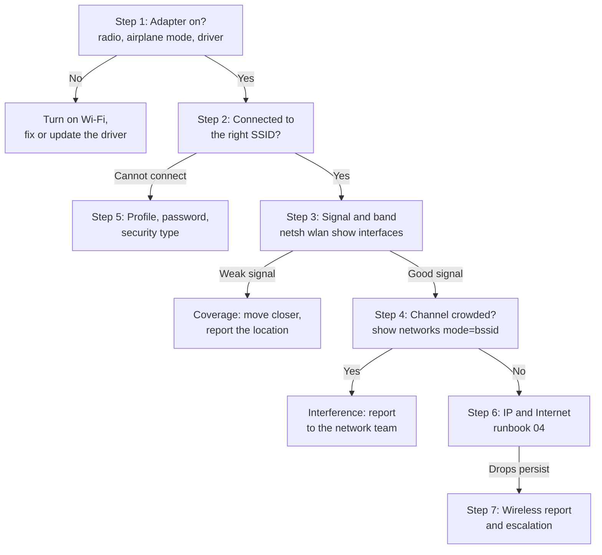

# Wi-Fi Troubleshooting: "The Wi-Fi Is Slow or Keeps Dropping"


| Element | Content |
|---|---|
| **Referent** | Diagnosis of a Windows workstation whose Wi-Fi connection fails, drops or is slow. |
| **Sender** | **Bariu Azeez** |
| **Message** | Read the real radio values (band, channel, signal, rate) with `netsh wlan`, tell a coverage or interference problem from a PC problem, and escalate with a wireless network report. |
| **Receiver** | Help desk technicians, field technicians, IT students. |
| **Channel** | GitHub repository `Bazeeza/Technical-Runbooks` |
| **Code** | English, technical writing · `netsh wlan`, PowerShell `NetAdapter` module, Windows 11 Settings |
| **Reference** | [Microsoft Learn: netsh wlan](https://learn.microsoft.com/en-us/windows-server/administration/windows-commands/netsh-wlan) · [Microsoft Support: analyze the wireless network report](https://support.microsoft.com/en-us/help/4000462) · [Microsoft Learn: Wi-Fi access and location changes](https://learn.microsoft.com/en-us/windows/win32/nativewifi/wi-fi-access-location-changes) · [Wi-Fi Alliance: Wi-Fi 6E: the details you need to know](https://www.wi-fi.org/beacon/chuck-lukaszewski/wi-fi-6e-the-details-you-need-to-know) · [Cisco: what is Wi-Fi 6 vs. Wi-Fi 6E vs. Wi-Fi 7](https://www.cisco.com/site/us/en/learn/topics/networking/what-is-wifi-6-vs-wifi-6e.html) |

---

## Objective

A Wi-Fi complaint ("slow", "drops every hour", "cannot connect") has three possible origins: **the radio environment** (weak signal, interference, crowded channel), **the network** (access point, authentication, DHCP) or **the PC** (driver, power saving, old profile). This runbook reads the measured values first, so the technician can say which one it is and fix it, or hand the network team a report instead of "the Wi-Fi is bad".

Companion files:

- [`Export-WifiDiagnostics.ps1`](Export-WifiDiagnostics.ps1): saves every command output of this runbook into one folder for the ticket, with `-WhatIf`.
- [Reading the wireless network report](WLAN-REPORT.md): what `netsh wlan show wlanreport` contains and how to read a disconnection.

## Prerequisites

- [ ] Access to the workstation (on site, or by [remote support](../07-Remote-Support/README.md): a Wi-Fi reset can cut the remote session)
- [ ] The expected network name (SSID) and its security type (WPA2/WPA3 Personal or Enterprise)
- [ ] An elevated Command Prompt or PowerShell for the wireless network report
- [ ] If possible, a second device on the same Wi-Fi to compare

---

## Wi-Fi bands in one table

| Band | Channels (North America) | Strengths | Weaknesses |
|---|---|---|---|
| **2.4 GHz** | 1 to 11, only **1, 6 and 11** do not overlap | Longest range, crosses walls best | Only three clean channels, shared with Bluetooth, microwave ovens and every neighbour |
| **5 GHz** | 36 to 165, many non-overlapping channels | Much more capacity, less interference | Shorter range, walls absorb more; **DFS** channels (52 to 144) must be left when radar is detected |
| **6 GHz** | Wi-Fi 6E and Wi-Fi 7 devices only | Clean spectrum, wide channels | Shortest range, needs a 6E/7 adapter **and** WPA3; availability depends on the country's regulator |

> [!NOTE]
> Wi-Fi generations and their IEEE names, as shown by `netsh` in **Radio type**: Wi-Fi 4 = 802.11n, Wi-Fi 5 = 802.11ac, Wi-Fi 6 and 6E = 802.11ax, Wi-Fi 7 = 802.11be. An adapter can only use the bands and generations it supports.

## Step 0 — Define the scope

| Question | Why |
|---|---|
| One user or everyone in this area? | Everyone → access point, coverage or interference. One user → this PC. |
| Everywhere, or only in one room? | One room → coverage hole or interference source. |
| Cannot connect, connects without Internet, or connected but slow / dropping? | Each symptom points to a different step below. |
| Does a cable work at the same desk? | Cable works → the problem is the wireless part only. |
| What changed: new PC, driver update, new access point, office move? | Most Wi-Fi tickets follow a change. |

## Decision flow



---

## Step 1 — Check that the adapter is on

```powershell
Get-NetAdapter -Physical | Select-Object Name, InterfaceDescription, Status, LinkSpeed
netsh wlan show drivers
```

In **Settings → Network & internet**: Wi-Fi is **On** and **Airplane mode** is off. Some laptops also have a function key or a physical switch for the radio.

**Expected result:** the Wi-Fi adapter shows `Up` (connected) or `Disconnected` (on, but not associated). `Not Present` or no adapter at all means a driver problem: open **Device Manager → Network adapters**, then reinstall the driver from the PC manufacturer.

In `netsh wlan show drivers`, the line **Radio types supported** lists the generations the adapter can use, and the authentication list shows whether it supports **WPA3**. An old adapter that only lists `802.11n` will never see a 6 GHz network, and one without WPA3 cannot join a WPA3-only network.

## Step 2 — Read the connection state

```cmd
netsh wlan show interfaces
```

| Field | What to check |
|---|---|
| **State** | `connected`, `disconnected`, or `authenticating` stuck for a long time |
| **SSID** | The right network, not a guest or a neighbour network with a similar name |
| **AP BSSID** | The MAC address of the access point radio in use: it changes when the PC roams to another access point |
| **Band** and **Channel** | 2.4, 5 or 6 GHz, and the channel number (see the table above) |
| **Radio type** | The generation negotiated, for example `802.11ac` |
| **Authentication** and **Cipher** | Must match the network, for example `WPA2-Personal` / `CCMP` |
| **Receive rate** / **Transmit rate** (Mbps) | Link rate negotiated with the access point, not the real throughput |
| **Signal** and **Rssi** | Signal as a percentage, and the received signal strength in dBm |

The field names above are the ones displayed by Windows 11 in English; a French Windows shows the same information with translated labels.

> [!NOTE]
> Since Windows 11 version 24H2, commands that read the SSID or BSSID need **location access**. If `netsh wlan` answers that it needs location permission, turn on **Settings → Privacy & security → Location → Location services**, then run the command again.

## Step 3 — Judge the signal

| Rssi (dBm) | Signal quality | What to expect |
|---|---|---|
| -30 to -60 | Excellent to very good | Full speed |
| -60 to -67 | Good | Common design target for voice and video calls |
| -67 to -75 | Fair | Web and e-mail work, calls and video may break up |
| -75 to -85 | Weak | Slow, frequent retries and drops |
| below -85 | Unusable | Disconnections |

dBm values are negative: **-55 is stronger than -75**. Every 3 dB is half or double the power, so a few dB matter.

- **Weak signal at the desk:** test again next to the access point. If the signal becomes good there and the problem disappears, it is **coverage**, not the PC. Note the location (floor, room) for the network team.
- **Good signal but low rate:** the PC may be on 2.4 GHz while 5 GHz is available. Check **Band**. Many networks use the same SSID on both bands and let the PC choose (band steering).
- **Laptop on a dock:** a metal dock, a monitor or the lid closed can block the antennas, which are often in the screen frame.

## Step 4 — Look for a crowded channel

```cmd
netsh wlan show networks mode=bssid
```

This lists every access point the PC hears, with its **Signal**, **Band**, **Channel** and, when the access point publishes it, **Channel Utilization** (BSS load).

**What to look for:**

- On 2.4 GHz, many networks on the same or **neighbouring** channels (for example 3, 4 and 6 overlap). Only 1, 6 and 11 are clean.
- A **Channel Utilization** that stays high on the access point in use: the channel is busy, everyone waits their turn.
- Several strong neighbour networks on your channel: common in apartment buildings and shared offices.

The help desk does **not** change access point channels: it gives this list to the network team, which plans channels for the whole floor.

## Step 5 — Fix a connection that fails

| Symptom | Likely cause | Fix |
|---|---|---|
| "Can't connect to this network" after a password change | Old saved profile with the old key | Forget the network and connect again (below) |
| Network visible on other devices, not on this PC | Band not supported (6 GHz, or 5 GHz on an old adapter), or hidden SSID | Check **Radio types supported** (step 1); for a hidden SSID, add it manually |
| Fails on a WPA3 network, works on WPA2 | Adapter or driver without WPA3 | Update the driver, or the network team enables WPA2/WPA3 transition mode |
| Enterprise Wi-Fi (802.1X) fails for one user | Expired password, certificate, or account | Check the account first ([runbook 05](../05-Active-Directory-User-Management/README.md)) |
| Connected, but a login page never appears (hotel, guest network) | Captive portal not shown | Open a browser to a plain HTTP site to trigger the portal |

**Forget a network** (deletes the saved profile and its key):

```cmd
netsh wlan show profiles
netsh wlan delete profile name="Office-WiFi"
```

Or **Settings → Network & internet → Wi-Fi → Manage known networks → (network) → Forget**. Replace `Office-WiFi` with the exact profile name. The user must know the password before you do this.

> [!WARNING]
> Never display or export a Wi-Fi key to "check the password" (`key=clear`): it prints the key in plain text on the screen and in the history. Ask the user to type it, or get it from the network team.

## Step 6 — Check IP and Internet

Once the PC is associated with a good signal, the rest is the same as a wired network: valid IP address, gateway, DNS, port. Follow [04 Network Troubleshooting](../04-Network-Troubleshooting/README.md) from step 2.

> [!TIP]
> Windows 11 can use a **random hardware address** per network (**Settings → Network & internet → Wi-Fi → Random hardware addresses**). A network that filters by MAC address, or a DHCP reservation, will not recognize the PC if this is on. Check it when "the Wi-Fi works everywhere except here".

## Step 7 — Drops that come back: collect evidence

Repeated disconnections need a history, not a single test. From an elevated Command Prompt:

```cmd
netsh wlan show wlanreport
```

This generates an HTML report of the **last three days** of Wi-Fi sessions, with each disconnection and its reason. How to read it: [WLAN-REPORT.md](WLAN-REPORT.md).

Then check the two PC-side causes of regular drops:

- **Power saving:** **Device Manager → Network adapters → (Wi-Fi adapter) → Properties → Power Management**, untick **Allow the computer to turn off this device to save power** if drops happen after idle periods.
- **Driver:** compare the driver date and version (`netsh wlan show drivers`) with the PC manufacturer's support page; install the manufacturer's version, not only what Windows Update offers.

To save everything for the ticket in one step:

```powershell
.\Export-WifiDiagnostics.ps1 -IncludeWlanReport
```

---

## Verification

- [ ] `netsh wlan show interfaces` shows `connected` to the right SSID, on the expected band
- [ ] **Rssi** is -67 dBm or better at the user's usual location
- [ ] The user's applications work, including a call or video if that was the complaint
- [ ] For intermittent drops: no new disconnection in the wireless report after the fix (check the next day)
- [ ] The ticket says which part was at fault (coverage, interference, profile, driver, network) and what was done

## Troubleshooting

| Symptom | Likely cause | Fix |
|---|---|---|
| Drops when walking between rooms | PC keeps a weak access point instead of roaming ("sticky client") | Note the **AP BSSID** before and after; update the driver; report to the network team |
| Slow at certain hours only | Busy channel or many users on one access point | Step 4 at the busy hour, report the channel utilization |
| Short disconnection, several users at once, on 5 GHz | DFS channel change after radar detection | Report it: the network team can avoid DFS channels |
| Wi-Fi drops when a Bluetooth headset is used | Both share the 2.4 GHz band | Prefer 5 GHz for the Wi-Fi connection |
| `There is no wireless interface on the system` | Adapter disabled, removed or driver missing | Step 1, **Device Manager** |
| `netsh wlan` asks for location permission | Windows 11 24H2 location privacy rule | Turn on Location services (step 2) |
| Everything fails after many attempts | Corrupted network stack | **Settings → Network & internet → Advanced network settings → Network reset** (reinstalls all adapters, removes VPN clients' virtual adapters, restarts the PC) |

## Rollback

- A forgotten profile is re-created by connecting again with the password.
- A network reset reinstalls the adapters with default settings: VPN clients and virtual switches may need to be reinstalled or reconfigured afterwards. Warn the user and note it in the ticket before running it.
- A driver update can be undone in **Device Manager → (adapter) → Properties → Driver → Roll Back Driver**.

## Information to give when escalating

```text
User location (building / floor / room) :
SSID and band (2.4 / 5 / 6 GHz)          :
Channel and AP BSSID                     :
Rssi (dBm) at the desk / near the AP     :
Radio type and driver version            :
Other users affected                     : yes / no
Time of the drops                        :
Wireless report and diagnostics folder   : (attached)
Actions already done                     :
```

> [!NOTE]
> The diagnostics folder contains network names and hardware addresses. Attach it to the ticket only, never to a public forum.

---

<sub>Written by Bariu Azeez · Found an error? <a href="https://github.com/Bazeeza/Technical-Runbooks/issues/new?template=runbook-error.yml">Report it here</a>.</sub>
