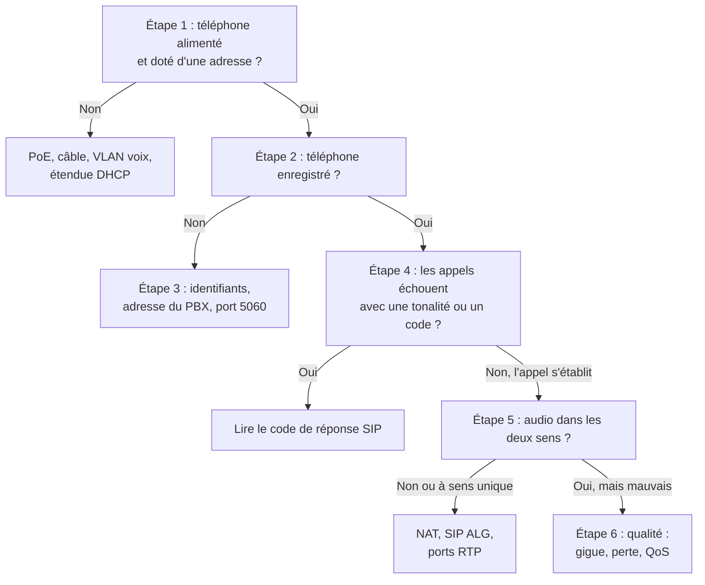

# Dépannage des téléphones VoIP / SIP : « Mon téléphone ne fonctionne pas »

[](README.fr.md)
[](README.md)


| Élément | Contenu |
|---|---|
| **Référent** | Diagnostic d'un téléphone de bureau SIP ou d'un téléphone logiciel (*softphone*) qui affiche « No service » (*aucun service*), ne peut pas appeler, ou appelle sans audio, avec un audio à sens unique ou un audio de mauvaise qualité. |
| **Émetteur** | **bazeeza** |
| **Message** | Localiser la panne dans la chaîne alimentation → réseau → enregistrement → signalisation d'appel → audio, corriger ce qui relève du téléphone et escalader le reste avec des preuves SIP. |
| **Récepteur** | Techniciens de soutien TI et techniciens terrain qui s'occupent des téléphones IP, étudiants en télécommunications. |
| **Canal** | Dépôt GitHub `Bazeeza/Technical-Runbooks` |
| **Code** | Français, rédaction technique (traduction de l'original anglais) · SIP, RTP, CLI Asterisk, commandes `show` de Cisco IOS · les exemples utilisent un système FreePBX générique |
| **Référence** | [RFC 3261: SIP](https://www.rfc-editor.org/rfc/rfc3261) · [Asterisk: Configuring res_pjsip to work through NAT](https://docs.asterisk.org/Configuration/Channel-Drivers/SIP/Configuring-res_pjsip/Configuring-res_pjsip-to-work-through-NAT) · [Sangoma: FreePBX Asterisk SIP Settings user guide](https://sangomakb.atlassian.net/wiki/spaces/PG/pages/26542239/Asterisk+SIP+Settings+User+Guide) · [Cisco: Voice over IP, per call bandwidth consumption](https://www.cisco.com/c/en/us/support/docs/voice/voice-quality/7934-bwidth-consume.html) · [RFC 4594: DiffServ service classes](https://www.rfc-editor.org/rfc/rfc4594) |

---

## Objectif

Un téléphone IP dépend d'une chaîne : l'**alimentation** (PoE), une adresse **réseau** dans le VLAN voix, un **enregistrement** auprès du PBX, la **signalisation SIP** pour établir chaque appel, puis les paquets **RTP** qui transportent la voix elle-même. Le symptôme indique où la chaîne s'est rompue. Ce runbook parcourt la chaîne dans l'ordre : le technicien corrige en quelques minutes les causes qui relèvent du téléphone et fournit à l'équipe téléphonie ou réseau des preuves précises pour le reste.

Fichiers complémentaires :

- [Lire un appel SIP](SIP-CALL-FLOW.fr.md) : diagrammes de séquence de l'enregistrement et de l'appel, champs SDP, codes de réponse SIP, CLI Asterisk.
- [Préparation du réseau pour la voix](VOICE-NETWORK-READINESS.fr.md) : codecs et bande passante, marquage DSCP, VLAN voix, budget PoE.

## Prérequis

- [ ] Le numéro de poste de l'utilisateur, le modèle du téléphone et son emplacement (étiquette de la prise)
- [ ] Le symptôme exact et l'heure d'un appel qui a échoué (pour les journaux du PBX)
- [ ] L'accès au menu ou à la page web du téléphone (mot de passe administrateur tiré du gestionnaire de mots de passe de l'équipe)
- [ ] Pour les étapes 4 à 6 : un accès en lecture au PBX (interface web FreePBX ou CLI Asterisk), ou un contact dans l'équipe téléphonie

---

## Fonctionnement d'un appel VoIP

| Couche | Protocole et port par défaut | Rôle | Symptôme typique en cas de panne |
|---|---|---|---|
| Alimentation | PoE (802.3af/at) | Alimente le téléphone par le câble réseau | Téléphone éteint ou qui redémarre |
| Réseau | DHCP, VLAN voix | Donne au téléphone une adresse dans le sous-réseau voix | « No network », « Obtaining IP » |
| Enregistrement | SIP `REGISTER`, UDP/TCP **5060** (TLS **5061**) | Indique au PBX où se trouve le poste | « No service », « Unregistered », touche de ligne rouge |
| Signalisation | SIP `INVITE`, `BYE` | Établit et termine chaque appel, négocie le codec | Tonalité occupée, occupé rapide, erreur à l'écran |
| Média | **RTP**, UDP, une plage de ports (**10000–20000** par défaut sur Asterisk / FreePBX) | Transporte la voix, dans les deux sens | L'appel s'établit mais sans audio, ou audio à sens unique |
| Qualité | QoS (DSCP **EF 46**), bande passante | Livre les paquets de voix à temps | Voix hachée, robotique ou en retard |

## Logigramme de décision



## Étape 0 — Définir la portée

| Question | Pourquoi |
|---|---|
| Un seul téléphone, ou tous les téléphones de l'étage ou du site ? | Tous les téléphones → PBX, ligne réseau SIP (*trunk*), réseau ou lien Internet. Un seul téléphone → ce téléphone, son câble ou son compte. |
| Appels internes, externes, ou les deux ? | Internes corrects mais externes en échec → le *trunk* SIP ou la route sortante. |
| Entrants, sortants, ou les deux ? | Seuls les entrants échouent → enregistrement expiré, ou route entrante. |
| Aucun audio, audio à sens unique, ou audio de mauvaise qualité ? | Chaque cas mène à une étape différente (5 ou 6). |
| Qu'est-ce qui a changé : nouveau téléphone, déménagement de bureau, nouveau routeur ou pare-feu, changement de mot de passe ? | Un nouveau routeur ou pare-feu est la cause classique de l'audio à sens unique (SIP ALG). |

---

## Étape 1 — Vérifier l'alimentation et le réseau

Sur le téléphone : l'écran est allumé, et le menu d'état du réseau affiche une adresse IP, une passerelle et, si elle est affichée, un identifiant de VLAN.

| Observation | Cause probable | Action |
|---|---|---|
| Téléphone complètement éteint | Pas de PoE sur le port, ou câble endommagé | Essayer un port et un câble qui fonctionnent ; vérifier `show power inline` sur le commutateur |
| Adresse dans le sous-réseau **de données** au lieu du sous-réseau voix | VLAN voix non appris (CDP ou LLDP-MED) | Voir [VLAN voix](VOICE-NETWORK-READINESS.fr.md#vlan-voix) |
| Aucune adresse (`0.0.0.0` ou « DHCP timeout ») | Étendue DHCP voix pleine ou injoignable | Vérifier l'étendue avec l'équipe réseau, puis l'étape 3 du [runbook 04](../04-Network-Troubleshooting/README.fr.md) |
| Le PC branché derrière le téléphone fonctionne, le téléphone non | Port, VLAN ou PoE propres au téléphone | Étapes ci-dessus ; échanger avec un téléphone qui fonctionne pour comparer |

Sur le commutateur, le port doit montrer le téléphone comme voisin, avec la puissance consommée :

```text
show power inline GigabitEthernet1/0/7
show cdp neighbors GigabitEthernet1/0/7
show interfaces GigabitEthernet1/0/7 switchport
```

**Résultat attendu :** alimentation `on`, le téléphone listé comme voisin, `Voice VLAN: 20` (le VLAN du site). La configuration du port est décrite dans la [configuration de base d'un commutateur Cisco](../11-Cisco-Switch-Baseline/README.fr.md).

## Étape 2 — Vérifier l'enregistrement

Sur le téléphone : la touche de ligne est verte ou affiche le poste, sans message « No service ». La plupart des téléphones ont aussi une page **Status → Account** (*État → Compte*) dans leur interface web.

Sur le PBX (FreePBX fait tourner Asterisk avec le pilote PJSIP), depuis l'interpréteur de commandes :

```bash
asterisk -rx "pjsip show contacts"
asterisk -rx "pjsip show endpoint 201"
```

Remplacez `201` par le poste de l'utilisateur.

**Résultat attendu :** le poste apparaît dans `pjsip show contacts` avec l'état `Avail` et un temps aller-retour en millisecondes. Dans `pjsip show endpoint 201`, la ligne **Contact** affiche l'adresse du téléphone.

Si le poste n'a aucun contact, le téléphone n'est pas enregistré : passez à l'étape 3. S'il est enregistré mais affiche une **adresse inattendue** (l'adresse publique du site au lieu de l'adresse privée du téléphone), le téléphone est derrière un NAT : gardez-le en tête pour l'étape 5.

## Étape 3 — Réparer un téléphone qui ne s'enregistre pas

| Vérification | Où | Pourquoi |
|---|---|---|
| Adresse et port du **serveur SIP / registrar** | Téléphone : paramètres du compte | Doivent correspondre à l'adresse du PBX (ou au nom du service hébergé) et au port, en général 5060 |
| **Nom d'utilisateur** et **identifiant d'authentification** | Téléphone : paramètres du compte ; PBX : le poste | En général le numéro de poste ; doivent être identiques des deux côtés |
| **Mot de passe (secret)** | PBX : **Applications → Extensions → (poste) → Secret** | Un mauvais secret donne `401` ou `403` en boucle |
| **Transport** | Téléphone et poste dans le PBX | UDP d'un côté et TCP ou TLS de l'autre ne fonctionne pas |
| Heure et date du téléphone | État du téléphone | L'enregistrement TLS échoue avec une mauvaise date (vérification des certificats) |
| Bannissement par le pare-feu du PBX | Administrateur du PBX | Des échecs répétés peuvent bannir l'adresse publique du site : tous les téléphones du site cessent de s'enregistrer |

Après une correction, **redémarrez le téléphone** ou forcez un nouvel enregistrement, puis refaites l'étape 2.

> [!WARNING]
> Ne lisez jamais un secret SIP à voix haute et ne le collez jamais dans un billet. Copiez-le directement du PBX vers la page web du téléphone, ou reprovisionnez le téléphone. Un secret SIP divulgué permet à n'importe qui de passer des appels, y compris des appels internationaux coûteux, aux frais de l'entreprise.

## Étape 4 — Les appels échouent : lire le code

Quand un appel échoue, le téléphone affiche souvent un message (« Busy », « Not found », « Forbidden »). Ce message est un **code de réponse SIP**. Trouvez l'appel dans le journal du PBX ou avec l'enregistreur SIP, puis utilisez le tableau de [Lire un appel SIP](SIP-CALL-FLOW.fr.md#codes-de-réponse-sip).

Les cas les plus fréquents :

| Code | Action du soutien TI |
|---|---|
| `404 Not Found` | Vérifier le numéro composé et le préfixe de numérotation (par exemple 9 pour une ligne extérieure) |
| `403 Forbidden` sur les appels extérieurs seulement | Le poste n'est pas autorisé sur la route sortante, ou le *trunk* le refuse : escalader à l'équipe téléphonie |
| `480 Temporarily Unavailable` en appelant un collègue | Le téléphone du collègue n'est pas enregistré ou est en mode « ne pas déranger » |
| `488 Not Acceptable Here` | Aucun codec commun : comparer les listes de codecs des deux téléphones et du poste |
| `503 Service Unavailable` sur tous les appels extérieurs | *Trunk* en panne ou plus aucun canal libre : escalader, d'autres utilisateurs sont touchés aussi |

## Étape 5 — Aucun audio ou audio à sens unique

L'appel **s'établit** (SIP a fonctionné), mais la voix ne passe pas dans un sens ou dans les deux : le RTP n'atteint pas sa destination.


Le téléphone annonce son adresse **privée** dans le SDP. Un interlocuteur à l'extérieur du site ne peut pas envoyer d'audio à une adresse privée : le correspondant entend l'utilisateur, mais l'utilisateur n'entend rien (ou l'inverse).

| Cause | Comment la reconnaître | Correction (par la bonne équipe) |
|---|---|---|
| **SIP ALG** sur le routeur ou le pare-feu | Audio à sens unique, coupures aléatoires après environ 30 secondes ou au réenregistrement, souvent après un remplacement de routeur | Désactiver le SIP ALG (« SIP helper », « SIP inspection ») sur le routeur du site ; il réécrit le SIP de travers plus souvent qu'il n'aide |
| PBX derrière un NAT sans son adresse publique | Tous les appels externes ont un audio à sens unique, les appels internes sont corrects | FreePBX : **Settings → Asterisk SIP Settings → General SIP Settings → NAT Settings** : mettre l'adresse publique dans **External Address** et ajouter chaque sous-réseau interne dans **Local Networks** ; puis redémarrer Asterisk |
| Ports RTP non redirigés ou bloqués | Aucun audio sur les appels externes, SIP fonctionne | Rediriger ou autoriser le RTP en **UDP** (la plage sous **RTP Port Ranges**, 10000–20000 par défaut) vers le PBX ; ne jamais mettre le PBX en « DMZ / hôte exposé » |
| Téléphone distant derrière un routeur domestique | Employé à distance seulement : audio à sens unique | Sur le poste (paramètres avancés PJSIP) : **Rewrite Contact**, **RTP Symmetric** et **Force rport** à Yes ; **Direct Media** à No pour que l'audio passe par le PBX |
| Pare-feu entre le VLAN voix et le PBX | Aucun audio sur les appels internes entre sous-réseaux | Autoriser la plage RTP entre le sous-réseau voix et le PBX |

Pour le prouver, capturez le SIP de l'appel (`pjsip set logger host <phone address>`, voir [Lire un appel SIP](SIP-CALL-FLOW.fr.md#observer-en-direct-sur-asterisk-et-freepbx)) et lisez la ligne `c=` de chaque SDP : une adresse privée envoyée vers l'extérieur est la cause.

> [!NOTE]
> SIP utilise UDP 5060 pour la signalisation, et RTP utilise une plage **distincte** de ports UDP choisis pour chaque appel. Une règle de pare-feu qui n'autorise que le 5060 donne exactement ce symptôme : les appels sonnent et s'établissent, mais personne n'entend rien.

## Étape 6 — Mauvaise qualité audio

| Symptôme | Cause probable | Vérification |
|---|---|---|
| Voix hachée, robotique | Perte de paquets ou gigue : lien congestionné | Utilisation du lien à l'heure de pointe, marquage QoS, voir [Préparation du réseau pour la voix](VOICE-NETWORK-READINESS.fr.md#objectifs-de-qualité) |
| Écho entendu par le correspondant | Volume du haut-parleur ou du casque trop élevé, ou problème de ligne analogique | Baisser le volume, essayer le combiné ; écho persistant sur les appels extérieurs seulement → escalader au fournisseur |
| Délai, les gens parlent en même temps | Chemin long (VPN, site distant, satellite) | Faire un ping vers le PBX depuis le PC derrière le téléphone : comparer avec la cible de 150 ms dans un sens |
| Mauvaise qualité seulement pour un téléphone logiciel en Wi-Fi | Signal Wi-Fi ou canal encombré | [09 Dépannage Wi-Fi](../09-WiFi-Troubleshooting/README.fr.md) ; préférer un câble pour les appels |
| Mauvaise qualité seulement pendant les gros téléchargements | Pas de QoS sur le lien Internet | Demander à l'équipe réseau une priorité pour la voix ou une réservation de bande passante |

Beaucoup de téléphones affichent des statistiques d'appel pendant ou après un appel (perte de paquets, gigue, codec) dans un menu **Call statistics** ou **Status** : notez-les dans le billet.

---

## Vérification

- [ ] Le téléphone affiche le poste, et `pjsip show contacts` le liste comme `Avail`
- [ ] Un appel interne et un appel externe s'établissent tous les deux, dans les **deux** sens
- [ ] Les deux personnes s'entendent clairement pendant au moins une minute (détecte les coupures à 30 secondes, typiques du SIP ALG)
- [ ] Un appel entrant de l'extérieur fait sonner le téléphone
- [ ] Le billet indique quel maillon de la chaîne était en faute et ce qui a été changé

## Dépannage

| Symptôme | Cause probable | Correction |
|---|---|---|
| Le téléphone s'enregistre, puis perd son enregistrement toutes les quelques minutes | La correspondance NAT expire avant le prochain enregistrement | Réduire l'intervalle d'enregistrement du téléphone, ou activer les messages de maintien (*qualify*) sur le poste |
| Les appels coupent après exactement 30 ou 32 secondes | `ACK` perdu : SIP ALG ou NAT qui réécrit l'établissement de l'appel | Désactiver le SIP ALG, capturer l'appel pour confirmer |
| Choix du clavier non reconnus dans un menu téléphonique | Mode DTMF différent | Utiliser les événements RFC 4733 (`telephone-event`) des deux côtés |
| Tous les téléphones d'un site désenregistrés en même temps | Lien Internet en panne, PBX en panne, ou adresse du site bannie | Vérifier d'abord le lien ; puis s'adresser à l'administrateur du PBX |
| Le téléphone fonctionne sur une prise, pas sur une autre | Port dans le mauvais VLAN ou sans PoE | Étape 1 sur les deux ports ; [câblage](../08-Network-Cabling-and-Termination/README.fr.md) si la prise est suspecte |

## Retour arrière

- Paramètres du téléphone : la plupart des téléphones gardent une sauvegarde de configuration dans leur page web, ou sont reprovisionnés depuis le PBX ; notez toute valeur modifiée à la main.
- Les modifications dans FreePBX prennent effet après **Apply Config** ; pour revenir en arrière, refaire la même modification avec la valeur précédente, puis **Apply Config** de nouveau.
- Les modifications du routeur (SIP ALG, redirection) sont faites par l'équipe réseau, qui garde la configuration précédente.

## Informations à fournir lors d'une escalade

```text
Extension and phone model             :
Location (building / floor / jack)    :
Phone address and VLAN                :
Registered (pjsip show contacts)      : yes / no
Internal calls / external calls       : works / fails
Incoming / outgoing                   : works / fails
SIP response code or screen message   :
Audio: none / one-way (which side) / poor
Time of a failed call                 :
Other users affected                  : yes / no
Recent change (router, move, phone)   :
Actions already done                  :
```

> [!NOTE]
> Les journaux SIP contiennent des numéros de téléphone et des noms d'appelants. Joignez-les au billet seulement, jamais à un forum public, et masquez les numéros quand vous les partagez hors de l'équipe téléphonie.

---

<sub>Écrit par bazeeza · Vous avez trouvé une erreur ? <a href="https://github.com/Bazeeza/Technical-Runbooks/issues/new?template=runbook-error.yml">Signalez-la ici</a>.</sub>
