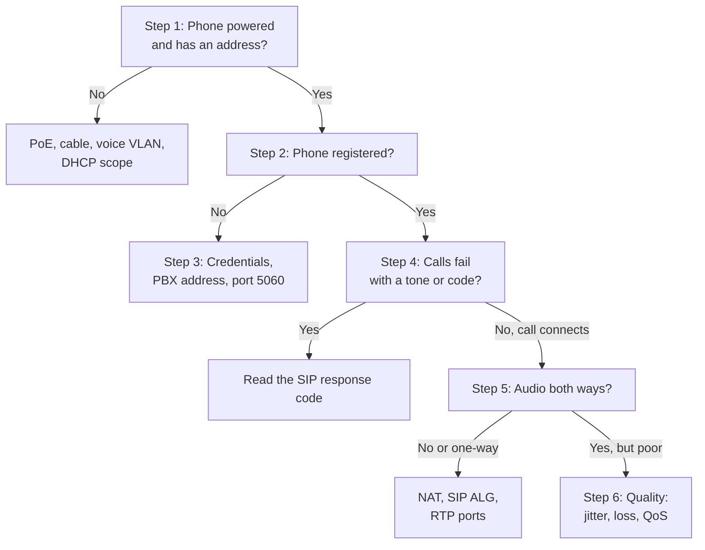

# VoIP / SIP Phone Troubleshooting: "My Phone Does Not Work"


| Element | Content |
|---|---|
| **Referent** | Diagnosis of a SIP desk phone or softphone that shows "No service", cannot call, or calls with no audio, one-way audio or poor audio. |
| **Sender** | **Bariu Azeez** |
| **Message** | Locate the fault in the chain power → network → registration → call signaling → audio, fix what is on the phone side, and escalate the rest with SIP evidence. |
| **Receiver** | Help desk and field technicians who support IP phones, telecom students. |
| **Channel** | GitHub repository `Bazeeza/Technical-Runbooks` |
| **Code** | English, technical writing · SIP, RTP, Asterisk CLI, Cisco IOS `show` commands · examples use a generic FreePBX system |
| **Reference** | [RFC 3261: SIP](https://www.rfc-editor.org/rfc/rfc3261) · [Asterisk: Configuring res_pjsip to work through NAT](https://docs.asterisk.org/Configuration/Channel-Drivers/SIP/Configuring-res_pjsip/Configuring-res_pjsip-to-work-through-NAT) · [Sangoma: FreePBX Asterisk SIP Settings user guide](https://sangomakb.atlassian.net/wiki/spaces/PG/pages/26542239/Asterisk+SIP+Settings+User+Guide) · [Cisco: Voice over IP, per call bandwidth consumption](https://www.cisco.com/c/en/us/support/docs/voice/voice-quality/7934-bwidth-consume.html) · [RFC 4594: DiffServ service classes](https://www.rfc-editor.org/rfc/rfc4594) |

---

## Objective

An IP phone depends on a chain: **power** (PoE), a **network** address in the voice VLAN, a **registration** with the PBX, **SIP signaling** to set up each call, then **RTP** packets for the voice itself. The symptom tells where the chain broke. This runbook walks the chain in order, so the technician fixes the phone-side causes in minutes and gives the telephony or network team precise evidence for the rest.

Companion files:

- [Reading a SIP call](SIP-CALL-FLOW.md): registration and call sequence diagrams, SDP fields, SIP response codes, Asterisk CLI.
- [Voice network readiness](VOICE-NETWORK-READINESS.md): codecs and bandwidth, DSCP marking, voice VLAN, PoE budget.

## Prerequisites

- [ ] The user's extension number, phone model and location (jack label)
- [ ] The exact symptom and the time of a failed call (for the PBX logs)
- [ ] Access to the phone's menu or web page (admin password from the team password manager)
- [ ] For steps 4 to 6: read access to the PBX (FreePBX web interface or Asterisk CLI), or a contact in the telephony team

---

## How a VoIP call works

| Layer | Protocol and default port | Role | Typical symptom when it fails |
|---|---|---|---|
| Power | PoE (802.3af/at) | Powers the phone through the network cable | Phone dark or rebooting |
| Network | DHCP, voice VLAN | Gives the phone an address in the voice subnet | "No network", "Obtaining IP" |
| Registration | SIP `REGISTER`, UDP/TCP **5060** (TLS **5061**) | Tells the PBX where the extension is | "No service", "Unregistered", red line key |
| Signaling | SIP `INVITE`, `BYE` | Sets up and ends each call, negotiates the codec | Busy tone, fast busy, error on the screen |
| Media | **RTP**, UDP, a port range (**10000–20000** by default on Asterisk / FreePBX) | Carries the voice, in both directions | Call connects but no audio, or one-way audio |
| Quality | QoS (DSCP **EF 46**), bandwidth | Delivers voice packets on time | Choppy, robotic or delayed voice |

## Decision flow



## Step 0 — Define the scope

| Question | Why |
|---|---|
| One phone, or every phone on the floor or site? | Every phone → PBX, trunk, network or Internet link. One phone → this phone, its cable or its account. |
| Internal calls, external calls, or both? | Internal fine but external fails → the SIP trunk or the outbound route. |
| Incoming, outgoing, or both? | Only incoming fails → registration expired, or inbound route. |
| No audio, one-way audio, or poor audio? | Each points to a different step (5 or 6). |
| What changed: new phone, office move, new router or firewall, password change? | A new router or firewall is the classic cause of one-way audio (SIP ALG). |

---

## Step 1 — Check power and network

On the phone: the screen is on, and the network status menu shows an IP address, a gateway and, when shown, a VLAN ID.

| Observation | Likely cause | Action |
|---|---|---|
| Phone completely dark | No PoE on the port, or damaged cable | Try a known-good port and cable; check `show power inline` on the switch |
| Address in the **data** subnet instead of the voice subnet | Voice VLAN not learned (CDP or LLDP-MED) | See [Voice VLAN](VOICE-NETWORK-READINESS.md#voice-vlan) |
| No address (`0.0.0.0` or "DHCP timeout") | Voice DHCP scope full or unreachable | Check the scope with the network team, then [runbook 04](../04-Network-Troubleshooting/README.md) step 3 |
| PC behind the phone works, phone does not | Phone's own port, VLAN or PoE | Steps above; swap with a working phone to compare |

On the switch, the port should show the phone as a neighbour with power drawn:

```text
show power inline GigabitEthernet1/0/7
show cdp neighbors GigabitEthernet1/0/7
show interfaces GigabitEthernet1/0/7 switchport
```

**Expected result:** power `on`, the phone listed as a neighbour, `Voice VLAN: 20` (the VLAN of the site). The port configuration is described in the [Cisco switch baseline](../11-Cisco-Switch-Baseline/README.md).

## Step 2 — Check the registration

On the phone: the line key is green or shows the extension, with no "No service" message. Most phones also have a **Status → Account** page in their web interface.

On the PBX (FreePBX runs Asterisk with the PJSIP driver), from the shell:

```bash
asterisk -rx "pjsip show contacts"
asterisk -rx "pjsip show endpoint 201"
```

Replace `201` with the user's extension.

**Expected result:** the extension appears in `pjsip show contacts` with status `Avail` and a round-trip time in milliseconds. In `pjsip show endpoint 201`, the **Contact** line shows the phone's address.

If the extension has no contact, the phone is not registered: go to step 3. If it is registered but shows an **unexpected address** (the site's public address instead of the phone's private address), the phone is behind NAT: keep that in mind for step 5.

## Step 3 — Fix a phone that does not register

| Check | Where | Why |
|---|---|---|
| **SIP server / registrar** address and port | Phone: account settings | Must match the PBX address (or the hosted service name) and port, usually 5060 |
| **User name** and **authentication ID** | Phone: account settings; PBX: the extension | Usually the extension number; must be identical on both |
| **Password (secret)** | PBX: **Applications → Extensions → (extension) → Secret** | A wrong secret gives `401` or `403` in a loop |
| **Transport** | Phone and PBX extension | UDP on one side and TCP or TLS on the other fails |
| Time and date on the phone | Phone status | TLS registration fails with a wrong date (certificate checks) |
| PBX firewall ban | PBX administrator | Repeated failures can ban the site's public address: every phone of the site stops registering |

After a correction, **reboot the phone** or force a new registration, then check step 2 again.

> [!WARNING]
> Never read a SIP secret out loud or paste it in a ticket. Copy it from the PBX to the phone's web page directly, or re-provision the phone. A leaked SIP secret lets anyone place calls, including expensive international calls, on the company's account.

## Step 4 — Calls fail: read the code

When a call fails, the phone often shows a message ("Busy", "Not found", "Forbidden"). That message is a **SIP response code**. Find the call in the PBX log or with the SIP logger, then use the table in [Reading a SIP call](SIP-CALL-FLOW.md#sip-response-codes).

The most frequent cases:

| Code | Help desk action |
|---|---|
| `404 Not Found` | Check the dialed number and the dial prefix (for example 9 for an outside line) |
| `403 Forbidden` on outside calls only | The extension is not allowed on the outbound route, or the trunk refuses it: escalate to the telephony team |
| `480 Temporarily Unavailable` when calling a colleague | The colleague's phone is not registered or in do-not-disturb |
| `488 Not Acceptable Here` | No common codec: compare the codec lists of both phones and the extension |
| `503 Service Unavailable` on every outside call | Trunk down or no channel left: escalate, other users are affected too |

## Step 5 — No audio or one-way audio

The call **connects** (SIP worked) but voice does not pass in one or both directions: RTP is not reaching its destination.


The phone announces its **private** address in the SDP. A party outside the site cannot send audio to a private address, so the remote side hears the user but the user hears nothing (or the reverse).

| Cause | How to recognize it | Fix (by the right team) |
|---|---|---|
| **SIP ALG** on the router or firewall | One-way audio, random drops after about 30 seconds or at re-registration, often after a router replacement | Disable SIP ALG ("SIP helper", "SIP inspection") on the site router; it rewrites SIP badly more often than it helps |
| PBX behind NAT without its public address | Every external call has one-way audio, internal calls are fine | FreePBX: **Settings → Asterisk SIP Settings → General SIP Settings → NAT Settings**: set **External Address** to the public address and add every internal subnet to **Local Networks**; then restart Asterisk |
| RTP ports not forwarded or blocked | No audio on external calls, SIP works | Forward or allow **UDP** RTP (the range under **RTP Port Ranges**, 10000–20000 by default) to the PBX; never put the PBX in a "DMZ / exposed host" |
| Remote phone behind a home router | Remote worker only: one-way audio | On the extension (PJSIP advanced settings): **Rewrite Contact**, **RTP Symmetric** and **Force rport** set to Yes; **Direct Media** set to No so audio goes through the PBX |
| Firewall between voice VLAN and PBX | No audio on internal calls between subnets | Allow the RTP range between the voice subnet and the PBX |

To prove it, capture the SIP of the call (`pjsip set logger host <phone address>`, see [Reading a SIP call](SIP-CALL-FLOW.md#watching-it-live-on-asterisk-and-freepbx)) and read the `c=` line of each SDP: a private address sent to the outside is the cause.

> [!NOTE]
> SIP uses UDP 5060 for signaling, and RTP uses a **separate** range of UDP ports chosen per call. A firewall rule that only allows 5060 gives exactly this symptom: calls ring and connect, but nobody hears anything.

## Step 6 — Poor audio quality

| Symptom | Likely cause | Check |
|---|---|---|
| Choppy, robotic voice | Packet loss or jitter: congested link | Link usage at the busy hour, QoS marking, see [Voice network readiness](VOICE-NETWORK-READINESS.md#quality-targets) |
| Echo heard by the remote party | Speakerphone or headset volume too high, or an analog line issue | Lower the volume, try the handset; persistent echo on outside calls only → escalate to the provider |
| Delay, people talk over each other | Long path (VPN, remote site, satellite) | Ping the PBX from the PC behind the phone: compare with the 150 ms one-way target |
| Quality bad only for a softphone on Wi-Fi | Wi-Fi signal or busy channel | [09 Wi-Fi Troubleshooting](../09-WiFi-Troubleshooting/README.md); prefer a cable for calls |
| Quality bad only during large downloads | No QoS on the Internet link | Ask the network team for voice priority or bandwidth reservation |

Many phones show call statistics during or after a call (packet loss, jitter, codec) in a **Call statistics** or **Status** menu: note them in the ticket.

---

## Verification

- [ ] The phone shows the extension, and `pjsip show contacts` lists it as `Avail`
- [ ] An internal call and an external call both connect, in **both** directions
- [ ] Both people hear each other clearly for at least one minute (catches drops at 30 seconds, typical of SIP ALG)
- [ ] An incoming call from outside rings the phone
- [ ] The ticket says which link of the chain was at fault and what was changed

## Troubleshooting

| Symptom | Likely cause | Fix |
|---|---|---|
| Phone registers, then loses registration every few minutes | NAT mapping expires before the next registration | Lower the phone's registration interval, or enable keep-alives (qualify) on the extension |
| Calls drop after exactly 30 or 32 seconds | `ACK` lost: SIP ALG or NAT rewriting the call setup | Disable SIP ALG, capture the call to confirm |
| Keypad choices not recognized in a phone menu | DTMF mode mismatch | Use RFC 4733 events (`telephone-event`) on both sides |
| All phones of a site unregistered at once | Internet link down, PBX down, or site address banned | Check the link first; then ask the PBX administrator |
| Phone works on one jack, not on another | Port in the wrong VLAN or without PoE | Step 1 on both ports; [cabling](../08-Network-Cabling-and-Termination/README.md) if the jack is suspect |

## Rollback

- Phone settings: most phones keep a configuration backup in their web page, or are re-provisioned from the PBX; note any value changed by hand.
- FreePBX changes take effect after **Apply Config**; reverting is the same change with the previous value, then **Apply Config** again.
- Router changes (SIP ALG, forwarding) are made by the network team, who keep the previous configuration.

## Information to give when escalating

```text
Extension and phone model             :
Location (building / floor / jack)    :
Phone address and VLAN                :
Registered (pjsip show contacts)      : yes / no
Internal calls / external calls       : works / fails
Incoming / outgoing                   : works / fails
SIP response code or screen message   :
Audio: none / one-way (which side) / poor
Time of a failed call                 :
Other users affected                  : yes / no
Recent change (router, move, phone)   :
Actions already done                  :
```

> [!NOTE]
> SIP logs contain phone numbers and caller names. Attach them to the ticket only, never to a public forum, and mask numbers when sharing outside the telephony team.

---

<sub>Written by Bariu Azeez · Found an error? <a href="https://github.com/Bazeeza/Technical-Runbooks/issues/new?template=runbook-error.yml">Report it here</a>.</sub>
