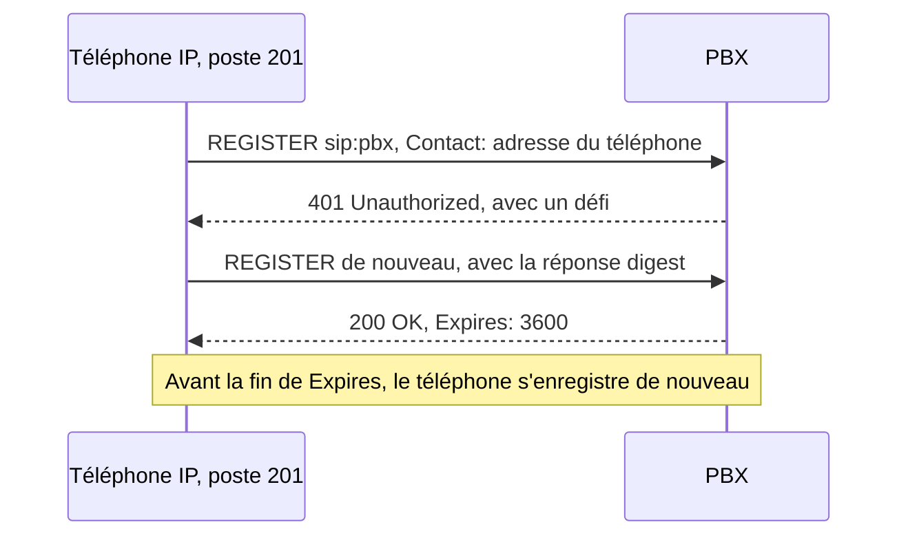
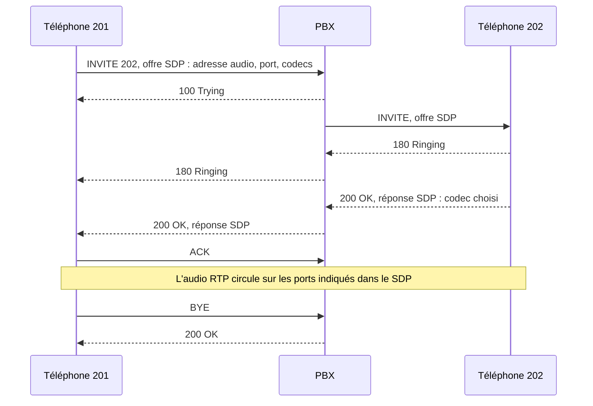

# Lire un appel SIP : enregistrement, établissement de l'appel et codes de réponse

[](SIP-CALL-FLOW.fr.md)
[](SIP-CALL-FLOW.md)


| Élément | Contenu |
|---|---|
| **Référent** | Les messages SIP échangés entre un téléphone IP et un PBX, et comment les lire pendant le traitement d'un billet. |
| **Émetteur** | **bazeeza** |
| **Message** | Reconnaître un enregistrement et un appel normaux, lire le code de réponse SIP qui termine un échange en échec, et trouver les adresses média dans le corps SDP. |
| **Récepteur** | Techniciens de soutien TI et techniciens terrain qui s'occupent des téléphones IP, étudiants en télécommunications. |
| **Canal** | Dépôt GitHub `Bazeeza/Technical-Runbooks` |
| **Code** | Français, rédaction technique (traduction de l'original anglais) · SIP (RFC 3261), SDP, CLI Asterisk |
| **Référence** | [RFC 3261: SIP](https://www.rfc-editor.org/rfc/rfc3261) · [RFC 4566: SDP](https://www.rfc-editor.org/rfc/rfc4566) · [Asterisk: Configuring res_pjsip to work through NAT](https://docs.asterisk.org/Configuration/Channel-Drivers/SIP/Configuring-res_pjsip/Configuring-res_pjsip-to-work-through-NAT) |

---

## Objectif

**SIP** établit, modifie et termine les appels ; il ne transporte pas la voix. La voix circule séparément dans des paquets **RTP**, vers les adresses et les ports annoncés dans le corps **SDP** des messages SIP. La plupart des billets de téléphonie se ramènent à une seule question : est-ce que SIP a échoué (un code de réponse dit pourquoi), ou est-ce que SIP a réussi et RTP a échoué (l'appel s'établit sans audio) ? Cette page montre à quoi ressemble chaque cas.

Retour au runbook principal : [10 Dépannage des téléphones VoIP / SIP](README.fr.md).

## Prérequis

- [ ] Un accès en lecture aux journaux ou à la CLI du PBX, ou à la page web du téléphone (pages d'état et de journal)
- [ ] Le numéro de poste et l'heure de l'appel qui a échoué

---

## Enregistrement : le téléphone indique au PBX où il se trouve



1. Le téléphone envoie `REGISTER` avec son **Contact** : l'adresse IP et le port où on peut le joindre.
2. Le PBX répond `401 Unauthorized` avec un défi (*challenge*). **C'est normal** : c'est ainsi que commence l'authentification *digest*, et le mot de passe ne traverse jamais le réseau.
3. Le téléphone répond au défi avec une empreinte (*hash*) de son mot de passe.
4. `200 OK` confirme l'enregistrement pour la durée indiquée dans **Expires** (en secondes). Le téléphone s'enregistre de nouveau avant qu'elle expire.

Un téléphone qui affiche « No service » ou « Unregistered » s'est arrêté quelque part dans cet échange.

## Établissement de l'appel : signalisation, puis média



L'appel est établi après `200 OK` et `ACK`. Tout ce qui précède est de la signalisation sur le port 5060 ; l'audio qui suit utilise d'autres ports (RTP, souvent UDP 10000 à 20000 sur un PBX Asterisk).

## Lire le corps SDP

Le SDP est du texte brut à l'intérieur de l'`INVITE` et du `200 OK`. Exemple d'offre envoyée par un téléphone (adresses d'exemple) :

```text
v=0
o=- 1234 1 IN IP4 192.168.20.51
s=-
c=IN IP4 192.168.20.51
t=0 0
m=audio 11780 RTP/AVP 0 8 9 101
a=rtpmap:0 PCMU/8000
a=rtpmap:8 PCMA/8000
a=rtpmap:9 G722/8000
a=rtpmap:101 telephone-event/8000
a=sendrecv
```

| Ligne | Signification | Ce qu'il faut vérifier |
|---|---|---|
| `c=IN IP4 ...` | Adresse où ce côté veut **recevoir** l'audio | Une adresse privée (192.168.x.x, 10.x.x.x, 172.16-31.x.x) envoyée à un interlocuteur **à l'extérieur** du site annonce un audio à sens unique |
| `m=audio 11780 RTP/AVP 0 8 9 101` | Port de réception, puis les codecs offerts, par ordre de préférence | Le port doit être joignable ; l'autre côté doit avoir au moins un codec en commun |
| `a=rtpmap:0 PCMU/8000` | Le codec numéro 0 est G.711 µ-law (8 est A-law, 9 est G.722) | Le même codec des deux côtés dans la réponse |
| `telephone-event` | Tonalités du clavier envoyées comme événements RTP (RFC 4733) | Absent d'un côté : les choix de menu (« faites le 1 ») ne sont pas reconnus |
| `a=sendrecv` | Audio dans les deux sens | `sendonly` ou `inactive` est normal pendant une mise en attente |

## Codes de réponse SIP

| Code | Signification | Cause habituelle dans un billet de téléphonie |
|---|---|---|
| `100 Trying` | Requête reçue, en cours de traitement | Normal |
| `180 Ringing` | Le téléphone appelé sonne | Normal |
| `183 Session Progress` | Média précoce (*early media*) : l'appelant entend un message ou des tonalités du réseau | Normal pour les appels vers le réseau public |
| `200 OK` | Succès | Normal |
| `401 Unauthorized` / `407 Proxy Authentication Required` | Identifiants demandés | Normal **une fois** ; répété, le mot de passe ou le nom d'utilisateur est erroné |
| `403 Forbidden` | Refusé | Mauvais identifiants, adresse IP bloquée par le pare-feu du PBX (fail2ban, pare-feu réactif), ou appel non autorisé par la route |
| `404 Not Found` | Numéro ou poste inconnu | Faute de frappe, route sortante manquante, poste supprimé |
| `408 Request Timeout` | Aucune réponse à temps | PBX ou téléphone injoignable, pare-feu qui rejette le SIP |
| `480 Temporarily Unavailable` | Destination injoignable pour le moment | Téléphone appelé non enregistré, ou en mode « ne pas déranger » |
| `486 Busy Here` | Occupé | Téléphone appelé déjà en communication, sans mise en attente d'appel |
| `488 Not Acceptable Here` | Offre média refusée | **Aucun codec commun**, ou paramètre média (chiffrement) non pris en charge |
| `503 Service Unavailable` | Le serveur ne peut pas traiter l'appel | *Trunk* en panne, aucun canal disponible, PBX surchargé |

Le premier chiffre donne la famille : `1xx` en cours, `2xx` succès, `3xx` redirection, `4xx` erreur du client (la requête est incorrecte), `5xx` erreur du serveur, `6xx` échec global (par exemple `603 Decline`).

## Observer en direct sur Asterisk et FreePBX

Depuis l'interpréteur de commandes du PBX (FreePBX fait tourner Asterisk avec le pilote PJSIP) :

```bash
asterisk -rvvv
```

Puis dans la console Asterisk :

```text
pjsip show endpoints
pjsip show contacts
pjsip show registrations
pjsip set logger host 192.168.20.51
pjsip set logger off
```

| Commande | Affiche |
|---|---|
| `pjsip show endpoints` | Chaque poste et chaque *trunk*, avec son état (`Avail`, `Unavailable`) |
| `pjsip show contacts` | L'adresse enregistrée de chaque téléphone et son temps aller-retour |
| `pjsip show registrations` | Les enregistrements sortants, en général vers le fournisseur SIP : `Registered` ou `Rejected` |
| `pjsip set logger host <ip>` | Affiche chaque message SIP envoyé à cette adresse ou reçu d'elle, SDP compris |

> [!WARNING]
> L'enregistreur SIP affiche des noms d'utilisateur, des numéros et des adresses. Désactivez-le une fois terminé, limitez-le à un seul hôte, et retirez les noms et les numéros avant de joindre un extrait à un billet.

## Vérification

- [ ] Vous pouvez désigner le code de réponse qui a terminé l'appel en échec, ou le `200 OK` et l'`ACK` qui prouvent que la signalisation a fonctionné
- [ ] Pour un appel sans audio, vous avez l'adresse `c=` et le port `m=audio` des deux côtés
- [ ] L'extrait joint au billet ne contient aucune empreinte de mot de passe, et les noms et les numéros sont masqués

## Dépannage

| Symptôme | Cause probable | Correction |
|---|---|---|
| `401` en boucle, jamais de `200 OK` | Mauvais secret sur le téléphone | Ressaisir le secret du poste tiré du PBX, voir le [runbook principal](README.fr.md) |
| `403` pour tous les téléphones d'un site | Adresse publique du site bannie par le pare-feu du PBX après des tentatives échouées | Demander à l'administrateur du PBX de vérifier la liste des bannissements, puis corriger le téléphone qui a le mauvais mot de passe |
| `488` seulement avec un modèle de téléphone | La liste de codecs du téléphone ne contient aucun codec autorisé sur le poste | Harmoniser les listes de codecs |
| Appel établi, aucun audio | SIP a fonctionné, RTP non | Runbook principal, étape 5 |

## Retour arrière

Cette page ne fait que lire des messages. Désactivez l'enregistreur SIP (`pjsip set logger off`) une fois terminé.

---

<sub>Écrit par bazeeza · Vous avez trouvé une erreur ? <a href="https://github.com/Bazeeza/Technical-Runbooks/issues/new?template=runbook-error.yml">Signalez-la ici</a>.</sub>
