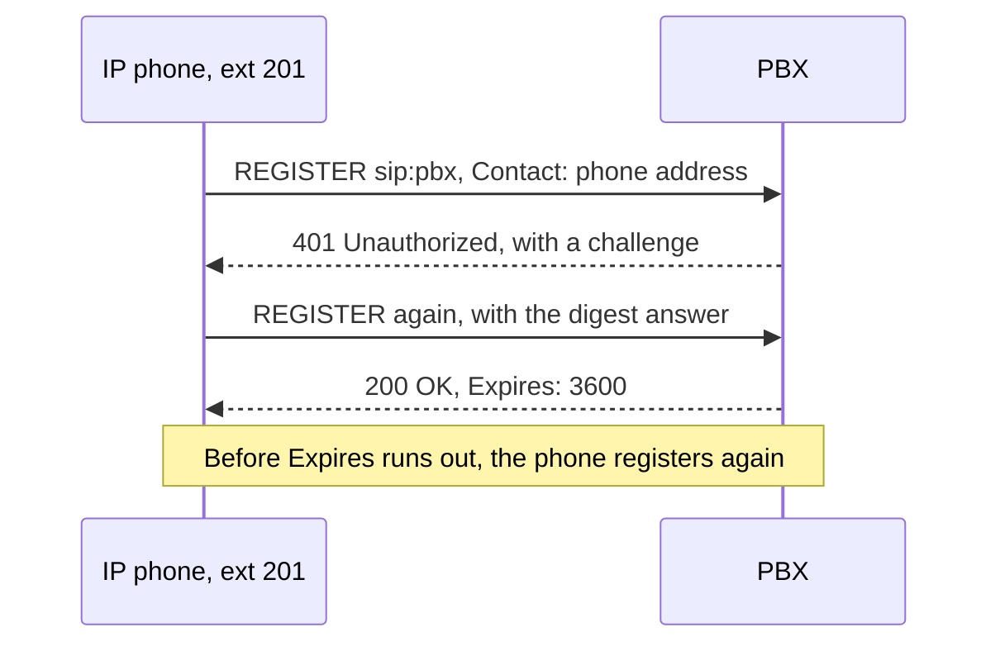
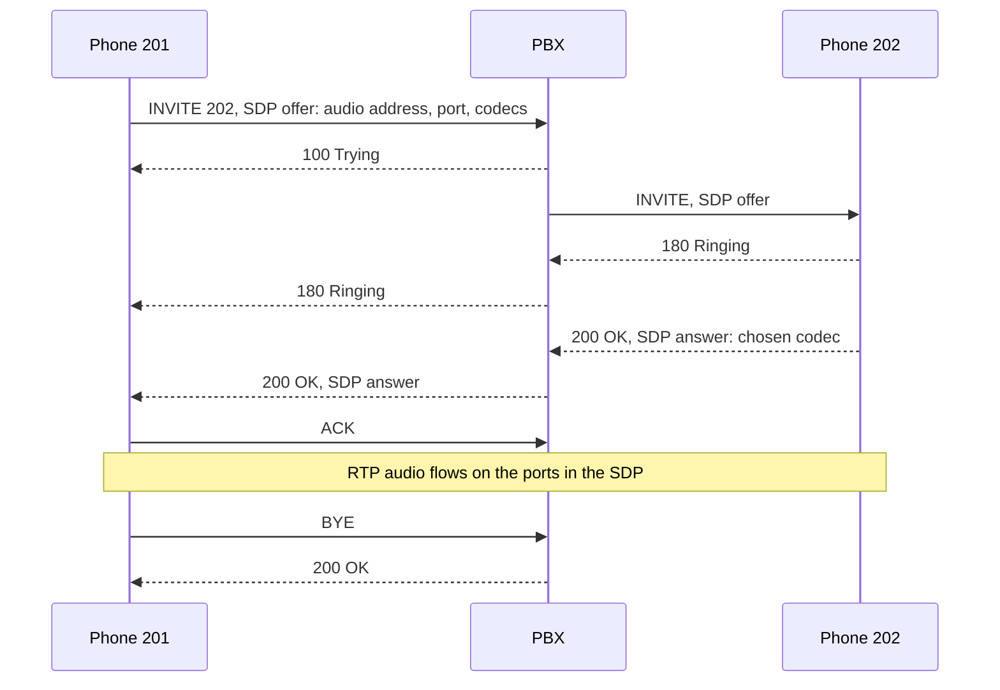

# Reading a SIP Call: Registration, Call Setup and Response Codes


| Element | Content |
|---|---|
| **Referent** | The SIP messages exchanged by an IP phone and a PBX, and how to read them during a ticket. |
| **Sender** | **Bariu Azeez** |
| **Message** | Recognize a normal registration and call, read the SIP response code that ends a failed one, and find the media addresses in the SDP body. |
| **Receiver** | Help desk and field technicians who support IP phones, telecom students. |
| **Channel** | GitHub repository `Bazeeza/Technical-Runbooks` |
| **Code** | English, technical writing · SIP (RFC 3261), SDP, Asterisk CLI |
| **Reference** | [RFC 3261: SIP](https://www.rfc-editor.org/rfc/rfc3261) · [RFC 4566: SDP](https://www.rfc-editor.org/rfc/rfc4566) · [Asterisk: Configuring res_pjsip to work through NAT](https://docs.asterisk.org/Configuration/Channel-Drivers/SIP/Configuring-res_pjsip/Configuring-res_pjsip-to-work-through-NAT) |

---

## Objective

**SIP** sets up, changes and ends calls; it does not carry the voice. The voice travels separately in **RTP** packets, to the addresses and ports announced in the **SDP** body of the SIP messages. Most phone tickets come down to one question: did SIP fail (a response code says why), or did SIP succeed and RTP fail (the call connects with no audio)? This page shows what each looks like.

Back to the main runbook: [10 VoIP / SIP Phone Troubleshooting](README.md).

## Prerequisites

- [ ] Read access to the PBX logs or CLI, or the phone's web page (status and log pages)
- [ ] The extension number and the time of the failed call

---

## Registration: the phone tells the PBX where it is



1. The phone sends `REGISTER` with its **Contact**: the IP address and port where it can be reached.
2. The PBX answers `401 Unauthorized` with a challenge. **This is normal**: it is how digest authentication starts, the password never crosses the network.
3. The phone answers the challenge with a hash of its password.
4. `200 OK` confirms the registration for the duration in **Expires** (seconds). The phone registers again before it runs out.

A phone that shows "No service" or "Unregistered" stopped somewhere in this exchange.

## Call setup: signaling, then media



The call is established after `200 OK` and `ACK`. Everything before that is signaling on port 5060; the audio that follows uses different ports (RTP, often UDP 10000 to 20000 on an Asterisk PBX).

## Reading the SDP body

The SDP is plain text inside the `INVITE` and the `200 OK`. Example of an offer from a phone (example addresses):

```text
v=0
o=- 1234 1 IN IP4 192.168.20.51
s=-
c=IN IP4 192.168.20.51
t=0 0
m=audio 11780 RTP/AVP 0 8 9 101
a=rtpmap:0 PCMU/8000
a=rtpmap:8 PCMA/8000
a=rtpmap:9 G722/8000
a=rtpmap:101 telephone-event/8000
a=sendrecv
```

| Line | Meaning | What to check |
|---|---|---|
| `c=IN IP4 ...` | Address where this side wants to **receive** audio | A private address (192.168.x.x, 10.x.x.x, 172.16-31.x.x) sent to a party **outside** the site means one-way audio is coming |
| `m=audio 11780 RTP/AVP 0 8 9 101` | Receiving port, then the codecs offered, in order of preference | The port must be reachable; the other side must share at least one codec |
| `a=rtpmap:0 PCMU/8000` | Codec number 0 is G.711 µ-law (8 is A-law, 9 is G.722) | Same codec on both sides in the answer |
| `telephone-event` | Keypad tones sent as RTP events (RFC 4733) | Missing on one side: menu choices ("press 1") are not recognized |
| `a=sendrecv` | Two-way audio | `sendonly` or `inactive` is normal during a hold |

## SIP response codes

| Code | Meaning | Usual cause on a phone ticket |
|---|---|---|
| `100 Trying` | Request received, being processed | Normal |
| `180 Ringing` | The called phone is ringing | Normal |
| `183 Session Progress` | Early media: the caller hears a message or tones from the network | Normal on calls to the public network |
| `200 OK` | Success | Normal |
| `401 Unauthorized` / `407 Proxy Authentication Required` | Credentials requested | Normal **once**; repeated, the password or user name is wrong |
| `403 Forbidden` | Refused | Wrong credentials, IP address blocked by the PBX firewall (fail2ban, responsive firewall), or call not allowed by the route |
| `404 Not Found` | Number or extension unknown | Typo, missing outbound route, extension deleted |
| `408 Request Timeout` | No answer in time | PBX or phone unreachable, firewall dropping SIP |
| `480 Temporarily Unavailable` | Destination not reachable now | Called phone not registered, or do-not-disturb |
| `486 Busy Here` | Busy | Called phone in a call without call waiting |
| `488 Not Acceptable Here` | Media offer refused | **No common codec**, or a media setting (encryption) not supported |
| `503 Service Unavailable` | Server cannot handle the call | Trunk down, no channel available, PBX overloaded |

The first digit gives the family: `1xx` in progress, `2xx` success, `3xx` redirection, `4xx` client error (the request is wrong), `5xx` server error, `6xx` global failure (for example `603 Decline`).

## Watching it live on Asterisk and FreePBX

From the PBX shell (FreePBX runs Asterisk with the PJSIP driver):

```bash
asterisk -rvvv
```

Then in the Asterisk console:

```text
pjsip show endpoints
pjsip show contacts
pjsip show registrations
pjsip set logger host 192.168.20.51
pjsip set logger off
```

| Command | Shows |
|---|---|
| `pjsip show endpoints` | Every extension and trunk, with its state (`Avail`, `Unavailable`) |
| `pjsip show contacts` | The registered address of each phone and its round-trip time |
| `pjsip show registrations` | Outbound registrations, usually to the SIP provider: `Registered` or `Rejected` |
| `pjsip set logger host <ip>` | Prints every SIP message to or from that address, SDP included |

> [!WARNING]
> The SIP logger prints user names, numbers and addresses. Turn it off when done, limit it to one host, and remove names and numbers before attaching an extract to a ticket.

## Verification

- [ ] You can point to the response code that ended the failed call, or to the `200 OK` and `ACK` that prove signaling worked
- [ ] For a no-audio call, you have the `c=` address and `m=audio` port of both sides
- [ ] The extract attached to the ticket contains no password hash, and names and numbers are masked

## Troubleshooting

| Symptom | Likely cause | Fix |
|---|---|---|
| `401` in a loop, never `200 OK` | Wrong secret on the phone | Re-enter the extension secret from the PBX, see the [main runbook](README.md) |
| `403` for every phone of one site | Site public address banned by the PBX firewall after failed attempts | Ask the PBX administrator to check the ban list, then fix the phone with the wrong password |
| `488` only with one phone model | Codec list on the phone has no codec allowed on the extension | Align the codec lists |
| Call established, no audio | SIP worked, RTP did not | Main runbook, step 5 |

## Rollback

This page only reads messages. Turn off the SIP logger (`pjsip set logger off`) when done.

---

<sub>Written by Bariu Azeez · Found an error? <a href="https://github.com/Bazeeza/Technical-Runbooks/issues/new?template=runbook-error.yml">Report it here</a>.</sub>
