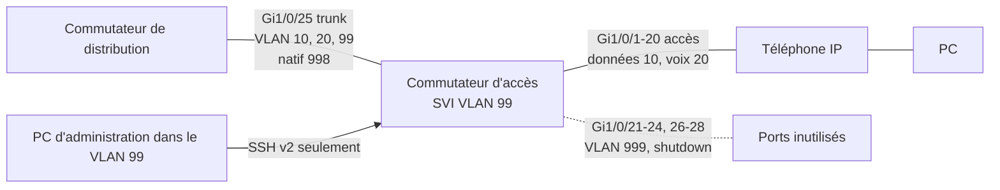

# Configuration de base d'un commutateur Cisco : configuration sécurisée d'un commutateur d'accès

[](README.fr.md)
[](README.md)


| Élément | Contenu |
|---|---|
| **Référent** | Première configuration d'un commutateur d'accès Cisco Catalyst neuf ou réinitialisé, avant son raccordement au réseau de production. |
| **Émetteur** | **bazeeza** |
| **Message** | Appliquer une configuration de base documentée et sécurisée : identité, comptes locaux, bannière, SSH version 2 seulement, VLAN, ports utilisateurs protégés, ports inutilisés mis à l'écart et liaison trunk restreinte, puis prouver que chaque partie fonctionne. |
| **Récepteur** | Techniciens réseau débutants, techniciens terrain qui préparent un commutateur, étudiants en réseautique (niveau CCNA). |
| **Canal** | Dépôt GitHub `Bazeeza/Technical-Runbooks` |
| **Code** | Français, rédaction technique (traduction de l'original anglais) · Cisco IOS CLI |
| **Référence** | [Cisco: Harden IOS Devices](https://www.cisco.com/c/en/us/support/docs/ip/access-lists/13608-21.html) · [Cisco: Secure Shell Version 2 Support](https://www.cisco.com/en/US/docs/ios-xml/ios/sec_usr_ssh/configuration/15-1mt/Secure_Shell_Version_2_Support.html) · [Cisco: Voice VLAN configuration example, Catalyst 2950/2960](https://www.cisco.com/c/en/us/support/docs/switches/catalyst-2950-series-switches/113260-voice-vlan-00.html) · [Cisco: Port Security, Catalyst 9300 Security Configuration Guide](https://www.cisco.com/c/en/us/td/docs/switches/lan/catalyst9300/software/release/17-9/configuration_guide/sec/b_179_sec_9300_cg/port_security.html) · [Cisco: Controlling switch access with passwords, Catalyst 2960-L](https://www.cisco.com/c/en/us/td/docs/switches/lan/catalyst2960l/software/15-2_7_e/configuration_guide/sec/b_1527e_security_2960l_cg/controlling_switch_access_with_passwords_and_privilege_levels.html) |

---

## Objectif

Un commutateur sorti de sa boîte répond sur tous ses ports, dans le VLAN 1, sans mot de passe et avec Telnet possible. N'importe qui s'y branche peut atteindre le plan de gestion ou ajouter son propre commutateur. Ce runbook en fait un commutateur d'accès prévisible : les utilisateurs dans leur VLAN, les téléphones dans le VLAN voix, les ports inutilisés désactivés, la gestion accessible **seulement** par SSH depuis le VLAN de gestion, et chaque choix expliqué.

Fichiers complémentaires :

- [`access-switch-baseline.cfg`](access-switch-baseline.cfg) : la configuration complète, section par section, prête à adapter et à coller.
- [Sécurité des ports et ports err-disabled](PORT-SECURITY-AND-ERR-DISABLED.fr.md) : que faire quand une protection bloque un port utilisateur.

## Prérequis

- [ ] Un câble console (RJ45 vers DB9 ou USB) et un logiciel de terminal à 9600 bauds, 8N1
- [ ] Le plan des VLAN du site et l'adressage de gestion (ce runbook utilise des valeurs d'exemple)
- [ ] Les secrets à définir, tirés du gestionnaire de mots de passe de l'équipe ; ne jamais en inventer un dans la CLI pour ensuite l'oublier
- [ ] Le commutateur **pas encore** raccordé au réseau de production
- [ ] Pour un commutateur réutilisé : l'autorisation de l'effacer (étape 1)

---

## La configuration de base en un coup d'œil



| VLAN | Nom | Pourquoi il existe |
|---|---|---|
| 10 | USERS | Postes de travail, derrière le téléphone sur le même port |
| 20 | VOICE | Téléphones IP, séparés pour que la voix puisse être priorisée et protégée (voir le [runbook 10](../10-VoIP-SIP-Phone-Troubleshooting/README.fr.md)) |
| 99 | MGMT | L'adresse du commutateur lui-même : les utilisateurs ne peuvent pas l'atteindre depuis le VLAN 10 |
| 998 | NATIVE | Le trafic non étiqueté sur la liaison trunk aboutit dans un VLAN vide, pas dans le VLAN 1 |
| 999 | BLACKHOLE | Ports inutilisés : même si quelqu'un en active un, il ne mène nulle part |

## Étape 1 — Partir d'un état connu

Sur un commutateur réutilisé, effacer l'ancienne configuration et la base de données des VLAN, puis redémarrer :

```text
write erase
delete flash:vlan.dat
reload
```

Répondez `no` si l'on vous demande d'enregistrer la configuration. À la fin du démarrage, répondez `no` au dialogue de configuration initiale.

**Résultat attendu :** l'invite est `Switch>`, et `show vlan brief` ne liste que les VLAN par défaut (1 et 1002 à 1005).

> [!WARNING]
> `write erase` et `delete flash:vlan.dat` détruisent la configuration. Sur un commutateur qui était en service, enregistrez-la d'abord (`show running-config` vers un fichier, ou `copy running-config tftp:`) et assurez-vous qu'il s'agit du bon commutateur.

## Étape 2 — Identité et comptes

Sections 1 et 2 du [fichier de configuration](access-switch-baseline.cfg).

- `hostname` et `ip domain-name` identifient le commutateur dans les journaux et sont nécessaires pour générer la clé SSH.
- `no ip domain-lookup` empêche le commutateur d'essayer de résoudre une commande mal tapée comme un nom d'hôte (le long gel après une faute de frappe).
- `enable algorithm-type scrypt secret` et `username ... algorithm-type scrypt secret` stockent les mots de passe sous forme d'empreintes de **type 9**. L'ancien `enable password` est stocké en clair ou avec le type 7, réversible.
- `service password-encryption` ne fait que masquer les mots de passe de type 7 restants à un coup d'œil rapide : ce n'est pas un vrai chiffrement.

**Résultat attendu :** `show running-config | include secret` affiche `secret 9` suivi d'une empreinte, jamais le mot de passe.

> [!NOTE]
> Le type 9 exige IOS 15.3(3) ou plus récent. Packet Tracer et les images plus anciennes ne l'acceptent pas : utilisez `enable secret` et `username ... secret`, qui donnent une empreinte de type 5.

## Étape 3 — Bannière et protection de la connexion

Sections 3 et 4. La bannière indique que l'accès est restreint et surveillé, ce qui rend un accès non autorisé clairement non autorisé. Elle ne doit **pas** contenir le nom d'hôte, le nom de l'entreprise, l'adresse ni un contact : elle est affichée à n'importe qui avant la connexion.

`login block-for 120 attempts 3 within 60` bloque les nouvelles connexions pendant 120 secondes après trois échecs en une minute, ce qui ralentit la devinette de mots de passe.

**Résultat attendu :** après trois mauvais mots de passe, `show login` indique que le commutateur est en mode silencieux (*quiet mode*).

## Étape 4 — VLAN

Section 5. Créez les VLAN et **nommez-les** : un nom dans `show vlan brief` évite un appel à l'équipe réseau.

```text
show vlan brief
```

**Résultat attendu :** les VLAN 10, 20, 99, 998 et 999 sont listés `active` avec leurs noms.

## Étape 5 — Adresse de gestion et SSH

Sections 6 à 8.

1. `interface Vlan99` reçoit l'adresse du commutateur ; `Vlan1` est désactivé pour que la gestion ne se trouve jamais dans le VLAN par défaut.
2. `ip default-gateway` permet au commutateur de répondre aux administrateurs d'autres sous-réseaux (un commutateur de couche 2 ne route pas).
3. `crypto key generate rsa general-keys modulus 2048` crée la clé SSH ; `ip ssh version 2` refuse la version 1, obsolète.
4. Sur `line vty 0 15` : `transport input ssh` refuse Telnet (en clair), `login local` utilise les comptes locaux, et `access-class MGMT-SSH in` n'accepte les sessions que depuis le sous-réseau de gestion.
5. `exec-timeout 10 0` ferme une session oubliée après 10 minutes.

```text
show ip ssh
show ip interface brief | include Vlan
```

**Résultat attendu :** `SSH Enabled - version 2.0`, et `Vlan99` est `up up` une fois la liaison trunk montante raccordée (une SVI n'est active que lorsqu'un port actif transporte son VLAN).

## Étape 6 — Ports utilisateurs

Section 11. Chaque port utilisateur dessert un PC (VLAN de données 10) et un téléphone IP (VLAN voix 20).

| Commande | Pourquoi |
|---|---|
| `switchport mode access` | Le port n'est jamais une liaison trunk, quel que soit l'appareil branché |
| `switchport voice vlan 20` | Le téléphone apprend son VLAN (CDP ou LLDP-MED) et étiquette les trames voix ; le PC derrière lui reste non étiqueté dans le VLAN 10 |
| `switchport nonegotiate` | Pas de DTP : un appareil ne peut pas demander au port de devenir une liaison trunk |
| `spanning-tree portfast` | Le port transmet immédiatement au lieu d'attendre environ 30 secondes, et le PC obtient son adresse DHCP à temps |
| `spanning-tree bpduguard enable` | Si un commutateur est branché (un BPDU arrive), le port passe en err-disabled avant de pouvoir créer une boucle |
| `switchport port-security maximum 3` + `violation restrict` | Au plus trois adresses MAC (PC, téléphone, téléphone vu dans deux VLAN) ; les appareils en trop sont refusés et journalisés, les appareils connus continuent de fonctionner |
| `aging time 10` + `aging type inactivity` | Une adresse inutilisée pendant 10 minutes est oubliée, pour qu'un PC remplacé ne reste pas bloqué indéfiniment |

## Étape 7 — Ports inutilisés et liaison trunk

Sections 12 et 13.

- Les ports inutilisés vont dans le VLAN 999 **et** sont désactivés. Deux couches : activer le port ne suffit pas pour atteindre un vrai réseau.
- La liaison montante est une liaison trunk avec `switchport trunk allowed vlan 10,20,99` : seuls les VLAN dont ce commutateur a besoin la traversent. Le VLAN natif est déplacé vers le VLAN inutilisé 998, ce qui déjoue le saut de VLAN (*VLAN hopping*) par double étiquetage via le VLAN natif. Le même VLAN natif doit être défini sur le commutateur de distribution, sinon CDP signale une **incohérence de VLAN natif** (*native VLAN mismatch*).

```text
show interfaces trunk
show interfaces status
```

**Résultat attendu :** `Gi1/0/25` est `trunking` avec le VLAN natif 998 et les VLAN `10,20,99` autorisés et en transmission ; les ports inutilisés affichent `disabled` dans le VLAN 999.

## Étape 8 — Heure, journaux et enregistrement

Section 14. Des journaux avec un horodatage exact (NTP) permettent à un technicien de relier une violation de port à l'appel d'un utilisateur. `logging buffered` garde les messages récents en mémoire, `logging host` les envoie au serveur syslog du site.

Testez une **nouvelle** session SSH depuis un PC du VLAN de gestion **avant** d'enregistrer. Ensuite :

```text
copy running-config startup-config
```

---

## Vérification

| Test | Commande ou action | Résultat attendu |
|---|---|---|
| Mots de passe hachés | `show running-config \| include secret` | `secret 9` (ou `secret 5`), aucun texte en clair |
| SSH v2 seulement | `show ip ssh` | `SSH Enabled - version 2.0` |
| Telnet refusé | `telnet 192.168.99.11` depuis le PC d'administration | Connexion refusée |
| SSH depuis un autre VLAN refusé | SSH depuis un PC du VLAN 10 | Connexion refusée, ligne `deny any log` comptée dans `show access-lists MGMT-SSH` |
| VLAN | `show vlan brief` | 10, 20, 99, 998, 999 nommés et actifs |
| Port utilisateur | `show interfaces Gi1/0/1 switchport` | `Access Mode VLAN: 10`, `Voice VLAN: 20`, `Negotiation of Trunking: Off` |
| Protections | `show port-security` et `show spanning-tree interface Gi1/0/1 portfast` | Sécurité des ports activée, portfast activé |
| Liaison trunk | `show interfaces trunk` | Natif 998, autorisés 10,20,99 |
| Ports inutilisés | `show interfaces status` | `disabled`, VLAN 999 |
| Enregistré | `show startup-config \| include hostname` | Le nouveau nom d'hôte |

## Dépannage

| Symptôme | Cause probable | Correction |
|---|---|---|
| `% Please define a domain-name first.` | Clé RSA générée avant `ip domain-name` | Définir le nom d'hôte et le nom de domaine, générer la clé de nouveau |
| SSH refusé depuis le PC d'administration | PC hors du sous-réseau `MGMT-SSH`, ou `Vlan99` inactif | `show access-lists MGMT-SSH`, `show ip interface brief` ; vérifier que la liaison trunk transporte le VLAN 99 |
| `Vlan99` reste `down` | Aucun port actif dans le VLAN 99 (liaison trunk non raccordée ou VLAN 99 non autorisé) | Raccorder la liaison montante, vérifier `show interfaces trunk` |
| Message CDP `Native VLAN mismatch` | VLAN natif 998 d'un seul côté | Définir le même VLAN natif aux deux extrémités de la liaison trunk |
| La liaison trunk ne monte pas sur un 3560 ou un 3750 | Encapsulation non définie sur un modèle qui prend en charge ISL | `switchport trunk encapsulation dot1q` avant `switchport mode trunk` |
| Le PC n'obtient une adresse qu'après environ 30 secondes | `portfast` absent | Ajouter `spanning-tree portfast` sur le port d'accès |
| Port utilisateur `err-disabled` | Sécurité des ports en mode shutdown, ou BPDU guard | [Sécurité des ports et ports err-disabled](PORT-SECURITY-AND-ERR-DISABLED.fr.md) |
| `Invalid input` sur `algorithm-type scrypt` | IOS antérieur à 15.3(3), ou Packet Tracer | Utiliser `enable secret` et `username ... secret` |

## Retour arrière

- Avant l'enregistrement, `reload` sans enregistrer revient à la configuration de démarrage précédente.
- Après l'enregistrement, restaurer la sauvegarde faite à l'étape 1, ou effacer comme à l'étape 1 et recommencer.
- Une ligne erronée s'annule avec sa forme `no` (par exemple `no switchport port-security maximum 3`).

> [!TIP]
> Conservez la configuration finale, **sans ses secrets**, avec la documentation du site. Les commandes `show running-config` et `show running-config | exclude secret` rendent la différence visible avant de la copier où que ce soit.

---

## Travaux liés

- [Aide-mémoire des commandes réseau](../04-Network-Troubleshooting/COMMAND-CHEATSHEET.fr.md) : les commandes Cisco `show` à côté de leurs équivalents Windows et Linux.
- [**Projets-Runbooks**](https://github.com/Bazeeza/Projets-Runbooks) : notes de laboratoire en français des cours de réseautique (VLAN, ACL, NAT, OSPF, router on a stick).

<sub>Écrit par bazeeza · Vous avez trouvé une erreur ? <a href="https://github.com/Bazeeza/Technical-Runbooks/issues/new?template=runbook-error.yml">Signalez-la ici</a>.</sub>
