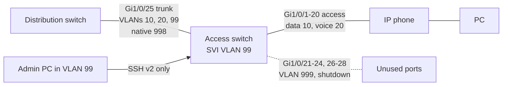

# Cisco Switch Baseline: Secure Configuration of an Access Switch


| Element | Content |
|---|---|
| **Referent** | First configuration of a new or reset Cisco Catalyst access switch, before it is connected to the production network. |
| **Sender** | **Bariu Azeez** |
| **Message** | Apply a documented, secure baseline: identity, local accounts, banner, SSH version 2 only, VLANs, protected user ports, parked unused ports and a restricted trunk, then prove each part works. |
| **Receiver** | Junior network technicians, field technicians preparing a switch, networking students (CCNA level). |
| **Channel** | GitHub repository `Bazeeza/Technical-Runbooks` |
| **Code** | English, technical writing · Cisco IOS CLI |
| **Reference** | [Cisco: Harden IOS Devices](https://www.cisco.com/c/en/us/support/docs/ip/access-lists/13608-21.html) · [Cisco: Secure Shell Version 2 Support](https://www.cisco.com/en/US/docs/ios-xml/ios/sec_usr_ssh/configuration/15-1mt/Secure_Shell_Version_2_Support.html) · [Cisco: Voice VLAN configuration example, Catalyst 2950/2960](https://www.cisco.com/c/en/us/support/docs/switches/catalyst-2950-series-switches/113260-voice-vlan-00.html) · [Cisco: Port Security, Catalyst 9300 Security Configuration Guide](https://www.cisco.com/c/en/us/td/docs/switches/lan/catalyst9300/software/release/17-9/configuration_guide/sec/b_179_sec_9300_cg/port_security.html) · [Cisco: Controlling switch access with passwords, Catalyst 2960-L](https://www.cisco.com/c/en/us/td/docs/switches/lan/catalyst2960l/software/15-2_7_e/configuration_guide/sec/b_1527e_security_2960l_cg/controlling_switch_access_with_passwords_and_privilege_levels.html) |

---

## Objective

A switch out of the box answers on every port, in VLAN 1, with no password and Telnet possible. Anyone who plugs in can reach the management plane or add their own switch. This runbook turns it into a predictable access switch: users in their VLAN, phones in the voice VLAN, unused ports shut down, management reachable **only** by SSH from the management VLAN, and every choice explained.

Companion files:

- [`access-switch-baseline.cfg`](access-switch-baseline.cfg): the complete configuration, section by section, ready to adapt and paste.
- [Port security and err-disabled ports](PORT-SECURITY-AND-ERR-DISABLED.md): what to do when a protection blocks a user port.

## Prerequisites

- [ ] A console cable (RJ45 to DB9 or USB) and a terminal program at 9600 baud, 8N1
- [ ] The site's VLAN plan and management addressing (this runbook uses example values)
- [ ] The secrets to set, from the team password manager; never invent one in the CLI and forget it
- [ ] The switch **not** connected to the production network yet
- [ ] For a reused switch: permission to erase it (step 1)

---

## The baseline at a glance



| VLAN | Name | Why it exists |
|---|---|---|
| 10 | USERS | Workstations, behind the phone on the same port |
| 20 | VOICE | IP phones, separated so voice can be prioritized and protected (see [runbook 10](../10-VoIP-SIP-Phone-Troubleshooting/README.md)) |
| 99 | MGMT | The switch's own address: users cannot reach it from VLAN 10 |
| 998 | NATIVE | Untagged traffic on the trunk lands in an empty VLAN, not in VLAN 1 |
| 999 | BLACKHOLE | Unused ports: even if someone enables one, it leads nowhere |

## Step 1 — Start from a known state

On a reused switch, erase the old configuration and VLAN database, then reload:

```text
write erase
delete flash:vlan.dat
reload
```

Answer `no` if asked to save the configuration. At the end of the boot, answer `no` to the initial configuration dialog.

**Expected result:** the prompt is `Switch>`, and `show vlan brief` lists only the default VLANs (1 and 1002 to 1005).

> [!WARNING]
> `write erase` and `delete flash:vlan.dat` destroy the configuration. On a switch that was in service, save it first (`show running-config` to a file, or `copy running-config tftp:`) and make sure it is the right switch.

## Step 2 — Identity and accounts

Sections 1 and 2 of the [configuration file](access-switch-baseline.cfg).

- `hostname` and `ip domain-name` identify the switch in logs and are needed to generate the SSH key.
- `no ip domain-lookup` stops the switch from trying to resolve a mistyped command as a host name (the long freeze after a typo).
- `enable algorithm-type scrypt secret` and `username ... algorithm-type scrypt secret` store the passwords as **type 9** hashes. The older `enable password` is stored in clear or with the reversible type 7.
- `service password-encryption` only hides the remaining type 7 passwords from a quick look: it is not real encryption.

**Expected result:** `show running-config | include secret` shows `secret 9` followed by a hash, never the password.

> [!NOTE]
> Type 9 needs IOS 15.3(3) or later. Packet Tracer and older images do not accept it: use `enable secret` and `username ... secret`, which give a type 5 hash.

## Step 3 — Banner and login protection

Sections 3 and 4. The banner states that access is restricted and monitored, which is what makes unauthorized access clearly unauthorized. It must **not** contain the hostname, the company name, the address or a contact: it is shown to anyone before login.

`login block-for 120 attempts 3 within 60` blocks new logins for 120 seconds after three failures in one minute, which slows down password guessing.

**Expected result:** after three wrong passwords, `show login` reports that the switch is in quiet mode.

## Step 4 — VLANs

Section 5. Create the VLANs and **name** them: a name in `show vlan brief` saves a call to the network team.

```text
show vlan brief
```

**Expected result:** VLANs 10, 20, 99, 998 and 999 are listed as `active` with their names.

## Step 5 — Management address and SSH

Sections 6 to 8.

1. `interface Vlan99` gets the switch's address; `Vlan1` is shut down so management never lives in the default VLAN.
2. `ip default-gateway` lets the switch answer admins in other subnets (a layer 2 switch does not route).
3. `crypto key generate rsa general-keys modulus 2048` creates the SSH key; `ip ssh version 2` refuses the obsolete version 1.
4. On `line vty 0 15`: `transport input ssh` refuses Telnet (clear text), `login local` uses the local accounts, and `access-class MGMT-SSH in` accepts sessions only from the management subnet.
5. `exec-timeout 10 0` closes a forgotten session after 10 minutes.

```text
show ip ssh
show ip interface brief | include Vlan
```

**Expected result:** `SSH Enabled - version 2.0`, and `Vlan99` is `up up` once the uplink trunk is connected (an SVI is up only when an active port carries its VLAN).

## Step 6 — User ports

Section 11. Each user port carries a PC (data VLAN 10) and an IP phone (voice VLAN 20).

| Command | Why |
|---|---|
| `switchport mode access` | The port is never a trunk, whatever is plugged in |
| `switchport voice vlan 20` | The phone learns its VLAN (CDP or LLDP-MED) and tags voice frames; the PC behind it stays untagged in VLAN 10 |
| `switchport nonegotiate` | No DTP: a device cannot ask the port to become a trunk |
| `spanning-tree portfast` | The port forwards at once instead of waiting about 30 seconds, so the PC gets its DHCP address on time |
| `spanning-tree bpduguard enable` | If a switch is plugged in (a BPDU arrives), the port is err-disabled before it can create a loop |
| `switchport port-security maximum 3` + `violation restrict` | At most three MAC addresses (PC, phone, phone seen in two VLANs); extra devices are refused and logged, known ones keep working |
| `aging time 10` + `aging type inactivity` | An address unused for 10 minutes is forgotten, so a replaced PC does not stay blocked forever |

## Step 7 — Unused ports and trunk

Sections 12 and 13.

- Unused ports go to VLAN 999 **and** are shut down. Two layers: enabling the port is not enough to reach a real network.
- The uplink is a trunk with `switchport trunk allowed vlan 10,20,99`: only the VLANs this switch needs cross it. The native VLAN is moved to the unused VLAN 998, which defeats VLAN hopping by double tagging through the native VLAN. The same native VLAN must be set on the distribution switch, or CDP reports a **native VLAN mismatch**.

```text
show interfaces trunk
show interfaces status
```

**Expected result:** `Gi1/0/25` is `trunking` with native VLAN 998 and VLANs `10,20,99` allowed and forwarding; unused ports show `disabled` in VLAN 999.

## Step 8 — Time, logs and save

Section 14. Logs with correct time stamps (NTP) are what lets a technician match a port violation to a user call. `logging buffered` keeps recent messages in memory, `logging host` sends them to the site's syslog server.

Test a **new** SSH session from a PC in the management VLAN **before** saving. Then:

```text
copy running-config startup-config
```

---

## Verification

| Test | Command or action | Expected result |
|---|---|---|
| Passwords hashed | `show running-config \| include secret` | `secret 9` (or `secret 5`), no clear text |
| SSH v2 only | `show ip ssh` | `SSH Enabled - version 2.0` |
| Telnet refused | `telnet 192.168.99.11` from the admin PC | Connection refused |
| SSH from another VLAN refused | SSH from a PC in VLAN 10 | Connection refused, `deny any log` line counted in `show access-lists MGMT-SSH` |
| VLANs | `show vlan brief` | 10, 20, 99, 998, 999 named and active |
| User port | `show interfaces Gi1/0/1 switchport` | `Access Mode VLAN: 10`, `Voice VLAN: 20`, `Negotiation of Trunking: Off` |
| Protections | `show port-security` and `show spanning-tree interface Gi1/0/1 portfast` | Port security enabled, portfast enabled |
| Trunk | `show interfaces trunk` | Native 998, allowed 10,20,99 |
| Unused ports | `show interfaces status` | `disabled`, VLAN 999 |
| Saved | `show startup-config \| include hostname` | The new hostname |

## Troubleshooting

| Symptom | Likely cause | Fix |
|---|---|---|
| `% Please define a domain-name first.` | RSA key generated before `ip domain-name` | Set the hostname and domain name, generate the key again |
| SSH refused from the admin PC | PC not in the `MGMT-SSH` subnet, or `Vlan99` down | `show access-lists MGMT-SSH`, `show ip interface brief`; check the trunk carries VLAN 99 |
| `Vlan99` stays `down` | No active port in VLAN 99 (trunk not connected or VLAN 99 not allowed) | Connect the uplink, check `show interfaces trunk` |
| CDP message `Native VLAN mismatch` | Native VLAN 998 on one side only | Set the same native VLAN on both ends of the trunk |
| Trunk does not come up on a 3560 or 3750 | Encapsulation not set on a model that supports ISL | `switchport trunk encapsulation dot1q` before `switchport mode trunk` |
| PC gets an address after about 30 seconds only | `portfast` missing | Add `spanning-tree portfast` on the access port |
| User port `err-disabled` | Port security in shutdown mode, or BPDU guard | [Port security and err-disabled ports](PORT-SECURITY-AND-ERR-DISABLED.md) |
| `Invalid input` on `algorithm-type scrypt` | IOS older than 15.3(3), or Packet Tracer | Use `enable secret` and `username ... secret` |

## Rollback

- Before saving, `reload` without saving returns to the previous startup configuration.
- After saving, restore the backup taken in step 1, or erase as in step 1 and start again.
- One wrong line is undone with its `no` form (for example `no switchport port-security maximum 3`).

> [!TIP]
> Keep the final configuration, **without its secrets**, with the site documentation. The commands `show running-config` and `show running-config | exclude secret` make the difference visible before you copy it anywhere.

---

## Related work

- [Network command cheat sheet](../04-Network-Troubleshooting/COMMAND-CHEATSHEET.md): the Cisco `show` commands next to their Windows and Linux equivalents.
- [**Projets-Runbooks**](https://github.com/Bazeeza/Projets-Runbooks): French lab notes from the networking courses (VLANs, ACL, NAT, OSPF, router on a stick).

<sub>Written by Bariu Azeez · Found an error? <a href="https://github.com/Bazeeza/Technical-Runbooks/issues/new?template=runbook-error.yml">Report it here</a>.</sub>
