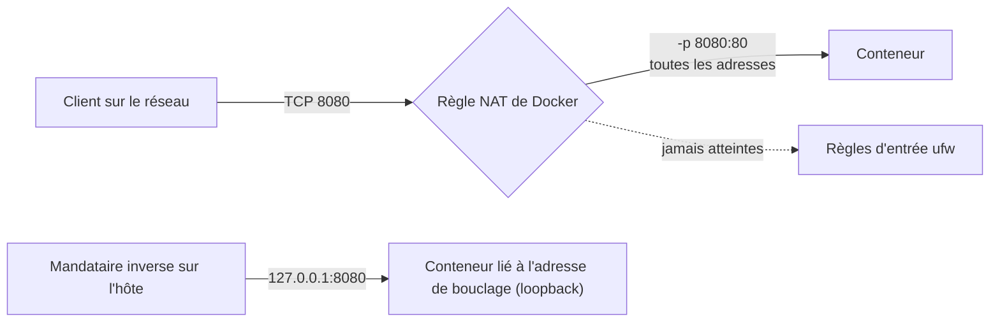

# Ports Docker et pare-feu : lier à 127.0.0.1

[](DOCKER-PORT-BINDING.fr.md)
[](DOCKER-PORT-BINDING.md)


| Élément | Contenu |
|---|---|
| **Référent** | Un serveur Linux protégé par ufw qui exécute aussi des conteneurs Docker avec des ports publiés. |
| **Émetteur** | **bazeeza** |
| **Message** | Un port publié par Docker est accessible depuis le réseau même quand ufw le refuse. Publiez sur `127.0.0.1` et faites d'un mandataire inverse (reverse proxy), ou d'un tunnel SSH, le seul point d'entrée. |
| **Récepteur** | Techniciens et administrateurs débutants qui exécutent des services auto-hébergés dans des conteneurs. |
| **Canal** | Dépôt GitHub `Bazeeza/Technical-Runbooks` |
| **Code** | Français, rédaction technique (traduction de l'original anglais) · Docker CLI, Docker Compose, Linux shell |
| **Référence** | [Docker: Packet filtering and firewalls](https://docs.docker.com/engine/network/packet-filtering-firewalls/) · [Docker: Port publishing and mapping](https://docs.docker.com/engine/network/port-publishing/) · [Docker: Daemon configuration file](https://docs.docker.com/reference/cli/dockerd/#daemon-configuration-file) |

---

## Objectif

Sur un serveur avec `ufw default deny incoming`, un technicien démarre un conteneur avec `-p 8080:80` et suppose que le pare-feu le protège. Ce n'est pas le cas. Ce guide explique pourquoi, montre comment vérifier ce qui est réellement exposé, et comment publier les ports pour que seul l'hôte puisse les atteindre.

## Pourquoi ufw ne voit pas les ports Docker

Docker écrit ses propres règles iptables. Un paquet destiné à un port publié est redirigé (DNAT) vers le conteneur **avant** que les règles d'entrée d'ufw soient vérifiées : il est donc transmis au conteneur au lieu d'être filtré comme du trafic destiné à l'hôte. La documentation de Docker le dit directement : le trafic vers un port publié « gets diverted before it goes through the ufw firewall settings » (*est détourné avant de passer par les règles du pare-feu ufw*).



Deux autres faits aggravent la situation :

- Sans adresse, `-p 8080:80` publie sur **toutes** les adresses de l'hôte, IPv4 et IPv6.
- Docker avertit qu'il ne faut pas modifier les règles qu'il crée, et que désactiver sa gestion d'iptables (`"iptables": false`) ne convient pas à la plupart des utilisateurs : les conteneurs perdent leur accès réseau.

La réponse sûre n'est pas de se battre contre le pare-feu, mais de **ne pas publier du tout sur l'interface publique**.

## Étape 1 — Voir ce qui écoute réellement

```bash
sudo ss -tlnp
docker ps --format 'table {{.Names}}\t{{.Ports}}'
```

| Ce que vous voyez | Signification |
|---|---|
| `0.0.0.0:8080` ou `[::]:8080`, `0.0.0.0:8080->80/tcp` | Accessible depuis tout réseau auquel le serveur est raccordé, avec ou sans ufw |
| `127.0.0.1:8080`, `127.0.0.1:8080->80/tcp` | Accessible seulement depuis l'hôte lui-même |
| Aucun `->` dans la colonne Ports | Non publié : accessible seulement depuis les autres conteneurs du même réseau Docker |

**Résultat attendu :** la liste de tous les ports publiés. Notez chacun de ceux qui sont liés à `0.0.0.0` ou à `[::]`.

## Étape 2 — Publier sur l'adresse de bouclage

En ligne de commande, placez l'adresse devant le port :

```bash
docker run -d --name web -p 127.0.0.1:8080:80 nginx
```

Dans un fichier Compose, mettez la correspondance entre guillemets (YAML peut lire `xx:yy` comme un nombre) :

```yaml
services:
  app:
    image: nginx
    ports:
      - "127.0.0.1:8080:80"
```

Recréez ensuite le conteneur (`docker compose up -d`) : la correspondance de ports d'un conteneur en cours d'exécution ne peut pas être modifiée.

**Résultat attendu :** `ss -tlnp` affiche `127.0.0.1:8080` et aucun `0.0.0.0:8080`.

> [!TIP]
> Une base de données ou une API interne utilisée seulement par un autre conteneur n'a besoin d'aucune ligne `ports:`. Les conteneurs d'un même réseau Compose se joignent par le nom du service.

## Étape 3 — Faire du bouclage la valeur par défaut (facultatif)

Pour se protéger contre le prochain `-p 8080:80` tapé sans réfléchir, définissez l'adresse de liaison par défaut du réseau bridge par défaut dans `/etc/docker/daemon.json` :

```json
{
  "ip": "127.0.0.1"
}
```

```bash
sudo systemctl restart docker
```

Pour les réseaux définis par l'utilisateur, que Compose crée pour chaque projet, Docker documente l'option `default-network-opts` avec `com.docker.network.bridge.host_binding_ipv4`. Un `127.0.0.1:` explicite dans chaque correspondance reste le choix le plus clair, parce qu'il est visible là où le port est déclaré.

> [!WARNING]
> Redémarrer le démon Docker redémarre les conteneurs qui ont une politique de redémarrage et arrête les autres. Planifiez-le comme une courte fenêtre de maintenance.

## Étape 4 — Exposer le service de la bonne façon

Un service lié à `127.0.0.1` a quand même besoin d'un point d'entrée pour ses utilisateurs :

| Besoin | Point d'entrée |
|---|---|
| Service web pour les utilisateurs | Un mandataire inverse sur l'hôte (Nginx, Caddy, Traefik) écoute sur le port 443 avec TLS, et c'est le seul port ouvert dans ufw : `sudo ufw allow 443/tcp` |
| Page d'administration utilisée par vous seul | Un tunnel SSH : `ssh -L 8080:127.0.0.1:8080 <user>@<server>`, puis ouvrez `http://localhost:8080` sur votre PC. Exige `AllowTcpForwarding yes` (ou `local`) dans le [fichier de configuration SSH complémentaire](10-hardening.conf). |

Le mandataire inverse est l'unique endroit où s'appliquent TLS, les journaux d'accès et les limites de débit, et le port 443 est un port qu'ufw contrôle bel et bien, parce que le mandataire s'exécute sur l'hôte, pas dans un conteneur publié.

## Vérification

Depuis **une autre machine**, pas depuis le serveur lui-même (le serveur atteint toujours sa propre adresse de bouclage) :

```bash
nc -zv <server-address> 8080
```

```powershell
Test-NetConnection <server-address> -Port 8080
```

| Test | Résultat attendu |
|---|---|
| `ss -tlnp` sur le serveur | Ports des conteneurs sur `127.0.0.1` seulement |
| `nc` ou `Test-NetConnection` vers le port du conteneur depuis une autre machine | Connexion refusée ou expirée (`TcpTestSucceeded : False`) |
| `curl -I http://127.0.0.1:8080` sur le serveur | Une réponse HTTP : le service fonctionne toujours |
| Même test vers le port 443 à travers le mandataire inverse | Le site répond en HTTPS |

## Dépannage

| Symptôme | Cause probable | Correction |
|---|---|---|
| Port toujours sur `0.0.0.0` après la modification du fichier Compose | Conteneur non recréé | `docker compose up -d` (ou `--force-recreate`) |
| Le mandataire inverse renvoie 502 Bad Gateway | Le mandataire pointe vers le mauvais port, ou il s'exécute lui-même dans un conteneur et `127.0.0.1` est sa propre adresse de bouclage | Utiliser `127.0.0.1:<port>` seulement quand le mandataire s'exécute sur l'hôte ; un mandataire dans un conteneur joint l'application par le nom du service sur un réseau partagé |
| `Bind for 127.0.0.1:8080 failed: port is already allocated` | Un autre conteneur ou service utilise le port | `sudo ss -tlnp \| grep 8080`, choisir un autre port de l'hôte |
| Tunnel SSH : `channel 2: open failed: administratively prohibited` | `AllowTcpForwarding no` dans la configuration SSH | Autoriser le transfert pour l'utilisateur administrateur seulement, ou utiliser le mandataire inverse |
| Port accessible en IPv6 seulement | Correspondance encore sur `[::]` | Lier explicitement les deux familles, ou seulement `127.0.0.1` |

---

<sub>Fait partie du [runbook 12, Renforcement de base d'un serveur Linux](README.fr.md) · Écrit par bazeeza</sub>
