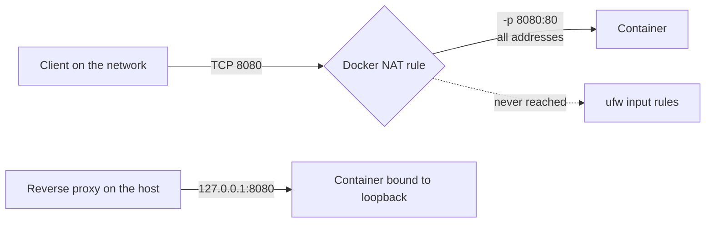

# Docker Ports and the Firewall: Bind to 127.0.0.1


| Element | Content |
|---|---|
| **Referent** | A Linux server protected by ufw that also runs Docker containers with published ports. |
| **Sender** | **Bariu Azeez** |
| **Message** | A port published by Docker is reachable from the network even when ufw denies it. Publish on `127.0.0.1` and let a reverse proxy, or an SSH tunnel, be the only way in. |
| **Receiver** | Technicians and junior administrators who run self-hosted services in containers. |
| **Channel** | GitHub repository `Bazeeza/Technical-Runbooks` |
| **Code** | English, technical writing · Docker CLI, Docker Compose, Linux shell |
| **Reference** | [Docker: Packet filtering and firewalls](https://docs.docker.com/engine/network/packet-filtering-firewalls/) · [Docker: Port publishing and mapping](https://docs.docker.com/engine/network/port-publishing/) · [Docker: Daemon configuration file](https://docs.docker.com/reference/cli/dockerd/#daemon-configuration-file) |

---

## Objective

On a server with `ufw default deny incoming`, a technician starts a container with `-p 8080:80` and assumes the firewall protects it. It does not. This guide explains why, shows how to check what is really exposed, and how to publish ports so that only the host can reach them.

## Why ufw does not see Docker ports

Docker writes its own iptables rules. A packet for a published port is redirected (DNAT) to the container **before** ufw's input rules are checked, so it is forwarded to the container instead of being filtered as traffic for the host. Docker's documentation says it directly: traffic to a published port "gets diverted before it goes through the ufw firewall settings".



Two more facts make it worse:

- Without an address, `-p 8080:80` publishes on **all** host addresses, IPv4 and IPv6.
- Docker warns that you should not edit the rules it creates, and that turning its iptables management off (`"iptables": false`) is not appropriate for most users: containers lose their network access.

The safe answer is not to fight the firewall, but to **not publish on the public interface at all**.

## Step 1 — See what is really listening

```bash
sudo ss -tlnp
docker ps --format 'table {{.Names}}\t{{.Ports}}'
```

| What you see | Meaning |
|---|---|
| `0.0.0.0:8080` or `[::]:8080`, `0.0.0.0:8080->80/tcp` | Reachable from any network the server is connected to, ufw or not |
| `127.0.0.1:8080`, `127.0.0.1:8080->80/tcp` | Reachable only from the host itself |
| No `->` in the Ports column | Not published: reachable only from other containers on the same Docker network |

**Expected result:** a list of every published port. Write down each one bound to `0.0.0.0` or `[::]`.

## Step 2 — Publish on the loopback address

On the command line, put the address in front of the port:

```bash
docker run -d --name web -p 127.0.0.1:8080:80 nginx
```

In a Compose file, quote the mapping (YAML can misread `xx:yy` as a number):

```yaml
services:
  app:
    image: nginx
    ports:
      - "127.0.0.1:8080:80"
```

Then recreate the container (`docker compose up -d`): a port mapping cannot be changed on a running container.

**Expected result:** `ss -tlnp` shows `127.0.0.1:8080` and no `0.0.0.0:8080`.

> [!TIP]
> A database or an internal API used only by another container does not need a `ports:` line at all. Containers on the same Compose network reach each other by service name.

## Step 3 — Make loopback the default (optional)

To protect against the next `-p 8080:80` typed without thinking, set the default bind address of the default bridge network in `/etc/docker/daemon.json`:

```json
{
  "ip": "127.0.0.1"
}
```

```bash
sudo systemctl restart docker
```

For user-defined networks, which Compose creates for every project, Docker documents the `default-network-opts` option with `com.docker.network.bridge.host_binding_ipv4`. Explicit `127.0.0.1:` in each mapping stays the clearest choice, because it is visible where the port is declared.

> [!WARNING]
> Restarting the Docker daemon restarts the containers that have a restart policy and stops the others. Plan it like a short maintenance window.

## Step 4 — Expose the service the right way

A service bound to `127.0.0.1` still needs a way in for its users:

| Need | Way in |
|---|---|
| Web service for users | A reverse proxy on the host (Nginx, Caddy, Traefik) listens on 443 with TLS, and is the only port opened in ufw: `sudo ufw allow 443/tcp` |
| Admin page used only by you | An SSH tunnel: `ssh -L 8080:127.0.0.1:8080 <user>@<server>`, then open `http://localhost:8080` on your PC. Needs `AllowTcpForwarding yes` (or `local`) in the [SSH drop-in](10-hardening.conf). |

The reverse proxy is the single place where TLS, access logs and rate limits are applied, and port 443 is a port ufw does control, because the proxy runs on the host, not in a published container.

## Verification

From **another machine**, not from the server itself (the server always reaches its own loopback):

```bash
nc -zv <server-address> 8080
```

```powershell
Test-NetConnection <server-address> -Port 8080
```

| Test | Expected result |
|---|---|
| `ss -tlnp` on the server | Container ports on `127.0.0.1` only |
| `nc` or `Test-NetConnection` to the container port from another machine | Connection refused or timed out (`TcpTestSucceeded : False`) |
| `curl -I http://127.0.0.1:8080` on the server | An HTTP answer: the service still works |
| Same test to port 443 through the reverse proxy | The site answers over HTTPS |

## Troubleshooting

| Symptom | Likely cause | Fix |
|---|---|---|
| Port still on `0.0.0.0` after editing the Compose file | Container not recreated | `docker compose up -d` (or `--force-recreate`) |
| Reverse proxy returns 502 Bad Gateway | Proxy points to the wrong port, or the proxy itself runs in a container and `127.0.0.1` is its own loopback | Use `127.0.0.1:<port>` only when the proxy runs on the host; a proxy in a container reaches the app by service name on a shared network |
| `Bind for 127.0.0.1:8080 failed: port is already allocated` | Another container or service uses the port | `sudo ss -tlnp \| grep 8080`, choose another host port |
| SSH tunnel: `channel 2: open failed: administratively prohibited` | `AllowTcpForwarding no` in the SSH configuration | Allow forwarding for the admin user only, or use the reverse proxy |
| Port reachable over IPv6 only | Mapping still on `[::]` | Bind both families explicitly, or only `127.0.0.1` |

---

<sub>Part of [runbook 12, Linux Server Hardening Basics](README.md) · Written by Bariu Azeez</sub>
