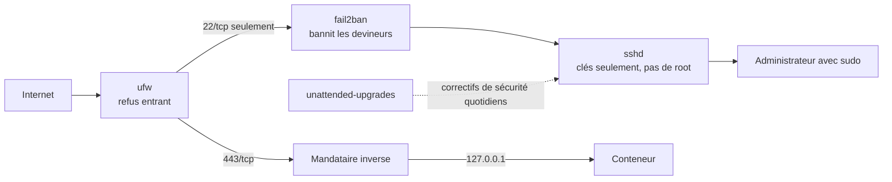

# Renforcement de base d'un serveur Linux : clés SSH, ufw, fail2ban et mises à jour automatiques

[](README.fr.md)
[](README.md)


| Élément | Contenu |
|---|---|
| **Référent** | Un nouveau serveur Debian ou Ubuntu (machine virtuelle, VPS ou machine de laboratoire) accessible par SSH, avant d'y installer le moindre service. |
| **Émetteur** | **bazeeza** |
| **Message** | Fermer les portes qu'un attaquant essaie en premier : connexion par clés SSH seulement, ni root ni mot de passe par SSH, un pare-feu qui refuse tout par défaut, le bannissement automatique de ceux qui devinent les mots de passe, les mises à jour de sécurité automatiques, et des ports de conteneurs qui ne contournent jamais le pare-feu. |
| **Récepteur** | Techniciens du soutien technique et administrateurs système débutants, étudiants qui préparent un laboratoire ou un service auto-hébergé. |
| **Canal** | Dépôt GitHub `Bazeeza/Technical-Runbooks` |
| **Code** | Français, rédaction technique (traduction de l'original anglais) · Linux shell (bash), OpenSSH, Windows PowerShell pour le côté client |
| **Référence** | [OpenBSD: sshd_config(5) manual](https://man.openbsd.org/sshd_config) · [Ubuntu Server: OpenSSH server](https://ubuntu.com/server/docs/how-to/security/openssh-server/) · [Ubuntu Server: Firewalls (ufw)](https://ubuntu.com/server/docs/how-to/security/firewalls/) · [ufw(8) manual, `limit` rule](https://manpages.ubuntu.com/manpages/noble/man8/ufw.8.html) · [Ubuntu Server: Automatic updates](https://ubuntu.com/server/docs/how-to/software/automatic-updates/) · [fail2ban project](https://github.com/fail2ban/fail2ban) · [Docker: Packet filtering and firewalls](https://docs.docker.com/engine/network/packet-filtering-firewalls/) |

---

## Objectif

Un serveur dont le port SSH est public reçoit des tentatives de connexion automatisées quelques minutes après sa mise en ligne. La plupart devinent les mots de passe de `root` et de noms d'utilisateur courants. Ce runbook retire ce qu'elles essaient de deviner, puis ajoute des couches pour qu'une seule erreur (un mot de passe faible, un port de conteneur oublié) ne suffise pas pour entrer.

État final :

- SSH accepte **seulement les clés**, seulement pour des administrateurs nommés, jamais `root`.
- Le pare-feu **refuse tout le trafic entrant** sauf SSH (et les services que vous ouvrez volontairement).
- Les échecs répétés sont **bannis** automatiquement.
- Les **mises à jour de sécurité** s'installent chaque jour sans que personne se connecte.
- Les conteneurs publient leurs ports sur **127.0.0.1**, derrière un mandataire inverse (reverse proxy).

Fichiers complémentaires :

- [`10-hardening.conf`](10-hardening.conf) : le fichier de configuration complémentaire (drop-in) du serveur SSH, commenté ligne par ligne.
- [`jail.local`](jail.local) : les paramètres de fail2ban pour SSH.
- [Ports Docker et pare-feu](DOCKER-PORT-BINDING.fr.md) : pourquoi `-p 8080:80` contourne ufw, et la correction.

## Prérequis

- [ ] Un serveur Debian 12 ou Ubuntu 22.04 / 24.04, et un compte avec `sudo`
- [ ] Un **deuxième moyen d'accès** qui ne dépend pas de SSH : la console de l'hyperviseur ou du fournisseur (« rescue » ou « web console » du VPS), ou un accès physique
- [ ] Sur votre PC : le client OpenSSH (intégré à Windows 10 et 11, à vérifier avec `ssh -V`)
- [ ] Le sous-réseau depuis lequel vos administrateurs se connectent, si l'accès sera limité par adresse
- [ ] Un instantané (snapshot) de la machine virtuelle, si la plateforme en offre

> [!WARNING]
> Chacune des étapes ci-dessous peut vous bloquer l'accès si elle est faite dans le mauvais ordre. La règle pour tout le runbook : **gardez votre session SSH actuelle ouverte, et testez avec une nouvelle session avant de la fermer.**

---

## Défense en couches



| Couche | Bloque | Étape |
|---|---|---|
| Clés SSH, pas de mots de passe | La devinette de mots de passe et les mots de passe réutilisés | 1 à 3 |
| Pas de connexion root, `AllowUsers` | La devinette du seul compte qui existe partout | 3 |
| Refus par défaut d'ufw | Les services qui écoutent par accident (base de données, page d'administration) | 4 |
| fail2ban | Le bruit de force brute, l'inondation des journaux | 5 |
| Mises à jour automatiques | Les vulnérabilités connues laissées sans correctif | 6 |
| Docker sur 127.0.0.1 | Les ports de conteneurs qui contournent le pare-feu | 7 |

## Étape 1 — Créer une clé SSH sur votre PC

Dans PowerShell (Windows) ou un terminal (Linux, macOS) :

```powershell
ssh-keygen -t ed25519 -C "admin-laptop-2026"
```

- Les clés **Ed25519** sont courtes, rapides et prises en charge par toutes les versions actuelles d'OpenSSH.
- Le commentaire (`-C`) nomme l'appareil, pour qu'une ancienne clé puisse être retrouvée et retirée du serveur plus tard. N'y mettez pas d'adresse courriel : il est copié sur chaque serveur.
- Donnez une **phrase de passe** (passphrase) à la clé. Un fichier de clé volé est alors inutile à lui seul.

**Résultat attendu :** deux fichiers dans `%USERPROFILE%\.ssh\` (ou `~/.ssh/`) : `id_ed25519` (privé, jamais copié nulle part) et `id_ed25519.pub` (public, celui que vous installez sur les serveurs).

## Étape 2 — Installer la clé publique sur le serveur

Depuis Linux ou macOS :

```bash
ssh-copy-id -i ~/.ssh/id_ed25519.pub <user>@<server>
```

Windows n'a pas `ssh-copy-id`. Le même résultat en PowerShell :

```powershell
Get-Content "$env:USERPROFILE\.ssh\id_ed25519.pub" |
    ssh <user>@<server> "mkdir -p ~/.ssh && chmod 700 ~/.ssh && cat >> ~/.ssh/authorized_keys && chmod 600 ~/.ssh/authorized_keys"
```

Les permissions comptent : sshd ignore un fichier `authorized_keys` dans lequel d'autres utilisateurs pourraient écrire.

Ouvrez un **nouveau** terminal et testez :

```bash
ssh -i ~/.ssh/id_ed25519 <user>@<server>
```

**Résultat attendu :** le serveur demande la phrase de passe de la clé (si vous en avez défini une), **pas** le mot de passe du compte.

## Étape 3 — Autoriser seulement les clés, pas de root

Copiez [`10-hardening.conf`](10-hardening.conf) sur le serveur, remplacez `<admin-user>`, puis installez-le :

```bash
sudo install -m 644 10-hardening.conf /etc/ssh/sshd_config.d/10-hardening.conf
sudo sshd -t
sudo sshd -T | grep -Ei '^(passwordauthentication|kbdinteractiveauthentication|permitrootlogin|allowusers)'
```

| Directive | Pourquoi |
|---|---|
| `PasswordAuthentication no` | La devinette de mots de passe ne fonctionne plus du tout, quel que soit le mot de passe |
| `KbdInteractiveAuthentication no` | Ferme l'autre porte qui peut demander un mot de passe par PAM |
| `PermitRootLogin no` | `root` existe sur chaque serveur Linux, c'est donc le premier nom deviné ; les administrateurs utilisent leur propre compte et `sudo`, ce qui laisse un nom dans les journaux |
| `AllowUsers` | Seuls les comptes listés peuvent se connecter, même un compte de service qui aurait une clé par erreur |
| `MaxAuthTries 3`, `LoginGraceTime 30` | Chaque connexion n'a droit qu'à peu de tentatives et peu de temps |
| `X11Forwarding no`, `AllowTcpForwarding no` | Un serveur n'en a pas besoin ; moins de fonctions, moins de surprises |

`sshd -t` n'affiche rien quand la syntaxe est valide. `sshd -T` affiche la configuration **effective** : c'est la preuve qu'aucun autre fichier ne remplace vos valeurs.

> [!NOTE]
> Pourquoi un fichier dans `sshd_config.d/` plutôt que modifier `sshd_config` : sshd garde la **première** valeur qu'il lit pour chaque mot-clé, et la ligne `Include` se trouve en haut du fichier principal. Les fichiers sont lus par ordre alphabétique : `10-hardening.conf` l'emporte donc sur le `50-cloud-init.conf` d'une image infonuagique, et les mises à jour de paquets ne touchent jamais à votre fichier.

Rechargez, **gardez la session actuelle ouverte**, et testez depuis un nouveau terminal :

```bash
sudo systemctl reload ssh
```

Le service s'appelle `ssh` sur Debian et Ubuntu (`sshd` sur les systèmes de la famille Red Hat).

**Résultat attendu :** une nouvelle connexion par clé fonctionne ; `ssh -o PubkeyAuthentication=no <user>@<server>` est refusé avec `Permission denied (publickey)`.

## Étape 4 — Pare-feu : refuser le trafic entrant par défaut

```bash
sudo apt install ufw
sudo ufw default deny incoming
sudo ufw default allow outgoing
sudo ufw limit OpenSSH
sudo ufw enable
sudo ufw status verbose
```

- La **règle SSH vient avant `ufw enable`**. Activer un pare-feu qui refuse tout par défaut sans elle coupe votre propre session.
- `limit` plutôt que `allow` : ufw refuse une adresse qui ouvre 6 connexions ou plus en 30 secondes. C'est un premier frein, peu coûteux, avant fail2ban.
- Ouvrez les autres services un par un, avec une raison : `sudo ufw allow 443/tcp`.
- Pour accepter SSH seulement depuis le réseau de gestion : `sudo ufw allow from 192.168.99.0/24 to any port 22 proto tcp`, puis retirez la règle générale (`sudo ufw status numbered`, `sudo ufw delete <number>`).

**Résultat attendu :** `Status: active`, `Default: deny (incoming), allow (outgoing)`, et `22/tcp (OpenSSH) LIMIT IN Anywhere`.

> [!WARNING]
> ufw ne filtre **pas** les ports publiés par Docker. Lisez l'étape 7 avant de vous fier à `ufw status` sur un serveur qui exécute des conteneurs.

## Étape 5 — Bannir ceux qui devinent les mots de passe avec fail2ban

```bash
sudo apt install fail2ban python3-systemd
sudo cp jail.local /etc/fail2ban/jail.local
sudo fail2ban-client -t
sudo systemctl restart fail2ban
sudo fail2ban-client status sshd
```

[`jail.local`](jail.local) bannit une adresse pendant 1 heure après 5 échecs en 10 minutes, plus longtemps pour les récidivistes, et place les bannissements dans ufw. Comme les connexions par mot de passe sont déjà désactivées, fail2ban ne protège pas un mot de passe : il réduit le bruit dans les journaux et la charge de milliers de tentatives.

Définissez `ignoreip` sur votre sous-réseau de gestion, pour que quelques fautes de frappe ne bannissent pas les administrateurs.

**Résultat attendu :** `Status for the jail: sshd` avec un compteur `Currently banned`. Pour lever un bannissement fait par erreur : `sudo fail2ban-client set sshd unbanip <address>`.

## Étape 6 — Installer automatiquement les mises à jour de sécurité

```bash
sudo apt install unattended-upgrades
sudo dpkg-reconfigure -plow unattended-upgrades
cat /etc/apt/apt.conf.d/20auto-upgrades
sudo unattended-upgrade -v --dry-run
```

`20auto-upgrades` doit contenir :

```text
APT::Periodic::Update-Package-Lists "1";
APT::Periodic::Unattended-Upgrade "1";
```

La valeur est un nombre de jours : `1` signifie chaque jour. Par défaut, seule l'origine **security** est installée automatiquement, ce qui garde faible le risque qu'une mise à jour casse un service.

Les redémarrages ne sont pas automatiques par défaut (`Unattended-Upgrade::Automatic-Reboot "false"` dans `50unattended-upgrades`). Une mise à jour du noyau n'est active qu'après un redémarrage, alors vérifiez :

```bash
cat /var/run/reboot-required 2>/dev/null || echo "No reboot needed"
```

**Résultat attendu :** la simulation (dry run) liste les paquets qu'elle installerait, et des journaux apparaissent dans `/var/log/unattended-upgrades/` après la première exécution quotidienne.

> [!TIP]
> Décidez de la politique de redémarrage avec le responsable du service : redémarrage automatique à une heure tranquille (`Automatic-Reboot "true"` et `Automatic-Reboot-Time "04:00"`), ou redémarrage manuel hebdomadaire après vérification de `reboot-required`.

## Étape 7 — Conteneurs : publier sur 127.0.0.1

Si le serveur exécute Docker :

```bash
sudo ss -tlnp
docker ps --format 'table {{.Names}}\t{{.Ports}}'
```

Tout port de conteneur affiché sur `0.0.0.0` ou `[::]` est accessible depuis le réseau **même si ufw le refuse**, parce que les règles NAT de Docker envoient le trafic au conteneur avant que les règles d'ufw soient vérifiées. Publiez-le sous la forme `127.0.0.1:8080:80` et placez un mandataire inverse sur le port 443 devant.

L'explication complète, la syntaxe Compose et les tests se trouvent dans [Ports Docker et pare-feu](DOCKER-PORT-BINDING.fr.md).

> [!IMPORTANT]
> Les membres du groupe `docker` peuvent démarrer un conteneur qui monte `/` et devenir root. N'y ajoutez que des administrateurs, comme vous le feriez pour `sudo`.

---

## Vérification

Exécutez les tests depuis **une autre machine** là où c'est indiqué : un serveur s'atteint toujours lui-même.

| Test | Commande ou action | Résultat attendu |
|---|---|---|
| Connexion par clé | `ssh <user>@<server>` | Connecté sans le mot de passe du compte |
| Mot de passe refusé | `ssh -o PubkeyAuthentication=no <user>@<server>` | `Permission denied (publickey)` |
| Root refusé | `ssh root@<server>` | `Permission denied` |
| Paramètres SSH effectifs | `sudo sshd -T \| grep -Ei 'passwordauth\|permitroot'` | `passwordauthentication no`, `permitrootlogin no` |
| Pare-feu | `sudo ufw status verbose` | Actif, refus entrant, seulement les ports que vous avez ouverts |
| fail2ban | `sudo fail2ban-client status sshd` | Prison (jail) active, échecs comptés |
| Mises à jour | `sudo unattended-upgrade -v --dry-run` | S'exécute sans erreur |
| Ports des conteneurs | `Test-NetConnection <server> -Port 8080` depuis votre PC | `TcpTestSucceeded : False` |
| Services à l'écoute | `sudo ss -tlnp` | Chaque ligne sur `0.0.0.0` ou `[::]` est un service que vous avez ouvert volontairement |

## Dépannage

| Symptôme | Cause probable | Correction |
|---|---|---|
| `Permission denied (publickey)` avec votre propre clé | Clé absente de `authorized_keys`, mauvaises permissions, ou utilisateur absent de `AllowUsers` | Depuis la console : `ls -la ~/.ssh`, `chmod 700 ~/.ssh`, `chmod 600 ~/.ssh/authorized_keys` ; lire `sudo journalctl -u ssh -n 50` |
| Mot de passe toujours accepté après l'étape 3 | Un autre fichier définit `PasswordAuthentication yes` en premier | `sudo sshd -T \| grep passwordauthentication`, puis `grep -r PasswordAuthentication /etc/ssh/` et renommer votre fichier pour qu'il passe en premier dans l'ordre alphabétique |
| `sshd -t` signale `Bad configuration option` | Nom d'option d'une autre version d'OpenSSH (par exemple `KbdInteractiveAuthentication` avant la 8.7) | Utiliser `ChallengeResponseAuthentication no` sur les anciennes versions |
| Accès bloqué après `ufw enable` | Règle SSH absente ou limitée au mauvais sous-réseau | Console du fournisseur : `sudo ufw allow OpenSSH` ou `sudo ufw disable`, puis corriger les règles |
| La prison fail2ban ne démarre pas : aucun fichier journal trouvé | Le système ne journalise que dans le journal de systemd | `backend = systemd` dans `jail.local` et le paquet `python3-systemd` |
| Vous vous êtes banni vous-même | Plusieurs tentatives échouées depuis votre adresse | Console : `sudo fail2ban-client set sshd unbanip <address>`, puis ajouter votre sous-réseau à `ignoreip` |
| Les mises à jour ne s'installent jamais | `20auto-upgrades` absent ou réglé à `"0"` | `sudo dpkg-reconfigure -plow unattended-upgrades` ; lire `/var/log/unattended-upgrades/` |
| Conteneur accessible bien qu'ufw refuse le port | Port publié sur toutes les adresses | [Ports Docker et pare-feu](DOCKER-PORT-BINDING.fr.md) |

## Retour arrière

- SSH : `sudo rm /etc/ssh/sshd_config.d/10-hardening.conf && sudo systemctl reload ssh` (depuis la console si SSH est fermé).
- Pare-feu : `sudo ufw disable` le désactive sans perdre les règles ; `sudo ufw reset` les supprime.
- fail2ban : `sudo systemctl stop fail2ban` retire ses bannissements.
- Mises à jour automatiques : régler les deux valeurs de `20auto-upgrades` à `"0"`.

---

## Travaux liés

- [Aide-mémoire des commandes réseau](../04-Network-Troubleshooting/COMMAND-CHEATSHEET.fr.md) : `ss`, `ip` et leurs équivalents Windows.
- [Runbook 13, Sauvegarde et restauration](../13-Backup-and-Restore/README.fr.md) : un serveur renforcé a quand même besoin d'une sauvegarde testée.
- [Runbook 07, Soutien à distance](../07-Remote-Support/README.fr.md) : la même idée du « moindre accès » appliquée au bureau à distance.

<sub>Écrit par bazeeza · Vous avez trouvé une erreur ? <a href="https://github.com/Bazeeza/Technical-Runbooks/issues/new?template=runbook-error.yml">Signalez-la ici</a>.</sub>
