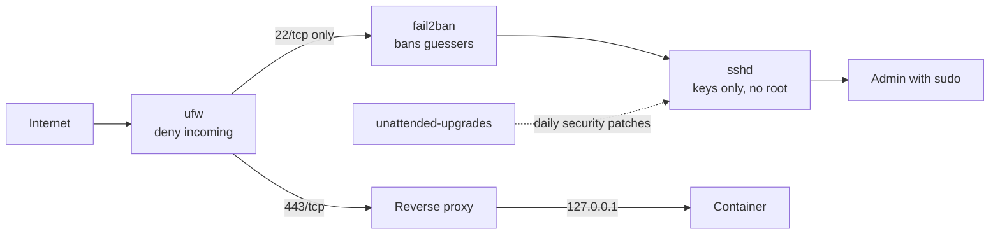

# Linux Server Hardening Basics: SSH Keys, ufw, fail2ban and Automatic Updates


| Element | Content |
|---|---|
| **Referent** | A new Debian or Ubuntu server (virtual machine, VPS or lab box) reachable by SSH, before any service is put on it. |
| **Sender** | **Bariu Azeez** |
| **Message** | Close the doors an attacker tries first: log in with SSH keys only, no root and no passwords over SSH, a default-deny firewall, automatic bans of password guessers, automatic security updates, and container ports that never bypass the firewall. |
| **Receiver** | Help desk and junior system administrators, students preparing a lab or a self-hosted service. |
| **Channel** | GitHub repository `Bazeeza/Technical-Runbooks` |
| **Code** | English, technical writing · Linux shell (bash), OpenSSH, Windows PowerShell for the client side |
| **Reference** | [OpenBSD: sshd_config(5) manual](https://man.openbsd.org/sshd_config) · [Ubuntu Server: OpenSSH server](https://ubuntu.com/server/docs/how-to/security/openssh-server/) · [Ubuntu Server: Firewalls (ufw)](https://ubuntu.com/server/docs/how-to/security/firewalls/) · [ufw(8) manual, `limit` rule](https://manpages.ubuntu.com/manpages/noble/man8/ufw.8.html) · [Ubuntu Server: Automatic updates](https://ubuntu.com/server/docs/how-to/software/automatic-updates/) · [fail2ban project](https://github.com/fail2ban/fail2ban) · [Docker: Packet filtering and firewalls](https://docs.docker.com/engine/network/packet-filtering-firewalls/) |

---

## Objective

A server with a public SSH port receives automated login attempts within minutes of going online. Most of them guess passwords for `root` and common usernames. This runbook removes what they guess at, then adds layers so that a single mistake (a weak password, a forgotten container port) is not enough to get in.

End state:

- SSH accepts **keys only**, for named administrators only, never `root`.
- The firewall **denies everything incoming** except SSH (and the services you open on purpose).
- Repeated failures are **banned** automatically.
- **Security updates** install every day without anyone logging in.
- Containers publish their ports on **127.0.0.1**, behind a reverse proxy.

Companion files:

- [`10-hardening.conf`](10-hardening.conf): the SSH server drop-in, commented line by line.
- [`jail.local`](jail.local): the fail2ban settings for SSH.
- [Docker ports and the firewall](DOCKER-PORT-BINDING.md): why `-p 8080:80` bypasses ufw, and the fix.

## Prerequisites

- [ ] A Debian 12 or Ubuntu 22.04 / 24.04 server, and an account with `sudo`
- [ ] A **second way in** that does not depend on SSH: the hypervisor or provider console (VPS "rescue" or "web console"), or physical access
- [ ] On your PC: the OpenSSH client (built into Windows 10 and 11, check with `ssh -V`)
- [ ] The subnet your administrators connect from, if access will be limited by address
- [ ] A snapshot of the virtual machine, if the platform offers one

> [!WARNING]
> Every step below can lock you out if it is done in the wrong order. The rule for the whole runbook: **keep your current SSH session open, and test with a new session before closing it.**

---

## Defense in layers



| Layer | Stops | Step |
|---|---|---|
| SSH keys, no passwords | Password guessing and reused passwords | 1 to 3 |
| No root login, `AllowUsers` | Guessing the one account that exists everywhere | 3 |
| ufw default deny | Services listening by accident (database, admin page) | 4 |
| fail2ban | Brute force noise, log flooding | 5 |
| Automatic updates | Known vulnerabilities left unpatched | 6 |
| Docker on 127.0.0.1 | Container ports that skip the firewall | 7 |

## Step 1 — Create an SSH key on your PC

In PowerShell (Windows) or a terminal (Linux, macOS):

```powershell
ssh-keygen -t ed25519 -C "admin-laptop-2026"
```

- **Ed25519** keys are short, fast and supported by every current OpenSSH version.
- The comment (`-C`) names the device, so an old key can be found and removed from the server later. Do not put an email address in it: it is copied to every server.
- Give the key a **passphrase**. A stolen key file is then useless on its own.

**Expected result:** two files in `%USERPROFILE%\.ssh\` (or `~/.ssh/`): `id_ed25519` (private, never copied anywhere) and `id_ed25519.pub` (public, the one you install on servers).

## Step 2 — Install the public key on the server

From Linux or macOS:

```bash
ssh-copy-id -i ~/.ssh/id_ed25519.pub <user>@<server>
```

Windows has no `ssh-copy-id`. The same result in PowerShell:

```powershell
Get-Content "$env:USERPROFILE\.ssh\id_ed25519.pub" |
    ssh <user>@<server> "mkdir -p ~/.ssh && chmod 700 ~/.ssh && cat >> ~/.ssh/authorized_keys && chmod 600 ~/.ssh/authorized_keys"
```

The permissions matter: sshd ignores an `authorized_keys` file that other users could write to.

Open a **new** terminal and test:

```bash
ssh -i ~/.ssh/id_ed25519 <user>@<server>
```

**Expected result:** the server asks for the key passphrase (if you set one), **not** for the account password.

## Step 3 — Allow keys only, no root

Copy [`10-hardening.conf`](10-hardening.conf) to the server, replace `<admin-user>`, and install it:

```bash
sudo install -m 644 10-hardening.conf /etc/ssh/sshd_config.d/10-hardening.conf
sudo sshd -t
sudo sshd -T | grep -Ei '^(passwordauthentication|kbdinteractiveauthentication|permitrootlogin|allowusers)'
```

| Directive | Why |
|---|---|
| `PasswordAuthentication no` | Password guessing no longer works at all, whatever the password |
| `KbdInteractiveAuthentication no` | Closes the other door that can ask for a password through PAM |
| `PermitRootLogin no` | `root` exists on every Linux server, so it is the first name guessed; admins use their own account and `sudo`, which leaves a name in the logs |
| `AllowUsers` | Only the listed accounts can log in, even a service account that has a key by mistake |
| `MaxAuthTries 3`, `LoginGraceTime 30` | Each connection gets few attempts and little time |
| `X11Forwarding no`, `AllowTcpForwarding no` | A server does not need these; fewer features, fewer surprises |

`sshd -t` prints nothing when the syntax is valid. `sshd -T` prints the **effective** configuration: it is the proof that no other file overrides your values.

> [!NOTE]
> Why a file in `sshd_config.d/` instead of editing `sshd_config`: sshd keeps the **first** value it reads for each keyword, and the `Include` line is at the top of the main file. Files are read in alphabetical order, so `10-hardening.conf` wins over a cloud image's `50-cloud-init.conf`, and package updates never touch your file.

Reload, **keep the current session open**, and test from a new terminal:

```bash
sudo systemctl reload ssh
```

The service is called `ssh` on Debian and Ubuntu (`sshd` on Red Hat family systems).

**Expected result:** a new key login works; `ssh -o PubkeyAuthentication=no <user>@<server>` is refused with `Permission denied (publickey)`.

## Step 4 — Firewall: deny incoming by default

```bash
sudo apt install ufw
sudo ufw default deny incoming
sudo ufw default allow outgoing
sudo ufw limit OpenSSH
sudo ufw enable
sudo ufw status verbose
```

- The **SSH rule comes before `ufw enable`**. Enabling a default-deny firewall without it cuts your own session.
- `limit` instead of `allow`: ufw refuses an address that opens 6 or more connections in 30 seconds. It is a first, cheap brake before fail2ban.
- Open other services one by one, with a reason: `sudo ufw allow 443/tcp`.
- To accept SSH from the management network only: `sudo ufw allow from 192.168.99.0/24 to any port 22 proto tcp`, then remove the general rule (`sudo ufw status numbered`, `sudo ufw delete <number>`).

**Expected result:** `Status: active`, `Default: deny (incoming), allow (outgoing)`, and `22/tcp (OpenSSH) LIMIT IN Anywhere`.

> [!WARNING]
> ufw does **not** filter ports published by Docker. Read step 7 before you trust `ufw status` on a server that runs containers.

## Step 5 — Ban password guessers with fail2ban

```bash
sudo apt install fail2ban python3-systemd
sudo cp jail.local /etc/fail2ban/jail.local
sudo fail2ban-client -t
sudo systemctl restart fail2ban
sudo fail2ban-client status sshd
```

[`jail.local`](jail.local) bans an address for 1 hour after 5 failures in 10 minutes, longer for repeat offenders, and puts the bans in ufw. With password logins already off, fail2ban does not protect a password: it cuts the noise in the logs and the load of thousands of attempts.

Set `ignoreip` to your management subnet, so a few typing mistakes do not ban the administrators.

**Expected result:** `Status for the jail: sshd` with a `Currently banned` counter. To lift a ban by mistake: `sudo fail2ban-client set sshd unbanip <address>`.

## Step 6 — Install security updates automatically

```bash
sudo apt install unattended-upgrades
sudo dpkg-reconfigure -plow unattended-upgrades
cat /etc/apt/apt.conf.d/20auto-upgrades
sudo unattended-upgrade -v --dry-run
```

`20auto-upgrades` must contain:

```text
APT::Periodic::Update-Package-Lists "1";
APT::Periodic::Unattended-Upgrade "1";
```

The value is a number of days: `1` means every day. By default only the **security** origin is installed automatically, which keeps the risk of an update breaking a service low.

Reboots are not automatic by default (`Unattended-Upgrade::Automatic-Reboot "false"` in `50unattended-upgrades`). A kernel update is only active after a reboot, so check:

```bash
cat /var/run/reboot-required 2>/dev/null || echo "No reboot needed"
```

**Expected result:** the dry run lists the packages it would install, and logs appear in `/var/log/unattended-upgrades/` after the first daily run.

> [!TIP]
> Decide the reboot policy with the service owner: automatic reboot at a quiet time (`Automatic-Reboot "true"` and `Automatic-Reboot-Time "04:00"`), or a weekly manual reboot after checking `reboot-required`.

## Step 7 — Containers: publish on 127.0.0.1

If the server runs Docker:

```bash
sudo ss -tlnp
docker ps --format 'table {{.Names}}\t{{.Ports}}'
```

Any container port shown on `0.0.0.0` or `[::]` is reachable from the network **even though ufw denies it**, because Docker's NAT rules send the traffic to the container before ufw's rules are checked. Publish it as `127.0.0.1:8080:80` and put a reverse proxy on 443 in front.

The full explanation, the Compose syntax and the tests are in [Docker ports and the firewall](DOCKER-PORT-BINDING.md).

> [!IMPORTANT]
> Members of the `docker` group can start a container that mounts `/` and become root. Add only administrators to it, as you would to `sudo`.

---

## Verification

Run the tests from **another machine** where it says so: a server always reaches itself.

| Test | Command or action | Expected result |
|---|---|---|
| Key login | `ssh <user>@<server>` | Logged in without the account password |
| Password refused | `ssh -o PubkeyAuthentication=no <user>@<server>` | `Permission denied (publickey)` |
| Root refused | `ssh root@<server>` | `Permission denied` |
| Effective SSH settings | `sudo sshd -T \| grep -Ei 'passwordauth\|permitroot'` | `passwordauthentication no`, `permitrootlogin no` |
| Firewall | `sudo ufw status verbose` | Active, deny incoming, only the ports you opened |
| fail2ban | `sudo fail2ban-client status sshd` | Jail running, failures counted |
| Updates | `sudo unattended-upgrade -v --dry-run` | Runs without error |
| Container ports | `Test-NetConnection <server> -Port 8080` from your PC | `TcpTestSucceeded : False` |
| Listening services | `sudo ss -tlnp` | Every line on `0.0.0.0` or `[::]` is a service you opened on purpose |

## Troubleshooting

| Symptom | Likely cause | Fix |
|---|---|---|
| `Permission denied (publickey)` with your own key | Key not in `authorized_keys`, wrong permissions, or user not in `AllowUsers` | From the console: `ls -la ~/.ssh`, `chmod 700 ~/.ssh`, `chmod 600 ~/.ssh/authorized_keys`; read `sudo journalctl -u ssh -n 50` |
| Password still accepted after step 3 | Another file sets `PasswordAuthentication yes` first | `sudo sshd -T \| grep passwordauthentication`, then `grep -r PasswordAuthentication /etc/ssh/` and rename your file so it sorts first |
| `sshd -t` reports `Bad configuration option` | Option name from another OpenSSH version (for example `KbdInteractiveAuthentication` before 8.7) | Use `ChallengeResponseAuthentication no` on old versions |
| Locked out after `ufw enable` | SSH rule missing or limited to the wrong subnet | Provider console: `sudo ufw allow OpenSSH` or `sudo ufw disable`, then fix the rules |
| fail2ban jail does not start: no log file found | The system logs only to the journal | `backend = systemd` in `jail.local` and the `python3-systemd` package |
| You banned yourself | Several failed attempts from your address | Console: `sudo fail2ban-client set sshd unbanip <address>`, then add your subnet to `ignoreip` |
| Updates never install | `20auto-upgrades` missing or set to `"0"` | `sudo dpkg-reconfigure -plow unattended-upgrades`; read `/var/log/unattended-upgrades/` |
| Container reachable although ufw denies the port | Port published on all addresses | [Docker ports and the firewall](DOCKER-PORT-BINDING.md) |

## Rollback

- SSH: `sudo rm /etc/ssh/sshd_config.d/10-hardening.conf && sudo systemctl reload ssh` (from the console if SSH is closed).
- Firewall: `sudo ufw disable` turns it off without losing the rules; `sudo ufw reset` deletes them.
- fail2ban: `sudo systemctl stop fail2ban` removes its bans.
- Automatic updates: set both values of `20auto-upgrades` to `"0"`.

---

## Related work

- [Network command cheat sheet](../04-Network-Troubleshooting/COMMAND-CHEATSHEET.md): `ss`, `ip` and their Windows equivalents.
- [Runbook 13, Backup and Restore](../13-Backup-and-Restore/README.md): a hardened server still needs a tested backup.
- [Runbook 07, Remote Support](../07-Remote-Support/README.md): the same "least access" idea applied to remote desktop.

<sub>Written by Bariu Azeez · Found an error? <a href="https://github.com/Bazeeza/Technical-Runbooks/issues/new?template=runbook-error.yml">Report it here</a>.</sub>
