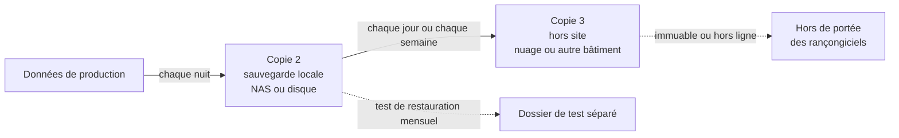

# Sauvegarde et restauration : la règle 3-2-1 et une restauration testée

[](README.fr.md)
[](README.md)


| Élément | Contenu |
|---|---|
| **Référent** | Tout poste de travail ou serveur dont les données manqueraient : documents des utilisateurs, partages de fichiers, configuration des serveurs, bases de données. |
| **Émetteur** | **bazeeza** |
| **Message** | Décider ce qui doit revenir et en combien de temps, garder trois copies sur deux types de supports dont une hors site, automatiser la sauvegarde, et **le prouver par un test de restauration** consigné dans un registre. Une sauvegarde qui n'a jamais été restaurée n'est qu'un espoir. |
| **Récepteur** | Techniciens de soutien, administrateurs débutants de petits sites et de laboratoires. |
| **Canal** | Dépôt GitHub `Bazeeza/Technical-Runbooks` |
| **Code** | Français, rédaction technique (traduction de l'original anglais) · Windows PowerShell 5.1, shell Linux (bash) |
| **Référence** | [CISA (US-CERT): Data Backup Options](https://www.cisa.gov/sites/default/files/publications/data_backup_options.pdf) · [CISA: #StopRansomware Guide](https://www.cisa.gov/stopransomware/ransomware-guide) · [NIST SP 800-34 Rev. 1, Contingency Planning Guide](https://csrc.nist.gov/pubs/sp/800/34/r1/upd1/final) · [restic documentation](https://restic.readthedocs.io/en/stable/) · [Microsoft: Back up and restore with File History](https://support.microsoft.com/en-us/windows/backup-and-restore-with-file-history-7bf065bf-f1ea-0a78-c1cf-7dcf51cc8bfc) · [Microsoft: wbadmin start recovery](https://learn.microsoft.com/en-us/windows-server/administration/windows-commands/wbadmin-start-recovery) |

---

## Objectif

Les disques tombent en panne, quelqu'un supprime le mauvais dossier, des mises à jour cassent des choses et un rançongiciel chiffre tout ce qu'il peut atteindre, y compris le disque de sauvegarde branché sur le même PC. Ce runbook met en place des sauvegardes qui survivent à chacun de ces cas, et fait du **test de restauration** une étape obligatoire et consignée.

État final :

- Les données à protéger, leur **RPO** et leur **RTO** sont écrits.
- Trois copies existent, sur deux types de supports, dont une hors site et hors de portée de la machine protégée.
- Les sauvegardes s'exécutent automatiquement et un échec est remarqué.
- Une restauration a été **testée**, comparée à l'original et consignée avec sa durée.

Fichiers associés :

- [Sauvegardes Windows](WINDOWS-BACKUP.fr.md) : File History, Windows Server Backup (`wbadmin`) et robocopy.
- [Sauvegardes Linux avec restic](RESTIC-LINUX.fr.md) : instantanés chiffrés, minuteur systemd, rétention, et quand rsync suffit.
- [`Test-RestoredFiles.ps1`](Test-RestoredFiles.ps1) : compare un dossier restauré avec l'original par empreinte SHA-256 et enregistre un rapport CSV.

## Prérequis

- [ ] La liste de ce que l'utilisateur ou le responsable du service ne peut pas perdre (demander : « si ceci disparaissait ce soir, de quoi auriez-vous besoin demain ? »)
- [ ] Une destination de sauvegarde qui n'est **pas** le disque protégé : disque externe, NAS, serveur de sauvegarde ou stockage infonuagique
- [ ] Les droits de lire les données et d'écrire dans la destination (administrateur local, `sudo` ou un compte de sauvegarde)
- [ ] Un dossier vide ou une machine de test pour le test de restauration
- [ ] Un endroit où conserver le mot de passe de chiffrement de la sauvegarde (le gestionnaire de mots de passe de l'équipe)

---

## La règle 3-2-1



| Nombre | Règle | Ce contre quoi elle protège |
|---|---|---|
| **3** copies | Les données en service plus deux sauvegardes | Une sauvegarde qui se révèle corrompue |
| **2** types de supports | Par exemple le disque du serveur et un NAS, ou un NAS et un stockage infonuagique | Une panne qui frappe tous les appareils d'un même type (même lot de disques, même bogue de stockage) |
| **1** hors site | Un autre bâtiment ou un fournisseur infonuagique | Incendie, inondation, vol, et un rançongiciel qui atteint tous les appareils connectés |

La règle est décrite dans *Data Backup Options* de la CISA. Les éditeurs de solutions de sauvegarde ajoutent maintenant souvent **« 1 hors ligne ou immuable, 0 erreur »** (3-2-1-1-0) : une copie qui ne peut pas être modifiée même avec des droits d'administrateur, et un test de restauration sans erreur. Les recommandations de la CISA sur les rançongiciels disent la même chose : garder les sauvegardes hors ligne et les tester.

## Étape 1 — Décider quoi protéger, et en combien de temps

Pour chaque système, remplir une ligne avant de choisir un outil :

| Système | Données | RPO | RTO | Responsable |
|---|---|---|---|---|
| *Exemple : partage de la comptabilité* | `D:\Shares\Finance` | 24 h | 4 h | Responsable des finances |
| *Exemple : serveur web Linux* | `/etc`, `/srv`, copie (*dump*) de la base de données | 24 h | 8 h | Responsable du service |

- **RPO** (*Recovery Point Objective*, objectif de point de reprise) : la quantité de **travail récent** qu'on peut perdre. Un RPO de 24 heures signifie qu'une sauvegarde par jour suffit ; un RPO d'une heure exige des sauvegardes toutes les heures.
- **RTO** (*Recovery Time Objective*, objectif de temps de reprise) : combien de temps le système peut rester **en panne** avant d'être rétabli. Il décide si un téléchargement lent depuis le nuage est acceptable ou si une copie locale est nécessaire.

Ces chiffres sont une décision **d'affaires** : le technicien propose, le responsable approuve. Les écrire évite la discussion après un incident.

**Résultat attendu :** chaque système à sauvegarder a une ligne avec un RPO, un RTO et un responsable.

## Étape 2 — Choisir l'outil

| Machine | Outil | Guide |
|---|---|---|
| Poste de travail Windows | File History vers un disque ou un partage | [Sauvegardes Windows, option A](WINDOWS-BACKUP.fr.md#option-a--file-history-poste-de-travail) |
| Serveur Windows | Windows Server Backup (`wbadmin`) | [Sauvegardes Windows, option B](WINDOWS-BACKUP.fr.md#option-b--windows-server-backup-serveur) |
| Serveur Linux | restic vers un serveur de sauvegarde ou un stockage infonuagique | [Sauvegardes Linux avec restic](RESTIC-LINUX.fr.md) |
| Deuxième copie d'un dossier | Miroir robocopy ou rsync | [robocopy](WINDOWS-BACKUP.fr.md#option-c--miroir-robocopy-vers-un-nas-deuxième-copie), [rsync](RESTIC-LINUX.fr.md#rsync--un-miroir-à-côté-de-la-sauvegarde) |

Une **synchronisation** (OneDrive, un miroir robocopy ou rsync) copie aussi les suppressions et le chiffrement. Elle est utile, mais elle n'est jamais la seule sauvegarde : au moins une copie doit garder les **anciennes versions**.

## Étape 3 — Configurer la sauvegarde

Suivre le guide choisi à l'étape 2 et vérifier ces points, quel que soit l'outil :

- [ ] La destination est **un autre appareil** que la source.
- [ ] Les sauvegardes sont **chiffrées** quand elles quittent le bâtiment (restic chiffre toujours ; pour les autres outils, un disque chiffré ou le chiffrement du côté du fournisseur).
- [ ] Le mot de passe de chiffrement est dans le gestionnaire de mots de passe : **un mot de passe perdu, c'est une sauvegarde perdue.**
- [ ] Le compte de sauvegarde peut écrire dans la destination, mais les utilisateurs de la machine protégée ne peuvent pas supprimer les sauvegardes.
- [ ] Les bases de données sont sauvegardées à partir d'une copie (*dump*) ou avec un outil qui connaît la base de données, pas en copiant les fichiers en service.

**Résultat attendu :** une première sauvegarde complète s'est terminée sans erreur.

## Étape 4 — Automatiser et surveiller

Une sauvegarde qui dépend de la mémoire de quelqu'un finira par s'arrêter. La planifier (horaire de File History, horaire de Windows Server Backup, minuteur systemd), puis s'assurer qu'un **échec est vu** :

| Outil | Où vérifier |
|---|---|
| File History | Page **File History** : date de la dernière copie |
| Windows Server Backup | `wbadmin get versions`, Observateur d'événements (Event Viewer) › **Applications and Services Logs** › **Microsoft** › **Windows** › **Backup** |
| restic avec systemd | `systemctl status restic-backup.service`, `journalctl -u restic-backup.service`, `restic snapshots` |
| robocopy | Code de sortie (8 ou plus signifie un échec) et le fichier `/LOG` |

**Résultat attendu :** la date de la dernière sauvegarde réussie remonte à moins d'un RPO.

## Étape 5 — Tester la restauration (obligatoire)

C'est l'étape la plus souvent sautée, et la seule qui prouve quelque chose. Tester au moins **une fois par mois**, et après toute modification de la configuration de sauvegarde.

1. Choisir un dossier qui compte (pas un dossier de test vide) et qui ne change pas pendant le test.
2. Le restaurer à un **emplacement séparé**, jamais par-dessus les données en service :
   - Windows : [File History ou `wbadmin start recovery -recoveryTarget:`](WINDOWS-BACKUP.fr.md)
   - Linux : [`restic restore ... --target /tmp/restore-test`](RESTIC-LINUX.fr.md#étape-6--test-de-restauration)
3. Chronométrer la restauration, du début de la demande jusqu'aux fichiers utilisables : c'est le vrai RTO.
4. Comparer le dossier restauré avec l'original :

```powershell
.\Test-RestoredFiles.ps1 -SourcePath D:\Shares\Finance -RestoredPath E:\RestoreTest\Finance -ReportPath .\restore-test-2026-10.csv
```

Sous Linux, `diff -r <original> <restored>` donne la même preuve pour un dossier.

5. Ouvrir deux ou trois fichiers avec leur application (un tableur, un PDF, une copie de base de données chargée dans une instance de test) : des octets identiques sont la preuve, ouvrir le fichier est la vérification de bon sens.
6. Supprimer la copie de test une fois le registre rempli, pour que de vieilles données restaurées ne traînent pas.

**Résultat attendu :** `Restore test PASSED` (code de sortie 0) ou aucune sortie de `diff -r`, les fichiers s'ouvrent normalement et la durée de restauration respecte le RTO.

> [!IMPORTANT]
> Un test de restauration qui échoue est un **bon** résultat : il a trouvé le problème avant qu'un incident ne le fasse. Le consigner, corriger la sauvegarde et tester de nouveau.

## Étape 6 — Consigner le test

Copier ce bloc dans le billet ou dans la documentation du site pour chaque test :

```text
Restore test record
Date / technician      :
System and data tested :
Backup tool / version  :
Backup date restored   :
Restored to            :
Restore duration       :            (RTO target:      )
Comparison result      : PASSED / FAILED  (Match: , Different: , Missing: )
Files opened           :
Problems and actions   :
Next test due          :
```

Les champs signifient, dans l'ordre : date et technicien ; système et données testés ; outil et version de sauvegarde ; date de la sauvegarde restaurée ; emplacement de restauration ; durée de la restauration (cible RTO) ; résultat de la comparaison (identiques, différents, manquants) ; fichiers ouverts ; problèmes et actions ; date du prochain test.

Le registre est ce que demandent un auditeur, un gestionnaire ou le prochain technicien : « à quand remonte la dernière restauration qui a vraiment fonctionné ? »

---

## Vérification

| Test | Comment | Résultat attendu |
|---|---|---|
| Inventaire | Tableau de l'étape 1 | Chaque système a ses données, son RPO, son RTO et son responsable |
| 3-2-1 | Compter les copies et leurs emplacements | 3 copies, 2 types de supports, 1 hors site |
| Versions | Lister les sauvegardes (`restic snapshots`, `wbadmin get versions`, versions de File History) | Plusieurs dates, pas seulement la plus récente |
| Automatisation | Date de la dernière sauvegarde | Moins d'un RPO |
| Restauration | `Test-RestoredFiles.ps1` ou `diff -r` | PASSED, aucune différence inattendue |
| Registre | Billet ou documentation | Un registre daté pour le dernier test |

## Dépannage

| Symptôme | Cause probable | Correction |
|---|---|---|
| Sauvegarde « réussie », mais le dossier n'y est pas | Dossier absent de la sélection, ou sur un autre volume | Vérifier la sélection ; `--one-file-system` de restic et `wbadmin -include` ne prennent que ce qui est listé |
| Test de restauration : beaucoup de fichiers `Missing` | Exclusions trop larges, ou fichiers ajoutés après la sauvegarde | Relire la sélection et les exclusions de la sauvegarde ; tester de nouveau après la prochaine sauvegarde |
| Test de restauration : fichiers `Different` | Fichiers modifiés après la sauvegarde, ou copie endommagée | Tester sur un dossier qui ne change pas ; lancer `restic check --read-data-subset` ou une nouvelle sauvegarde |
| Restauration beaucoup plus lente que le RTO | Copie hors site trop lente pour la taille des données | Garder une copie locale pour les restaurations rapides, et la copie hors site pour les sinistres |
| Disque de sauvegarde chiffré avec le reste | Disque toujours connecté à la machine | Le déconnecter entre les exécutions, ou utiliser un serveur de sauvegarde sur lequel la machine ne peut pas écrire directement |
| Impossible d'ouvrir la sauvegarde : mot de passe inconnu | Mot de passe de chiffrement jamais consigné | Rien ne peut le récupérer : faire une nouvelle sauvegarde et, cette fois, conserver le mot de passe |

## Retour arrière

Les sauvegardes et les tests de restauration ne modifient pas les données en service quand la restauration se fait à un emplacement séparé. Si une restauration a été lancée par erreur par-dessus les données en service, arrêter, puis restaurer les fichiers écrasés à partir de la version de sauvegarde **précédente**.

---

## Travaux liés

- [Runbook 12, bases du durcissement d'un serveur Linux](../12-Linux-Server-Hardening/README.fr.md) : clés SSH pour le compte de sauvegarde, et un serveur qui risque moins d'avoir besoin d'une restauration.
- [Runbook 02, liste de vérification après l'installation](../02-Windows-11-Clean-Installation/POST-INSTALL-CHECKLIST.fr.md) : l'étape où les données de l'utilisateur reviennent de la sauvegarde sur un nouveau poste de travail.
- [**Projets-Runbooks**](https://github.com/Bazeeza/Projets-Runbooks) : notes de laboratoire en français, y compris sur les services AWS.

<sub>Écrit par bazeeza · Vous avez trouvé une erreur ? <a href="https://github.com/Bazeeza/Technical-Runbooks/issues/new?template=runbook-error.yml">Signalez-la ici</a>.</sub>
