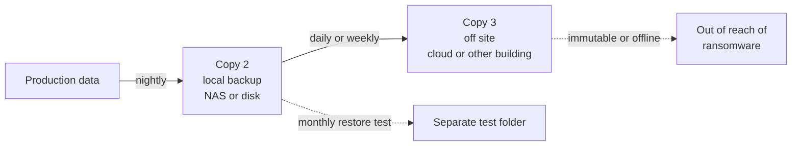

# Backup and Restore: the 3-2-1 Rule and a Tested Restore


| Element | Content |
|---|---|
| **Referent** | Any workstation or server whose data would be missed: user documents, file shares, server configuration, databases. |
| **Sender** | **Bariu Azeez** |
| **Message** | Decide what must come back and how fast, keep three copies on two kinds of media with one off site, automate the backup, and **prove it with a restore test** written down in a record. A backup that was never restored is only a hope. |
| **Receiver** | Help desk technicians, junior administrators of small sites and labs. |
| **Channel** | GitHub repository `Bazeeza/Technical-Runbooks` |
| **Code** | English, technical writing · Windows PowerShell 5.1, Linux shell (bash) |
| **Reference** | [CISA (US-CERT): Data Backup Options](https://www.cisa.gov/sites/default/files/publications/data_backup_options.pdf) · [CISA: #StopRansomware Guide](https://www.cisa.gov/stopransomware/ransomware-guide) · [NIST SP 800-34 Rev. 1, Contingency Planning Guide](https://csrc.nist.gov/pubs/sp/800/34/r1/upd1/final) · [restic documentation](https://restic.readthedocs.io/en/stable/) · [Microsoft: Back up and restore with File History](https://support.microsoft.com/en-us/windows/backup-and-restore-with-file-history-7bf065bf-f1ea-0a78-c1cf-7dcf51cc8bfc) · [Microsoft: wbadmin start recovery](https://learn.microsoft.com/en-us/windows-server/administration/windows-commands/wbadmin-start-recovery) |

---

## Objective

Disks fail, people delete the wrong folder, updates break things and ransomware encrypts everything it can reach, including the backup disk plugged into the same PC. This runbook sets up backups that survive each of these, and makes the **restore test** a mandatory, recorded step.

End state:

- The data to protect, its **RPO** and its **RTO** are written down.
- Three copies exist, on two kinds of media, one of them off site and out of reach of the protected machine.
- Backups run automatically and a failure is noticed.
- A restore has been **tested**, compared to the original, and recorded with its duration.

Companion files:

- [Windows backups](WINDOWS-BACKUP.md): File History, Windows Server Backup (`wbadmin`) and robocopy.
- [Linux backups with restic](RESTIC-LINUX.md): encrypted snapshots, a systemd timer, retention, and when rsync is enough.
- [`Test-RestoredFiles.ps1`](Test-RestoredFiles.ps1): compares a restored folder with the original by SHA-256 hash, and saves a CSV report.

## Prerequisites

- [ ] The list of what the user or the service owner cannot lose (ask: "if this disappeared tonight, what would you need tomorrow?")
- [ ] A backup destination that is **not** the disk being protected: external disk, NAS, backup server, or cloud storage
- [ ] Rights to read the data and write to the destination (local administrator, `sudo`, or a backup account)
- [ ] An empty folder or a test machine for the restore test
- [ ] A place to store the encryption password of the backup (the team password manager)

---

## The 3-2-1 rule



| Number | Rule | What it protects against |
|---|---|---|
| **3** copies | The live data plus two backups | One backup that turns out to be corrupt |
| **2** kinds of media | For example the server disk and a NAS, or a NAS and cloud storage | A fault that hits every device of one kind (same disk batch, same storage bug) |
| **1** off site | Another building or a cloud provider | Fire, flood, theft, and ransomware that reaches every connected device |

The rule is described in CISA's *Data Backup Options*. Backup vendors now often add **"1 offline or immutable, 0 errors"** (3-2-1-1-0): one copy that cannot be modified even with administrator rights, and a restore test with no error. CISA's ransomware guidance makes the same point: keep backups offline and test them.

## Step 1 — Decide what to protect, and how fast

For each system, fill in one line before choosing a tool:

| System | Data | RPO | RTO | Owner |
|---|---|---|---|---|
| *Example: accounting share* | `D:\Shares\Finance` | 24 h | 4 h | Finance manager |
| *Example: Linux web server* | `/etc`, `/srv`, database dump | 24 h | 8 h | Service owner |

- **RPO** (Recovery Point Objective): how much **recent work** you may lose. An RPO of 24 hours means one backup a day is enough; an RPO of one hour needs hourly backups.
- **RTO** (Recovery Time Objective): how long the system may be **down** before it is back. It decides whether a slow cloud download is acceptable or a local copy is needed.

The numbers are a **business** decision: the technician proposes, the owner agrees. Writing them down avoids the argument after an incident.

**Expected result:** every system to back up has a line with an RPO, an RTO and an owner.

## Step 2 — Choose the tool

| Machine | Tool | Guide |
|---|---|---|
| Windows workstation | File History to a disk or a share | [Windows backups, option A](WINDOWS-BACKUP.md#option-a--file-history-workstation) |
| Windows server | Windows Server Backup (`wbadmin`) | [Windows backups, option B](WINDOWS-BACKUP.md#option-b--windows-server-backup-server) |
| Linux server | restic to a backup server or cloud storage | [Linux backups with restic](RESTIC-LINUX.md) |
| Second copy of a folder | robocopy or rsync mirror | [robocopy](WINDOWS-BACKUP.md#option-c--robocopy-mirror-to-a-nas-second-copy), [rsync](RESTIC-LINUX.md#rsync-a-mirror-next-to-the-backup) |

A **sync** (OneDrive, a robocopy or rsync mirror) copies deletions and encryption too. It is useful, but it is never the only backup: at least one copy must keep **older versions**.

## Step 3 — Configure the backup

Follow the guide chosen in step 2, and check these points whatever the tool:

- [ ] The destination is **another device** than the source.
- [ ] Backups are **encrypted** when they leave the building (restic always encrypts; for other tools, an encrypted disk or provider-side encryption).
- [ ] The encryption password is in the password manager: **a lost password is a lost backup.**
- [ ] The backup account can write to the destination, but the protected machine's users cannot delete the backups.
- [ ] Databases are backed up from a dump or with a tool that knows the database, not by copying live files.

**Expected result:** a first complete backup finished without error.

## Step 4 — Automate and watch

A backup that depends on someone remembering will stop. Schedule it (File History schedule, Windows Server Backup schedule, systemd timer), then make sure a **failure is seen**:

| Tool | Where to check |
|---|---|
| File History | **File History** page: date of the last copy |
| Windows Server Backup | `wbadmin get versions`, Event Viewer › **Applications and Services Logs** › **Microsoft** › **Windows** › **Backup** |
| restic with systemd | `systemctl status restic-backup.service`, `journalctl -u restic-backup.service`, `restic snapshots` |
| robocopy | Exit code (8 or more is a failure) and the `/LOG` file |

**Expected result:** the date of the last successful backup is less than one RPO old.

## Step 5 — Test the restore (mandatory)

This is the step that is skipped most often, and the only one that proves anything. Test at least **once a month**, and after any change to the backup configuration.

1. Pick a folder that matters (not an empty test folder) and that does not change during the test.
2. Restore it to a **separate location**, never over the live data:
   - Windows: [File History or `wbadmin start recovery -recoveryTarget:`](WINDOWS-BACKUP.md)
   - Linux: [`restic restore ... --target /tmp/restore-test`](RESTIC-LINUX.md#step-6--restore-test)
3. Time the restore, from the start of the request to usable files: it is the real RTO.
4. Compare the restored folder with the original:

```powershell
.\Test-RestoredFiles.ps1 -SourcePath D:\Shares\Finance -RestoredPath E:\RestoreTest\Finance -ReportPath .\restore-test-2026-10.csv
```

On Linux, `diff -r <original> <restored>` gives the same proof for a folder.

5. Open two or three files with their application (a spreadsheet, a PDF, a database dump loaded into a test instance): identical bytes are the proof, opening the file is the sanity check.
6. Delete the test copy once the record is written, so old restored data does not linger.

**Expected result:** `Restore test PASSED` (exit code 0) or no output from `diff -r`, files open normally, and the restore time is within the RTO.

> [!IMPORTANT]
> A restore test that fails is a **good** result: it found the problem before an incident did. Record it, fix the backup, and test again.

## Step 6 — Record the test

Copy this block into the ticket or the site documentation for each test:

```text
Restore test record
Date / technician      :
System and data tested :
Backup tool / version  :
Backup date restored   :
Restored to            :
Restore duration       :            (RTO target:      )
Comparison result      : PASSED / FAILED  (Match: , Different: , Missing: )
Files opened           :
Problems and actions   :
Next test due          :
```

The record is what an auditor, a manager or the next technician asks for: "when was the last time a restore really worked?"

---

## Verification

| Test | How | Expected result |
|---|---|---|
| Inventory | Step 1 table | Every system has data, RPO, RTO and owner |
| 3-2-1 | Count the copies and their locations | 3 copies, 2 kinds of media, 1 off site |
| Versions | List the backups (`restic snapshots`, `wbadmin get versions`, File History versions) | Several dates, not only the latest |
| Automation | Date of the last backup | Less than one RPO old |
| Restore | `Test-RestoredFiles.ps1` or `diff -r` | PASSED, no unexpected difference |
| Record | Ticket or documentation | A dated record for the last test |

## Troubleshooting

| Symptom | Likely cause | Fix |
|---|---|---|
| Backup "successful" but the folder is not in it | Folder not in the selection, or on another volume | Check the selection; restic `--one-file-system` and `wbadmin -include` only take what is listed |
| Restore test: many `Missing` files | Exclusions too wide, or files added after the backup | Read the backup selection and exclusions; test again after the next backup |
| Restore test: `Different` files | Files changed after the backup, or a damaged copy | Test on a folder that does not change; run `restic check --read-data-subset` or a new backup |
| Restore much slower than the RTO | Off-site copy too slow for the size | Keep a local copy for fast restores, the off-site one for disasters |
| Backup disk encrypted with the rest | Disk always connected to the machine | Disconnect it between runs, or use a backup server the machine cannot write to directly |
| Cannot open the backup: password unknown | Encryption password never recorded | Nothing can recover it: make a new backup, and store the password this time |

## Rollback

Backups and restore tests do not change the live data when the restore goes to a separate location. If a restore was run over the live data by mistake, stop, and restore the overwritten files from the **previous** backup version.

---

## Related work

- [Runbook 12, Linux Server Hardening Basics](../12-Linux-Server-Hardening/README.md): SSH keys for the backup account, and a server that is less likely to need the restore.
- [Runbook 02, post-installation checklist](../02-Windows-11-Clean-Installation/POST-INSTALL-CHECKLIST.md): the step where the user's data comes back from the backup onto a new workstation.
- [**Projets-Runbooks**](https://github.com/Bazeeza/Projets-Runbooks): French lab notes, including AWS services.

<sub>Written by Bariu Azeez · Found an error? <a href="https://github.com/Bazeeza/Technical-Runbooks/issues/new?template=runbook-error.yml">Report it here</a>.</sub>
