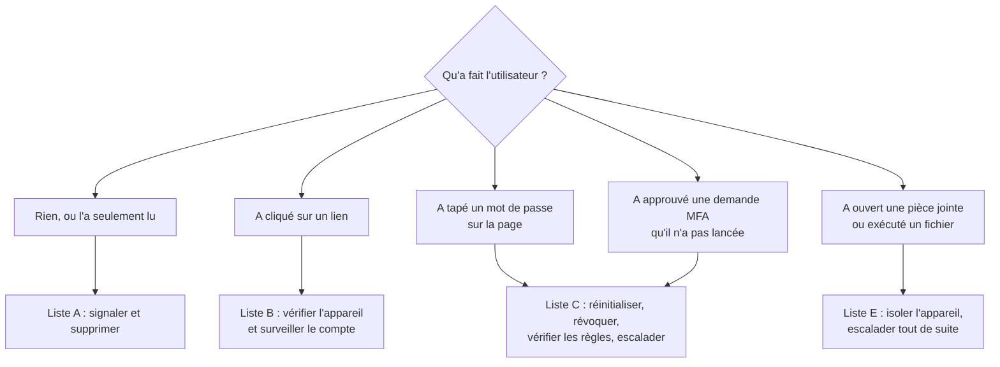

# Liste de vérification de première intervention en cas d'hameçonnage

[](FIRST-RESPONSE-CHECKLIST.fr.md)
[](FIRST-RESPONSE-CHECKLIST.md)


| Élément | Contenu |
|---|---|
| **Référent** | Ce que fait le soutien TI dans les premières minutes après qu'un utilisateur a signalé un message d'hameçonnage, selon ce que l'utilisateur en a fait. |
| **Émetteur** | **bazeeza** |
| **Message** | Poser une seule question (« qu'avez-vous fait avec le message ? »), puis suivre la liste correspondante : signalement seulement, clic sur un lien, mot de passe saisi, demande MFA inattendue approuvée, ou pièce jointe ouverte. Contenir d'abord, escalader tôt, ne jamais blâmer l'utilisateur. |
| **Récepteur** | Techniciens de soutien TI, premier niveau. |
| **Canal** | Dépôt GitHub `Bazeeza/Technical-Runbooks` |
| **Code** | Français, liste de vérification (traduction de l'original anglais) · Microsoft Graph PowerShell, Exchange Online PowerShell |
| **Référence** | [Microsoft Learn: Respond to a compromised e-mail account](https://learn.microsoft.com/en-us/defender-office-365/responding-to-a-compromised-email-account) · [Microsoft Learn: Revoke user access in an emergency](https://learn.microsoft.com/en-us/entra/identity/users/users-revoke-access) · [Microsoft Learn: Manage user authentication methods](https://learn.microsoft.com/en-us/entra/identity/authentication/howto-mfa-userdevicesettings) · [Canadian Centre for Cyber Security: Don't take the bait (ITSAP.00.101)](https://www.cyber.gc.ca/en/guidance/dont-take-bait-recognize-and-avoid-phishing-attacks) |

Retour à [14 Signalement d'hameçonnage et première intervention](README.fr.md).

---

## La première question

> **« Qu'avez-vous fait avec le message ? »**

Posez-la calmement et remerciez l'utilisateur d'avoir signalé : un utilisateur qui a peur d'être blâmé signale tard, ou pas du tout, et chaque minute compte.



## Liste A — Signalé, sans clic

- [ ] L'utilisateur le signale avec le bouton **Report** › **Report phishing** (Signaler › Signaler l'hameçonnage) d'Outlook (il envoie l'original avec ses en-têtes ; un transfert ne le fait pas)
- [ ] Si le bouton n'est pas disponible, demandez plutôt les en-têtes ([comment les copier](READING-EMAIL-HEADERS.fr.md#étape-1--copier-les-en-têtes))
- [ ] Notez dans le billet : objet, expéditeur, heure de réception, nombre de destinataires connus
- [ ] Prévenez l'équipe de sécurité ou l'administrateur de la messagerie si plusieurs utilisateurs l'ont reçu : ils peuvent chercher et supprimer le message de chaque boîte aux lettres
- [ ] Remerciez l'utilisateur

## Liste B — A cliqué sur un lien, n'a rien tapé

- [ ] Demandez ce qui est apparu : une page de connexion, un téléchargement, une fenêtre « votre PC est infecté », rien
- [ ] Si un fichier a été téléchargé, suivez la **liste E**
- [ ] Lancez une analyse antivirus complète (Microsoft Defender : **Windows Security** › **Virus & threat protection** › **Scan options** › **Full scan**)
- [ ] Fermez l'onglet du navigateur et effacez la page de l'historique seulement si l'équipe de sécurité n'en a pas besoin ; sinon, laissez-les
- [ ] Surveillez le compte pendant une semaine : des demandes MFA inattendues ou des alertes de connexion signifient que l'utilisateur a tapé plus qu'il ne s'en souvient (passez à la **liste C**)
- [ ] Complétez la **liste A** (signaler le message)

## Liste C — A tapé un mot de passe ou approuvé une demande MFA inattendue

L'attaquant est peut-être déjà connecté. Agissez dans cet ordre, et utilisez un autre canal que le courriel pour parler à l'utilisateur (téléphone, appel Teams depuis un compte connu, en personne) : la boîte aux lettres peut être lue par l'attaquant.

| # | Action | Où | Pourquoi |
|---|---|---|---|
| 1 | **Escalader** à l'équipe de sécurité et lui donner l'heure du clic | Billet + téléphone | Elle peut désactiver le compte et consulter les journaux de connexion pendant que vous travaillez |
| 2 | **Réinitialiser le mot de passe** avec un nouveau mot de passe unique ; ne jamais l'envoyer par courriel | Centre d'administration Microsoft 365 › **Users** › **Active users** › **Reset password**, ou centre d'administration Entra › utilisateur › **Reset password** ; pour un compte synchronisé, dans Active Directory ([runbook 05](../05-Active-Directory-User-Management/README.fr.md)) | Le mot de passe volé ne fonctionne plus pour les nouvelles connexions |
| 3 | **Révoquer les sessions** | Centre d'administration Entra › utilisateur › **Revoke sessions**, ou `Revoke-MgUserSignInSession` | Une réinitialisation seule ne met pas fin aux sessions déjà ouvertes : la révocation invalide les jetons d'actualisation (refresh tokens) |
| 4 | **Examiner les méthodes MFA** et retirer tout téléphone ou application que l'utilisateur ne reconnaît pas ; en cas de doute, **Require re-register MFA** | Centre d'administration Entra › utilisateur › **Authentication methods** | Les attaquants ajoutent leur propre méthode pour revenir plus tard |
| 5 | **Vérifier le transfert et les règles de boîte de réception** | Exchange Online PowerShell (ci-dessous) | Une règle cachée qui transfère ou supprime le courrier est le moyen le plus courant de continuer à espionner après la réinitialisation |
| 6 | Changer ce même mot de passe **partout ailleurs** où il était utilisé, depuis un appareil sain | Autres comptes de l'utilisateur | Les attaquants essaient les mots de passe volés sur d'autres sites |
| 7 | Dire à l'utilisateur quoi surveiller : demandes MFA inattendues, réponses à des courriels qu'il n'a jamais envoyés | Téléphone ou en personne | Il est le premier à voir une deuxième tentative |

Commandes pour les étapes 3 et 5, lancées par un administrateur qui a les rôles indiqués dans les procédures de Microsoft (remplacez le compte d'exemple) :

```powershell
# Step 3: revoke the user's refresh tokens (Microsoft Graph PowerShell)
Connect-MgGraph -Scopes 'User.RevokeSessions.All'
Revoke-MgUserSignInSession -UserId 'user@contoso.com'

# Step 5: look for forwarding on the mailbox and for rules that forward, redirect or delete (Exchange Online PowerShell)
Connect-ExchangeOnline
Get-Mailbox -Identity 'user@contoso.com' | Format-List Forwarding*Address, DeliverTo*
Get-InboxRule -Mailbox 'user@contoso.com' -IncludeHidden | Format-List Name, Enabled, RedirectTo, Forward*, DeleteMessage, MoveToFolder, Identity
```

Les commentaires signifient : étape 3, révoquer les jetons d'actualisation de l'utilisateur (Microsoft Graph PowerShell) ; étape 5, chercher un transfert sur la boîte aux lettres et des règles qui transfèrent, redirigent ou suppriment (Exchange Online PowerShell).

Une valeur `ForwardingSmtpAddress` non vide, ou une règle que l'utilisateur n'a pas créée et qui transfère le courrier, le supprime ou le déplace vers **RSS Subscriptions**, **Notes** ou **Junk Email**, est un signe de compromission : **ne la supprimez pas vous-même**, consignez-la et remettez-la à l'équipe de sécurité, qui décide quand la retirer.

> [!IMPORTANT]
> Une demande MFA que l'utilisateur a approuvée sans avoir lancé de connexion équivaut à un mot de passe volé **et** à un second facteur volé. Traitez-la comme la liste C, même si l'utilisateur a « seulement appuyé sur Approuver ».

## Liste E — A ouvert une pièce jointe ou exécuté un fichier

- [ ] **Déconnectez l'appareil du réseau** tout de suite : débranchez le câble et coupez le Wi-Fi (mode avion). Ne l'éteignez **pas** : l'équipe de sécurité peut avoir besoin de ce qui est en mémoire
- [ ] Escaladez immédiatement à l'équipe de sécurité, par téléphone
- [ ] Notez le nom du fichier, l'heure à laquelle il a été ouvert et ce que l'utilisateur a vu (rien, un document qui demande d'« activer le contenu », une erreur)
- [ ] Ne supprimez ni le fichier ni le courriel
- [ ] Si l'utilisateur a aussi tapé un mot de passe, appliquez la **liste C** depuis un autre appareil, sain
- [ ] Remettez à l'utilisateur un appareil de remplacement si l'enquête garde le sien

---

## Fiche d'incident

Copiez ce bloc dans le billet :

```text
Phishing first response record
Ticket / technician      :
Reported by / time       :
Message (subject, sender):
Time received / opened   :
User action              : A none / B clicked / C password or MFA / E attachment
Actions taken (time)     : reported / scanned / reset / sessions revoked / MFA reviewed / rules checked / isolated
Rules or forwarding found:
Escalated to / time      :
Other users affected     :
Follow-up date           :
```

## Ce qu'il ne faut pas faire

| À éviter | Pourquoi |
|---|---|
| Transférer le courriel d'hameçonnage à des collègues « comme exemple » | Quelqu'un va cliquer ; utilisez le bouton **Report** ou une capture d'écran |
| Ouvrir le lien « pour voir » | Il peut installer quelque chose, ou confirmer à l'attaquant que l'adresse est active |
| Envoyer le nouveau mot de passe par courriel ou par clavardage au compte de l'utilisateur | L'attaquant peut encore le lire |
| Supprimer les règles, fichiers ou courriels suspects avant que l'équipe de sécurité les ait vus | Ce sont les preuves qui montrent ce que l'attaquant a fait |
| Blâmer l'utilisateur | Le prochain ne signalera pas |

---

<sub>Écrit par bazeeza · Vous avez trouvé une erreur ? <a href="https://github.com/Bazeeza/Technical-Runbooks/issues/new?template=runbook-error.yml">Signalez-la ici</a>.</sub>
