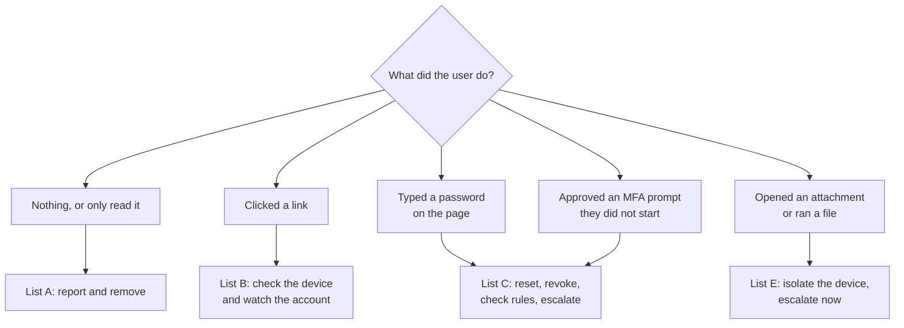

# Phishing First Response Checklist


| Element | Content |
|---|---|
| **Referent** | What the help desk does in the first minutes after a user reports a phishing message, depending on what the user did with it. |
| **Sender** | **bazeeza** |
| **Message** | Ask one question ("what did you do with it?"), then follow the matching list: report only, clicked a link, entered a password, approved an unexpected MFA prompt, or opened an attachment. Contain first, escalate early, never blame the user. |
| **Receiver** | Help desk technicians, first level. |
| **Channel** | GitHub repository `Bazeeza/Technical-Runbooks` |
| **Code** | English, checklist · Microsoft Graph PowerShell, Exchange Online PowerShell |
| **Reference** | [Microsoft Learn: Respond to a compromised e-mail account](https://learn.microsoft.com/en-us/defender-office-365/responding-to-a-compromised-email-account) · [Microsoft Learn: Revoke user access in an emergency](https://learn.microsoft.com/en-us/entra/identity/users/users-revoke-access) · [Microsoft Learn: Manage user authentication methods](https://learn.microsoft.com/en-us/entra/identity/authentication/howto-mfa-userdevicesettings) · [Canadian Centre for Cyber Security: Don't take the bait (ITSAP.00.101)](https://www.cyber.gc.ca/en/guidance/dont-take-bait-recognize-and-avoid-phishing-attacks) |

Back to [14 Phishing Report and First Response](README.md).

---

## The first question

> **"What did you do with the message?"**

Ask it calmly and thank the user for reporting: a user who is afraid of being blamed reports late, or not at all, and minutes matter.



## List A — Reported, not clicked

- [ ] The user reports it with the **Report** › **Report phishing** button in Outlook (it sends the original with its headers; forwarding it does not)
- [ ] If the button is not available, ask for the headers instead ([how to copy them](READING-EMAIL-HEADERS.md#step-1--copy-the-headers))
- [ ] Note in the ticket: subject, sender, time received, number of known recipients
- [ ] Tell the security team or the mail administrator if several users received it: they can search and remove the message from every mailbox
- [ ] Thank the user

## List B — Clicked a link, typed nothing

- [ ] Ask what appeared: a sign-in page, a download, a "your PC is infected" pop-up, nothing
- [ ] If a file was downloaded, follow **List E**
- [ ] Run a full antivirus scan (Microsoft Defender: **Windows Security** › **Virus & threat protection** › **Scan options** › **Full scan**)
- [ ] Clear the browser tab and history of the page only if the security team does not need it; otherwise leave it
- [ ] Watch the account for one week: unexpected MFA prompts or sign-in alerts mean the user typed more than they remember (go to **List C**)
- [ ] Complete **List A** (report the message)

## List C — Typed a password, or approved an unexpected MFA prompt

The attacker may already be signed in. Act in this order, and use another channel than e-mail to talk to the user (phone, Teams call from a known account, in person): the mailbox may be read by the attacker.

| # | Action | Where | Why |
|---|---|---|---|
| 1 | **Escalate** to the security team and tell them the time of the click | Ticket + phone | They may disable the account and look at sign-in logs while you work |
| 2 | **Reset the password** to a new, unique one; never send it by e-mail | Microsoft 365 admin center › **Users** › **Active users** › **Reset password**, or Entra admin center › user › **Reset password**; for a synced account, in Active Directory ([runbook 05](../05-Active-Directory-User-Management/README.md)) | The stolen password stops working for new sign-ins |
| 3 | **Revoke sessions** | Entra admin center › user › **Revoke sessions**, or `Revoke-MgUserSignInSession` | A reset alone does not end sessions that are already open: revoking invalidates the refresh tokens |
| 4 | **Review the MFA methods** and remove any phone or app the user does not recognize; if in doubt, **Require re-register MFA** | Entra admin center › user › **Authentication methods** | Attackers add their own method to come back later |
| 5 | **Check forwarding and inbox rules** | Exchange Online PowerShell (below) | A hidden rule that forwards or deletes mail is the most common way to keep spying after the reset |
| 6 | Change the same password **anywhere else** it was used, from a clean device | User's other accounts | Attackers try stolen passwords on other sites |
| 7 | Tell the user what to watch for: unexpected MFA prompts, replies to e-mails they never sent | Phone or in person | They are the first to see a second attempt |

Commands for steps 3 and 5, run by an administrator with the roles listed in the Microsoft procedures (replace the example account):

```powershell
# Step 3: revoke the user's refresh tokens (Microsoft Graph PowerShell)
Connect-MgGraph -Scopes 'User.RevokeSessions.All'
Revoke-MgUserSignInSession -UserId 'user@contoso.com'

# Step 5: look for forwarding on the mailbox and for rules that forward, redirect or delete (Exchange Online PowerShell)
Connect-ExchangeOnline
Get-Mailbox -Identity 'user@contoso.com' | Format-List Forwarding*Address, DeliverTo*
Get-InboxRule -Mailbox 'user@contoso.com' -IncludeHidden | Format-List Name, Enabled, RedirectTo, Forward*, DeleteMessage, MoveToFolder, Identity
```

A non-empty `ForwardingSmtpAddress`, or a rule the user did not create that forwards mail, deletes it or moves it to **RSS Subscriptions**, **Notes** or **Junk Email**, is a sign of compromise: **do not delete it yourself**, record it and give it to the security team, who decide when to remove it.

> [!IMPORTANT]
> An MFA prompt the user approved without starting a sign-in is the same as a stolen password **and** a stolen second factor. Treat it as List C even if the user "only pressed Approve".

## List E — Opened an attachment or ran a file

- [ ] **Disconnect the device from the network** now: unplug the cable and turn off Wi-Fi (airplane mode). Do **not** shut it down: the security team may need what is in memory
- [ ] Escalate to the security team immediately, by phone
- [ ] Note the file name, the time it was opened and what the user saw (nothing, a document asking to "enable content", an error)
- [ ] Do not delete the file or the e-mail
- [ ] If the user also typed a password, apply **List C** from another, clean device
- [ ] Give the user a replacement device if the investigation keeps theirs

---

## Incident record

Copy this block into the ticket:

```text
Phishing first response record
Ticket / technician      :
Reported by / time       :
Message (subject, sender):
Time received / opened   :
User action              : A none / B clicked / C password or MFA / E attachment
Actions taken (time)     : reported / scanned / reset / sessions revoked / MFA reviewed / rules checked / isolated
Rules or forwarding found:
Escalated to / time      :
Other users affected     :
Follow-up date           :
```

## What not to do

| Don't | Why |
|---|---|
| Forward the phishing e-mail to colleagues "as an example" | Someone will click it; use the **Report** button or a screenshot |
| Open the link "to see" | It may install something, or confirm to the attacker that the address is active |
| Send the new password by e-mail or chat to the user's account | The attacker may still read it |
| Delete suspicious rules, files or e-mails before the security team has seen them | They are the evidence that shows what the attacker did |
| Blame the user | The next one will not report |

---

<sub>Written by bazeeza · Found an error? <a href="https://github.com/Bazeeza/Technical-Runbooks/issues/new?template=runbook-error.yml">Report it here</a>.</sub>
