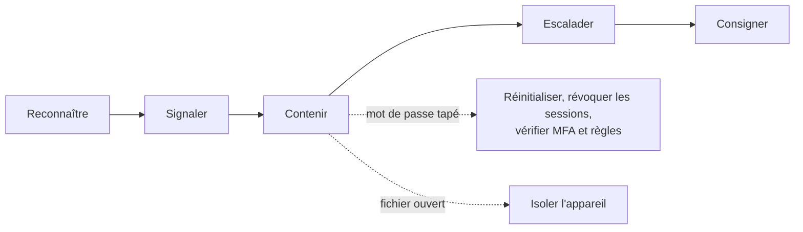

# Signalement d'hameçonnage et première intervention

| Élément | Contenu |
|---|---|
| **Référent** | Un utilisateur reçoit, ou a déjà donné suite à, un courriel qui tente de voler un mot de passe, de l'argent ou l'accès à son ordinateur. |
| **Émetteur** | **bazeeza** |
| **Message** | Reconnaître les signes, faire signaler le message de la bonne façon, contenir les dégâts selon ce que l'utilisateur a fait (réinitialiser, révoquer les sessions, vérifier les règles, isoler l'appareil), escalader tôt et tout consigner dans le billet. |
| **Récepteur** | Techniciens de soutien TI, et les utilisateurs qu'ils forment à signaler. |
| **Canal** | Dépôt GitHub `Bazeeza/Technical-Runbooks` |
| **Code** | Français, rédaction technique (traduction de l'original anglais) · Windows PowerShell 5.1, Microsoft Graph PowerShell, Exchange Online PowerShell |
| **Référence** | [Canadian Centre for Cyber Security: Don't take the bait (ITSAP.00.101)](https://www.cyber.gc.ca/en/guidance/dont-take-bait-recognize-and-avoid-phishing-attacks) · [Microsoft Learn: Report phishing in Outlook](https://learn.microsoft.com/en-us/defender-office-365/submissions-outlook-report-messages) · [Microsoft Learn: Respond to a compromised e-mail account](https://learn.microsoft.com/en-us/defender-office-365/responding-to-a-compromised-email-account) · [Microsoft Learn: Revoke user access in an emergency](https://learn.microsoft.com/en-us/entra/identity/users/users-revoke-access) · [Microsoft Learn: Anti-spam message headers](https://learn.microsoft.com/en-us/defender-office-365/message-headers-eop-mdo) |

---

## Objectif

L'hameçonnage est la porte d'entrée la plus courante dans une organisation : un courriel convaincant, un clic, un mot de passe tapé. Le soutien TI est généralement le premier à en entendre parler. Ce runbook transforme ce premier appel en une procédure courte et reproductible :

1. **Reconnaître** le message.
2. **Signaler** le message pour que le système de messagerie et l'équipe de sécurité en tirent des leçons.
3. **Contenir** selon ce que l'utilisateur a fait.
4. **Escalader** à l'équipe de sécurité.
5. **Consigner** les faits dans le billet.

État final : le message est signalé et supprimé, le compte et l'appareil sont sûrs ou isolés, l'équipe de sécurité est informée et le billet contient un compte rendu daté.

Fichiers compagnons :

- [Lire les en-têtes d'un courriel suspect](READING-EMAIL-HEADERS.fr.md) : copier les en-têtes, lire SPF, DKIM, DMARC et la chaîne Received.
- [Liste de vérification de première intervention](FIRST-RESPONSE-CHECKLIST.fr.md) : quoi faire pour chaque action de l'utilisateur, avec les commandes.
- [`Get-EmailHeaderSummary.ps1`](Get-EmailHeaderSummary.ps1) : résumé en lecture seule d'en-têtes enregistrés, avec les signaux d'alerte, et un [exemple](sample-headers-suspicious.txt) fictif pour s'exercer.

## Prérequis

- [ ] Le contact d'escalade de l'organisation pour les incidents de sécurité (nom, téléphone, heures)
- [ ] Pour le confinement : un compte administrateur avec les bons rôles (User Administrator ou Authentication Administrator dans Entra ID, un rôle Exchange pour les vérifications de boîte aux lettres), ou un collègue qui en a un
- [ ] Pour les commandes : les modules PowerShell `Microsoft.Graph` et `ExchangeOnlineManagement`
- [ ] Un moyen de joindre l'utilisateur **autre que sa boîte aux lettres** (téléphone, appel Teams depuis un compte connu, en personne)

> [!NOTE]
> Toutes les adresses de ce runbook utilisent `contoso.com` (le nom utilisé dans la documentation de Microsoft) ou le domaine réservé `.example`. Aucun message, utilisateur ou organisation réel n'est montré.

---

## Étape 1 — Reconnaître le message

La plupart des hameçonnages suivent le même schéma : un **appât** qui crée une émotion (urgence, peur, récompense), un **hameçon** (un lien, une pièce jointe, un code QR, un numéro de téléphone) et une **demande** (se connecter, payer, installer, appeler). Vérifiez les signes avec l'utilisateur, sans cliquer :

| Signe | Exemple |
|---|---|
| Urgence ou menace | « Votre boîte aux lettres sera supprimée dans 24 heures », « dernier avis » |
| Demande inattendue d'identifiants ou de paiement | « Confirmez votre mot de passe », « mettez à jour les coordonnées bancaires de cette facture » |
| L'adresse de l'expéditeur ne correspond pas au nom | Nom affiché *IT Support*, adresse `it-support@contoso-helpdesk.example` |
| Domaine sosie | Mot ajouté, lettres interverties (`rn` pour `m`), autre domaine de premier niveau |
| Le texte du lien diffère de la vraie destination | Le survol affiche un autre domaine que celui du texte |
| Pièce jointe inattendue | Facture, message vocal ou « document sécurisé » que l'utilisateur n'attendait pas, surtout `.html`, `.zip`, `.iso` ou un document qui demande d'**activer le contenu** |
| Code QR qui mène à une page de connexion | Scanné avec un téléphone, il échappe aux protections de l'ordinateur |
| Étiquette d'expéditeur externe ou conseil de sécurité | Outlook indique que l'expéditeur est externe, ou que c'est le premier message de cette adresse |

En cas de doute, l'utilisateur vérifie auprès de l'expéditeur supposé **par un autre canal** : un numéro de téléphone tiré de l'annuaire de l'entreprise ou du site officiel, jamais celui du message.

Pour un examen plus poussé, copiez les en-têtes et suivez [Lire les en-têtes d'un courriel suspect](READING-EMAIL-HEADERS.fr.md).

**Résultat attendu :** le billet explique pourquoi le message est suspect, en une ou deux phrases.

## Étape 2 — Le signaler de la bonne façon

L'utilisateur (ou le technicien, depuis la session de l'utilisateur avec son consentement) sélectionne le message, puis **Report** › **Report phishing** (Signaler › Signaler l'hameçonnage). Le bouton intégré existe dans Outlook pour Microsoft 365, le nouvel Outlook pour Windows, Outlook sur le web, Outlook pour Mac et les applications mobiles, lorsque l'organisation a activé le signalement par les utilisateurs.

- Le message signalé est **supprimé** de la boîte aux lettres et envoyé, avec ses en-têtes d'origine, à la boîte de signalement choisie par les administrateurs, à Microsoft, ou aux deux.
- Transférer le message en pièce jointe est la solution de repli quand le bouton est absent ; le transférer dans le corps du message fait perdre les en-têtes d'origine.
- Si plusieurs personnes l'ont reçu, prévenez l'administrateur de la messagerie : il peut trouver et supprimer chaque copie.

**Résultat attendu :** le message est signalé et ne se trouve plus dans la boîte de réception de l'utilisateur.

## Étape 3 — Contenir selon ce que l'utilisateur a fait

Demandez **« Qu'avez-vous fait avec le message ? »** et suivez la liste correspondante de la [liste de vérification de première intervention](FIRST-RESPONSE-CHECKLIST.fr.md) :

| L'utilisateur... | Risque | Confinement | Liste de vérification |
|---|---|---|---|
| L'a seulement lu, ou n'a rien fait | Faible | Signaler et supprimer | [Liste A](FIRST-RESPONSE-CHECKLIST.fr.md#liste-a--signalé-sans-clic) |
| A cliqué sur un lien, n'a rien tapé | Moyen | Analyse antivirus, surveiller les demandes MFA | [Liste B](FIRST-RESPONSE-CHECKLIST.fr.md#liste-b--a-cliqué-sur-un-lien-na-rien-tapé) |
| A tapé un mot de passe, ou approuvé une demande MFA qu'il n'a pas lancée | Élevé | Réinitialiser le mot de passe, **révoquer les sessions**, examiner les méthodes MFA, vérifier le transfert et les règles de boîte de réception | [Liste C](FIRST-RESPONSE-CHECKLIST.fr.md#liste-c--a-tapé-un-mot-de-passe-ou-approuvé-une-demande-mfa-inattendue) |
| A ouvert une pièce jointe ou exécuté un fichier | Élevé | **Déconnecter l'appareil** du réseau, ne pas l'éteindre | [Liste E](FIRST-RESPONSE-CHECKLIST.fr.md#liste-e--a-ouvert-une-pièce-jointe-ou-exécuté-un-fichier) |

Pourquoi à la fois une réinitialisation **et** une révocation des sessions : la réinitialisation bloque les nouvelles connexions avec le mot de passe volé, mais un navigateur ou une application déjà connecté continue de fonctionner avec ses jetons jusqu'à leur expiration. Révoquer les sessions oblige chaque appareil à se reconnecter.

**Résultat attendu :** le niveau de risque est inscrit dans le billet et la liste correspondante est complétée.

## Étape 4 — Escalader

Escaladez à l'équipe de sécurité dès que le risque est moyen ou élevé, **avant** de terminer le confinement si elle peut agir plus vite (désactiver le compte, bloquer l'expéditeur pour tout le monde, chercher dans les autres boîtes aux lettres). Transmettez-lui :

- L'heure d'arrivée du message et l'heure à laquelle l'utilisateur a agi
- Ce que l'utilisateur a fait et vu
- Le fichier des en-têtes, ou le message signalé
- Ce que vous avez déjà fait, avec les heures

**Résultat attendu :** l'équipe de sécurité a pris en charge le billet, avec un nom et une heure.

## Étape 5 — Consigner et boucler la boucle

Remplissez la [fiche d'incident](FIRST-RESPONSE-CHECKLIST.fr.md#fiche-dincident), puis rappelez l'utilisateur : dites-lui ce qui a été fait, ce qu'il doit surveiller (demandes MFA inattendues, réponses à des courriels qu'il n'a jamais envoyés) et remerciez-le d'avoir signalé. Un utilisateur qu'on a remercié signale plus vite la fois suivante.

**Résultat attendu :** un compte rendu daté dans le billet et un utilisateur qui sait ce qui va se passer ensuite.

---

## Vérification

| Test | Comment | Résultat attendu |
|---|---|---|
| Message signalé | Demander au responsable de la boîte de signalement, ou consulter la page **Submissions** du portail Microsoft Defender (onglet **User reported**) | Le message figure dans la liste |
| Mot de passe changé | Connexion avec le nouveau mot de passe, depuis l'appareil de l'utilisateur | Fonctionne ; l'ancien est refusé |
| Sessions révoquées | Centre d'administration Entra › utilisateur › **Sign-in logs** | Les nouvelles connexions après l'heure de révocation viennent seulement des appareils connus de l'utilisateur |
| Méthodes MFA | Centre d'administration Entra › utilisateur › **Authentication methods** | Seulement des méthodes que l'utilisateur reconnaît |
| Règles de messagerie | `Get-InboxRule -Mailbox <user> -IncludeHidden` et `Get-Mailbox <user> \| Format-List Forwarding*` | Aucune règle ni aucun transfert que l'utilisateur n'a pas créé |
| Appareil | Analyse antivirus complète, ou verdict de l'équipe de sécurité | Sain, ou remplacé |

## Dépannage

| Symptôme | Cause probable | Correction |
|---|---|---|
| Aucun bouton **Report** dans Outlook | Signalement par les utilisateurs non activé, version d'Outlook plus ancienne, ou un complément de signalement tiers est utilisé à la place | Utiliser le complément s'il y en a un, sinon transférer en pièce jointe à l'adresse de signalement ; prévenir l'administrateur de la messagerie |
| Un message signalé depuis une boîte aux lettres partagée disparaît mais n'arrive jamais dans la boîte de signalement | La personne qui signale n'a pas la permission **Send As** sur la boîte aux lettres partagée | Le signaler depuis une boîte aux lettres qui a Send As, ou demander la permission à l'administrateur ([runbook 15](../15-Microsoft-365-Outlook-Basics/SHARED-MAILBOXES-AND-PERMISSIONS.fr.md)) |
| Après la réinitialisation, l'attaquant lit encore le courrier | Sessions non révoquées, une règle de transfert, ou un mot de passe d'application | Révoquer les sessions, vérifier le transfert et les règles de boîte de réception, supprimer les mots de passe d'application de l'utilisateur |
| L'utilisateur continue de recevoir des demandes MFA qu'il n'a pas lancées | Quelqu'un a le mot de passe actuel | Refaire la liste C : réinitialiser, révoquer, examiner les méthodes MFA ; escalader |
| `Get-InboxRule` n'est pas reconnu | Exchange Online PowerShell non connecté | `Install-Module ExchangeOnlineManagement`, puis `Connect-ExchangeOnline` |
| `Revoke-MgUserSignInSession` renvoie *Insufficient privileges* | Portée (scope) ou rôle manquant | Se connecter avec `-Scopes 'User.RevokeSessions.All'` à l'aide d'un compte qui a le rôle Entra requis |

## Retour arrière

Les actions de confinement peuvent être conservées sans risque. Si un compte a été désactivé par erreur, l'administrateur le réactive (centre d'administration Entra › utilisateur › **Account status** › **Edit** › **Account enabled**) une fois que l'équipe de sécurité est d'accord. Un message légitime signalé par erreur peut être signalé comme **Not junk** (Courrier légitime) ou libéré par l'administrateur.

---

## Travaux liés

- [Runbook 05, gestion des utilisateurs Active Directory](../05-Active-Directory-User-Management/README.fr.md) : réinitialisation des mots de passe des comptes synchronisés depuis Active Directory.
- [Runbook 07, liste de vérification de sécurité du soutien à distance](../07-Remote-Support/SECURITY-CHECKLIST.fr.md) : les mêmes réflexes face aux arnaques au faux soutien technique par téléphone.
- [Runbook 15, notions de base de Microsoft 365 et d'Outlook](../15-Microsoft-365-Outlook-Basics/README.fr.md) : inscription à la MFA, boîtes aux lettres partagées et client Outlook.

Écrit par bazeeza · Vous avez trouvé une erreur ? <a href="https://github.com/Bazeeza/Technical-Runbooks/issues/new?template=runbook-error.yml">Signalez-la ici</a>.
