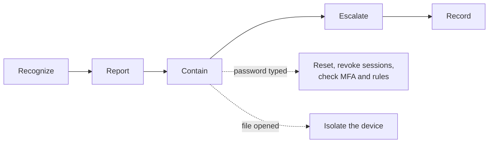

# Phishing Report and First Response

| Element | Content |
|---|---|
| **Referent** | A user receives, or has already acted on, an e-mail that tries to steal a password, money or access to their computer. |
| **Sender** | **bazeeza** |
| **Message** | Recognize the signs, have the message reported the right way, contain the damage according to what the user did (reset, revoke sessions, check rules, isolate the device), escalate early, and record everything in the ticket. |
| **Receiver** | Help desk technicians, and the users they train to report. |
| **Channel** | GitHub repository `Bazeeza/Technical-Runbooks` |
| **Code** | English, technical writing · Windows PowerShell 5.1, Microsoft Graph PowerShell, Exchange Online PowerShell |
| **Reference** | [Canadian Centre for Cyber Security: Don't take the bait (ITSAP.00.101)](https://www.cyber.gc.ca/en/guidance/dont-take-bait-recognize-and-avoid-phishing-attacks) · [Microsoft Learn: Report phishing in Outlook](https://learn.microsoft.com/en-us/defender-office-365/submissions-outlook-report-messages) · [Microsoft Learn: Respond to a compromised e-mail account](https://learn.microsoft.com/en-us/defender-office-365/responding-to-a-compromised-email-account) · [Microsoft Learn: Revoke user access in an emergency](https://learn.microsoft.com/en-us/entra/identity/users/users-revoke-access) · [Microsoft Learn: Anti-spam message headers](https://learn.microsoft.com/en-us/defender-office-365/message-headers-eop-mdo) |

---

## Objective

Phishing is the most common way into an organization: one convincing e-mail, one click, one typed password. The help desk is usually the first to hear about it. This runbook turns that first call into a short, repeatable procedure:

1. **Recognize** the message.
2. **Report** it so the mail system and the security team learn from it.
3. **Contain** according to what the user did.
4. **Escalate** to the security team.
5. **Record** the facts in the ticket.

End state: the message is reported and removed, the account and the device are safe or isolated, the security team is informed, and the ticket holds a dated record.

Companion files:

- [Reading the headers of a suspicious e-mail](READING-EMAIL-HEADERS.md): copy the headers, read SPF, DKIM, DMARC and the Received chain.
- [First response checklist](FIRST-RESPONSE-CHECKLIST.md): what to do for each user action, with the commands.
- [`Get-EmailHeaderSummary.ps1`](Get-EmailHeaderSummary.ps1): read-only summary of saved headers with red flags, and a fictional [sample](sample-headers-suspicious.txt) to practice on.

## Prerequisites

- [ ] The organization's escalation contact for security incidents (name, phone, hours)
- [ ] For containment: an administrator account with the right roles (User Administrator or Authentication Administrator in Entra ID, an Exchange role for mailbox checks), or a colleague who has one
- [ ] For the commands: the `Microsoft.Graph` and `ExchangeOnlineManagement` PowerShell modules
- [ ] A way to reach the user **other than their mailbox** (phone, Teams call from a known account, in person)

> [!NOTE]
> All addresses in this runbook use `contoso.com` (Microsoft's documentation name) or the reserved `.example` domain. No real message, user or organization is shown.

---

## Step 1 — Recognize the message

Most phishing follows the same pattern: a **bait** that creates emotion (urgency, fear, reward), a **hook** (a link, an attachment, a QR code, a phone number) and a **request** (sign in, pay, install, call). Check the signs with the user, without clicking:

| Sign | Example |
|---|---|
| Urgency or threat | "Your mailbox will be deleted in 24 hours", "final notice" |
| Unexpected request for credentials or payment | "Confirm your password", "update the bank details for this invoice" |
| Sender address does not match the name | Display name *IT Support*, address `it-support@contoso-helpdesk.example` |
| Look-alike domain | Added word, swapped letters (`rn` for `m`), other top-level domain |
| Link text differs from the real destination | Hovering shows another domain than the text says |
| Unexpected attachment | Invoice, voicemail or "secure document" the user did not expect, especially `.html`, `.zip`, `.iso` or a document asking to **enable content** |
| QR code that leads to a sign-in page | Scanned with a phone, it escapes the computer's protections |
| External sender tag or safety tip | Outlook shows that the sender is external, or that it is the first message from this address |

When in doubt, the user checks with the supposed sender **through another channel**: a phone number from the company directory or the official website, never the one in the message.

For a closer look, copy the headers and follow [Reading the headers of a suspicious e-mail](READING-EMAIL-HEADERS.md).

**Expected result:** the ticket says why the message is suspicious, in one or two sentences.

## Step 2 — Report it the right way

The user (or the technician, from the user's session with consent) selects the message, then **Report** › **Report phishing**. The built-in button exists in Outlook for Microsoft 365, the new Outlook for Windows, Outlook on the web, Outlook for Mac and the mobile apps, when the organization has enabled user reporting.

- The reported message is **deleted** from the mailbox and sent, with its original headers, to the reporting mailbox chosen by the administrators, to Microsoft, or both.
- Forwarding the message as an attachment is the fallback when the button is missing; forwarding it inline loses the original headers.
- If several people received it, tell the mail administrator: they can find and remove every copy.

**Expected result:** the message is reported and no longer in the user's inbox.

## Step 3 — Contain according to what the user did

Ask **"What did you do with the message?"** and follow the matching list of the [first response checklist](FIRST-RESPONSE-CHECKLIST.md):

| The user... | Risk | Containment | Checklist |
|---|---|---|---|
| Only read it, or did nothing | Low | Report and remove | [List A](FIRST-RESPONSE-CHECKLIST.md#list-a--reported-not-clicked) |
| Clicked a link, typed nothing | Medium | Antivirus scan, watch for MFA prompts | [List B](FIRST-RESPONSE-CHECKLIST.md#list-b--clicked-a-link-typed-nothing) |
| Typed a password, or approved an MFA prompt they did not start | High | Reset password, **revoke sessions**, review MFA methods, check forwarding and inbox rules | [List C](FIRST-RESPONSE-CHECKLIST.md#list-c--typed-a-password-or-approved-an-unexpected-mfa-prompt) |
| Opened an attachment or ran a file | High | **Disconnect the device** from the network, do not shut it down | [List E](FIRST-RESPONSE-CHECKLIST.md#list-e--opened-an-attachment-or-ran-a-file) |

Why both a reset **and** a session revocation: the reset stops new sign-ins with the stolen password, but a browser or an app that is already signed in keeps working with its tokens until they expire. Revoking the sessions forces every device to sign in again.

**Expected result:** the risk level is in the ticket and the matching list is complete.

## Step 4 — Escalate

Escalate to the security team as soon as the risk is medium or high, **before** finishing the containment if they can act faster (disable the account, block the sender for everyone, search other mailboxes). Give them:

- The time the message arrived and the time the user acted
- What the user did and saw
- The headers file, or the reported message
- What you have already done, with the times

**Expected result:** the security team has acknowledged the ticket, with a name and a time.

## Step 5 — Record and close the loop

Fill in the [incident record](FIRST-RESPONSE-CHECKLIST.md#incident-record), then call the user back: tell them what was done, what to watch for (unexpected MFA prompts, replies to e-mails they never sent), and thank them for reporting. A user who was thanked reports faster next time.

**Expected result:** a dated record in the ticket and a user who knows what happens next.

---

## Verification

| Test | How | Expected result |
|---|---|---|
| Message reported | Ask the reporting mailbox owner, or the **Submissions** page of the Microsoft Defender portal (**User reported** tab) | The message is listed |
| Password changed | Sign-in with the new password, from the user's device | Works; the old one is refused |
| Sessions revoked | Entra admin center › user › **Sign-in logs** | New sign-ins after the revocation time only from the user's known devices |
| MFA methods | Entra admin center › user › **Authentication methods** | Only methods the user recognizes |
| Mail rules | `Get-InboxRule -Mailbox <user> -IncludeHidden` and `Get-Mailbox <user> \| Format-List Forwarding*` | No rule or forwarding the user did not create |
| Device | Antivirus full scan, or the security team's verdict | Clean, or replaced |

## Troubleshooting

| Symptom | Likely cause | Fix |
|---|---|---|
| No **Report** button in Outlook | User reporting not enabled, an older Outlook build, or a third-party reporting add-in is used instead | Use the add-in if there is one, otherwise forward as an attachment to the reporting address; tell the mail administrator |
| Message reported from a shared mailbox disappears but never reaches the reporting mailbox | The reporter has no **Send As** permission on the shared mailbox | Report it from a mailbox with Send As, or ask the administrator for the permission ([runbook 15](../15-Microsoft-365-Outlook-Basics/SHARED-MAILBOXES-AND-PERMISSIONS.md)) |
| After the reset, the attacker still reads the mail | Sessions not revoked, a forwarding rule, or an app password | Revoke sessions, check forwarding and inbox rules, delete the user's app passwords |
| The user keeps getting MFA prompts they did not start | Someone has the current password | List C again: reset, revoke, review MFA methods; escalate |
| `Get-InboxRule` is not recognized | Exchange Online PowerShell not connected | `Install-Module ExchangeOnlineManagement`, then `Connect-ExchangeOnline` |
| `Revoke-MgUserSignInSession` returns *Insufficient privileges* | Missing scope or role | Connect with `-Scopes 'User.RevokeSessions.All'` using an account with the required Entra role |

## Rollback

Containment actions are safe to keep. If an account was disabled by mistake, the administrator enables it again (Entra admin center › user › **Account status** › **Edit** › **Account enabled**) after the security team agrees. A wrongly reported legitimate message can be reported as **Not junk** or released by the administrator.

---

## Related work

- [Runbook 05, Active Directory User Management](../05-Active-Directory-User-Management/README.md): password resets for accounts synchronized from Active Directory.
- [Runbook 07, Remote support security checklist](../07-Remote-Support/SECURITY-CHECKLIST.md): the same reflexes for tech support scams by phone.
- [Runbook 15, Microsoft 365 and Outlook Basics](../15-Microsoft-365-Outlook-Basics/README.md): MFA registration, shared mailboxes and the Outlook client.

Written by bazeeza · Found an error? <a href="https://github.com/Bazeeza/Technical-Runbooks/issues/new?template=runbook-error.yml">Report it here</a>.
