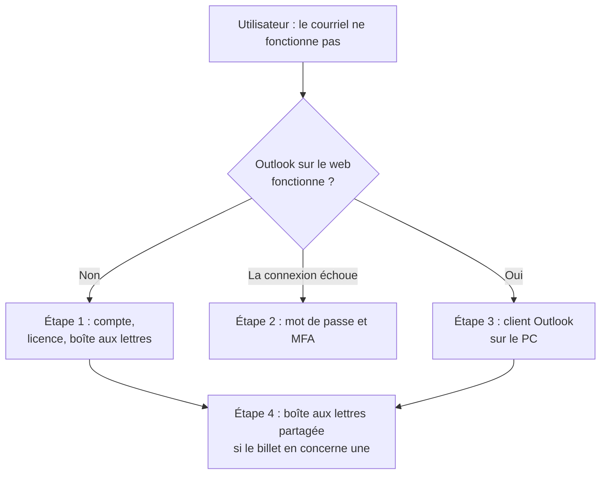

# Notions de base de Microsoft 365 et d'Outlook

[](README.fr.md)
[](README.md)


| Élément | Contenu |
|---|---|
| **Référent** | Les billets de courriel Microsoft 365 les plus courants : « Outlook ne fonctionne pas », « j'ai changé de téléphone et je ne peux plus me connecter », « j'ai besoin d'accéder à la boîte de l'équipe ». |
| **Émetteur** | **bazeeza** |
| **Message** | Vérifier le compte dans le bon ordre (connexion autorisée, licence, boîte aux lettres, MFA), puis le client Outlook (profil, mode Exchange mis en cache, fichier de données hors connexion), puis les permissions de la boîte aux lettres partagée, et vérifier chaque correction par un test que l'utilisateur peut voir. |
| **Récepteur** | Techniciens de soutien TI qui accompagnent des utilisateurs de Microsoft 365. |
| **Canal** | Dépôt GitHub `Bazeeza/Technical-Runbooks` |
| **Code** | Français, rédaction technique (traduction de l'original anglais) · Windows PowerShell 5.1, Microsoft Graph PowerShell, Exchange Online PowerShell |
| **Référence** | [Microsoft Learn: Manage authentication methods for Microsoft Entra MFA](https://learn.microsoft.com/en-us/entra/identity/authentication/howto-mfa-userdevicesettings) · [Microsoft Learn: Get-MgUserLicenseDetail](https://learn.microsoft.com/en-us/powershell/module/microsoft.graph.users/get-mguserlicensedetail) · [Microsoft Learn: Plan and configure Cached Exchange Mode](https://learn.microsoft.com/en-us/microsoft-365-apps/outlook/configuration/cached-exchange-mode) · [Microsoft Learn: About shared mailboxes](https://learn.microsoft.com/en-us/microsoft-365/admin/email/about-shared-mailboxes) · [Microsoft Learn: Give mailbox permissions to another user](https://learn.microsoft.com/en-us/microsoft-365/admin/add-users/give-mailbox-permissions-to-another-user) |

---

## Objectif

Un problème de courriel peut venir de quatre endroits : le **compte** (bloqué, sans licence, MFA), la **boîte aux lettres** (pleine, permissions), le **réseau**, ou le **client Outlook** sur le PC. Les vérifier dans un ordre fixe évite de reconstruire un profil quand la vraie cause était une licence manquante.

État final : l'utilisateur se connecte avec la MFA, la boîte aux lettres fonctionne dans Outlook sur le web et dans Outlook sur le PC, et les boîtes aux lettres partagées s'ouvrent avec les permissions demandées dans le billet.

Fichiers compagnons :

- [Profils Outlook et mode Exchange mis en cache](OUTLOOK-PROFILE-AND-CACHE.fr.md) : mode sans échec, profil propre, période hors connexion et reconstruction d'un fichier `.ost`.
- [Boîtes aux lettres partagées et permissions](SHARED-MAILBOXES-AND-PERMISSIONS.fr.md) : Full Access, Send As, Send on Behalf, mappage automatique (auto-mapping) et retrait.
- [`Get-OutlookClientInfo.ps1`](Get-OutlookClientInfo.ps1) : rapport en lecture seule des clients Outlook, des profils, des fichiers de données et de l'espace libre, pour le billet.

## Prérequis

- [ ] Le nom de connexion de l'utilisateur (user principal name), confirmé par un billet ou un rappel, jamais seulement par un courriel reçu
- [ ] Un rôle adapté à la tâche : Helpdesk Administrator ou User Administrator pour consulter les utilisateurs et réinitialiser les mots de passe, **Authentication Administrator** pour les méthodes MFA, un rôle Exchange pour les permissions de boîte aux lettres, License Administrator pour attribuer des licences
- [ ] Pour les commandes : les modules PowerShell `Microsoft.Graph` et `ExchangeOnlineManagement`
- [ ] Pour les vérifications du client : un accès au PC de l'utilisateur (en personne ou par [soutien à distance](../07-Remote-Support/README.fr.md))

> [!NOTE]
> Les exemples utilisent `contoso.com`, le nom utilisé dans la documentation de Microsoft. Ne collez jamais dans un billet le mot de passe, le code MFA ou le code de récupération d'un vrai utilisateur.

---



## Étape 1 — Vérifier le compte et sa licence

Commencez par un test rapide : l'utilisateur ouvre **Outlook sur le web** dans un navigateur. Si cela fonctionne là, passez à l'étape 3.

Sinon, dans le **centre d'administration Microsoft 365** › **Users** › **Active users** › sélectionnez l'utilisateur :

| Vérification | Où | Bon état |
|---|---|---|
| Connexion autorisée | Haut du volet de l'utilisateur (**Block sign-in** / **Unblock sign-in**) | La connexion n'est pas bloquée |
| Licence | Onglet **Licenses and apps** | Une licence qui comprend Exchange Online est attribuée, avec **Exchange Online** coché sous **Apps** |
| Boîte aux lettres | Onglet **Mail** | Les paramètres de la boîte aux lettres s'affichent (pas de message « mailbox not found ») |
| Taille de la boîte aux lettres | Onglet **Mail** › **Mailbox storage** | Sous le quota |

La même vérification de licence avec Microsoft Graph PowerShell :

```powershell
Connect-MgGraph -Scopes 'User.Read.All'
Get-MgUserLicenseDetail -UserId 'user@contoso.com' | Select-Object SkuPartNumber
(Get-MgUserLicenseDetail -UserId 'user@contoso.com').ServicePlans |
    Where-Object { $_.ServicePlanName -like 'EXCHANGE*' } |
    Format-Table ServicePlanName, ProvisioningStatus
```

Un plan de service Exchange avec `ProvisioningStatus` à **Success** signifie que la boîte aux lettres peut exister. Une nouvelle licence peut prendre un certain temps avant que la boîte aux lettres soit prête : dites-le à l'utilisateur au lieu de reconstruire quoi que ce soit.

**Résultat attendu :** connexion autorisée, une licence Exchange attribuée et provisionnée, la boîte aux lettres présente et pas pleine.

## Étape 2 — Vérifier le mot de passe et la MFA

La plupart des billets « je ne peux pas me connecter » après un changement de téléphone sont des billets de MFA : l'application Microsoft Authenticator ou le numéro de téléphone était sur l'ancien téléphone.

**Si l'utilisateur a encore une méthode qui fonctionne** (un autre numéro de téléphone, un deuxième appareil, une clé de sécurité), il gère lui-même ses méthodes dans [Security info](https://mysignins.microsoft.com/security-info) (Informations de sécurité) : **+ Add sign-in method**, puis il retire l'ancien téléphone.

**Si l'utilisateur n'a aucune méthode qui fonctionne**, un **Authentication Administrator** intervient dans le **centre d'administration Microsoft Entra** › **Entra ID** › **Users** › sélectionnez l'utilisateur › **Authentication methods** :

| Option | Ce qu'elle fait | Quand |
|---|---|---|
| **Require re-register MFA** | Supprime les numéros de téléphone, les inscriptions Authenticator et les jetons logiciels, désactive les jetons matériels ; l'utilisateur configure une nouvelle méthode à la prochaine connexion | Téléphone perdu ou remplacé |
| **Reset password** | Définit un mot de passe temporaire qui doit être changé à la prochaine connexion | Mot de passe oublié (ou réinitialisation en libre-service, si elle est activée) |
| **Revoke sessions** | Invalide les jetons d'actualisation (refresh tokens), donc chaque appareil doit se reconnecter | Appareil perdu, ou compromission soupçonnée ([runbook 14](../14-Phishing-Report-and-First-Response/README.fr.md)) |

> [!IMPORTANT]
> Retirer la MFA de quelqu'un est exactement ce qu'un attaquant demande au soutien TI. **Vérifiez l'identité** avant toute réinitialisation de la MFA : un rappel au numéro de l'annuaire de l'entreprise, la confirmation du gestionnaire ou une vérification en personne, selon la procédure de l'organisation. Inscrivez dans le billet comment l'identité a été vérifiée.

Après la réinitialisation, restez au téléphone pendant que l'utilisateur se connecte et inscrit la nouvelle méthode, puis vérifiez que **Authentication methods** ne liste que la nouvelle.

**Résultat attendu :** l'utilisateur se connecte à Outlook sur le web avec la nouvelle méthode, et l'ancien téléphone n'est plus listé.

## Étape 3 — Vérifier le client Outlook sur le PC

Quand Outlook sur le web fonctionne mais pas Outlook sur le PC, le problème est local. Recueillez d'abord les faits, en tant qu'utilisateur, puis suivez le guide :

```powershell
.\Get-OutlookClientInfo.ps1 -OutputPath "$env:USERPROFILE\Desktop\outlook-info.txt"
```

Le rapport indique si l'utilisateur utilise **Outlook classique** ou le **nouvel Outlook**, liste les profils classiques et celui par défaut, les fichiers `.ost` et `.pst` avec leur taille, et l'espace disque libre. Ensuite :

| Symptôme | Section du guide |
|---|---|
| Plantages, gels, erreur d'un complément | [Mode sans échec](OUTLOOK-PROFILE-AND-CACHE.fr.md#étape-2--démarrer-en-mode-sans-échec) |
| Demandes de mot de passe sans fin, bloqué à « Loading profile » | [Nouveau profil](OUTLOOK-PROFILE-AND-CACHE.fr.md#étape-3--créer-un-nouveau-profil-garder-lancien) |
| Anciens courriels absents, lenteur sur un petit disque | [Mode Exchange mis en cache et période hors connexion](OUTLOOK-PROFILE-AND-CACHE.fr.md#étape-4--régler-le-mode-exchange-mis-en-cache-et-la-période-hors-connexion) |
| Un dossier ne se met jamais à jour | [Reconstruire le fichier de données hors connexion](OUTLOOK-PROFILE-AND-CACHE.fr.md#étape-5--reconstruire-le-fichier-de-données-hors-connexion) |
| Rien ne fonctionne, même un envoi à soi-même | [Runbook 04, dépannage réseau](../04-Network-Troubleshooting/README.fr.md) |

**Résultat attendu :** Outlook sur le PC affiche les mêmes courriels qu'Outlook sur le web, et la barre d'état affiche **All folders are up to date** (Tous les dossiers sont à jour).

## Étape 4 — Accès à une boîte aux lettres partagée

Pour les billets « j'ai besoin d'accéder à la boîte du soutien », confirmez **quelle** permission est nécessaire et **qui l'a approuvée**, puis suivez [Boîtes aux lettres partagées et permissions](SHARED-MAILBOXES-AND-PERMISSIONS.fr.md) :

| L'utilisateur doit... | Permission |
|---|---|
| Lire et classer le courrier de l'équipe | Full Access |
| Répondre en tant qu'adresse de l'équipe | Full Access + Send As |
| Répondre avec son propre nom « de la part de » l'équipe | Full Access + Send on Behalf |

Une boîte aux lettres partagée n'a pas besoin de licence jusqu'à 50 Go, et sa propre connexion doit rester **bloquée**.

**Résultat attendu :** en moins d'une heure, la boîte aux lettres apparaît dans l'Outlook de l'utilisateur et un message de test est envoyé avec la bonne ligne d'expéditeur.

---

## Vérification

| Test | Comment | Résultat attendu |
|---|---|---|
| Compte | Volet de l'utilisateur dans le centre d'administration | Connexion autorisée, licence Exchange provisionnée |
| MFA | L'utilisateur se connecte à Outlook sur le web | La nouvelle méthode est demandée, la connexion réussit |
| Envoi et réception | L'utilisateur s'envoie un message, puis en envoie un à une adresse de test externe | Les deux arrivent ; la réponse revient |
| Client Outlook | Barre d'état d'Outlook classique | **Connected to: Microsoft Exchange**, **All folders are up to date** |
| Boîte aux lettres partagée | L'ouvrir, envoyer un test depuis celle-ci | Visible, ligne d'expéditeur conforme à la demande |
| Billet | Consignation | Vérification d'identité, actions et heures inscrites |

## Dépannage

| Symptôme | Cause probable | Correction |
|---|---|---|
| Outlook sur le web : « We couldn't find a mailbox for this user » | Aucune licence Exchange, ou la licence vient d'être attribuée | Attribuer une licence qui comprend Exchange Online ; attendre le provisionnement |
| Boucle de connexion après un changement de téléphone | Méthode MFA encore sur l'ancien téléphone | Étape 2 : Security info, ou **Require re-register MFA** après vérification de l'identité |
| L'utilisateur reçoit mais ne peut pas envoyer, « mailbox full » | Quota de la boîte aux lettres atteint | Vider **Deleted Items**, archiver ; vérifier la taille dans le centre d'administration |
| Fonctionne sur le web, pas dans Outlook | Problème du client | Étape 3 et le [guide des profils](OUTLOOK-PROFILE-AND-CACHE.fr.md) |
| Boîte aux lettres partagée : « You do not have the permission to send... » | Seulement Full Access, ou délai de réplication | Ajouter Send As ou Send on Behalf ; attendre jusqu'à 60 minutes |
| `Get-MgUserLicenseDetail` ne renvoie rien | Aucune licence, ou mauvais nom d'utilisateur | Vérifier le user principal name ; vérifier **Licenses and apps** |

## Retour arrière

Chaque changement a son inverse : retirer la licence, retirer une permission (`Remove-MailboxPermission`, `Remove-RecipientPermission`), revenir au profil Outlook précédent, redonner son ancien nom à l'ancien `.ost`. Une réinitialisation de la MFA ne peut pas être annulée : l'utilisateur inscrit sa méthode de nouveau, et c'est pourquoi la vérification d'identité passe en premier.

---

## Travaux liés

- [Runbook 14, signalement d'hameçonnage et première intervention](../14-Phishing-Report-and-First-Response/README.fr.md) : les mêmes centres d'administration, utilisés après le vol d'un mot de passe.
- [Runbook 05, gestion des utilisateurs Active Directory](../05-Active-Directory-User-Management/README.fr.md) : réinitialisation des mots de passe des comptes synchronisés depuis Active Directory.
- [Runbook 07, soutien à distance](../07-Remote-Support/README.fr.md) : comment atteindre le PC de l'utilisateur pour l'étape 3.

<sub>Écrit par bazeeza · Vous avez trouvé une erreur ? <a href="https://github.com/Bazeeza/Technical-Runbooks/issues/new?template=runbook-error.yml">Signalez-la ici</a>.</sub>
