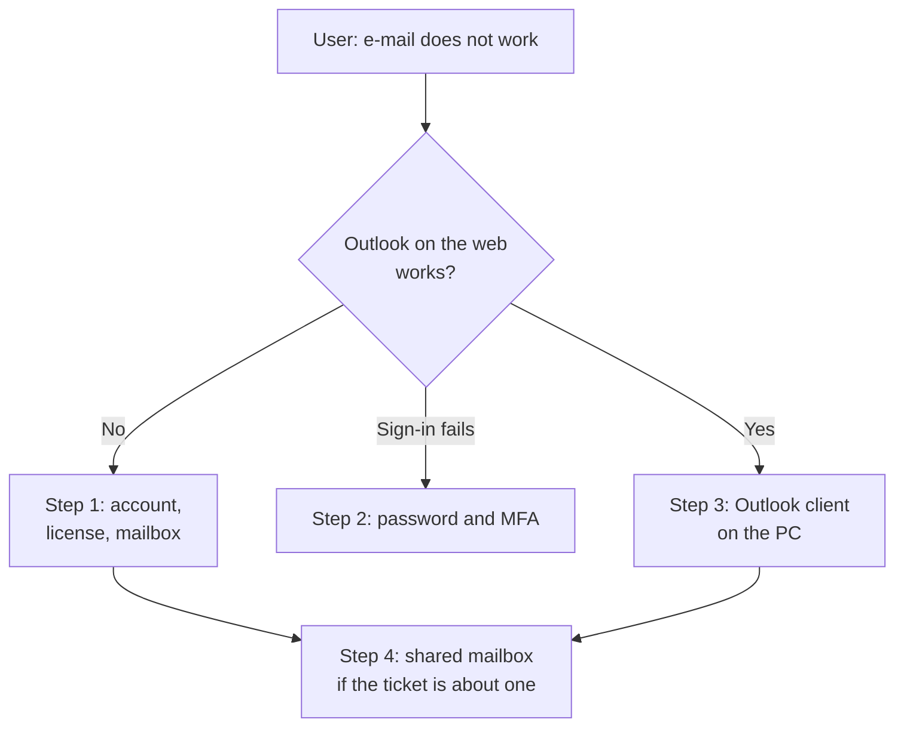

# Microsoft 365 and Outlook Basics


| Element | Content |
|---|---|
| **Referent** | The most common Microsoft 365 e-mail tickets: "Outlook does not work", "I changed phone and cannot sign in", "I need access to the team mailbox". |
| **Sender** | **bazeeza** |
| **Message** | Check the account in the right order (sign-in allowed, license, mailbox, MFA), then the Outlook client (profile, Cached Exchange Mode, offline data file), then the shared mailbox permissions, and verify each fix with a test the user can see. |
| **Receiver** | Help desk technicians supporting Microsoft 365 users. |
| **Channel** | GitHub repository `Bazeeza/Technical-Runbooks` |
| **Code** | English, technical writing · Windows PowerShell 5.1, Microsoft Graph PowerShell, Exchange Online PowerShell |
| **Reference** | [Microsoft Learn: Manage authentication methods for Microsoft Entra MFA](https://learn.microsoft.com/en-us/entra/identity/authentication/howto-mfa-userdevicesettings) · [Microsoft Learn: Get-MgUserLicenseDetail](https://learn.microsoft.com/en-us/powershell/module/microsoft.graph.users/get-mguserlicensedetail) · [Microsoft Learn: Plan and configure Cached Exchange Mode](https://learn.microsoft.com/en-us/microsoft-365-apps/outlook/configuration/cached-exchange-mode) · [Microsoft Learn: About shared mailboxes](https://learn.microsoft.com/en-us/microsoft-365/admin/email/about-shared-mailboxes) · [Microsoft Learn: Give mailbox permissions to another user](https://learn.microsoft.com/en-us/microsoft-365/admin/add-users/give-mailbox-permissions-to-another-user) |

---

## Objective

An e-mail problem can come from four places: the **account** (blocked, unlicensed, MFA), the **mailbox** (full, permissions), the **network**, or the **Outlook client** on the PC. Checking them in a fixed order avoids rebuilding a profile when the real cause was a missing license.

End state: the user signs in with MFA, the mailbox works in Outlook on the web and in Outlook on the PC, and shared mailboxes open with the permissions the ticket asked for.

Companion files:

- [Outlook profiles and Cached Exchange Mode](OUTLOOK-PROFILE-AND-CACHE.md): safe mode, a clean profile, the offline period and an `.ost` rebuild.
- [Shared mailboxes and permissions](SHARED-MAILBOXES-AND-PERMISSIONS.md): Full Access, Send As, Send on Behalf, auto-mapping and removal.
- [`Get-OutlookClientInfo.ps1`](Get-OutlookClientInfo.ps1): read-only report of the Outlook clients, profiles, data files and free space for the ticket.

## Prerequisites

- [ ] The user's sign-in name (user principal name), confirmed by a ticket or a callback, never only by an incoming e-mail
- [ ] A role that matches the task: Helpdesk Administrator or User Administrator to read users and reset passwords, **Authentication Administrator** for MFA methods, an Exchange role for mailbox permissions, License Administrator to assign licenses
- [ ] For the commands: the `Microsoft.Graph` and `ExchangeOnlineManagement` PowerShell modules
- [ ] For the client checks: access to the user's PC (in person or [remote support](../07-Remote-Support/README.md))

> [!NOTE]
> Examples use `contoso.com`, Microsoft's documentation name. Never paste a real user's password, MFA code or recovery code into a ticket.

---



## Step 1 — Check the account and its license

Start with a quick test: the user opens **Outlook on the web** in a browser. If it works there, go to step 3.

Otherwise, in the **Microsoft 365 admin center** › **Users** › **Active users** › select the user:

| Check | Where | Good state |
|---|---|---|
| Sign-in allowed | Top of the user pane (**Block sign-in** / **Unblock sign-in**) | Sign-in is not blocked |
| License | **Licenses and apps** tab | A license that includes Exchange Online is assigned, with **Exchange Online** checked under **Apps** |
| Mailbox | **Mail** tab | Mailbox settings are shown (no "mailbox not found" message) |
| Mailbox size | **Mail** tab › **Mailbox storage** | Below the quota |

The same license check with Microsoft Graph PowerShell:

```powershell
Connect-MgGraph -Scopes 'User.Read.All'
Get-MgUserLicenseDetail -UserId 'user@contoso.com' | Select-Object SkuPartNumber
(Get-MgUserLicenseDetail -UserId 'user@contoso.com').ServicePlans |
    Where-Object { $_.ServicePlanName -like 'EXCHANGE*' } |
    Format-Table ServicePlanName, ProvisioningStatus
```

An Exchange service plan with `ProvisioningStatus` **Success** means the mailbox can exist. A new license can take some time before the mailbox is ready: say so to the user instead of rebuilding anything.

**Expected result:** sign-in allowed, an Exchange license assigned and provisioned, the mailbox present and not full.

## Step 2 — Check password and MFA

Most "cannot sign in" tickets after a phone change are MFA tickets: the Microsoft Authenticator app or the phone number was on the old phone.

**If the user still has a working method** (another phone number, a second device, a security key), they manage their methods themselves at [Security info](https://mysignins.microsoft.com/security-info): **+ Add sign-in method**, then remove the old phone.

**If the user has no working method**, an **Authentication Administrator** acts in the **Microsoft Entra admin center** › **Entra ID** › **Users** › select the user › **Authentication methods**:

| Option | What it does | When |
|---|---|---|
| **Require re-register MFA** | Deletes the phone numbers, Authenticator registrations and software tokens, deactivates hardware tokens; the user sets up a new method at the next sign-in | Lost or replaced phone |
| **Reset password** | Sets a temporary password that must be changed at the next sign-in | Forgotten password (or self-service password reset, if enabled) |
| **Revoke sessions** | Invalidates the refresh tokens, so every device must sign in again | Lost device, or suspected compromise ([runbook 14](../14-Phishing-Report-and-First-Response/README.md)) |

> [!IMPORTANT]
> Removing someone's MFA is exactly what an attacker asks the help desk to do. **Verify the identity** before any MFA reset: a callback to the number in the company directory, the manager's confirmation, or an in-person check, as the organization's procedure says. Write in the ticket how identity was verified.

After the reset, stay on the phone while the user signs in and registers the new method, then check that **Authentication methods** lists only the new one.

**Expected result:** the user signs in to Outlook on the web with the new method, and the old phone is no longer listed.

## Step 3 — Check the Outlook client on the PC

When Outlook on the web works but Outlook on the PC does not, the problem is local. Collect the facts first, as the user, then follow the guide:

```powershell
.\Get-OutlookClientInfo.ps1 -OutputPath "$env:USERPROFILE\Desktop\outlook-info.txt"
```

The report says whether the user runs **classic Outlook** or the **new Outlook**, lists the classic profiles and the default one, the `.ost` and `.pst` files with their size, and the free disk space. Then:

| Symptom | Guide section |
|---|---|
| Crashes, freezes, an add-in error | [Safe mode](OUTLOOK-PROFILE-AND-CACHE.md#step-2--start-in-safe-mode) |
| Endless password prompts, stuck at "Loading profile" | [New profile](OUTLOOK-PROFILE-AND-CACHE.md#step-3--create-a-new-profile-keep-the-old-one) |
| Old mail missing, slow on a small disk | [Cached Exchange Mode and the offline period](OUTLOOK-PROFILE-AND-CACHE.md#step-4--set-cached-exchange-mode-and-the-offline-period) |
| One folder never updates | [Rebuild the offline data file](OUTLOOK-PROFILE-AND-CACHE.md#step-5--rebuild-the-offline-data-file) |
| Nothing works, even sending to oneself | [Runbook 04, network troubleshooting](../04-Network-Troubleshooting/README.md) |

**Expected result:** Outlook on the PC shows the same mail as Outlook on the web, and the status bar shows **All folders are up to date**.

## Step 4 — Shared mailbox access

For "I need access to the support mailbox" tickets, confirm **which** permission is needed and **who approved** it, then follow [Shared mailboxes and permissions](SHARED-MAILBOXES-AND-PERMISSIONS.md):

| The user needs to... | Permission |
|---|---|
| Read and file the team's mail | Full Access |
| Answer as the team address | Full Access + Send As |
| Answer with their own name "on behalf of" the team | Full Access + Send on Behalf |

A shared mailbox does not need a license up to 50 GB, and its own sign-in should stay **blocked**.

**Expected result:** within an hour, the mailbox appears in the user's Outlook and a test message is sent with the right sender line.

---

## Verification

| Test | How | Expected result |
|---|---|---|
| Account | Admin center user pane | Sign-in allowed, Exchange license provisioned |
| MFA | User signs in to Outlook on the web | Prompted for the new method, sign-in succeeds |
| Send and receive | The user sends a message to themselves, then to an external test address | Both arrive; the reply comes back |
| Outlook client | Status bar of classic Outlook | **Connected to: Microsoft Exchange**, **All folders are up to date** |
| Shared mailbox | Open it, send a test from it | Visible, sender line as requested |
| Ticket | Record | Identity check, actions and times written |

## Troubleshooting

| Symptom | Likely cause | Fix |
|---|---|---|
| Outlook on the web: "We couldn't find a mailbox for this user" | No Exchange license, or the license was just assigned | Assign a license that includes Exchange Online; wait for provisioning |
| Sign-in loop after a phone change | MFA method still on the old phone | Step 2: Security info, or **Require re-register MFA** after identity check |
| User receives but cannot send, "mailbox full" | Mailbox quota reached | Empty **Deleted Items**, archive; check the size in the admin center |
| Works on the web, not in Outlook | Client problem | Step 3 and the [profile guide](OUTLOOK-PROFILE-AND-CACHE.md) |
| Shared mailbox: "You do not have the permission to send..." | Only Full Access, or replication delay | Add Send As or Send on Behalf; wait up to 60 minutes |
| `Get-MgUserLicenseDetail` returns nothing | No license, or wrong user name | Check the user principal name; check **Licenses and apps** |

## Rollback

Each change has an opposite: unassign the license, remove a permission (`Remove-MailboxPermission`, `Remove-RecipientPermission`), go back to the previous Outlook profile, rename the old `.ost` back. An MFA reset cannot be undone: the user registers their method again, which is why the identity check comes first.

---

## Related work

- [Runbook 14, Phishing Report and First Response](../14-Phishing-Report-and-First-Response/README.md): the same admin centers, used after a password is stolen.
- [Runbook 05, Active Directory User Management](../05-Active-Directory-User-Management/README.md): password resets for accounts synchronized from Active Directory.
- [Runbook 07, Remote Support](../07-Remote-Support/README.md): how to reach the user's PC for step 3.

<sub>Written by bazeeza · Found an error? <a href="https://github.com/Bazeeza/Technical-Runbooks/issues/new?template=runbook-error.yml">Report it here</a>.</sub>
