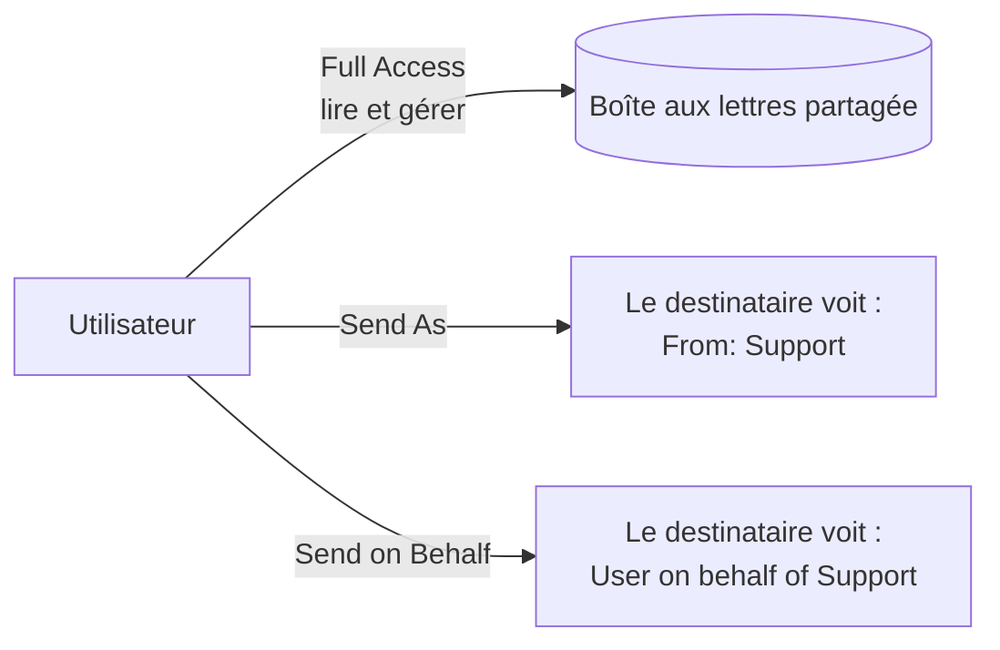

# Boîtes aux lettres partagées et permissions de boîte aux lettres

[](SHARED-MAILBOXES-AND-PERMISSIONS.fr.md)
[](SHARED-MAILBOXES-AND-PERMISSIONS.md)


| Élément | Contenu |
|---|---|
| **Référent** | Une boîte aux lettres utilisée par une équipe (`support@`, `reception@`), et les trois permissions qui permettent à un utilisateur de la lire, d'envoyer en tant qu'elle ou d'envoyer de sa part. |
| **Émetteur** | **bazeeza** |
| **Message** | Accorder seulement la permission demandée dans le billet, savoir que Full Access ne permet pas d'envoyer, maîtriser le mappage automatique (auto-mapping), attendre la réplication, et garder la boîte aux lettres partagée sans licence et sa connexion bloquée, sauf besoin documenté contraire. |
| **Récepteur** | Techniciens de soutien TI qui ont des droits d'administrateur Exchange, ou qui préparent la demande pour un administrateur. |
| **Canal** | Dépôt GitHub `Bazeeza/Technical-Runbooks` |
| **Code** | Français, rédaction technique (traduction de l'original anglais) · Exchange Online PowerShell |
| **Référence** | [Microsoft Learn: About shared mailboxes](https://learn.microsoft.com/en-us/microsoft-365/admin/email/about-shared-mailboxes) · [Microsoft Learn: Give mailbox permissions to another user](https://learn.microsoft.com/en-us/microsoft-365/admin/add-users/give-mailbox-permissions-to-another-user) · [Microsoft Learn: Add-MailboxPermission](https://learn.microsoft.com/en-us/powershell/module/exchangepowershell/add-mailboxpermission) · [Microsoft Learn: Add-RecipientPermission](https://learn.microsoft.com/en-us/powershell/module/exchangepowershell/add-recipientpermission) |

Retour à [15 Notions de base de Microsoft 365 et d'Outlook](README.fr.md).

---

## Ce qu'il faut savoir d'abord

| Fait | Conséquence pour le billet |
|---|---|
| Une boîte aux lettres partagée stocke jusqu'à **50 Go sans licence** | N'attribuez pas de licence « au cas où ». Une licence (Exchange Online Plan 2) est nécessaire au-delà de 50 Go, pour une conservation pour litige (litigation hold) ou pour une archive plus grande |
| Les utilisateurs qui l'ouvrent ont besoin de **leur propre** boîte aux lettres Exchange Online avec licence | Un utilisateur sans licence ne peut pas utiliser la boîte aux lettres partagée |
| La boîte aux lettres partagée a un compte d'utilisateur avec un mot de passe système | **Bloquez la connexion** de ce compte et gardez-la bloquée : chacun utilise son propre compte et ses permissions |
| Microsoft recommande au plus **25 utilisateurs** en même temps | Pour des groupes plus grands, un groupe Microsoft 365 est le meilleur outil |
| Seules des personnes **de l'intérieur** de l'organisation peuvent recevoir l'accès | Les utilisateurs externes ont besoin d'une autre solution, comme un groupe Microsoft 365 |
| Les membres peuvent toujours supprimer des messages | Si la suppression doit être restreinte, utilisez plutôt un groupe Microsoft 365 |
| Les changements prennent effet après **jusqu'à 60 minutes** | Dites-le dans le billet ; l'erreur « You do not have the permission to send... » juste après un changement disparaît généralement d'elle-même |

## Les trois permissions



| Permission | Nom dans le centre d'administration | Permet à l'utilisateur de | Ne permet **pas** à l'utilisateur de |
|---|---|---|---|
| **Full Access** | Read and manage | Ouvrir la boîte aux lettres, lire, déplacer et supprimer des éléments, y compris les éléments privés du calendrier | Envoyer du courrier depuis celle-ci |
| **Send As** | Send as | Envoyer un message qui semble venir de la boîte aux lettres elle-même | La lire |
| **Send on Behalf** | Send on behalf of | Envoyer un message affiché comme « *utilisateur* on behalf of *boîte aux lettres* » | La lire |

Une équipe de soutien a généralement besoin de **Full Access + Send As**. Demandez au demandeur laquelle est nécessaire, et qui l'a approuvée (le propriétaire de la boîte aux lettres ou le gestionnaire) : l'accès à une boîte aux lettres est un accès à ses données.

## Étape 1 — Accorder Full Access

**Centre d'administration Microsoft 365 :** **Users** › **Active users** › sélectionnez la boîte aux lettres partagée (ou **Teams & groups** › **Shared mailboxes**) › onglet **Mail** › **Read and manage permissions** › **Add permissions** › choisissez l'utilisateur › **Add**.

**Exchange Online PowerShell :**

```powershell
Connect-ExchangeOnline

# Full Access, mailbox added to the user's Outlook automatically (default)
Add-MailboxPermission -Identity 'support@contoso.com' -User 'user@contoso.com' -AccessRights FullAccess -InheritanceType All

# Full Access without auto-mapping: the user adds the mailbox manually when needed
Add-MailboxPermission -Identity 'support@contoso.com' -User 'user@contoso.com' -AccessRights FullAccess -InheritanceType All -AutoMapping $false
```

Les commentaires signifient : Full Access, boîte aux lettres ajoutée automatiquement à l'Outlook de l'utilisateur (par défaut) ; Full Access sans mappage automatique, l'utilisateur ajoute la boîte aux lettres lui-même au besoin.

Le **mappage automatique** (auto-mapping) utilise la découverte automatique (Autodiscover) pour ajouter de lui-même la boîte aux lettres à l'Outlook classique de l'utilisateur. Deux limites documentées par Microsoft :

- Il ne fonctionne pas quand Full Access est accordé à un **groupe** : chaque membre doit alors ajouter la boîte aux lettres lui-même.
- Pour le désactiver pour un utilisateur qui a déjà Full Access, retirez la permission (`Remove-MailboxPermission`) et ajoutez-la de nouveau avec `-AutoMapping $false`.

**Résultat attendu :** en moins d'une heure, la boîte aux lettres partagée apparaît sous la boîte aux lettres de l'utilisateur dans Outlook, ou l'utilisateur peut l'ajouter.

## Étape 2 — Accorder Send As ou Send on Behalf

**Centre d'administration Microsoft 365 :** même onglet **Mail** › **Send as permissions** ou **Send on behalf of permissions** › **Add permissions**.

**Exchange Online PowerShell :**

```powershell
# Send As
Add-RecipientPermission -Identity 'support@contoso.com' -Trustee 'user@contoso.com' -AccessRights SendAs -Confirm:$false

# Send on Behalf (adds the user to the list, keeps the existing ones)
Set-Mailbox -Identity 'support@contoso.com' -GrantSendOnBehalfTo @{Add = 'user@contoso.com'}
```

Le second commentaire signifie : Send on Behalf (ajoute l'utilisateur à la liste et garde ceux qui y sont déjà).

Dans Outlook, l'utilisateur sélectionne **From** dans un nouveau message (si **From** est masqué : **Options** › **From**) et choisit l'adresse de la boîte aux lettres partagée.

**Résultat attendu :** un message de test envoyé depuis la boîte aux lettres partagée arrive avec la ligne d'expéditeur attendue.

## Étape 3 — Vérifier

```powershell
# Who has Full Access (ignore the NT AUTHORITY\SELF entry)
Get-MailboxPermission -Identity 'support@contoso.com' | Where-Object { $_.User -notlike 'NT AUTHORITY\*' } | Format-Table User, AccessRights, IsInherited

# Who has Send As
Get-RecipientPermission -Identity 'support@contoso.com' | Where-Object { $_.Trustee -notlike 'NT AUTHORITY\*' } | Format-Table Trustee, AccessRights

# Who has Send on Behalf
Get-Mailbox -Identity 'support@contoso.com' | Select-Object -ExpandProperty GrantSendOnBehalfTo
```

Les commentaires signifient, dans l'ordre : qui a Full Access (ignorer l'entrée `NT AUTHORITY\SELF`) ; qui a Send As ; qui a Send on Behalf.

Inscrivez le résultat dans le billet : qui a reçu quelle permission, approuvée par qui, et quand.

## Étape 4 — Retirer l'accès quand il n'est plus nécessaire

Quand un utilisateur change d'équipe ou quitte l'organisation, retirez les permissions le jour même :

```powershell
Remove-MailboxPermission -Identity 'support@contoso.com' -User 'user@contoso.com' -AccessRights FullAccess -InheritanceType All -Confirm:$false
Remove-RecipientPermission -Identity 'support@contoso.com' -Trustee 'user@contoso.com' -AccessRights SendAs -Confirm:$false
Set-Mailbox -Identity 'support@contoso.com' -GrantSendOnBehalfTo @{Remove = 'user@contoso.com'}
```

Outlook classique peut continuer d'afficher la boîte aux lettres pendant un certain temps, avec des erreurs à l'ouverture ; elle disparaît après l'actualisation de la découverte automatique (Autodiscover), ou après la création d'un [nouveau profil](OUTLOOK-PROFILE-AND-CACHE.fr.md#étape-3--créer-un-nouveau-profil-garder-lancien).

---

## Dépannage

| Symptôme | Cause probable | Correction |
|---|---|---|
| « You do not have the permission to send the message on behalf of the specified user » | Permission ajoutée il y a moins d'une heure, ou seul Full Access a été accordé | Attendre jusqu'à 60 minutes ; vérifier que **Send As** ou **Send on Behalf** existe |
| La boîte aux lettres partagée n'apparaît pas dans Outlook | Permission accordée à un groupe, `-AutoMapping $false`, ou pas encore répliquée | L'ajouter manuellement : **File** › **Account Settings** › **Account Settings** › **Change** › **More Settings** › **Advanced** › **Add**, ou l'ouvrir dans Outlook sur le web |
| Les éléments envoyés vont dans les **Sent Items** de l'utilisateur | Comportement par défaut lors d'un envoi en tant qu'une autre boîte aux lettres | L'administrateur Exchange peut le changer avec `Set-Mailbox -MessageCopyForSentAsEnabled $true` (et `-MessageCopyForSendOnBehalfEnabled $true`) |
| Send As ne fonctionne pas dans Outlook classique | Boîte aux lettres masquée dans la liste d'adresses (`HiddenFromAddressListsEnabled` vaut `True`) | Microsoft documente que Send As et Send on Behalf exigent que la boîte aux lettres soit visible dans la liste d'adresses globale |
| Un utilisateur signale un hameçonnage depuis la boîte aux lettres partagée, le message disparaît mais n'arrive jamais à la sécurité | La personne qui signale n'a pas la permission **Send As** | Accorder Send As, ou signaler depuis Outlook sur le web avec la bonne permission ([runbook 14](../14-Phishing-Report-and-First-Response/README.fr.md)) |
| La boîte aux lettres partagée n'envoie plus | Elle a atteint 50 Go | Archiver ou supprimer les anciens éléments, ou lui attribuer une licence Exchange Online Plan 2 |

---

<sub>Écrit par bazeeza · Vous avez trouvé une erreur ? <a href="https://github.com/Bazeeza/Technical-Runbooks/issues/new?template=runbook-error.yml">Signalez-la ici</a>.</sub>
