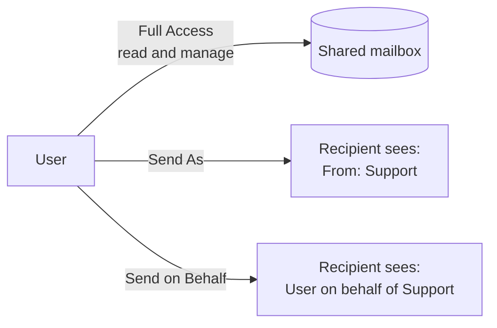

# Shared Mailboxes and Mailbox Permissions


| Element | Content |
|---|---|
| **Referent** | A mailbox used by a team (`support@`, `reception@`), and the three permissions that let a user read it, send as it, or send on its behalf. |
| **Sender** | **bazeeza** |
| **Message** | Grant only the permission the ticket asks for, know that Full Access does not allow sending, control auto-mapping, wait for replication, and keep the shared mailbox unlicensed and its sign-in blocked unless a documented need says otherwise. |
| **Receiver** | Help desk technicians with Exchange administrator rights, or who prepare the request for one. |
| **Channel** | GitHub repository `Bazeeza/Technical-Runbooks` |
| **Code** | English, technical writing · Exchange Online PowerShell |
| **Reference** | [Microsoft Learn: About shared mailboxes](https://learn.microsoft.com/en-us/microsoft-365/admin/email/about-shared-mailboxes) · [Microsoft Learn: Give mailbox permissions to another user](https://learn.microsoft.com/en-us/microsoft-365/admin/add-users/give-mailbox-permissions-to-another-user) · [Microsoft Learn: Add-MailboxPermission](https://learn.microsoft.com/en-us/powershell/module/exchangepowershell/add-mailboxpermission) · [Microsoft Learn: Add-RecipientPermission](https://learn.microsoft.com/en-us/powershell/module/exchangepowershell/add-recipientpermission) |

Back to [15 Microsoft 365 and Outlook Basics](README.md).

---

## What to know first

| Fact | Consequence for the ticket |
|---|---|
| A shared mailbox stores up to **50 GB without a license** | Do not assign a license "just in case". A license (Exchange Online Plan 2) is needed for more than 50 GB, litigation hold, or a larger archive |
| Users who open it need **their own** licensed Exchange Online mailbox | An unlicensed user cannot use the shared mailbox |
| The shared mailbox has a user account with a system password | **Block sign-in** for that account and keep it blocked: people use their own account and permissions |
| Microsoft recommends at most **25 users** at the same time | For larger groups, a Microsoft 365 group is the better tool |
| Only people **inside** the organization can be given access | External users need another solution, such as a Microsoft 365 group |
| Members can always delete messages | If deletion must be restricted, use a Microsoft 365 group instead |
| Changes take effect after **up to 60 minutes** | Say so in the ticket; the "You do not have the permission to send..." error right after a change usually disappears by itself |

## The three permissions



| Permission | Admin center name | Lets the user | Does **not** let the user |
|---|---|---|---|
| **Full Access** | Read and manage | Open the mailbox, read, move and delete items, including private calendar items | Send mail from it |
| **Send As** | Send as | Send a message that appears to come from the mailbox itself | Read it |
| **Send on Behalf** | Send on behalf of | Send a message shown as "*user* on behalf of *mailbox*" | Read it |

A support team usually needs **Full Access + Send As**. Ask the requester which one is needed, and who approved it (the mailbox owner or the manager): access to a mailbox is access to its data.

## Step 1 — Grant Full Access

**Microsoft 365 admin center:** **Users** › **Active users** › select the shared mailbox (or **Teams & groups** › **Shared mailboxes**) › **Mail** tab › **Read and manage permissions** › **Add permissions** › choose the user › **Add**.

**Exchange Online PowerShell:**

```powershell
Connect-ExchangeOnline

# Full Access, mailbox added to the user's Outlook automatically (default)
Add-MailboxPermission -Identity 'support@contoso.com' -User 'user@contoso.com' -AccessRights FullAccess -InheritanceType All

# Full Access without auto-mapping: the user adds the mailbox manually when needed
Add-MailboxPermission -Identity 'support@contoso.com' -User 'user@contoso.com' -AccessRights FullAccess -InheritanceType All -AutoMapping $false
```

**Auto-mapping** uses Autodiscover to add the mailbox to the user's classic Outlook by itself. Two limits documented by Microsoft:

- It does not work when Full Access is given to a **group**: each member must then add the mailbox manually.
- To turn it off for a user who already has Full Access, remove the permission (`Remove-MailboxPermission`) and add it again with `-AutoMapping $false`.

**Expected result:** within an hour, the shared mailbox appears under the user's own mailbox in Outlook, or the user can add it.

## Step 2 — Grant Send As or Send on Behalf

**Microsoft 365 admin center:** same **Mail** tab › **Send as permissions** or **Send on behalf of permissions** › **Add permissions**.

**Exchange Online PowerShell:**

```powershell
# Send As
Add-RecipientPermission -Identity 'support@contoso.com' -Trustee 'user@contoso.com' -AccessRights SendAs -Confirm:$false

# Send on Behalf (adds the user to the list, keeps the existing ones)
Set-Mailbox -Identity 'support@contoso.com' -GrantSendOnBehalfTo @{Add = 'user@contoso.com'}
```

In Outlook, the user selects **From** in a new message (if **From** is hidden: **Options** › **From**) and chooses the shared mailbox address.

**Expected result:** a test message sent from the shared mailbox arrives with the expected sender line.

## Step 3 — Verify

```powershell
# Who has Full Access (ignore the NT AUTHORITY\SELF entry)
Get-MailboxPermission -Identity 'support@contoso.com' | Where-Object { $_.User -notlike 'NT AUTHORITY\*' } | Format-Table User, AccessRights, IsInherited

# Who has Send As
Get-RecipientPermission -Identity 'support@contoso.com' | Where-Object { $_.Trustee -notlike 'NT AUTHORITY\*' } | Format-Table Trustee, AccessRights

# Who has Send on Behalf
Get-Mailbox -Identity 'support@contoso.com' | Select-Object -ExpandProperty GrantSendOnBehalfTo
```

Write the result in the ticket: who received which permission, approved by whom, and when.

## Step 4 — Remove access when it is no longer needed

When a user changes team or leaves, remove the permissions the same day:

```powershell
Remove-MailboxPermission -Identity 'support@contoso.com' -User 'user@contoso.com' -AccessRights FullAccess -InheritanceType All -Confirm:$false
Remove-RecipientPermission -Identity 'support@contoso.com' -Trustee 'user@contoso.com' -AccessRights SendAs -Confirm:$false
Set-Mailbox -Identity 'support@contoso.com' -GrantSendOnBehalfTo @{Remove = 'user@contoso.com'}
```

Classic Outlook may keep showing the mailbox for a while, with errors when it is opened; it disappears after Autodiscover refreshes, or after a [new profile](OUTLOOK-PROFILE-AND-CACHE.md#step-3--create-a-new-profile-keep-the-old-one).

---

## Troubleshooting

| Symptom | Likely cause | Fix |
|---|---|---|
| "You do not have the permission to send the message on behalf of the specified user" | Permission added less than an hour ago, or only Full Access was given | Wait up to 60 minutes; check that **Send As** or **Send on Behalf** exists |
| Shared mailbox does not appear in Outlook | Permission given to a group, `-AutoMapping $false`, or not yet replicated | Add it manually: **File** › **Account Settings** › **Account Settings** › **Change** › **More Settings** › **Advanced** › **Add**, or open it in Outlook on the web |
| Sent items go to the user's own **Sent Items** | Default behavior when sending as another mailbox | The Exchange administrator can change it with `Set-Mailbox -MessageCopyForSentAsEnabled $true` (and `-MessageCopyForSendOnBehalfEnabled $true`) |
| Send As does not work in classic Outlook | Mailbox hidden from the address list (`HiddenFromAddressListsEnabled` is `True`) | Microsoft documents that Send As and Send on Behalf need the mailbox to be visible in the global address list |
| A user reports phishing from the shared mailbox, the message disappears but never reaches security | The reporter has no **Send As** permission | Grant Send As, or report from Outlook on the web with the right permission ([runbook 14](../14-Phishing-Report-and-First-Response/README.md)) |
| The shared mailbox stops sending | It reached 50 GB | Archive or delete old items, or license it with Exchange Online Plan 2 |

---

<sub>Written by bazeeza · Found an error? <a href="https://github.com/Bazeeza/Technical-Runbooks/issues/new?template=runbook-error.yml">Report it here</a>.</sub>
