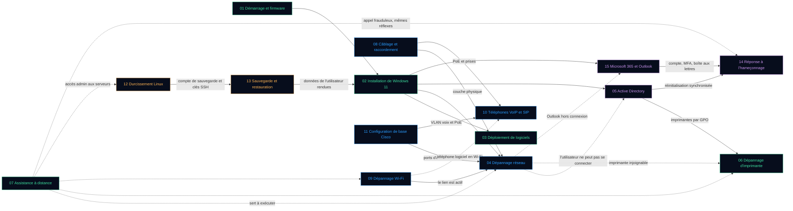

<h1 align="center">Technical Runbooks</h1>

<p align="center">
  <a href="README.fr.md"></a>
  <a href="README.md"></a>
</p>

<p align="center">
  <b>Des procédures TI pas à pas, écrites pour être suivies sous pression et reproduites par n'importe quel technicien.</b><br>
  Soutien TI · Postes de travail · Réseau · Câblage · Wi-Fi · VoIP · Commutation Cisco · Serveurs Linux · Sauvegarde · Active Directory · Microsoft 365 · Réponse à l'hameçonnage · Impression · Assistance à distance
</p>

<p align="center">
  
  
  
  
  <br>
  <a href="https://github.com/Bazeeza/Technical-Runbooks/actions/workflows/markdown.yml"></a>
  <a href="https://github.com/Bazeeza/Technical-Runbooks/actions/workflows/powershell.yml"></a>
  <a href="CHANGELOG.fr.md"></a>
</p>

| Élément | Contenu |
|---|---|
| Objectif | Donner à tout technicien des procédures TI pas à pas, qu'on peut suivre sous pression et qui donnent le même résultat à chaque fois |
| Technologies | Windows 11, Windows Server et Active Directory, PowerShell, Microsoft 365 et Exchange Online, Cisco IOS, Linux (OpenSSH, ufw, fail2ban, restic), Asterisk/FreePBX, Markdown, GitHub Actions |
| Niveau | Débutant à intermédiaire (indiqué pour chaque runbook dans l'[index](#runbooks)) |
| Contenu | 15 runbooks avec des guides complémentaires, des scripts PowerShell et des fichiers de configuration, un [modèle](TEMPLATE.fr.md) de runbook, un [guide de style](docs/STYLE.fr.md) et des vérifications automatiques de qualité |
| Statut | Maintenu : version 1.0.0 publiée le 2026-11-02, changements suivants dans le [journal des modifications](CHANGELOG.fr.md) |
| Lire en premier | [04 Dépannage réseau](04-Network-Troubleshooting/README.fr.md), le runbook auquel la plupart des autres se rattachent |

> **En bref :** procédures TI pas à pas, rédigées en anglais selon un gabarit unique (objectif, prérequis, étapes avec résultat attendu, vérification, dépannage, sources officielles). Chaque modification est vérifiée automatiquement (markdownlint, liens, PSScriptAnalyzer). Les anciennes notes d'étude copiées de sources externes sont rangées dans [`archive/`](archive/README.fr.md), avec leur source.

> [!NOTE]
> Les runbooks sont traduits en français un par un (`X.fr.md` à côté de `X.md`). Tant qu'un runbook n'a pas sa version française, les liens de cette page pointent vers l'original en anglais.

---

## Runbooks

| # | Runbook | Ce que vous saurez faire | Niveau | Durée |
|---|---|---|---|---|
| 01 | [**Démarrage du PC et BIOS / UEFI**](01-PC-Boot-Process-and-BIOS-UEFI/README.fr.md) | Expliquer chaque étape du démarrage, entrer dans le firmware, régler l'ordre de démarrage, vérifier Secure Boot et le TPM | Beginner | 20 min |
| | ↳ [Dépannage : le PC ne démarre pas](01-PC-Boot-Process-and-BIOS-UEFI/TROUBLESHOOTING.fr.md) | Trouver l'étape qui échoue avec un arbre de décision, réparer avec WinRE | Beginner–Intermediate | 15–60 min |
| 02 | [**Installation propre de Windows 11**](02-Windows-11-Clean-Installation/README.fr.md) | Vérifier la compatibilité, créer la clé USB, installer en GPT/UEFI | Beginner | 60–90 min |
| | ↳ [Liste de vérification après installation](02-Windows-11-Clean-Installation/POST-INSTALL-CHECKLIST.fr.md) | Livrer un poste à jour, sécurisé, nommé et vérifié | Beginner | 30–45 min |
| 03 | [**Déploiement de logiciels (winget et MSI)**](03-Software-Deployment/README.fr.md) | Installer, vérifier, mettre à jour et désinstaller des logiciels en mode silencieux, lire les codes de sortie | Beginner–Intermediate | 15 min |
| | ↳ [`Install-StandardApps.ps1`](03-Software-Deployment/Install-StandardApps.ps1) | Installer une liste d'applications standard avec vérification et journalisation | Intermediate | 5 min |
| 04 | [**Dépannage réseau**](04-Network-Troubleshooting/README.fr.md) | Diagnostiquer un « pas d'Internet » couche par couche, du câble jusqu'au port | Beginner–Intermediate | 10–30 min |
| | ↳ [Aide-mémoire des commandes](04-Network-Troubleshooting/COMMAND-CHEATSHEET.fr.md) | Les commandes équivalentes sous Windows, Linux et Cisco IOS | Beginner | — |
| 05 | [**Gestion des comptes Active Directory**](05-Active-Directory-User-Management/README.fr.md) | Déverrouiller, réinitialiser, créer et désactiver des comptes en sécurité, trouver la source d'un verrouillage | Beginner–Intermediate | 5–20 min |
| 06 | [**Dépannage d'imprimante**](06-Printer-Troubleshooting/README.fr.md) | Trouver le maillon en panne, de l'appareil jusqu'au spouleur, tester les ports 9100/631, corriger le port ou le pilote | Beginner–Intermediate | 10–30 min |
| | ↳ [`Reset-PrintQueue.ps1`](06-Printer-Troubleshooting/Reset-PrintQueue.ps1) | Vider une file bloquée : arrêter le spouleur, vider le dossier spool, redémarrer et vérifier | Beginner | 2 min |
| | ↳ [Déployer des imprimantes par stratégie de groupe](06-Printer-Troubleshooting/GPO-DEPLOYMENT.fr.md) | Connecter une imprimante partagée pour un service à l'ouverture de session, avec ciblage et retrait propre | Intermediate | 20 min |
| 07 | [**Soutien à distance avec Assistance rapide**](07-Remote-Support/README.fr.md) | Choisir le bon outil à distance, se connecter avec le consentement de l'utilisateur, travailler et fermer la session en sécurité | Beginner | 5 min |
| | ↳ [Bureau à distance avec NLA](07-Remote-Support/RDP.fr.md) | Activer RDP sur le port 3389 avec NLA, limiter les comptes et les adresses sources | Intermediate | 15 min |
| | ↳ [Liste de contrôle de sécurité](07-Remote-Support/SECURITY-CHECKLIST.fr.md) | Appliquer les mêmes règles de consentement et de traçabilité à chaque session, réagir à une arnaque | Beginner | 2 min |
| 08 | [**Câblage réseau et terminaison**](08-Network-Cabling-and-Termination/README.fr.md) | Sertir un câble RJ45 en T568A ou T568B, choisir Cat 5e, 6 ou 6A, travailler en sécurité | Beginner | 10–15 min |
| | ↳ [Test des câbles et défauts du schéma de câblage](08-Network-Cabling-and-Termination/CABLE-TESTING.fr.md) | Tester chaque câble, lire les coupures, courts-circuits, paires croisées et séparées, et les corriger | Beginner–Intermediate | 2–10 min |
| | ↳ [Panneaux de brassage et étiquetage](08-Network-Cabling-and-Termination/PATCH-PANEL-AND-LABELING.fr.md) | Raccorder un panneau de brassage ou une prise keystone et étiqueter les deux extrémités avec un identifiant TIA-606 | Beginner | 5 min par port |
| 09 | [**Dépannage Wi-Fi**](09-WiFi-Troubleshooting/README.fr.md) | Lire la bande, le canal et le signal avec `netsh wlan`, distinguer un problème de couverture, une interférence et une panne du PC | Beginner–Intermediate | 10–30 min |
| | ↳ [`Export-WifiDiagnostics.ps1`](09-WiFi-Troubleshooting/Export-WifiDiagnostics.ps1) | Enregistrer toutes les sorties de diagnostic Wi-Fi dans un seul dossier pour le billet, en lecture seule | Beginner | 1 min |
| | ↳ [Lire le rapport de réseau sans fil](09-WiFi-Troubleshooting/WLAN-REPORT.fr.md) | Transformer trois jours d'historique Wi-Fi en déconnexions datées avec leur raison | Intermediate | 10 min |
| 10 | [**Dépannage des téléphones VoIP / SIP**](10-VoIP-SIP-Phone-Troubleshooting/README.fr.md) | Suivre la chaîne PoE → VLAN voix → enregistrement → SIP → RTP, corriger l'audio à sens unique causé par le NAT et le SIP ALG | Intermediate | 10–30 min |
| | ↳ [Lire un appel SIP](10-VoIP-SIP-Phone-Troubleshooting/SIP-CALL-FLOW.fr.md) | Suivre un enregistrement et un appel, lire le SDP et les codes de réponse SIP | Intermediate | 15 min |
| | ↳ [Préparation du réseau pour la voix](10-VoIP-SIP-Phone-Troubleshooting/VOICE-NETWORK-READINESS.fr.md) | Calculer la bande passante des codecs, vérifier DSCP EF 46, le VLAN voix et le budget PoE | Intermediate | 20 min |
| 11 | [**Configuration de base d'un commutateur Cisco**](11-Cisco-Switch-Baseline/README.fr.md) | Configurer un commutateur d'accès de façon sécurisée : SSH v2 seulement, VLAN, sécurité des ports, portfast, VLAN « trou noir », trunk restreint | Intermediate | 30–45 min |
| | ↳ [`access-switch-baseline.cfg`](11-Cisco-Switch-Baseline/access-switch-baseline.cfg) | La configuration de base complète, commentée section par section | Intermediate | — |
| | ↳ [Sécurité des ports et ports err-disabled](11-Cisco-Switch-Baseline/PORT-SECURITY-AND-ERR-DISABLED.fr.md) | Trouver pourquoi un port utilisateur est bloqué, identifier l'appareil et rétablir le port en sécurité | Intermediate | 5–15 min |
| 12 | [**Renforcement de base d'un serveur Linux**](12-Linux-Server-Hardening/README.fr.md) | Se connecter avec des clés SSH seulement, bloquer root et les mots de passe, régler ufw pour refuser les connexions entrantes, bannir les tentatives avec fail2ban, appliquer les correctifs automatiquement | Intermediate | 45–60 min |
| | ↳ [`10-hardening.conf`](12-Linux-Server-Hardening/10-hardening.conf) et [`jail.local`](12-Linux-Server-Hardening/jail.local) | Le fichier complémentaire du serveur SSH et la prison fail2ban, commentés ligne par ligne | Intermediate | — |
| | ↳ [Ports Docker et pare-feu](12-Linux-Server-Hardening/DOCKER-PORT-BINDING.fr.md) | Comprendre pourquoi un port de conteneur publié contourne ufw, le lier à 127.0.0.1 derrière un proxy inverse | Intermediate | 10–15 min |
| 13 | [**Sauvegarde et restauration**](13-Backup-and-Restore/README.fr.md) | Fixer le RPO et le RTO, appliquer la règle 3-2-1, automatiser les sauvegardes et faire un test de restauration consigné | Intermediate | 60 min + 30 min par test |
| | ↳ [Sauvegardes Windows](13-Backup-and-Restore/WINDOWS-BACKUP.fr.md) | Historique des fichiers, Windows Server Backup (`wbadmin`) et robocopy, avec restauration dans un dossier séparé | Intermediate | 20–40 min |
| | ↳ [Sauvegardes Linux avec restic](13-Backup-and-Restore/RESTIC-LINUX.fr.md) | Instantanés chiffrés sur un minuteur systemd, rétention, vérification du dépôt et restaurations | Intermediate | 30–45 min |
| | ↳ [`Test-RestoredFiles.ps1`](13-Backup-and-Restore/Test-RestoredFiles.ps1) | Prouver une restauration : comparer chaque fichier avec l'original par SHA-256, enregistrer un rapport CSV | Beginner | 2 min |
| 14 | [**Signalement d'hameçonnage et première intervention**](14-Phishing-Report-and-First-Response/README.fr.md) | Reconnaître un courriel d'hameçonnage, le faire signaler avec le bouton **Report** d'Outlook, contenir selon ce que l'utilisateur a fait, escalader et consigner | Beginner | 10–30 min |
| | ↳ [Liste de vérification de première intervention](14-Phishing-Report-and-First-Response/FIRST-RESPONSE-CHECKLIST.fr.md) | Réinitialiser le mot de passe, révoquer les sessions, revoir les méthodes MFA, trouver les règles de transfert, isoler le poste | Beginner | 5–30 min |
| | ↳ [Lire les en-têtes d'un courriel](14-Phishing-Report-and-First-Response/READING-EMAIL-HEADERS.fr.md) et [`Get-EmailHeaderSummary.ps1`](14-Phishing-Report-and-First-Response/Get-EmailHeaderSummary.ps1) | Lire From, Reply-To, Return-Path, SPF, DKIM, DMARC et la chaîne Received, avec un script de résumé en lecture seule | Intermediate | 10 min |
| 15 | [**Notions de base de Microsoft 365 et d'Outlook**](15-Microsoft-365-Outlook-Basics/README.fr.md) | Vérifier dans l'ordre la connexion, la licence, la boîte aux lettres et la MFA, puis le client Outlook, puis l'accès aux boîtes partagées | Beginner | 10–45 min |
| | ↳ [Profils Outlook et mode Exchange mis en cache](15-Microsoft-365-Outlook-Basics/OUTLOOK-PROFILE-AND-CACHE.fr.md) | Démarrer en mode sans échec, créer un profil propre, régler la période hors connexion, reconstruire un fichier `.ost` en sécurité | Beginner | 15–45 min |
| | ↳ [Boîtes aux lettres partagées et permissions](15-Microsoft-365-Outlook-Basics/SHARED-MAILBOXES-AND-PERMISSIONS.fr.md) | Accorder, vérifier et retirer Full Access, Send As et Send on Behalf, contrôler le mappage automatique | Intermediate | 10–20 min |
| | ↳ [`Get-OutlookClientInfo.ps1`](15-Microsoft-365-Outlook-Basics/Get-OutlookClientInfo.ps1) | Lister les clients Outlook, les profils, les fichiers de données et l'espace libre pour le billet, en lecture seule | Beginner | 1 min |

Les **niveaux** correspondent au badge en haut de chaque document. **Beginner** (débutant) : soutien de premier niveau, sans droits d'administrateur au-delà du poste. **Beginner–Intermediate** : les premières étapes relèvent du premier niveau, les suivantes demandent des droits d'administrateur ou des connaissances plus poussées. **Intermediate** (intermédiaire) : administration d'un serveur, d'un équipement réseau ou d'un locataire (*tenant*).

---

## Comment les runbooks se relient



| Couleur | Domaine | Runbooks |
|---|---|---|
| Vert `#3fe0a0` | Poste de travail et soutien aux utilisateurs | 01, 02, 03, 06, 07 |
| Bleu `#2b9dff` | Réseau, câblage et téléphonie | 04, 08, 09, 10, 11 |
| Orange `#ffb454` | Serveurs et protection des données | 12, 13 |
| Violet `#c792ea` | Identité, courriel et sécurité | 05, 14, 15 |

Un nouveau poste suit la chaîne de gauche à droite : réglages du firmware, système d'exploitation, applications, vérification du réseau, compte utilisateur. Les imprimantes viennent en dernier, souvent déployées par stratégie de groupe, et l'assistance à distance est la façon dont la plupart de ces procédures sont réalisées depuis le soutien TI. Le câblage et le Wi-Fi se trouvent sous le runbook réseau : quand l'étape 1 du runbook 04 ne trouve aucun lien, ce sont eux qu'on consulte ensuite. La configuration de base du commutateur définit les ports d'accès et les VLAN dont dépend chaque appareil filaire, y compris les téléphones IP du runbook 10. Côté serveurs, le runbook 12 durcit un serveur Linux avant qu'il n'héberge quoi que ce soit, et le runbook 13 garantit que chaque machine de la chaîne, poste ou serveur, a une sauvegarde qui a vraiment été restaurée. Côté utilisateurs, le runbook 15 couvre le compte Microsoft 365, la MFA et Outlook dont chaque nouveau poste a besoin, et le runbook 14 réutilise les mêmes centres d'administration quand un mot de passe a été volé par un courriel d'hameçonnage.

---

## Le standard des runbooks

Chaque runbook suit le même [modèle](TEMPLATE.fr.md), pour qu'un technicien sache toujours où regarder :

| Section | Rôle |
|---|---|
| **Tableau d'en-tête** | Referent, Sender, Message, Receiver, Channel, Code, Reference : ce qu'est le document, qui l'a écrit, pour qui, et quelles sources officielles le soutiennent |
| **Objective** (objectif) | Le problème résolu et l'état final attendu |
| **Prerequisites** (prérequis) | Ce qui doit être prêt **avant** de commencer (droits, outils, sauvegardes) |
| **Procedure** (procédure) | Des étapes numérotées avec la commande exacte, **pourquoi** on la lance et le résultat attendu |
| **Verification** (vérification) | Comment prouver que le travail est terminé |
| **Troubleshooting** (dépannage) | Symptôme → cause probable → correction |
| **Rollback** (retour arrière) | Comment annuler chaque changement, ou pourquoi il ne peut pas l'être |
| *Bloc d'escalade* (facultatif) | Les faits dont le niveau de soutien suivant a besoin, prêts à coller dans le billet |

Principes d'écriture :

1. **Reproductible** : un autre technicien obtient le même résultat sans poser de questions.
2. **Sûr** : les étapes risquées portent un avertissement, la protection des données et le retour arrière passent en premier.
3. **Expliqué** : chaque commande dit *pourquoi*, pas seulement *comment*.
4. **Sourcé** : les commandes sont vérifiées dans la documentation officielle des fabricants.

---

## Structure du dépôt

```text
Technical-Runbooks/
├── 01-PC-Boot-Process-and-BIOS-UEFI/        étapes du démarrage, réglages du firmware, PC qui ne démarre pas
├── 02-Windows-11-Clean-Installation/        installation propre en GPT/UEFI, liste après installation
├── 03-Software-Deployment/                  winget et MSI, Install-StandardApps.ps1
├── 04-Network-Troubleshooting/              diagnostic couche par couche, aide-mémoire des commandes
├── 05-Active-Directory-User-Management/     déverrouiller, réinitialiser, créer et désactiver des comptes
├── 06-Printer-Troubleshooting/              spouleur et ports, Reset-PrintQueue.ps1, imprimantes par GPO
├── 07-Remote-Support/                       Quick Assist, Bureau à distance avec NLA, liste de sécurité
├── 08-Network-Cabling-and-Termination/      T568A/T568B, test des câbles, panneaux de brassage, brochage
├── 09-WiFi-Troubleshooting/                 netsh wlan, Export-WifiDiagnostics.ps1, rapport sans fil
├── 10-VoIP-SIP-Phone-Troubleshooting/       PoE, VLAN voix, déroulement d'un appel SIP, réseau voix
├── 11-Cisco-Switch-Baseline/                configuration de base d'un commutateur d'accès, err-disabled
├── 12-Linux-Server-Hardening/               clés SSH, ufw, fail2ban, ports Docker et pare-feu
├── 13-Backup-and-Restore/                   3-2-1, sauvegardes Windows et restic, Test-RestoredFiles.ps1
├── 14-Phishing-Report-and-First-Response/   signaler, contenir, lire les en-têtes, Get-EmailHeaderSummary.ps1
├── 15-Microsoft-365-Outlook-Basics/         vérifications du compte, profils Outlook, boîtes partagées
├── archive/                                 anciennes notes d'étude tirées de sources externes, créditées
├── docs/                                    guide de style de la documentation (anglais et français)
├── scripts/                                 Test-ReadmePair.ps1 et ses tests Pester (tests/)
├── .github/                                 workflows de CI, formulaire d'issue, Dependabot
├── .markdownlint-cli2.jsonc                 règles markdownlint
├── PSScriptAnalyzerSettings.psd1            règles d'analyse PowerShell
├── TEMPLATE.md                              le modèle de runbook (TEMPLATE.fr.md en français)
├── CONTRIBUTING.md                          règles d'écriture, règles des scripts et vérifications locales
├── CHANGELOG.md                             historique des versions
├── README.md                                version anglaise
└── README.fr.md                             version française (ce fichier)
```

Chaque fichier `.md` traduit a sa jumelle `.fr.md` dans le même dossier (`TEMPLATE.fr.md`, `CONTRIBUTING.fr.md`, `CHANGELOG.fr.md`, `docs/STYLE.fr.md`, `archive/README.fr.md`).

| Dossier | README |
|---|---|
| `01-PC-Boot-Process-and-BIOS-UEFI/` | [README.fr.md](01-PC-Boot-Process-and-BIOS-UEFI/README.fr.md) |
| `02-Windows-11-Clean-Installation/` | [README.fr.md](02-Windows-11-Clean-Installation/README.fr.md) |
| `03-Software-Deployment/` | [README.fr.md](03-Software-Deployment/README.fr.md) |
| `04-Network-Troubleshooting/` | [README.fr.md](04-Network-Troubleshooting/README.fr.md) |
| `05-Active-Directory-User-Management/` | [README.fr.md](05-Active-Directory-User-Management/README.fr.md) |
| `06-Printer-Troubleshooting/` | [README.fr.md](06-Printer-Troubleshooting/README.fr.md) |
| `07-Remote-Support/` | [README.fr.md](07-Remote-Support/README.fr.md) |
| `08-Network-Cabling-and-Termination/` | [README.fr.md](08-Network-Cabling-and-Termination/README.fr.md) |
| `09-WiFi-Troubleshooting/` | [README.fr.md](09-WiFi-Troubleshooting/README.fr.md) |
| `10-VoIP-SIP-Phone-Troubleshooting/` | [README.fr.md](10-VoIP-SIP-Phone-Troubleshooting/README.fr.md) |
| `11-Cisco-Switch-Baseline/` | [README.fr.md](11-Cisco-Switch-Baseline/README.fr.md) |
| `12-Linux-Server-Hardening/` | [README.fr.md](12-Linux-Server-Hardening/README.fr.md) |
| `13-Backup-and-Restore/` | [README.fr.md](13-Backup-and-Restore/README.fr.md) |
| `14-Phishing-Report-and-First-Response/` | [README.fr.md](14-Phishing-Report-and-First-Response/README.fr.md) |
| `15-Microsoft-365-Outlook-Basics/` | [README.fr.md](15-Microsoft-365-Outlook-Basics/README.fr.md) |
| `archive/` | [README.fr.md](archive/README.fr.md) |

---

## Vérifications de qualité

Chaque push et chaque pull request sont vérifiés automatiquement par GitHub Actions, et les liens externes sont vérifiés une fois par semaine :

| Vérification | Ce qu'elle détecte |
|---|---|
| **markdownlint** | Niveaux de titres sautés, blocs de code sans langage, espaces en fin de ligne, plusieurs titres de premier niveau ([règles](.markdownlint-cli2.jsonc)) |
| **lychee** (hors ligne) | Liens relatifs qui pointent vers un fichier absent |
| **lychee** (hebdomadaire, en ligne) | Liens vers la documentation des fabricants qui ont changé ou disparu ([workflow](.github/workflows/external-links.yml)) |
| **PSScriptAnalyzer** | Erreurs et avertissements PowerShell, comme des verbes non approuvés ou des variables inutilisées ([paramètres](PSScriptAnalyzerSettings.psd1)) |
| **Windows PowerShell 5.1** | Scripts qui ne seraient pas analysés par le shell par défaut de Windows 11 |
| **Test-ReadmePair** | Documents traduits sans leur jumelle ou sans leurs boutons de langue, et liens relatifs vers un fichier absent ([script](scripts/Test-ReadmePair.ps1), [guide de style](docs/STYLE.fr.md)) |
| **Pester** | Régressions dans les scripts du dépôt, testées sous PowerShell 7 et Windows PowerShell 5.1 ([tests](scripts/tests/Test-ReadmePair.Tests.ps1)) |

## Contribuer

Vous avez trouvé une commande fausse ou une étape cassée ? Utilisez le formulaire **[Report an error in a runbook](https://github.com/Bazeeza/Technical-Runbooks/issues/new?template=runbook-error.yml)** (signaler une erreur dans un runbook), ou lisez le [guide de contribution](CONTRIBUTING.fr.md) avant d'ouvrir une pull request. Les changements sont listés dans le [journal des modifications](CHANGELOG.fr.md).

> [!NOTE]
> Le dossier [`archive/`](archive/README.fr.md) contient d'anciennes notes d'étude copiées de sources externes (TryHackMe, un dépliant de sensibilisation, un message de forum). Elles sont conservées avec leur source créditée et ne font pas partie de la série de runbooks.

---

## Travaux liés

- [**Projets-Runbooks**](https://github.com/Bazeeza/Projets-Runbooks) : runbooks de laboratoire en français (réseaux Cisco, supervision Zabbix, scripts de durcissement CIS, services AWS, MeshCentral)

<p align="center"><sub>Écrit par <b>bazeeza</b> · Technicien en réseau et télécommunication · Montréal, QC · <a href="mailto:info@bazeeza.ca">info@bazeeza.ca</a></sub></p>
