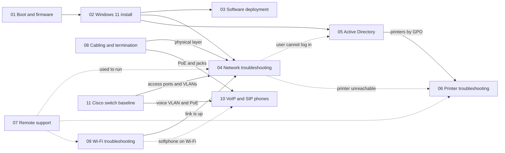

<h1 align="center">Technical Runbooks</h1>

  <b>Step-by-step IT procedures, written to be followed under pressure and reproduced by any technician.</b> 
  Help desk · Workstations · Networking · Cabling · Wi-Fi · VoIP · Cisco switching · Active Directory · Printing · Remote support

  
  
  
  
   
  
  
  

> **En bref (français) :** procédures TI pas à pas, rédigées en anglais selon un gabarit unique (objectif, prérequis, étapes avec résultat attendu, vérification, dépannage, sources officielles). Chaque modification est vérifiée automatiquement (markdownlint, liens, PSScriptAnalyzer). Les anciennes notes d'étude copiées de sources externes sont rangées dans [`archive/`](archive/README.md), avec leur source.

---

## Runbooks

| # | Runbook | What you will be able to do | Level | Time |
|---|---|---|---|---|
| 01 | [**PC Boot Process and BIOS / UEFI**](01-PC-Boot-Process-and-BIOS-UEFI/README.md) | Explain every boot stage, enter the firmware, set the boot order, check Secure Boot and TPM | 🟢 Beginner | 20 min |
| | ↳ [Troubleshooting: the PC does not start](01-PC-Boot-Process-and-BIOS-UEFI/TROUBLESHOOTING.md) | Locate the failing stage with a decision tree, repair with WinRE | 🟡 Intermediate | 15–60 min |
| 02 | [**Windows 11 Clean Installation**](02-Windows-11-Clean-Installation/README.md) | Check compatibility, create the USB key, install on GPT/UEFI | 🟢 Beginner | 60–90 min |
| | ↳ [Post-installation checklist](02-Windows-11-Clean-Installation/POST-INSTALL-CHECKLIST.md) | Deliver an updated, secured, named and verified workstation | 🟢 Beginner | 30–45 min |
| 03 | [**Software Deployment (winget and MSI)**](03-Software-Deployment/README.md) | Install, verify, update and remove software silently, read exit codes | 🟡 Intermediate | 15 min |
| | ↳ [`Install-StandardApps.ps1`](03-Software-Deployment/Install-StandardApps.ps1) | Install a standard application list with verification and logging | 🟡 Intermediate | 5 min |
| 04 | [**Network Troubleshooting**](04-Network-Troubleshooting/README.md) | Diagnose "no Internet" layer by layer, from the cable to the port | 🟡 Intermediate | 10–30 min |
| | ↳ [Command cheat sheet](04-Network-Troubleshooting/COMMAND-CHEATSHEET.md) | Equivalent commands on Windows, Linux and Cisco IOS | 🟢 Beginner | — |
| 05 | [**Active Directory User Management**](05-Active-Directory-User-Management/README.md) | Unlock, reset, create and disable accounts safely, find lockout sources | 🟡 Intermediate | 5–20 min |
| 06 | [**Printer Troubleshooting**](06-Printer-Troubleshooting/README.md) | Find the failing link from the device to the spooler, test ports 9100/631, fix the port or driver | 🟡 Intermediate | 10–30 min |
| | ↳ [`Reset-PrintQueue.ps1`](06-Printer-Troubleshooting/Reset-PrintQueue.ps1) | Clear a stuck queue: stop the spooler, empty the spool folder, restart and verify | 🟢 Beginner | 2 min |
| | ↳ [Deploying printers with Group Policy](06-Printer-Troubleshooting/GPO-DEPLOYMENT.md) | Connect a shared printer for a department at logon, with targeting and clean removal | 🟡 Intermediate | 20 min |
| 07 | [**Remote Support with Quick Assist**](07-Remote-Support/README.md) | Choose the right remote tool, connect with consent, work and close the session safely | 🟢 Beginner | 5 min |
| | ↳ [Remote Desktop with NLA](07-Remote-Support/RDP.md) | Enable RDP on port 3389 with NLA, limit accounts and source addresses | 🟡 Intermediate | 15 min |
| | ↳ [Security checklist](07-Remote-Support/SECURITY-CHECKLIST.md) | Apply the same consent and record rules to every session, react to a scam | 🟢 Beginner | 2 min |
| 08 | [**Network Cabling and Termination**](08-Network-Cabling-and-Termination/README.md) | Crimp an RJ45 cable to T568A or T568B, choose Cat 5e, 6 or 6A, work safely | 🟢 Beginner | 10–15 min |
| | ↳ [Cable testing and wire map faults](08-Network-Cabling-and-Termination/CABLE-TESTING.md) | Test every cable, read opens, shorts, crossed and split pairs, and fix them | 🟢 Beginner | 2–10 min |
| | ↳ [Patch panels and labeling](08-Network-Cabling-and-Termination/PATCH-PANEL-AND-LABELING.md) | Punch down a panel or keystone jack and label both ends with a TIA-606 identifier | 🟢 Beginner | 5 min per port |
| 09 | [**Wi-Fi Troubleshooting**](09-WiFi-Troubleshooting/README.md) | Read band, channel and signal with `netsh wlan`, tell coverage from interference from a PC fault | 🟡 Intermediate | 10–30 min |
| | ↳ [`Export-WifiDiagnostics.ps1`](09-WiFi-Troubleshooting/Export-WifiDiagnostics.ps1) | Save every Wi-Fi diagnostic output in one folder for the ticket, read-only | 🟢 Beginner | 1 min |
| | ↳ [Reading the wireless network report](09-WiFi-Troubleshooting/WLAN-REPORT.md) | Turn three days of Wi-Fi history into dated disconnections with a reason | 🟡 Intermediate | 10 min |
| 10 | [**VoIP / SIP Phone Troubleshooting**](10-VoIP-SIP-Phone-Troubleshooting/README.md) | Walk the chain PoE → voice VLAN → registration → SIP → RTP, fix one-way audio caused by NAT and SIP ALG | 🟡 Intermediate | 10–30 min |
| | ↳ [Reading a SIP call](10-VoIP-SIP-Phone-Troubleshooting/SIP-CALL-FLOW.md) | Follow a registration and a call, read the SDP and the SIP response codes | 🟡 Intermediate | 15 min |
| | ↳ [Voice network readiness](10-VoIP-SIP-Phone-Troubleshooting/VOICE-NETWORK-READINESS.md) | Size codec bandwidth, check DSCP EF 46, the voice VLAN and the PoE budget | 🟡 Intermediate | 20 min |
| 11 | [**Cisco Switch Baseline**](11-Cisco-Switch-Baseline/README.md) | Configure an access switch securely: SSH v2 only, VLANs, port security, portfast, black hole VLAN, restricted trunk | 🟡 Intermediate | 30–45 min |
| | ↳ [`access-switch-baseline.cfg`](11-Cisco-Switch-Baseline/access-switch-baseline.cfg) | The complete baseline configuration, commented section by section | 🟡 Intermediate | — |
| | ↳ [Port security and err-disabled ports](11-Cisco-Switch-Baseline/PORT-SECURITY-AND-ERR-DISABLED.md) | Find why a user port is blocked, identify the device and recover the port safely | 🟡 Intermediate | 5–15 min |

---

## How the runbooks connect

A new workstation follows the chain from left to right: firmware settings, operating system, applications, network check, user account. Printers come last, often deployed by Group Policy, and remote support is the way most of these procedures are carried out from the help desk. Cabling and Wi-Fi sit underneath the network runbook: when step 1 of runbook 04 finds no link, they are the next stop. The switch baseline defines the access ports and VLANs that every wired device, including the IP phones of runbook 10, depends on.

---

## The runbook standard

Every runbook follows the same [template](TEMPLATE.md), so a technician always knows where to look:

| Section | Purpose |
|---|---|
| **Header table** | Referent, Sender, Message, Receiver, Channel, Code, Reference: what the document is, who wrote it, for whom, and which official sources back it |
| **Objective** | The problem solved and the expected end state |
| **Prerequisites** | What must be ready **before** starting (rights, tools, backups) |
| **Procedure** | Numbered steps with the exact command, **why** it is done, and the expected result |
| **Verification** | How to prove the job is done |
| **Troubleshooting** | Symptom → likely cause → fix |

Writing principles:

1. **Reproducible**: another technician gets the same result without asking questions.
2. **Safe**: risky steps carry a warning, data protection and rollback come first.
3. **Explained**: each command says *why*, not only *how*.
4. **Sourced**: commands are checked against official vendor documentation.

---

## Quality checks

Every push and pull request is checked automatically by GitHub Actions:

| Check | What it catches |
|---|---|
| **markdownlint** | Skipped heading levels, code blocks without a language, trailing spaces, several top-level titles ([rules](.markdownlint-cli2.jsonc)) |
| **lychee** (offline) | Relative links that point to a missing file |
| **PSScriptAnalyzer** | PowerShell errors and warnings, such as unapproved verbs or unused variables ([settings](PSScriptAnalyzerSettings.psd1)) |
| **Windows PowerShell 5.1** | Scripts that would not parse in the default shell of Windows 11 |

## Contributing

Found a wrong command or a broken step? Use the **[Report an error in a runbook](https://github.com/Bazeeza/Technical-Runbooks/issues/new?template=runbook-error.yml)** form, or read the [contributing guide](CONTRIBUTING.md) before opening a pull request. Changes are listed in the [changelog](CHANGELOG.md).

> [!NOTE]
> The [`archive/`](archive/README.md) folder holds early study notes copied from external sources (TryHackMe, an awareness leaflet, a forum post). They are kept with their source credited and are not part of the runbook series.

---

## Related work

- [**Projets-Runbooks**](https://github.com/Bazeeza/Projets-Runbooks): lab runbooks in French (Cisco networks, Zabbix monitoring, CIS hardening scripts, AWS services, MeshCentral)

Written by <b>Bariu Azeez</b> · Network and telecommunication technician · Montréal, QC · <a href="mailto:Azeez@bazeeza.ca">Azeez@bazeeza.ca</a>

