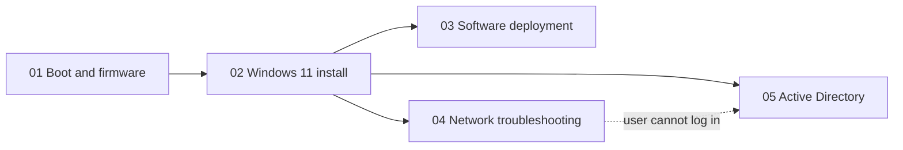

<h1 align="center">Technical Runbooks</h1>

  <b>Step-by-step IT procedures, written to be followed under pressure and reproduced by any technician.</b> 
  Help desk · Workstations · Networking · Active Directory

  
  
  
  

---

## Runbooks

| # | Runbook | What you will be able to do | Level | Time |
|---|---|---|---|---|
| 01 | [**PC Boot Process and BIOS / UEFI**](01-PC-Boot-Process-and-BIOS-UEFI/README.md) | Explain every boot stage, enter the firmware, set the boot order, check Secure Boot and TPM | 🟢 Beginner | 20 min |
| | ↳ [Troubleshooting: the PC does not start](01-PC-Boot-Process-and-BIOS-UEFI/TROUBLESHOOTING.md) | Locate the failing stage with a decision tree, repair with WinRE | 🟡 Intermediate | 15–60 min |
| 02 | [**Windows 11 Clean Installation**](02-Windows-11-Clean-Installation/README.md) | Check compatibility, create the USB key, install on GPT/UEFI | 🟢 Beginner | 60–90 min |
| | ↳ [Post-installation checklist](02-Windows-11-Clean-Installation/POST-INSTALL-CHECKLIST.md) | Deliver an updated, secured, named and verified workstation | 🟢 Beginner | 30–45 min |
| 03 | [**Software Deployment (winget and MSI)**](03-Software-Deployment/README.md) | Install, verify, update and remove software silently, read exit codes | 🟡 Intermediate | 15 min |
| | ↳ [`Install-StandardApps.ps1`](03-Software-Deployment/Install-StandardApps.ps1) | Install a standard application list with verification and logging | 🟡 Intermediate | 5 min |
| 04 | [**Network Troubleshooting**](04-Network-Troubleshooting/README.md) | Diagnose "no Internet" layer by layer, from the cable to the port | 🟡 Intermediate | 10–30 min |
| | ↳ [Command cheat sheet](04-Network-Troubleshooting/COMMAND-CHEATSHEET.md) | Equivalent commands on Windows, Linux and Cisco IOS | 🟢 Beginner | — |
| 05 | [**Active Directory User Management**](05-Active-Directory-User-Management/README.md) | Unlock, reset, create and disable accounts safely, find lockout sources | 🟡 Intermediate | 5–20 min |

---

## How the runbooks connect

A new workstation follows the chain from left to right: firmware settings, operating system, applications, network check, user account.

---

## The runbook standard

Every runbook follows the same [template](TEMPLATE.md), so a technician always knows where to look:

| Section | Purpose |
|---|---|
| **Header table** | Referent, Sender, Message, Receiver, Channel, Code, Reference: what the document is, who wrote it, for whom, and which official sources back it |
| **Objective** | The problem solved and the expected end state |
| **Prerequisites** | What must be ready **before** starting (rights, tools, backups) |
| **Procedure** | Numbered steps with the exact command, **why** it is done, and the expected result |
| **Verification** | How to prove the job is done |
| **Troubleshooting** | Symptom → likely cause → fix |

Writing principles:

1. **Reproducible**: another technician gets the same result without asking questions.
2. **Safe**: risky steps carry a warning, data protection and rollback come first.
3. **Explained**: each command says *why*, not only *how*.
4. **Sourced**: commands are checked against official vendor documentation.

---

## Related work

- [**Projets-Runbooks**](https://github.com/Bazeeza/Projets-Runbooks): lab runbooks in French (Cisco networks, Zabbix monitoring, CIS hardening scripts, AWS services, MeshCentral)

Written by <b>Bariu Azeez</b> · Network and telecommunication technician · Montréal, QC · <a href="mailto:Azeez@bazeeza.ca">Azeez@bazeeza.ca</a>

